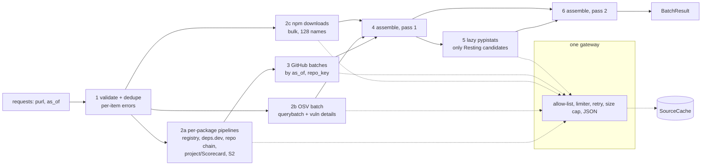

# Design: autopsy-sources

> **Implements:** `.kiro/specs/autopsy-sources/requirements.md` (SRC-DEP, PURE, API, HTTP, RATE, SEC, CACHE, REPO, LAT, S1…S9, OSV, GH, WARN, TEST, REC, ANC, NFR).
> **Location:** pure half `backend/core/sources/`, I/O half `backend/sources/` (D1). **Prototype:** `scripts/capture_anchors.py`; §14 lists every place this design departs from it.

---

## 1. Overview

`autopsy_async(requests, ...)` turns `(purl, as_of)` pairs into `Signals` plus evidence in five phases. Only the I/O phases touch the network, and all of them go through one gateway.



Each source has two small parts. A **pure parser** (`core/sources/parse/`) turns a decoded `object` into a typed fact or `None` and never raises. A **client function** (`sources/clients/`) builds the URL (`core/sources/urls.py`), calls the gateway, consults the cache and returns `Found | Absent | Failed`. **Assembly** (`core/sources/assemble.py`, pure) combines facts into `Signals`, evidence and warnings; the S1/S1b logic and the fallback chains live there. It runs twice, because the lazy PyPI downloads decision needs the first-pass `Signals` (§6.3).

The orchestrator does what the prototype's `capture_phase1` and `capture_github` do, but concurrently, with OSV batched across packages and repo lookups deduplicated by `repo_key`.

---

## 2. Packages and modules

```
backend/core/sources/                 # PURE HALF: no httpx, asyncio, os, logging, print (SRC-PURE-1)
├── __init__.py          # re-exports pure types; docstring (D1, D3, D4, D5, D11)
├── model.py             # Evidence, SourceWarning, ItemError, SourceResult, BatchResult, SourceStats, codes, EVIDENCE_KEYS, JsonValue
├── secret.py            # SecretToken, redact()
├── config.py            # SourcesConfig, HostPolicy, Timeouts, RetryPolicy, CachePolicy, Limits, defaults
├── clock.py             # Clock Protocol (no implementation)
├── urls.py              # ALLOWED_HOSTS; every URL builder (the only place a URL is formatted)
├── accessors.py         # as_mapping, as_list, as_str, as_int, as_score, as_date, as_bool: None on wrong type
├── facts.py             # typed facts per source + JSON codecs (decode returns None on mismatch)
├── parse/
│   ├── depsdev.py       # version doc, package doc (isDefault), project doc
│   ├── osv.py           # querybatch response, vuln doc
│   ├── registry.py      # npm abbreviated + full packument, PyPI JSON
│   ├── downloads.py     # npm single + bulk, pypistats
│   ├── scorecard.py     # Scorecard API doc
│   └── github.py        # build_batch_query(), first page, history page, author keys
├── osv_fix.py           # fixed_versions(), has_fix (SRC-OSV-4)
├── repo_resolve.py      # candidate order, reserved owners, choose_repo (SRC-REPO)
├── resting.py           # is_resting_candidate(): the only module that imports core.scoring beyond types
├── assemble.py          # Kleene logic, chains, Signals + Evidence + warnings, two-pass
├── cassette.py          # Cassette/Entry dataclasses, canonical request hash (no file I/O)
└── tests/
    ├── fixtures/recorded/{anchors.cassette.json, pypistats_probe.json, README.md}   # written by the manual task
    ├── strategies.py    # osv_vuln_docs, json_like, signals, fact strategies
    ├── oracles.py       # has_fix_oracle, kleene tables, resting oracle
    ├── recorded.py      # load cassette JSON, fetch a recorded body by URL (for parser tests)
    └── test_*.py        # §12

backend/sources/                      # I/O HALF: imports core.sources; from core.scoring only core.scoring.types (SRC-DEP-4)
├── __init__.py          # autopsy_async, autopsy, SourceSession, SourceCache, MemoryCache, SystemClock
├── api.py               # autopsy_async, autopsy (sync wrapper)
├── clock.py             # SystemClock (time.monotonic, datetime.now, asyncio.sleep)
├── limiter.py           # HostLimiter
├── gateway.py           # HttpGateway, ApiRequest, Ok / NotFound / Failed
├── cache.py             # SourceCache Protocol, CacheEntry, MemoryCache, single flight, cached_call()
├── clients/
│   ├── depsdev.py       # version(), package(), project()
│   ├── osv.py           # query_batch(), vuln()
│   ├── registry.py      # npm_abbreviated(), npm_full(), pypi()
│   ├── downloads.py     # npm_bulk(), npm_single(), pypistats()
│   ├── scorecard.py     # project()
│   └── github.py        # repos(), history_page()
├── session.py           # SourceSession, collect(), orchestration, per-package isolation
└── tests/
    ├── clock.py         # FakeClock
    ├── transports.py    # replay_transport(), fault_transport(), counting handler (all httpx.MockTransport)
    ├── fakeweb.py       # generated, internally consistent mini-internet for properties
    ├── strategies.py    # fault_plans, package_sets, cache_ops
    └── test_*.py        # §12

scripts/record_source_responses.py    # manual recorder (§13); has its own RecordingTransport
```

`pyproject.toml` (SRC-DEP-1, SRC-DEP-2), applied in task T0:

```toml
dependencies = ["packageurl-python==0.17.6", "pyyaml==6.0.3", "httpx==0.28.1"]   # via: uv add "httpx==0.28.1"
[tool.pytest.ini_options]   testpaths = ["core", "sources"]
[tool.mypy]                 files = ["core", "sources"]
[tool.ruff.lint.isort]      known-first-party = ["core", "sources"]
```

`structure.md` was updated with this spec (new `core/sources/` and `sources/` rules).

---

## 3. Data model (`core/sources/model.py`, `facts.py`)

```python
JsonValue = None | bool | int | float | str | list["JsonValue"] | dict[str, "JsonValue"]

@dataclass(frozen=True)
class Evidence:
    value: JsonValue
    source_url: str | None
    fetched_at: datetime | None               # tz-aware UTC
    extra_source_urls: tuple[str, ...] = ()   # sorted
    note: str | None = None                   # fixed template; no third-party text
    # __post_init__: value is not None => source_url and fetched_at set; fetched_at.tzinfo is UTC

@dataclass(frozen=True)
class SourceWarning:
    code: str                                 # member of WARNING_CODES
    source: str                               # member of SOURCE_NAMES
    signals: tuple[str, ...]                  # sorted EVIDENCE_KEYS missing because of this failure
    detail: str                               # <= 200 chars, template + validated values only
    status: int | None = None

@dataclass(frozen=True)
class ItemError:
    code: Literal["INVALID_PURL", "MISSING_VERSION", "INVALID_AS_OF"]
    detail: str                               # fixed template, no input echo beyond a truncated, redacted prefix

@dataclass(frozen=True)
class SourceResult:
    input_purl: str                           # truncated to 200 chars
    signals: Signals | None
    error: ItemError | None                   # exactly one of signals/error is set
    evidence: Mapping[str, Evidence]          # EVIDENCE_KEYS when signals is set, else empty; read-only
    warnings: tuple[SourceWarning, ...]       # sorted, de-duplicated
    repo: str | None                          # github.com/<Owner>/<Repo>
    repo_via: Literal["depsdev", "registry", "project_urls"] | None
    resolved_version: str | None
    latest_version: str | None

@dataclass(frozen=True)
class SourceStats:
    requests: Mapping[str, int]               # by source name
    failures: Mapping[str, int]               # SourceErrors{source}
    cache_hits: int
    cache_misses: int
    s9_skipped: int                           # PyPI packages that could not be Resting (D14)

@dataclass(frozen=True)
class BatchResult:
    results: tuple[SourceResult, ...]         # input order
    stats: SourceStats
```

Facts are small frozen dataclasses with `to_json()` and `from_json(obj) -> Self | None`; they hold parsed values only:

| Fact | Fields |
|---|---|
| `DepsDevVersion` | `is_deprecated: bool \| None`, `published_at: date \| None`, `repo_candidates: tuple[str, ...]` (raw strings, in order) |
| `DepsDevPackage` | `default_version: str \| None` (the single `isDefault` entry) |
| `DepsDevProject` | `maintained: float \| None`, `overall: float \| None`, `has_scorecard: bool` |
| `NpmRegistry` | `latest: str \| None`, `latest_deprecated: bool \| None`, `resolved_deprecated: bool \| None`, `resolved_found: bool` |
| `NpmFull` | `latest_published: date \| None`, `repo_candidates: tuple[str, ...]` |
| `PypiDoc` | `latest: str \| None`, `latest_published: date \| None`, `resolved_found: bool \| None`, `repo_candidates: tuple[str, ...]` (label-ordered) |
| `Downloads` | `weekly: int \| None` (`None` = the source knows no such package) |
| `OsvIds` | `ids: tuple[str, ...]` |
| `OsvVuln` | `id`, `withdrawn: bool`, `published_at: date \| None`, `fixed_versions: tuple[str, ...]`, `has_fix: bool` |
| `GitHubRepo` | `is_archived`, `pushed_at`, `open_issues`, `closed_issues`, `committers: int \| None`, `committers_lower_bound: bool`, `found: bool` |

Every cached item is `{"fetched_at": "<ISO>Z", "data": <fact JSON, or null for Absent>}`.

---

## 4. Gateway (`sources/gateway.py`, `limiter.py`, `clock.py`)

### 4.1 Types

```python
@dataclass(frozen=True)
class ApiRequest:
    method: Literal["GET", "POST"]
    url: str                              # built by core/sources/urls.py
    source: str                           # SOURCE_NAMES member, for stats and warnings
    body: JsonValue = None                # POST only; compact, sorted keys
    accept: str = "application/json"
    not_found_ok: bool = False

@dataclass(frozen=True)
class Ok:        data: object; url: str; fetched_at: datetime
@dataclass(frozen=True)
class NotFound:  url: str; fetched_at: datetime
@dataclass(frozen=True)
class Failed:    kind: str; url: str; status: int | None   # kind is a WARNING_CODES member
```

### 4.2 Clock

```python
class Clock(Protocol):                    # core/sources/clock.py
    def now(self) -> datetime: ...        # tz-aware UTC
    def monotonic(self) -> float: ...
    async def sleep(self, seconds: float) -> None: ...
```

`SystemClock` (`sources/clock.py`) wraps `datetime.now(UTC)`, `time.monotonic` and `asyncio.sleep`. `FakeClock` (`sources/tests/clock.py`) holds one simulated time; `sleep(s)` sets time to `max(time, time_at_call + s)` and yields once with `asyncio.sleep(0)`. It is not a discrete-event simulator: concurrent sleepers do not add up and a late wake can look later than it should. That is enough for the invariants tested (no more than N in flight, starts at least `min_interval` apart, backoff within bounds), and it never makes them pass vacuously because the limiter reads `monotonic()` after each sleep.

The per-request overall deadline uses `asyncio.timeout` (event-loop time, not the `Clock`). Its test uses a real 50 ms deadline against a handler that streams slowly.

### 4.3 Config (`core/sources/config.py`)

`ALLOWED_HOSTS` is a code constant in `urls.py`, and `SourcesConfig.hosts` must have exactly those keys, so configuration can tune a host but never add one. The numbers below are proposals; real tuning comes from the recording run and the W4 load test. A handler builds the config from SSM; these are the fallbacks (`tech.md`: no hardcoded runtime config).

| Host | `max_concurrency` | `min_interval_seconds` | `max_response_bytes` |
|---|---|---|---|
| `api.deps.dev` | 10 | 0 | 8 MiB |
| `api.osv.dev` | 4 | 0 | 8 MiB |
| `registry.npmjs.org` | 10 | 0 | 16 MiB |
| `pypi.org` | 10 | 0 | 16 MiB |
| `api.npmjs.org` | 5 | 0 | 1 MiB |
| `pypistats.org` | 1 | 1.2 (above 2× the measured safe 0.5 s) | 1 MiB |
| `api.securityscorecards.dev` | 4 | 0 | 4 MiB |
| `api.github.com` | 1 | 0 | 8 MiB |

Why those caps: measured on 10 Nov 2026, the largest anchor bodies are the express abbreviated packument (343 kB), the express full packument (824 kB), the express deps.dev package document (57 kB) and PyPI `six` (40 kB). Caps leave a 20× margin and bound memory. Packuments of very large packages can exceed 8 MiB; for the fallback full packument that means S2/repo come from other sources or stay missing, which is acceptable.

| Setting | Default |
|---|---|
| Timeouts: connect / read / write / pool | 5 s / 15 s / 10 s / 10 s |
| Per-request overall deadline | 30 s |
| Batch deadline | 240 s (inside the 5-minute workflow limit, PRD §10.6) |
| Retry: `max_attempts`, `base`, `cap`, `max_retry_after_seconds` | 4, 0.5 s, 8 s, 20 s |
| `max_packages_in_flight` | 50 |
| `max_packages_per_call` | 1,000 |
| `max_vuln_details_per_package` / `per_batch` | 200 / 5,000 |
| `max_history_pages` | 10 |
| `github_rate_floor` (points, must be ≥ 1: a floor of 0 can never trigger) | 200 |
| Cache TTLs: default, pypistats | 86,400 s, 604,800 s |

The npm bulk limit (128 names) is a code constant next to the URL builder, because it is a property of the npm API, not a tuning knob. `contact` is required (no default) and must contain no control characters.

### 4.4 `HttpGateway.fetch(request) -> Ok | NotFound | Failed`

```
validate(request.url)                       # https, host in ALLOWED_HOSTS, no port/userinfo/fragment
    -> Failed(HOST_NOT_ALLOWED)
if batch deadline passed                    -> Failed(DEADLINE_EXCEEDED)
for attempt in 1..max_attempts:
    async with limiter[host].slot():        # concurrency + min interval + penalty not-before
        outcome = await _once(request)
    match outcome:
        success / NotFound                  -> return
        retryable (429, 500, 502, 503, 504, ReadTimeout, ConnectError, ...):
            wait = Retry-After (delta or HTTP-date) if present else jitter backoff
            if 429 or Retry-After: limiter.penalise(min(wait, cap))
            if wait > max_retry_after_seconds or wait > remaining deadline:
                return Failed(RATE_LIMITED if throttled else last kind)
            await clock.sleep(wait); continue
        permanent                           -> return Failed(kind)
return Failed(last kind)
```

`_once` sends the request with `client.stream(...)`:

1. Headers: `User-Agent`, `Accept`, and for `api.github.com` only, `Authorization: Bearer <token>` (SRC-SEC-2). The client is created with no default auth, no cookies kept (`client.cookies.clear()` in `finally`), `follow_redirects=False`, `trust_env=False`, default TLS verification, and the injected `transport` when given (tests).
2. Status handling: 3xx → `REDIRECT_REFUSED` (the `Location` header is never read). 404 → `NotFound` if `not_found_ok`. GitHub `403` with `Retry-After` or `x-ratelimit-remaining: 0` is treated like `429`. Other status ≥ 400 → `HTTP_STATUS`.
3. Check `Content-Type` against the allowed media types, then `Content-Length` against the cap.
4. Read with `aiter_bytes()` (httpx decodes gzip/deflate/brotli, so the count is of decoded bytes and a compression bomb stops at the cap), appending to a bytearray and aborting at the cap.
5. `json.loads(bytes.decode("utf-8"), parse_constant=reject)` where `reject` raises `ValueError` for `NaN`, `Infinity`, `-Infinity`. `ValueError`, `UnicodeDecodeError` and `RecursionError` → `INVALID_JSON`.

All `httpx.HTTPError` subclasses map to `TIMEOUT` or `CONNECT_ERROR` by type. `Failed` never carries the exception text. Every string the gateway produces passes `redact()` (§11), and every URL it stores (`Failed`, `Ok`, `NotFound`) has its `user:password@` removed first (`urls.strip_userinfo`, SRC-SEC-3). A rejected URL (`HOST_NOT_ALLOWED`) is the one place an arbitrary caller string reaches `Failed.url`, so it is stripped before it is cut to its length limit.

### 4.5 `HostLimiter`

```
async def slot(self):                        # async context manager
    await self._sem.acquire()                # at most max_concurrency in flight
    try:
        async with self._lock:               # serialises slot assignment only
            start = max(clock.monotonic(), self._next_start, self._not_before)
            self._next_start = start + min_interval
        if start > clock.monotonic():
            await clock.sleep(start - clock.monotonic())
        yield
    finally:
        self._sem.release()

def penalise(self, seconds):  self._not_before = max(self._not_before, clock.monotonic() + seconds)
```

Slots are assigned before sleeping, so `min_interval` holds with several waiters, and the semaphore is held while waiting, which is what bounds `max_concurrency`.

---

## 5. Cache (`sources/cache.py`)

```python
@dataclass(frozen=True)
class CacheEntry:
    value: JsonValue

class SourceCache(Protocol):
    async def get(self, key: str) -> CacheEntry | None: ...
    async def put(self, key: str, value: JsonValue, *, ttl_seconds: int) -> None: ...
```

`MemoryCache(clock, max_entries=50_000)` keeps `OrderedDict[str, (expires_monotonic, json_string)]`. Reads parse the JSON string, so a caller cannot mutate stored data; a hit moves the key to the end; inserts evict from the front past `max_entries`.

`cached_call` is the only code that touches the cache:

```python
async def cached_call(ctx, namespace, subject, ttl, fetch, codec) -> Found[T] | Absent | Failed:
    key = f"v1#{namespace}#{subject}"
    return await ctx.single_flight(key, lambda: _cached(...))      # SRC-CACHE-7
# _cached: get -> decode (None => miss, CACHE_ERROR warning) -> hit returns the stored fetched_at
#          miss -> fetch() -> Found/Absent: put (errors ignored, warned) ; Failed: nothing stored
```

| Namespace | Subject | TTL |
|---|---|---|
| `depsdev.version` | `package_key` of the version | 24 h |
| `depsdev.package` | `ecosystem/name` (ASCII-lower) | 24 h |
| `depsdev.project` | `repo_key` | 24 h |
| `registry.npm` | `package_key` (resolved version) | 24 h |
| `registry.npm.full` | `package_key` of the latest version | 24 h |
| `registry.pypi` | `package_key` (resolved version) | 24 h |
| `downloads.npm` | name (ASCII-lower); a bulk response fills one entry per name | 24 h |
| `downloads.pypistats` | normalised name | 7 d |
| `scorecard` | `repo_key` | 24 h |
| `osv.ids` | `package_key` | 24 h |
| `osv.vuln` | `<id>#<ecosystem>/<PEP 503 name>` | 24 h |
| `github.repo` | `repo_key#<as_of>` | 24 h |

`package_key` and `repo_key` come from `core.purl`. The raw purl is never used, because qualifiers and npm name case would split one package into several entries (`core.purl` docstring).

**`osv.vuln` is keyed by advisory *and* package.** The cached `OsvVuln` holds `has_fix` and `fixed_versions`, which are computed for one ecosystem and name (SRC-OSV-4: only the `affected` entries for that package count). A key of the advisory id alone would let the answer for one package be served to another package named by the same advisory (for example `flask-sqlalchemy` and `Flask_SQLAlchemy` normalise to one subject, but `npm/x` and `PyPI/x` do not), and a fixable advisory for one could read as fixed, or unfixed, for the other. The subject uses the PEP 503 normalised name so spellings of one PyPI package share an entry. The advisory is still **fetched once per batch**: the client reads the document once and parses it once per package group that needs it, so the request count stays "one per distinct id" while the cache holds one fact per `(id, package)`.

---

## 6. Per-source clients and parsers

URL column shows `urls.py` output, with `q()` = `quote(segment, safe="")`. Scoped npm names and project keys were checked against the live hosts on 10 Nov 2026: `%40scope%2Fname` returns 200 on `registry.npmjs.org`, `api.npmjs.org` and `api.deps.dev`.

| Source | Request | Parser reads | Notes |
|---|---|---|---|
| deps.dev version | `GET https://api.deps.dev/v3/systems/{npm\|pypi}/packages/{q(name)}/versions/{q(version)}` (404 ok) | `isDeprecated` (bool), `publishedAt`, `relatedProjects[].relationType == "SOURCE_REPO"` → `projectKey.id`, `links[].label == "SOURCE_REPO"` → `url` | Requested for the resolved and the latest version, concurrently when both are known. |
| deps.dev package (fallback) | `GET …/v3/systems/{npm\|pypi}/packages/{q(name)}` (404 ok) | `versions[]` entries with `isDefault == true`; takes the version string of the single default | Only when the registry `Failed` (SRC-LAT-1). Checked 10 Nov 2026: `left-pad` → `1.3.0`, `six` → `1.17.0`; the express document is 57 kB. |
| deps.dev project | `GET …/v3/projects/{q("github.com/<o>/<r>")}` (404 ok) | `scorecard.overallScore`, `scorecard.checks[name == "Maintained"].score` | `has_scorecard` false when the block is absent → Scorecard API fallback. |
| Scorecard API | `GET https://api.securityscorecards.dev/projects/github.com/{q(owner)}/{q(repo)}` (404 ok) | `score`, `checks[name == "Maintained"].score` | Only when deps.dev gave neither value (or failed), as in the prototype. |
| npm registry | `GET https://registry.npmjs.org/{q(name)}`, `Accept: application/vnd.npm.install-v1+json` | `dist-tags.latest`; `versions[latest].deprecated` and `versions[resolved].deprecated` (truthy = deprecated) | `resolved_found` = `resolved in versions`. The message text is never read. |
| npm full (fallback) | same URL, `Accept: application/json` | `time[latest]`, `repository` (string or `{url}`) | Only when deps.dev lacks `publishedAt` or a repo. |
| PyPI JSON | `GET https://pypi.org/pypi/{q(name)}/json` | `info.version`; `urls[]` upload times (files of the latest release); `releases` keys and `releases[latest]` when present; `info.project_urls`, `home_page`, `download_url` | See the `releases` note below. |
| npm downloads, bulk | `GET https://api.npmjs.org/downloads/point/last-week/{q(n1)},{q(n2)},…` | `{name: {downloads, …} \| null}` | See §6.3. |
| npm downloads, single | `GET …/last-week/{q(name)}` | `downloads` | Scoped names and names that are unsafe for bulk; also a chunk of one. |
| pypistats | `GET https://pypistats.org/api/packages/{q(normalised)}/recent` | `data.last_week` | Lazy (§6.3). |
| OSV query | `POST https://api.osv.dev/v1/querybatch` `{"queries":[{"package":{"name","ecosystem"},"version"[, "page_token"]}]}` | `results[i].vulns[].id`, `next_page_token` | ≤ 1,000 queries per request. |
| OSV vuln | `GET https://api.osv.dev/v1/vulns/{q(id)}` (404 ok) | `id`, `withdrawn`, `published`, `affected[]` | A 404 for a listed id is a failure of S7 (OSV-6), not an absence. |
| GitHub | `POST https://api.github.com/graphql` | §6.2 | Variables only. |

**PyPI `releases` key.** PyPI has deprecated the `releases` key on the project-level JSON ([pypi/warehouse#11991](https://github.com/pypi/warehouse/issues/11991)); on 10 Nov 2026 the response still contains it (`six`: 29 releases, plus a top-level `urls` list). The parser takes the latest release date from `urls` first and from `releases[latest]` only as a fallback, and treats `resolved_found` as unknown (not a `VERSION_NOT_FOUND`) when `releases` is absent. The prototype read `releases` only. The recorded PyPI bodies contain both keys, so the day PyPI drops `releases` the recorded tests still pass, and a synthetic case without it covers the new shape.

### 6.1 OSV (`parse/osv.py`, `osv_fix.py`, `clients/osv.py`)

```
query_batch(queries):
    chunks of <= 1000 -> POST; results[i] <-> queries[i]   (length mismatch -> every query in chunk Failed(UNEXPECTED_SHAPE))
    pending = {i : next_page_token}; re-POST only those with page_token; <= 20 rounds else PAGINATION_ABORTED for those
    a `vulns` entry that is unusable (not a mapping, no str id, invalid id) -> that query Failed(UNEXPECTED_SHAPE), paging stops   # SRC-OSV-3
ids = union over packages; fetch each once, bounded by Limits; per package: if |ids| > max_vuln_details_per_package -> TOO_MANY_ADVISORIES
S7(pkg) = None if ANY of {chunk, page, unusable entry, detail fetch for one of its ids} failed or capped     # SRC-OSV-6
        = tuple(sorted(Advisory(id, has_fix, published_at) for vuln in details if not withdrawn))
```

**Malformed `next_page_token` fails closed.** `parse_query_results` returns `None` for the whole chunk when any result's `next_page_token` is present but neither `null` nor a `str` (a number, a list, a mapping, a `bool`). The alternative, treating an unusable token as "no further page", would end paging early: the advisories on the pages we never fetched are silently missing, a package that should read Cursed (a no-fix advisory on page 2) could read clean, and S7 would be a confident `()` or a short list instead of unknown. That is the one error we cannot afford, because S7 distinguishes `None` (unknown) from `()` (known empty) (`mortality-model.md`). Failing the chunk costs a known, visible loss (S7 `None` with a warning for the packages in that chunk, fixable by a retry or a later run) and keeps SRC-OSV-6 true. One bad token also rejects the sibling queries in the same chunk: OSV answers with one `results` array, and a response that breaks the documented shape is not trusted for any of its entries. An absent, `null` or empty-string token still means "no further page", which is what a normal last page looks like. Covered by `test_parse_osv.py` (wrong-type token, sibling rejection) and `test_properties_osv_fix.py` (arbitrary token JSON either is a `str` or rejects the chunk).

`osv_fix.fixed_versions(vuln, ecosystem, name) -> tuple[str, ...] | None` (`None` = unreadable, D17):

```
vuln not a mapping                       -> None
affected: absent/null -> (); not a list  -> None
for entry in affected:
    entry not a mapping                  -> None
    whose(entry):                        # provably another package? ours? cannot tell?
        package absent/null              -> other  (names nobody)
        package not a mapping            -> None
        ecosystem is a str != ours       -> other  (provably another package)
        name is a str, pep503 != ours    -> other
        ecosystem or name wrong-typed    -> None   (damaged, and nothing says it is not ours)
        ecosystem or name absent/null    -> other  (incomplete identity)
        else                             -> ours
    other: continue
    ranges: absent/null -> nothing; not a list -> None
    for rng in ranges:
        not a mapping                    -> None
        type wrong-typed                 -> None   (cannot tell whether it is GIT)
        type == "GIT"                    -> skip without looking inside
        events: absent/null -> nothing; not a list -> None
        for ev in events:
            not a mapping                -> None
            introduced present, not str  -> None
            fixed: absent/null -> nothing; not a str -> None; a str passing is_valid_version -> add
return sorted(out)
```

`parse_vuln` returns `None` when `fixed_versions` does, and so does the client, which fails that package's S7 (SRC-OSV-6). **Why fail closed:** a `fixed` that stops being a string would otherwise turn a fixable advisory into a no-fix one, which can flip Wounded into Cursed with no warning. **Why the identity rule is asymmetric:** a damaged `package.name` cannot be told apart from our package unless `ecosystem` already proves it is another one, so the entry fails the advisory only when it *might* be ours; an entry that is provably another package's cannot concern us and is ignored however damaged it is. **Why `withdrawn` and `published` are in the same family:** read as "absent" they bring a withdrawn advisory back as a live one (`withdrawn`, found by the single-leaf fault property) or hide the date the Cursed rule needs (`published`).

`has_fix = bool(fixed_versions)`. `is_valid_version` is the SRC-SEC-4 pattern; a `fixed` of the wrong type, empty, or with unexpected characters does not count. This is the prototype's logic with the type checks made explicit.

**Independent oracle** (`core/sources/tests/oracles.py`): flattens the document into `(path_tuple, value)` pairs with a manual stack and answers `has_fix` as "exists a path of the form `("affected", i, "ranges", j, "events", k, "fixed")` such that `doc.affected[i].package` matches and `doc.affected[i].ranges[j].type != "GIT"`; a `fixed` that is not a string matching the version pattern in full makes the answer `None` (unreadable)". It shares no code with `osv_fix` and uses no nested `.get` chains, so a missing-type guard in one and not the other shows up as a counterexample.

### 6.2 GitHub (`parse/github.py`, `clients/github.py`)

`build_batch_query(count)` (pure, in `parse/github.py`) generates the query text from a repo count; only variables carry data (`$o0`, `$n0`, …, `$since`, `$until`):

```graphql
query($since: GitTimestamp!, $until: GitTimestamp!, $o0: String!, $n0: String!, …) {
  rateLimit { cost remaining resetAt }
  r0: repository(owner: $o0, name: $n0) {
    isArchived
    pushedAt
    open: issues(states: OPEN) { totalCount }
    closed: issues(states: CLOSED) { totalCount }
    defaultBranchRef { target { ... on Commit {
      history(since: $since, until: $until, first: 100) {
        pageInfo { hasNextPage endCursor }
        nodes { author { name email user { login } } }
      } } } }
  }
  …
}
```

Lifted from the prototype; the only addition is `rateLimit`. Batching: group packages by `as_of`; inside a group the distinct `repo_key`s sorted; chunks of 50. Follow-up pages (the prototype's `HISTORY_PAGE_QUERY`) are per repo, serial through the GitHub limiter, up to `max_history_pages`. The author set is a Python `set[str]` built from `login`, lower-cased `email`, or `name`.

| Situation | Result |
|---|---|
| Whole request `Failed` | All repos in the chunk: GitHub signals `None`, one warning per affected package |
| `data` is `null` | Same as above (`UNEXPECTED_SHAPE`) |
| `r_i` is `null` | That repo: not found, signals `None`, note "repository not found" |
| `r_i` missing from `data`, or not an object | That repo `Failed(UNEXPECTED_SHAPE)`, not cached. Never "not found" (SRC-GH-9) |
| A field present with the wrong type (`isArchived`, `pushedAt`, `totalCount`, a history node, `author`, `user`, `login`, `email`, `name`, `hasNextPage`, a missing `nodes` / `pageInfo`) | That signal `None`, one `UNEXPECTED_SHAPE` failure naming exactly those signals, the rest kept, not cached. A malformed node makes the **whole page** malformed, so S5 is `None` (SRC-GH-9) |
| A field absent or `null` (`isArchived`, `pushedAt`, `totalCount`, `defaultBranchRef`, `target`, `history`, a commit's `author`, `user`, `login`, `email`, `name`) | An absence: `None`, the "not reported" note, no warning, cached. A commit with a `null` author is skipped (bots, unlinked commits) |
| `defaultBranchRef` is `null` | S5 `None` (empty repo), others kept |
| Follow-up page fails | S5 `None` + warning, others kept |
| `remaining < github_rate_floor` | Stop follow-ups, S5 `None` + `RATE_LIMITED`, others kept |
| Page cap reached | S5 = count so far, `PAGINATION_TRUNCATED`, note "lower bound" |
| No token | Everything GitHub `None`, `GITHUB_DISABLED` |

Cache: one `github.repo` entry per `repo_key#as_of` holds the whole `GitHubRepo` fact, so a second package in the same repo (in this call or later) costs nothing.

### 6.3 Downloads (S9): npm bulk, PyPI lazy (D14)

**npm bulk.** Behaviour checked against the live API on 10 Nov 2026: `…/last-week/request,left-pad,JSONStream,zzz-no-such-pkg` returns `{"request": {"downloads", "package", "start", "end"}, …, "zzz-no-such-pkg": null}` with the requested spelling as key; a scoped name in a bulk request returns `400` for the whole request; a single name returns the flat form `{"downloads", "start", "end", "package"}`; a trailing comma adds an `""` key. The client therefore:

1. takes the distinct npm names of the batch, sorted;
2. splits them into *bulk-safe* (matches `[A-Za-z0-9][A-Za-z0-9._~-]*`, so no comma, no `@`, no `/`) and *individual* (the rest);
3. checks the cache per name and keeps the misses;
4. sends the bulk-safe misses in chunks of ≤ 128; a chunk with one name uses the single form; each individual name uses the single form;
5. parses a bulk response with `parse_npm_bulk(data, requested)`: for each requested name, a mapping with a non-negative `int` `downloads` gives the value, `null` gives "unknown package" (`Downloads(None)`), anything else is `UNEXPECTED_SHAPE`; keys that were not requested are ignored;
6. stores one cache entry per name.

The bulk-safe pattern is a security rule, not a convenience: the purl grammar allows a comma in an npm name, and a hostile SBOM could otherwise make one lookup stand for two packages.

**PyPI lazy phase.** After the first assembly, `resting.is_resting_candidate(signals)` decides who is looked up:

```python
def is_resting_candidate(signals: Signals, weights: Weights | None = None) -> bool:
    w = weights or load_weights()
    probe = replace(signals, s9_weekly_downloads=w.resting_min_weekly_downloads)
    return score_package(probe, w).base_state is BaseState.RESTING
```

This asks the scorer, so the thresholds (`ailing ≤ mortality < dead`), the known-empty advisory rule, the S6 rule and S1 are applied by the code that owns them. The result does not depend on the `s9` already in the input. The cost is one `score_package` call per PyPI package (pure and cheap).

Consequences: a PyPI package that is Dead, Alive, Unknown or has advisories never causes a pypistats request; its S9 evidence says "not fetched: package cannot be Resting". The remaining requests run serially through the 3 s limiter, after everything else, under the batch deadline. For the anchors that is exactly one request, for `six`.

---

## 7. Repository resolution (`core/sources/repo_resolve.py`)

```
resolve(depsdev_resolved, depsdev_latest, ecosystem, npm_full_loader, pypi_doc) -> (repo | None, via | None)
    1. for doc in (depsdev_resolved, depsdev_latest): first accepted candidate of doc.repo_candidates   -> via "depsdev"
    2. npm and nothing yet: await npm_full_loader() -> first accepted of repo_candidates                 -> via "registry"
    3. pypi and nothing yet: first accepted of pypi_doc.repo_candidates (label-ordered)                  -> via "project_urls"
accepted(raw) = (n := normalise_repo_url(raw)) is not None and owner(n).lower() not in RESERVED_OWNERS
```

`resolve` is split so the pure part is `choose(...)` over already-fetched candidate lists; the session performs the lazy `npm_full_loader` fetch between the steps.

`parse/registry.py` orders PyPI candidates once: `project_urls` entries sorted by label priority (`source`, `source code`, `repository`, `code`, `github`, `homepage`, `home`, then other labels alphabetically), then `home_page`, then `download_url`. Duplicates keep their first position.

Dedupe: the orchestrator builds `repo_key(repo) → {display repo, packages}` once per `as_of` group. The deps.dev project lookup, the Scorecard fallback and the GitHub query each run once per key. The display form used for evidence is the smallest string among the sharers, so it does not depend on input order.

The npm full packument is fetched lazily and only for packages whose deps.dev documents gave no repo, which in the anchors is none (the prototype also fetched it lazily).

---

## 8. Orchestration (`sources/session.py`)

```
collect(requests):
    if len(requests) > max_packages_per_call: raise ValueError              # before any I/O
    items = validate each -> Parsed(purl, as_of) | ItemError (D16)
    unique = dedupe by (format_purl, as_of)
    start: osv_task = osv_for_all(unique), npm_dl_task = npm_downloads(unique npm names)
    async with TaskGroup: for p in unique: sem(max_packages_in_flight): facts[p] = guarded(pipeline(p))
    github = await github_for(repos grouped by as_of)
    osv, npm_dl = await osv_task, await npm_dl_task
    pass1 = {p: assemble(p, facts[p], osv[p], github[p], npm_dl[p], downloads=Deferred if pypi else from npm_dl)}
    candidates = [p for p in unique pypi if is_resting_candidate(pass1[p].signals)]
    pypi_dl = await pypistats_for(candidates)                               # serial through the 1.2 s limiter
    final = {p: assemble(..., downloads=state(p))}                          # Skipped for non-candidates
    return BatchResult(results in input order, stats)
```

`pipeline(p)`, each step awaiting only what it needs:

1. concurrently: registry (npm abbreviated or PyPI JSON) and deps.dev version for the **resolved** version;
2. **if the registry returned `Failed` or no usable latest** (not `NotFound`): deps.dev package → `default_version` as the latest (SRC-LAT-1);
3. deps.dev version for the **latest** version (needs the latest);
4. repo resolution (§7);
5. concurrently: deps.dev project then Scorecard fallback (S4, S8), and npm full packument if S2 or repo needs it.

`guarded(coro)` catches `Exception` (not `BaseException`), returns an `InternalError` fact, and the assembler emits `INTERNAL_ERROR` with the exception **type name** only. It re-raises `CancelledError`.

Per-package inputs from the purl: `registry_name(purl)` for npm URLs and OSV queries, `normalise_pypi_name` for PyPI and pypistats, `purl.version` as `resolved`, `package_key(purl)` for cache subjects.

`autopsy_async` is `async with SourceSession(config, token, cache, transport, clock) as s: return await s.collect(requests)`. `autopsy` is `asyncio.run(autopsy_async(...))` with the same keyword arguments; there is no other logic in it.

---

## 9. Assembly (`core/sources/assemble.py`)

Pure: `assemble(purl, as_of, facts, failures, repo_info, downloads) -> (Signals, Mapping[str, Evidence], tuple[SourceWarning, ...])`, where `downloads` is one of `Found(Downloads)`, `Absent`, `Failed(kind)`, `Skipped`, `Deferred`. `Deferred` (first pass, PyPI) yields S9 `None` with a pending note that the second pass replaces.

### 9.1 Kleene logic

```python
def k_not(a):  return None if a is None else (not a)
def k_and(a, b):
    if a is False or b is False: return False
    if a is None or b is None:   return None
    return True
def k_or(*parts):
    if any(p is True for p in parts): return True
    if any(p is None for p in parts): return None
    return False
```

| Signal | Definition |
|---|---|
| S1 | npm: `k_or(latest_deprecated, archived)`. PyPI: `archived` alone. `latest_deprecated` = deps.dev `isDeprecated` (latest) if it is a `bool`, else the registry's. `archived` = GitHub `isArchived`, `None` when no repo or GitHub failed. |
| S1b | npm: `k_and(resolved_deprecated, k_not(latest_deprecated))`. PyPI: `None`. |

Truth table for S1b (the oracle in SRC-TEST-9 enumerates all nine inputs):

| resolved | latest | S1b |
|---|---|---|
| True | False | True |
| True | True | False |
| True | None | None |
| False | any | False |
| None | True | False |
| None | False | None |
| None | None | None |

### 9.2 Fallback chains

| Signal | Chain (first non-`None` wins; its URL and `fetched_at` go in the evidence) |
|---|---|
| latest version | registry → deps.dev package `isDefault` (note "latest version from deps.dev") |
| S2 | deps.dev latest `publishedAt` → npm full `time[latest]` → PyPI `urls` upload time (earliest) → PyPI `releases[latest]` (earliest) |
| S4, S8 | deps.dev project → Scorecard API (also when deps.dev failed). Both values come from the **same** document so they stay consistent |
| S3, S5, S6 | GitHub fact for the package's repo |
| S7 | OSV result; `None` on any failure for the package |
| S9 | npm: bulk/single fact. PyPI: pypistats fact if looked up, else the "cannot be Resting" note |

Dates: `as_date` parses with `datetime.fromisoformat`, converts to UTC, takes the date. A value that does not parse is `None` with `UNEXPECTED_SHAPE`.

### 9.3 Domain guard

`as_int(value, minimum=0)` rejects `bool`, floats and negatives. `as_score(value)` rejects `bool`, non-finite values, and anything outside [0, 10] other than exactly −1. A rejection is recorded as an `OUT_OF_DOMAIN` failure for that signal. The `Signals(...)` call is wrapped in `try/except ValueError`: on failure, the fields named by a re-validation pass are set to `None` (SRC-API-6). This is belt and braces; the property test (SRC-TEST-5) checks it is never needed.

### 9.4 Evidence and warnings

Evidence notes come from a fixed table (for example `"deps.dev has no scorecard for this repo"`, `"no GitHub repo resolved"`, `"PyPI exposes no deprecation signal"`, `"lower bound: history capped at 10 pages"`, `"not fetched: package cannot be Resting"`, `"latest version from deps.dev"`). Repo names appear only after `normalise_repo_url`. Failures recorded during the pipeline are `Failure(code, source, status, feeds)` where `feeds` is the static set of evidence keys that source contributes to. At assembly, `SourceWarning.signals = feeds ∩ {keys whose final value is None}`, so a failure rescued by a fallback still produces a warning with `signals=()`.

---

## 10. Dedupe summary

| What | Key | Where |
|---|---|---|
| Input pairs | `(format_purl, as_of)` | `session.collect` |
| Per-package source calls | `package_key` | cache subjects, single flight |
| Repo-level calls | `repo_key` | deps.dev project, Scorecard API, GitHub |
| OSV queries | `(ecosystem, registry_name, version)` | `osv.query_batch` |
| OSV details | request: advisory id (once per batch); parsed fact and cache: `<id>#<ecosystem>/<PEP 503 name>` | one request per id, one fact per package group |
| GitHub history | `repo_key#as_of` | `github.repo` cache |
| npm downloads | name (ASCII-lower) | once per batch + cache, 128 per request |

---

## 11. Security design

**Token path.** The caller creates `SecretToken(raw)` and passes it to `autopsy_async`. The session hands it to `HttpGateway`, which stores it and calls `reveal()` in exactly one place, when the host is `api.github.com`. `SecretToken.__repr__`/`__str__` return `SecretToken(***)`, `__reduce__` raises, and the class is not a dataclass so `asdict` cannot reach its field. `redact(text, token)` replaces the exact token and the shapes `gh[pousr]_[A-Za-z0-9]{20,}` and `github_pat_[A-Za-z0-9_]{20,}` (the prototype's `_SECRET_SHAPES`); `Evidence.__post_init__` and `SourceWarning.__post_init__` apply the shape part, so even a bug upstream cannot emit a token-shaped string. The pure half never sees the raw token; the I/O half receives it as an argument and never reads the environment (`test_silence.py`).

**Credentials in URLs.** `strip_userinfo` removes everything between the scheme and the last `@`. That is stricter than the RFC 3986 authority, on purpose: a credential that contains `/`, `?`, `#`, a second `@`, a control character or no scheme is removed whole instead of being left half visible. It runs before truncation in the gateway (a cut could otherwise leave the start of a password without its `@`) and again in `Evidence`, so a URL reaches evidence only if it passed through it. Every URL `urls.py` builds quotes `@` as `%40`, so built URLs are unchanged; a foreign URL with an `@` in its path loses the text before it, which costs a diagnostic detail and never a secret.

**SSRF (T2).** The URL builders accept only typed values that already passed `parse_purl`, `normalise_repo_url` or an id regex. `ApiRequest.url` is validated again at the gateway. Redirects are refused, so no response can steer a request to another host. `trust_env=False` removes proxy and netrc surprises. The bulk-safe name pattern (§6.3) keeps a comma-bearing name from merging lookups.

**Untrusted text (T1).** Parsers return typed scalars. The only strings that cross into results are listed in SRC-SEC-4. The npm deprecation message, OSV `summary` and `details`, PyPI `summary`/`description`, GitHub author names (used only as set members, then counted) never reach evidence. If a later spec needs them for the Death Certificate, they come through a separate, explicitly untrusted channel.

**Cost (T7).** Response caps, per-package and per-batch OSV caps, history page cap, batch deadline, per-host concurrency, the lazy PyPI phase and the cache bound limit the work an adversarial package set can cause. A package with thousands of advisories gets `S7 = None` and a warning; it never causes thousands of requests.

**Cassettes.** Request headers are never stored; the recorder rejects token-shaped output.

---

## 12. Testing design

Pure-half tests are in `backend/core/sources/tests/`, I/O-half tests in `backend/sources/tests/`. Fixtures resolve through `Path(__file__)`; the I/O tests reach the cassette at `Path(__file__).parents[2] / "core" / "sources" / "tests" / "fixtures" / "recorded"`.

**Pure half**

| File | Covers |
|---|---|
| `test_purity.py` | SRC-PURE-1, glob-parametrised, mirrors `core/graph/tests/test_purity.py` |
| `test_model.py`, `test_secret.py`, `test_config.py` | invariants, redaction, validation |
| `test_urls.py` | each builder with scoped npm names, PyPI local versions (`+`), project keys, bulk joins; no raw `/` left in a segment; property: `urlsplit(url).hostname` ∈ `ALLOWED_HOSTS` for any valid purl |
| `test_accessors.py` | wrong types, `bool` for `int`, NaN, huge ints, long strings |
| `test_parse_*.py`, `test_recorded_parsers.py` | synthetic shapes first; SRC-TEST-2 on recorded bodies after the manual task |
| `test_osv_fix.py`, `test_properties_osv_fix.py` | recorded advisories with known `has_fix`; SRC-TEST-3 |
| `test_repo_resolve.py` | every URL form of EX-9; label priority; reserved owners; `pycrypto`/`nose` yield none; dedupe by `repo_key` (case variants) |
| `test_resting.py`, `test_properties_resting.py` | SRC-TEST-15 |
| `test_assemble.py`, `test_properties_assemble.py` | Kleene tables (SRC-TEST-9), chains, evidence invariants, warning attachment, two-pass S9, SRC-TEST-5 |
| `test_cassette.py` | canonical hash is stable under key order, distinguishes bodies |

**I/O half**

| File | Covers |
|---|---|
| `test_silence.py` | SRC-PURE-2, SRC-DEP-4: `check_silence` allows exactly `core.scoring.types` in `sources/`; bad samples for the package, `from core.scoring import types`, `score`, `weights`, `classify`, `normalise`, `priority`, `sort`, `constants`, and a name that only starts with `core.scoring.types` |
| `test_limiter.py`, `test_properties_limiter.py` | SRC-TEST-8 on `FakeClock` |
| `test_gateway.py` | SRC-TEST-10 |
| `test_cache.py`, `test_properties_cache.py` | SRC-TEST-13; model-based random put/get/advance vs a dict model |
| `test_clients_*.py` | each client against `MockTransport` with hand-built bodies: cache hit/miss, `NotFound`, failures, bulk downloads (SRC-TEST-18) |
| `test_session.py` | order, duplicates, per-item errors (SRC-TEST-16), no token, deadline, lazy PyPI phase, latest fallback (SRC-TEST-17), counting handler request budget (SRC-NFR-1) |
| `test_api.py` | `autopsy` equals `asyncio.run(autopsy_async)`; `RuntimeError` inside a loop |
| `test_security.py` | SRC-TEST-11, SRC-TEST-12 |
| `test_properties_session.py` | SRC-TEST-5, 6 (fakeweb), 7, and result independent of order and scheduling (SRC-API-7) |
| `test_recorded_clients.py` | clients against the cassette, after the manual task |
| `test_anchors_e2e.py` | SRC-ANC-1…5, SRC-TEST-6 over the cassette, pypistats probe default check |

**Transports (all `httpx.MockTransport`, SRC-TEST-1).**

- `replay_transport(cassette) -> (transport, log)`: the handler hashes `(method, url, canonical body)`, answers with the recorded status, content type, `Retry-After` and JSON body, and appends unmatched requests to `log.unmatched` while raising `httpx.ConnectError`.
- `fault_transport(inner_handler, plan)`: the handler looks up the request key in the plan and applies the fault for the first `k` attempts, then delegates. Faults: `ReadTimeout`, `ConnectError`, status 429 with `Retry-After` (seconds or date), 500/502/503/504, 3xx with a `Location`, 404, truncated body, a body that is not JSON, a body above the cap, a wrong content type, `{}`/`[]`/`null`, the right JSON type with **every** leaf of another type (`wrong_field_types`), and the same for **one** leaf (`wrong_one_leaf`, the n-th in document order). The all-leaves kind wrecks `hasNextPage` and every count at once, so it cannot tell a skipped commit node from a rejected response; the one-leaf kind leaves the rest readable and is what shows a parser that skips what it cannot read (found when the S5 exemption was removed). The plan is keyed by request key, not call index, so it does not depend on scheduling.
- In a faulted run over the cassette, a request the cassette lacks (a fallback endpoint that was not recorded) is logged and answered as a connection error; only clean runs assert `log.unmatched` is empty.
- A counting handler wraps any handler and exposes per-host and per-endpoint counts.
- Slow-drip is tested separately with an async-iterator response body and a real short deadline.

**Fakeweb (`fakeweb.py`).** Properties need a consistent universe for packages that were never recorded. `fakeweb` generates, from a seed, a set of npm and PyPI packages with registry docs, deps.dev docs, OSV advisories, a repo graph (including shared repos and case variants), GitHub responses and downloads, and serves them through one handler. It is a test fixture for properties only, not evidence of real behaviour; the recorded cassette covers that.

**Properties.**

| Test | Property |
|---|---|
| `test_has_fix_matches_oracle`, `test_has_fix_ignores_git_and_last_affected` | SRC-TEST-3 |
| `test_parsers_total` | SRC-TEST-4, `json_like()` |
| `test_signals_always_validate` | SRC-TEST-5 |
| `test_failures_only_degrade` | SRC-TEST-6 (no exemptions) |
| `test_one_damaged_github_leaf_only_degrades`, `test_one_damaged_leaf_on_any_host_but_osv_only_degrades` | SRC-TEST-6 with `wrong_one_leaf`, same strict invariant (SRC-GH-9) |
| `test_repo_page_malformed_matches_oracle`, `test_one_malformed_node_always_makes_s5_unknown` | SRC-GH-9: independent oracle for absent / null / wrong-typed per field and for the history; one damaged node anywhere makes S5 unknown |
| `test_a_wrong_typed_member_in_an_entry_that_names_the_package_is_unreadable`, `test_damage_that_cannot_concern_the_package_is_ignored` | SRC-OSV-4, D17: damage at each listed site, including a `fixed` string outside the version pattern, makes the advisory unreadable; damage in another package's entry or a `GIT` range changes nothing |
| `test_leaf_sweep.py` | SRC-TEST-6: exhaustive single-leaf, all-pairs (two small worlds) and release-date pair sweeps with the strict invariant |
| `test_strip_userinfo_*` | SRC-SEC-3: no `@` left, identity without `@`, any credential spelling removed, built URLs unchanged |
| `test_batching_and_dedupe` | SRC-TEST-7 |
| `test_limiter_invariants` | SRC-TEST-8 |
| `test_kleene_matches_truth_table` | SRC-TEST-9 |
| `test_resting_candidate_matches_exhaustive_oracle` | SRC-TEST-15 |
| `test_invalid_items_do_not_affect_valid_items` | SRC-TEST-16 |
| `test_cache_ttl_lru_isolation` | model-based |
| `test_result_independent_of_order_and_scheduling` | SRC-API-7: shuffled inputs, and a handler that adds random yields |

Async bodies run through a helper `run(coro)` (`asyncio.run`) with `deadline=None`; `max_examples` comes from the repo's `ci`/`dev` profiles. If the nine-anchor fault property is too slow for 500 examples, it runs on a three-package subset and the example test keeps all nine.

**Coverage gate (SRC-TEST-14).** From `backend/`:

```
uv run pytest core/sources sources --cov=core/sources --cov=sources --cov-report=
uv run coverage report --include='core/sources/*' --omit='*/tests/*' --fail-under=85
uv run coverage report --include='sources/*' --omit='*/tests/*' --fail-under=85
```

Two reports, because one combined percentage could hide a thin half.

---

## 13. Recording script (`scripts/record_source_responses.py`, manual)

Run from `backend/`: `GITHUB_TOKEN=… GRAVEYARD_CONTACT=… uv run python ../scripts/record_source_responses.py [--fallbacks] [--probe-pypistats] [--strict]`. The script defines its own `RecordingTransport(httpx.AsyncBaseTransport)` that wraps `httpx.AsyncHTTPTransport` and captures the exchange (it cannot be a `MockTransport`, because it must reach the network).

```
1. read GITHUB_TOKEN, GRAVEYARD_CONTACT from the environment (here, not in the packages); fail if missing
2. transport = RecordingTransport(httpx.AsyncHTTPTransport())
3. result = await autopsy_async(ANCHOR_PURLS_AT_AS_OF, config=..., token=SecretToken(token), transport=transport)   # one batch of nine
4. if --fallbacks: fetch the extra URLs of SRC-REC-2 through the same gateway
5. score each result with score_package and compare with the MM-ANC table (state, dead_reason, cursed, wounded,
   left-pad mortality, pycrypto/nose confidence, six within 0.5 of 43.7): ANY mismatch -> print it, exit non-zero, write nothing
6. print SRC-ANC-3 parity differences as warnings (blocking only with --strict)
7. check sizes (2 MiB per body, 6 MiB total) and scan the output for the token and token shapes
8. write the cassette atomically (tmp file, rename) and append provenance rows to fixtures/recorded/README.md
9. if --probe-pypistats: run the SRC-REC-5 series, write pypistats_probe.json, add the finding to the README
```

The cassette entry is `{"request": {"method", "url", "body"}, "response": {"status", "content_type", "retry_after", "body"}}`, sorted by `(url, body hash)` so diffs are stable. Replay answers with exactly those fields, so the clients are tested against the real status, content type and body. If live data changed an anchor's state since the original capture (for example a new OSV advisory for `express@4.17.1`), step 5 stops and reports, and the decision on the expectation is yours.

The pypistats probe sends 12 sequential requests (3 each at 3.0, 2.0, 1.0 and 0.5 s) for well-known packages, stops at the first `429`, and records status, `Retry-After` and any `x-ratelimit-*` headers per request. `safe_interval_seconds` is the smallest tested interval with no `429`. A unit test (`test_pypistats_probe.py`) then asserts that the default `pypistats.org` interval is at least **twice** that value when the file exists, so a measured limit the default does not respect cannot be forgotten. The probe recorded on 2026-11-11 found a safe interval of 0.5 s (12 requests, no 429), and the default is 1.2 s.

---

## 14. Deviations from the prototype, and risks

| # | Prototype | This design | Why |
|---|---|---|---|
| 1 | Sync, one request at a time, fixed delay per host | Async, per-host concurrency and interval, penalty window | D2, SRC-RATE |
| 2 | One OSV `querybatch` per package | One per 1,000 queries across packages; vuln details once per id | PRD §10.7 |
| 3 | Own regex `parse_github_repo` | `core.purl.normalise_repo_url` | Brief; PV-REPO rules, T2 |
| 4 | First GitHub-looking PyPI URL | Label priority and reserved owners | A `sponsors/<user>` link parses as a repo (D10) |
| 5 | Evidence key `source`, `extra_sources` | `source_url`, `extra_source_urls`, typed `Evidence` | Brief, AU-3 |
| 6 | Repos deduplicated by exact `(owner, name)` | By `repo_key` (case-folded) | `core.purl` docstring |
| 7 | Token in a module global, scrub function | Token argument, `SecretToken`, `redact`, no env access | T6, D7 |
| 8 | Numeric `Retry-After` only, 60 s sleep | Delta and HTTP-date, 20 s cap, jitter, deadline-aware, host penalty | SRC-HTTP-8 |
| 9 | GitHub `403` always fatal | `403`+`Retry-After` or remaining 0 handled as throttling | GitHub secondary limits |
| 10 | No size cap, `resp.json()`, default `trust_env` | Streaming cap, strict JSON, `trust_env=False`, cookies cleared | SRC-HTTP-4…7 |
| 11 | S1 `False` when GitHub is missing (npm) | Kleene OR: `None` | D5 |
| 12 | A missing registry doc fails the whole package | Registry failure loses nothing that deps.dev can supply; the latest version comes from the deps.dev package endpoint | AU-4, D15 |
| 13 | PyPI date from `releases[latest]` only | `urls` first, `releases` fallback | PyPI has deprecated `releases` |
| 14 | No cache | `SourceCache` protocol and `MemoryCache` | AU-5, §10.7 |
| 15 | Partial OSV list possible if a detail fetch is skipped by id regex | Whole S7 `None` on any failed or capped fetch; invalid ids counted in a warning | SRC-OSV-6 |
| 16 | No `rateLimit` query | `rateLimit { cost remaining resetAt }` and a floor | GitHub 5,000 pts/hr |
| 17 | One downloads request per package, all ecosystems | npm bulk (128 names), PyPI only for Resting candidates | D14 |
| 18 | One pypistats request per PyPI package at a 3 s pace (the prototype's 3× delay) | Only candidates; `pycrypto` and `nose` no longer get S9 | D14 |
| 19 | Exceptions escape as `FetchError` and abort the package | Outcome values; per-item errors for bad input | D3, D16 |
| 20 | An unusable entry in OSV `vulns` could be skipped | The package's S7 is `None` + `UNEXPECTED_SHAPE`, never a shorter list | D17, SRC-OSV-3, SRC-OSV-6 |
| 21 | A history node with a wrong-typed author was skipped; a wrong-typed `hasNextPage` read as "no next page"; a non-object alias was "not found" and cached | Whole page malformed, S5 `None` + warning; alias unusable; nothing cached | D17, SRC-GH-9 |
| 22 | An OSV `published` of the wrong type became `None` silently | The advisory document is rejected and S7 is `None` + warning; absent or `null` stays an honest `None` | D17, SRC-OSV-5 |
| 23 | `Failed.url` kept whatever a rejected URL contained | `user:password@` removed from every stored URL, before truncation | SRC-SEC-3 |
| 24 | A wrong-typed `fixed`, `introduced`, range `type`, `events`, `ranges` or identity field in an OSV `affected` entry, or a string `fixed` outside the version pattern, was ignored, so a fixable advisory could read as no-fix | The advisory is unreadable when the entry might be ours; S7 `None` + `UNEXPECTED_SHAPE` | D17, SRC-OSV-4 |
| 25 | A wrong-typed OSV `withdrawn`, deps.dev `publishedAt`, npm `time[latest]` or PyPI upload time was read as "absent" | The document is rejected (`UNEXPECTED_SHAPE`, not cached); S2 can no longer vanish silently when its sources are damaged together | D17, SRC-OSV-5, SRC-S2 |

**Risks.**

| Risk | Mitigation |
|---|---|
| Per-process limits can exceed a host's real limit when 20 Map branches run at once (D8) | `429` backoff and host penalty; cache; pick the per-host numbers from the recording and load test |
| Many Resting candidates make the lazy pypistats phase slow (50 candidates × 1.2 s = 60 s, was 150 s at 3 s) and a missed S9 downgrades a package from Resting to Ailing | Phase runs last under the 240 s deadline; 7-day cache; the probe measured a safe interval of 0.5 s, so the default is 1.2 s; the host advertises 60 requests per window, which the 12-request probe cannot confirm over a sustained run, so a 429 is still expected under heavy use and is handled (host penalty, `Retry-After`); revisit the interval or add a second download source if the load test shows it |
| `is_resting_candidate` depends on first-pass signals; a failed GitHub call lowers confidence and can change who is a candidate | Same inputs the scorer will use; a package missing GitHub data scores on fewer signals and is decided on those |
| `has_fix` can read fixable when a fix exists only for another major line (D9) | Known limitation, same as the shipped scoring spec; revisit with a version matcher |
| GitHub `pushedAt` covers all branches, while the PRD says default branch | Same as the prototype; noted in the evidence |
| S5 under the 10-page cap is a lower bound | Warning and note; only matters above 1,000 commits a year |
| PyPI removes `releases` | §6 handles it; synthetic test covers the shape |
| Live data drift since 3 Nov changes an anchor state | The recorder refuses to write and reports (SRC-REC-4) |
| The recordings add under 2 MB to the repo (about 0.7 MB abbreviated npm, 0.8 MB express full, 0.1 MB PyPI) | Within the 6 MiB budget; verbatim, no trimming, so tests exercise real bodies |
| A `backend/sources` package name is generic | Matches `structure.md`; `known-first-party` makes imports unambiguous |
| **Deferred (accepted for v1).** Found by the strict sweep. `explained()` in the SRC-TEST-6 property accepts "upstream has nothing" notes (`NOTE_NO_MAINTAINED`, `NOTE_NO_OVERALL`, `NOTE_NO_REPO`) as an explanation, as the requirement allows. In a faulted run the upstream *did* have the value, so with that allowance removed the single-leaf sweep reports two more classes with no warning: (1) a wrong-typed Scorecard `overallScore`, check `name` or check `score` (deps.dev project and Scorecard API) gives S4/S8 `None`; (2) a wrong-typed repo candidate (`info.home_page`, `repository.url`) gives "no GitHub repo resolved", which silently drops S1(github), S3, S5, S6 and S8 | Same mechanism as S2 and OSV: reject the document that carries a damaged field feeding a signal (`parse_project`, `parse_scorecard_api`, the candidate readers). Reproduce with `STRICT=1`: set `_ABSENCE_NOTES` in `test_properties_session.py` to `{NOTE_S9_SKIPPED}` and run `test_leaf_sweep.py`. **Accepted for v1:** it needs corrupted upstream data from Scorecard, deps.dev, npm or PyPI, and the effect is lower confidence (the signal reads as missing), not a different state. Revisit if a later spec needs a verdict that depends on S4, S8 or the repo. |

## 15. Traceability for requirements that tests do not cite by ID (T14.9)

Every requirement ID is either cited in a test docstring or listed here with the test, gate or document that covers it.

| ID | Covered by |
|---|---|
| SRC-ANC-2 | `test_anchors_e2e.py::test_state_matches_the_mm_anc_table_and_the_fixture`, `test_the_cassette_serves_every_request` |
| SRC-ANC-4 | `test_anchors_e2e.py::test_evidence_urls_are_allow_listed_and_times_fall_inside_the_run` |
| SRC-ANC-5 | `test_anchors_e2e.py::test_batching_in_the_request_log` |
| SRC-TEST-2 | `core/sources/tests/test_recorded_parsers.py` (expected values from independent walks of the recorded JSON; the recording holds no GitHub follow-up page, so history paging is tested with hand-built pages in `test_parse_github.py` and `test_clients_github.py`) |
| SRC-REC-2, SRC-REC-4 | `sources/tests/test_record_script.py` (environment read by the script only; refusal on a state change) |
| SRC-DEP-1, SRC-DEP-2 | T14.6 `git diff --stat` of `pyproject.toml` and `uv.lock` against the commit before the spec; T14.1 and T14.2 |
| SRC-DEP-3 | `test_purity.py` and `test_silence.py` (imports), `grep core.scoring sources` in T14.7 |
| SRC-HTTP-4 | `test_gateway.py::test_redirect_is_refused_and_location_is_never_requested`, `test_client_ignores_the_environment_and_never_follows_redirects` |
| SRC-HTTP-6 | `test_gateway.py::test_declared_content_length_over_the_cap_fails_before_reading` and the chunked oversize tests beside it |
| SRC-HTTP-9 | `test_gateway.py::test_404_is_not_found_when_the_request_allows_it`, `test_404_is_a_plain_failure_when_the_request_does_not_allow_it`; the non-JSON 404 bodies in `test_recorded_clients.py` |
| SRC-HTTP-10 | `test_gateway.py::test_get_sends_user_agent_with_contact_and_the_requested_accept` |
| SRC-RATE-2 | `test_gateway.py::test_a_429_delays_a_sibling_task_on_the_same_host`, `test_limiter.py::test_penalty_delays_a_sibling_task_that_starts_later` |
| SRC-RATE-3 | `test_limiter.py::test_in_flight_count_never_exceeds_max_concurrency`, `test_properties_session.py` (`max_packages_in_flight`) |
| SRC-RATE-5 | The module docstring of `sources/limiter.py` (documentation requirement) |
| SRC-GH-6 | `test_clients_github.py::test_rate_floor_stops_follow_ups_but_keeps_the_other_signals` and the two tests after it; `Limits` validation in `test_config.py` |
| SRC-OSV-2 | `test_clients_osv.py::test_query_bad_next_page_token_is_unexpected_shape_for_the_open_queries`, `test_query_page_guard_stops_at_twenty_pages` |
| SRC-S5, SRC-S6, SRC-S7 | Pointer rows: see SRC-GH-4…9 and SRC-OSV-1…7, and the recorded-body tests in `test_recorded_parsers.py` |
| SRC-API-8 | `test_silence.py` (no clock read in either package); `as_of` enters only through `window` and the GitHub cache subject |
| SRC-API-9 | `test_session.py::test_stats_count_requests_once_per_source`, `test_anchors_e2e.py::test_stats_count_what_was_skipped` |
| SRC-SEC-6 | `test_purity.py` (no `subprocess`, `socket`, `os` in `core/sources`); for `sources/`, T14 greps that neither package imports `subprocess`, `socket`, `importlib`, `multiprocessing`, `ctypes`, `pickle` or `marshal` or calls `exec`, `eval` or `__import__` (empty on 10 Nov 2026); the host allow-list holds metadata endpoints only (`test_security.py`) |
| SRC-NFR-2 | Not asserted in unit tests by design: measured by the manual load test of `testing.md` (W4) |
| SRC-NFR-3 | Bound by configuration (`max_packages_in_flight`, `max_response_bytes`); `test_security.py` response-size tests |

**Recorded-cassette deviations in the T13 tests.**

| Topic | Behaviour |
|---|---|
| Fault property over the cassette (`test_recorded_faults.py`) | A fallback request the cassette lacks is a connection error. Because the cassette key ignores `Accept`, a full-packument request for an anchor whose recorded packument is the abbreviated one is treated as unrecorded too (it has no `time`, and real npm always sends one). |
| S4 and S8 under a deps.dev project fault | The Scorecard API fallback legitimately gives its own, newer value (express 8.9 against 8.5 from deps.dev). The property accepts exactly that recorded value and nothing else. |
