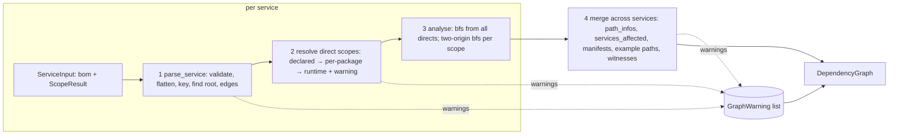

# Design: dependency-graph

> **Implements:** `.kiro/specs/dependency-graph/requirements.md` (DG-DEP, DG-PURE, DG-WARN, DG-ING, DG-ROOT, DG-DUP, DG-SCP, DG-EXP, DG-SVC, DG-PATH, DG-WIT, DG-OUT, DG-NFR, DG-EX, DG-INV).
> **Location:** `backend/core/graph/` (pure; no I/O).

---

## 1. Overview

`build_graph` takes one `ServiceInput` per manifest directory and returns one `DependencyGraph`. It works in four stages. Only stage 3 is graph-theoretic; the rest is validation and bookkeeping.



The lockfile parsers are independent of `build_graph`. They produce a `ScopeResult` that the caller passes in the `ServiceInput`. Parsers and `build_graph` share only the key builders and the warning helpers.

**One idea carries the exposure design.** A node's `PathInfo` set depends only on two things per scope `s`: whether the node is a direct dependency of scope `s`, and whether some *other* direct dependency of scope `s` reaches it. The second question is answered by a multi-source breadth-first search that keeps, for every node, the two nearest *distinct* origins (§5.3). If the node holds a label whose origin is not the node itself, it is reachable from another source. That one search also yields the witness path.

---

## 2. Input facts (checked against the recorded fixtures)

| Fact | Evidence | Consequence |
|---|---|---|
| The root is a `components` entry with a purl (e.g. `pkg:npm/graveyard-spike-npm-fixture@0.0.1?package-id=3491eba9e54c1ca3`), and it is the only `dependencies` ref that no `dependsOn` lists. | Both fixtures: one unreferenced ref, equal to a component bom-ref. | Root rule DG-ROOT-1(b). |
| `metadata.component.bom-ref` (npm `6fb2060e44576377`, py `d77b2f1eba698105`) is in neither `components` nor `dependencies`. | Both fixtures. | `metadata.component` is not the primary root source (DG-ROOT-2). |
| `bom-ref` = `purl + "?package-id=<16 hex>"`; every `dependsOn` entry equals some component's `bom-ref` exactly. | Both fixtures: no dangling refs. | Exact-match resolution (DG-ING-6); the suffix is never parsed. |
| npm `purl` keeps `JSONStream`; the bom-ref is lower-case. | `SPIKES.md` Q6. | Resolve through the component's `purl`, then `package_key` (D1). |
| One non-library component: `type: file`, name `/package-lock.json` or `/uv.lock`, no purl. | Both fixtures. | Skipped silently (DG-ING-5). |
| Syft emits a `dependencies` entry only for components that have dependencies (npm: 46 of 112). | `SPIKES.md` Q5. | Missing entry = no edges. |
| `package-lock.json` root entry: `packages[""]` with `dependencies: {express, JSONStream, moment, request}`; the npm fixture lockfile has 116 entries and no `dev`/`devOptional` flag. | `spikes/fixtures/npm/package-lock.json`. | Declared scope is available (D11); a real dev/optional lockfile is generated with npm (§7.2a). |
| `backend/uv.lock` has a project package (`source = { virtual = "." }`) with 2 runtime `dependencies` and a `[package.dev-dependencies]` table with a 6-package `dev` group; its other 20 packages are all transitive dev packages (the two runtime dependencies have no dependencies of their own). | `backend/uv.lock` at commit `0fbf989`. | A real dev group exists for `parse_uv_lock`; it has no optional-dependencies, cycles, two-version names or dangling references, so those need a synthetic file (§7.2). |
| `uv.lock` project package: `source = { virtual = "." }`, `dependencies = [{ name = "nose" }, …]`. | `spikes/fixtures/py/uv.lock`. | Project detection by `source` key; `direct_scopes` read from it. |
| The earlier npm SBOM predated `JSONStream` (114 components vs 116 lockfile entries); it was re-recorded in T0 (`docs/SPIKES.md`). | Count check. | The fixture is the re-recorded BOM. |

Python 3.12's `tomllib` reads both TOML formats; `json` reads the rest. No dependency is added (D10).

---

## 3. Module layout

```
backend/core/graph/
├── __init__.py            # public API + docstring (D1, D4, D5, D14)
├── model.py               # Scope, ScopeMap, GraphWarning, ScopeResult, ServiceInput, ExamplePath, PathWitness,
│                          #   GraphNode, DependencyGraph; DEFAULT_* limits; WARNING_CODES; MAX_* text caps
├── diagnostics.py         # make_warning(), finalise_warnings(): truncate, sort, de-duplicate, cap
├── keys.py                # npm_key(name, version), pypi_key(name, version): Purl(...) → package_key, ValueError on bad
├── cyclonedx.py           # parse_service(): validation, flatten, key map, roots, edges → ParsedService
├── traverse.py            # bfs_levels, nearest_two_origins, follow_chain, dag_preds, back_paths (string-keyed, iterative)
├── analyse.py             # analyse_service(): path_infos + candidate witnesses + distances for one service
├── build.py               # build_graph(): orchestration, scope resolution, merge, selection, warnings
├── serialise.py           # graph_to_dict()
├── scopes_common.py       # text-size guard, decoder wrappers (RecursionError → ValueError), ScopeResult assembly
├── scopes_npm.py          # parse_package_lock
├── scopes_poetry.py       # parse_poetry_lock
├── scopes_uv.py           # parse_uv_lock
├── scopes_requirements.py # parse_requirements_txt
└── tests/
    ├── __init__.py
    ├── strategies.py              # abstract_services(), render(), shuffled(), lockfile renderers
    ├── oracle.py                  # independent brute-force oracle; imports nothing from core.graph
    ├── fixtures/                  # see requirements "Fixtures"; README.md records provenance
    ├── test_fixtures.py           # fixture integrity (no local paths, pinned counts, shape facts of §2)
    ├── test_model.py              # dataclasses, derived properties, GraphNode invariants
    ├── test_diagnostics.py        # warning sort/dedupe/cap/truncation
    ├── test_traverse.py           # primitives, examples
    ├── test_cyclonedx.py          # ingest, roots, dedupe, rejections (DG-EX-4, 5, 11, 12, 13, 14)
    ├── test_scopes_npm.py  test_scopes_poetry.py  test_scopes_uv.py  test_scopes_requirements.py
    ├── test_build.py              # DG-EX-6…10, 15…17, 24
    ├── test_syft_fixtures.py      # DG-EX-1, 2, 3, 23
    ├── test_scale.py              # DG-EXP-2 diamond, DG-OUT-5 shapes, DG-NFR-1 timings, complete digraph
    ├── test_serialise.py          # graph_to_dict
    ├── test_purity.py             # DG-PURE-1, 2
    ├── test_oracle_sanity.py      # the oracle can see the D5 trap
    ├── test_public_api.py         # __all__, imports
    ├── test_properties_traverse.py
    ├── test_properties_ingest.py        # DG-INV-11 (build_graph), parse_service order independence
    ├── test_properties_scopes.py        # DG-INV-10
    └── test_properties_graph.py         # DG-INV-1…9, 12
```

`core/graph` imports `core.purl` and `core.scoring.types` only. `core.scoring` and `core.purl` are unchanged.

### Constants (`model.py`)

Structural limits, not tunable model parameters. The `BuildGraph` handler passes SSM values (`tech.md`); these are the fallbacks.

| Name | Value | Used by |
|---|---|---|
| `SUPPORTED_SPEC_VERSIONS` | `("1.5", "1.6", "1.7")` | DG-ING-2 |
| `DEFAULT_K_PATHS` | `3` | DG-PATH-1 |
| `DEFAULT_MAX_PATH_NODES` | `64` | DG-PATH-6 |
| `DEFAULT_MAX_SERVICES` | `50` | DG-ING-8 |
| `DEFAULT_MAX_COMPONENTS` | `20_000` | DG-ING-8 |
| `DEFAULT_MAX_EDGES` | `200_000` | DG-ING-8 |
| `MAX_LOCKFILE_CHARS` | `10_000_000` | DG-SCP-0 |
| `MAX_WARNINGS_PER_CODE`, `MAX_SUBJECTS`, `MAX_TEXT` | `50`, `20`, `200` | DG-WARN-4 |
| `WARNING_CODES` | frozenset of the 12 codes in DG-WARN-2 | DG-WARN-2 |

---

## 4. Data model

The dataclasses are as in the requirements. Details the requirements leave open:

- All are `@dataclass(frozen=True)`. `ScopeMap` values are `types.MappingProxyType` over a dict built in sorted key order, so `==` works and nothing can mutate them. They are therefore not hashable; nothing hashes them.
- `GraphNode.__post_init__` enforces DG-OUT-3. It does not recompute anything, so it is O(1) per node.
- `GraphNode.direct`, `.transitive`, `.scope` are `@property`.
- `DependencyGraph.node(key)` uses `bisect.bisect_left(self.nodes, key, key=lambda n: n.key)`, available from Python 3.10.
- `PathInfo` is imported, not redefined (DG-DEP-2). It has no ordering, so path-info ordering uses an explicit sort key `(not p.runtime, not p.direct)`.
- `GraphWarning.subjects` holds package keys, bom-refs or lockfile names. They come from untrusted input, so they are truncated to `MAX_TEXT` (DG-WARN-4); they are data, never instructions (threat T1: this text must never be placed in a model prompt).

---

## 5. Algorithms

### 5.1 Ingest (`cyclonedx.py`)

`parse_service(path, bom, limits) -> ParsedService`, where

```python
@dataclass(frozen=True)
class ParsedService:
    path: str
    packages: Mapping[str, str]               # package_key -> smallest canonical purl (DG-DUP-3)
    directs: tuple[str, ...]                  # sorted package_keys that a root depends on
    adj: Mapping[str, tuple[str, ...]]        # package_key -> sorted successors; no self-edges, no root keys
    warnings: tuple[GraphWarning, ...]        # service stamped
```

Steps (all iterative; every validation failure raises `ValueError("<path>: <field>: <rule>")`):

1. **Validate the envelope.** Mapping; `bomFormat`; `specVersion` string in `SUPPORTED_SPEC_VERSIONS`; types of `components`, `dependencies`, `metadata.component.bom-ref` (the last only if present).
2. **Flatten `components`** with a stack. Count; if the count exceeds `max_components`, raise.
3. **Map each component.** Skip rules and warnings as DG-ING-5. For a kept component, compute `purl_obj = parse_purl(c["purl"])`, `key = package_key(purl_obj)`, `display = format_purl(dataclasses.replace(purl_obj, qualifiers=(), subpath=None))`. Keep the smallest `display` per key. Record `ref_to_key[bom-ref] = key` (or `SKIPPED`). On a repeated bom-ref: equal outcome is a duplicate; a different outcome raises (DG-ING-7). A component without a `bom-ref` still becomes a package; it just cannot be an edge endpoint.
4. **Find roots.** `children = {t for e in dependencies for t in e.dependsOn}`. A root entry satisfies DG-ROOT-1. The set of root bom-refs is `roots`. Each root's own component is dropped from `packages` by bom-ref. If another component maps to the same key (only possible in a malformed SBOM), that component keeps the node.
5. **Build edges.** For each `dependencies` entry `e`:
   - if `e.ref in roots`: for each target, resolve with `ref_to_key`; kept → `directs`; skipped or unknown → `DANGLING_REF`;
   - else if `e.ref` resolves to a kept key `u`: for each target `v` that resolves to a kept key and `v ≠ u` and `v` is not a root → add `(u, v)`; unresolved → `DANGLING_REF`;
   - else if `e.ref` is unknown (not a component, not `metadata.component.bom-ref`) → `DANGLING_REF` once for the ref;
   - edges to a root's bom-ref are dropped (DG-ING-10).
   `adj` is built from a `set` of `(source key, target key)` pairs, then sorted per source. If the number of distinct pairs exceeds `max_edges`, raise (DG-ING-8). Only non-root edges are counted: root edges go to `directs`, not to the pair set, and there are at most as many of them as distinct components, which `max_components` already bounds.
6. **Root outcome.** One root: no warning. Several: `MULTIPLE_ROOTS` (`subjects` = the root bom-refs, sorted). None: `ROOT_NOT_FOUND`.

`directs` is the union of the resolved children of all roots.

Every step that depends on iteration order (dict insertion order of the input) either goes through a set and is sorted afterwards, or takes `min`. The result is therefore a function of the multiset of components and entries, which is what DG-ROOT-5 and DG-OUT-1 need.

### 5.2 Scope resolution (`build.py`)

```python
def effective_scopes(directs, scopes: ScopeResult | None) -> tuple[dict[str, Scope], tuple[str, ...]]:
    for d in directs:
        if scopes and d in scopes.direct_scopes:   out[d] = scopes.direct_scopes[d]
        elif scopes and d in scopes.package_scopes: out[d] = scopes.package_scopes[d]
        else:                                       out[d] = "runtime"; assumed.append(d)
```

If `assumed` is non-empty, one `SCOPE_ASSUMED` warning is emitted for the service with `subjects = sorted(assumed)` (DG-SCP-9). `scopes.warnings` are stamped with the service path and appended (DG-WARN-3).

Scope is consulted **only** here. The traversal in §5.3 sees `directs` partitioned by scope and nothing else (D4).

### 5.3 Traversal primitives (`traverse.py`)

All functions take `adj: Mapping[str, Sequence[str]]` with sorted successor lists and return plain dicts. No recursion.

```python
class Label(NamedTuple):
    dist: int                      # number of nodes on the path from the origin to this node; origin itself = 1
    origin: str                    # the source this label came from
    prev: tuple[str, int] | None   # (node, label index) of the predecessor label, None for an origin

def bfs_levels(adj, sources) -> dict[str, int]:
    """Single-label BFS from the sorted `sources`; dist 1 at the sources."""

def nearest_two_origins(adj, sources) -> dict[str, list[Label]]:
    labels = {s: [Label(1, s, None)] for s in sources}
    queue = deque((s, 0) for s in sources)                      # sources are sorted
    while queue:
        v, i = queue.popleft()
        lv = labels[v][i]
        for w in adj.get(v, ()):                                # sorted
            lw = labels.setdefault(w, [])
            if len(lw) < 2 and all(l.origin != lv.origin for l in lw):
                lw.append(Label(lv.dist + 1, lv.origin, (v, i)))
                queue.append((w, len(lw) - 1))
    return labels

def follow_chain(labels, node, index) -> tuple[str, ...]:       # path from origin to node, forward order
def dag_preds(adj_reverse, dist) -> dict[str, tuple[str, ...]]: # preds p of v with dist[p] == dist[v] - 1, sorted
def back_paths(dag, node, limit) -> Iterator[tuple[str, ...]]:  # minimum-length paths in the DG-PATH-3 order, lazily
```

**Why `nearest_two_origins` is right.** Let `R(v)` be the set of sources that reach `v` by some walk, and `d(o, v)` the shortest walk length (in nodes) from `o` to `v`.

*Claim.* After the search, `labels[v]` has `min(2, |R(v)|)` labels, with distinct origins, each carrying the exact `d(origin, v)`, and no source outside `labels[v]` is strictly nearer than the farther label.

*Sketch.* The queue is FIFO and every push has `dist` one greater than its parent's, so labels are created in non-decreasing `dist` order, as in ordinary BFS. A label `(o, d)` at `w` can only come from a label `(o, d-1)` at a predecessor `v`. If `o` is among the two nearest origins of `w` but not of `v`, then `v` already holds two other origins at distance ≤ `d-1`; both reach `w` at distance ≤ `d`, so `w` has two other origins at least as near, and the choice between tied origins only affects which label is kept, never a distance. By induction on `d`, `w` receives its two nearest origins. Each node accepts at most two labels and each accepted label scans its out-edges once, so the cost is at most `2(V+E)`. The property test `test_two_origin_labels_match_oracle` checks the claim against brute force on random graphs.

**What it gives us, for a scope `s` with sources `S_s` (sorted):**

| Question | Answer from `labels` |
|---|---|
| Is `n` a direct dependency of scope `s`? | `n ∈ S_s`. |
| Is `n` reached transitively under scope `s`? | `labels[n]` contains a label whose `origin ≠ n`. |
| Shortest transitive path for `(s, transitive)` | the first label of `labels[n]` with `origin ≠ n`, followed through `prev` to its origin. |

*Why "origin ≠ n" is exactly the simple-path condition (D5).* A transitive path has ≥ 2 nodes, so a simple one starts at some `o ≠ n`. Conversely, a shortest walk from `o ≠ n` to `n` is simple: if it repeated a node, cutting the loop would give a shorter walk with the same endpoints. The one walk that cutting cannot repair is `n → … → n`, which starts at `n`; that is a label with `origin == n`, and the rule discards it. If `n ∈ S_s`, its own origin label is created first and has `dist 1`, so it occupies slot 1 of 2, and slot 2 is the nearest *other* origin. If `n ∉ S_s`, slot 1 is already the nearest origin.

*Why a chain is a simple path.* Every label on a chain has the same `origin`, and a node holds at most one label per origin, so no node repeats.

*Why the length is minimal.* Any simple path realising `(s, transitive)` starts at some `o ∈ S_s, o ≠ n` and has at least `d(o, n)` nodes. The label gives the minimum of `d(o, n)` over `o ≠ n`.

**Example paths.** `bfs_levels` runs once per service from *all* directs (scope ignored). `dag_preds` keeps, per node, the predecessors one level closer. `back_paths(dag, n, limit)` is an iterative depth-first walk from `n` through sorted `dag_preds`, yielding each path reversed to forward order; because preds are sorted and all paths have equal length, successive yields are in increasing order of the tuple read from `n` backwards. Every node at level `d > 1` has at least one predecessor at level `d-1` by construction, so the walk never dead-ends and a yield costs O(L) plus the preds it skips.

### 5.4 Per-service analysis and merge

`analyse_service(adj, scoped_directs)` returns an internal `ServiceAnalysis`:

```python
@dataclass
class ServiceAnalysis:
    dist: dict[str, int]                         # bfs_levels from all directs
    dag: dict[str, tuple[str, ...]]              # dag_preds
    labels: dict[Scope, dict[str, list[Label]]]  # nearest_two_origins per scope that has sources
    sources: dict[Scope, frozenset[str]]
    # computed on demand:
    def infos(self, n) -> set[PathInfo]
    def witness_len(self, n, info) -> int | None
    def witness_path(self, n, info) -> tuple[str, ...]
```

`infos(n)`: for each scope `s` with sources: `(s, direct)` if `n ∈ sources[s]`; `(s, transitive)` if `labels[s][n]` has a label with `origin ≠ n`. Cost O(1) per query after the searches.

`build_graph` then:

1. Parses and analyses services in sorted path order. Total cost O(Σ(V_s + E_s)), at most five passes over each service (one `bfs_levels`, two `nearest_two_origins`, one reverse adjacency, one `dag_preds`).
2. For each key, folds over the services that contain it, in service order, to get `manifests`, `path_infos` (union), `services_affected` (count of services with non-empty `infos`), and the display purl (smallest).
3. **Example paths.** `m = min(dist_s[n] for services containing n)`. If `m > max_path_nodes`, omit (count it for `PATHS_OMITTED`). Otherwise, for each service in order with `dist_s[n] == m`, take paths from `back_paths(dag_s, n, remaining)` until K are collected. Yields are `ExamplePath(service, nodes)`.
4. **Witnesses.** For each `pi` in the node's `path_infos`: over services, the candidate length is `1` for a direct member and `label.dist` for a transitive one; pick the minimum, ties by service order; build the path once: `(n,)` for direct, `follow_chain(...)` for transitive. If the length exceeds `max_path_nodes`, omit it.
5. **Warnings.** Collect per-service ingest warnings, scope warnings, `SCOPE_ASSUMED`, the single `PATHS_OMITTED`, then `finalise_warnings` (§5.6).

Witness ties between two different minimum-length paths within one service are resolved by the traversal: sources are sorted, successors are sorted, the queue is FIFO, so the first label to reach a node is a function of the sorted graph. Input order cannot change it (DG-WIT-3).

### 5.5 Worked examples

**The D5 trap.** `root → a`, `a → b`, `b → a`; `a` is a runtime direct dependency.
Sources `S_rt = {a}`. Labels: `a: [(1,a)]`; processing `a` offers `(2,a)` to `b`, accepted; processing `b` offers `(3,a)` to `a`, but `a` already holds origin `a`, rejected. So `a` has no label with `origin ≠ a`: `path_infos(a) = {(rt, direct)}`. `b` has `(2,a)`: `{(rt, transitive)}`. Plain reachability would say `a` is reachable from itself via `b` and add a transitive member; the oracle says no simple path of two or more nodes starts at `a` and ends at `a`.

**Two sources, one cycle.** `root → a`, `root → b`, `a ↔ b`, both runtime. Labels: `a: [(1,a), (2,b)]`, `b: [(1,b), (2,a)]`. Each has a label with a foreign origin, so both are `{(rt, direct), (rt, transitive)}`; witnesses are `(a,)` and `(b, a)` for `a`.

**Mixed scopes.** `root → a` (rt), `root → b` (dev), `b → a`. `S_rt = {a}`: `a: [(1,a)]`. `S_dev = {b}`: `b: [(1,b)]`, `a: [(2,b)]`. So `a = {(rt, direct), (dev, transitive)}`.

**Diamond blow-up.** A 40-layer, 2-wide diamond has 2^40 simple paths. Each node holds at most two labels, so the search scans the out-edges of at most two labels per node: a few hundred operations for the 80 nodes.

### 5.6 Warnings (`diagnostics.py`)

`finalise_warnings(ws)`:

1. Truncate `detail`, each subject, to `MAX_TEXT`; sort and de-duplicate `subjects`; cap them at `MAX_SUBJECTS`, appending the total to `detail` (`"… (47 in total)"`).
2. De-duplicate by value, sort by `(service or "", code, detail, subjects)`.
3. Group by `(service, code)`; keep the first `MAX_WARNINGS_PER_CODE`; if more, add `GraphWarning("WARNINGS_TRUNCATED", f"{code}: {n} more omitted", service)`.

Truncation is applied after sorting, so the kept subset does not depend on input order. A `WARNINGS_TRUNCATED` entry is itself exempt from the cap (it is at most one per group). The step is idempotent: `finalise_warnings(finalise_warnings(ws)) == finalise_warnings(ws)`.

### 5.7 Complexity

| Stage | Time | Space |
|---|---|---|
| Ingest (`parse_service`) | O(C + D + E) with sorting O(E log Δ) | O(C + E) |
| Per-service searches | O(V + E) (≤ 5 passes) | O(V + E) |
| Merge and `path_infos` | O(Σ V_s) | O(V) |
| Example paths | O(K · L) per node | O(V · K · L), `L ≤ max_path_nodes` |
| Witnesses | O(L) per member (≤ 4) | O(V · 4 · L) |
| Warnings | O(W log W) | O(W) |

`C` is the number of components, `D` the number of `dependsOn` entries, `Δ` the maximum out-degree. Nothing is quadratic in the graph size. The depth cap (D15) bounds the `L` factor.

---

## 6. Scope parsers

All share `scopes_common.py`:

```python
def check_size(text) -> None                      # type, MAX_LOCKFILE_CHARS
def load_json(text) -> Any                         # json.loads; JSONDecodeError/RecursionError/ValueError → ValueError
def load_toml(text) -> dict[str, Any]              # tomllib.loads; TOMLDecodeError/RecursionError → ValueError
def cross_check(direct_scopes, package_scopes) -> list[GraphWarning]  # declared runtime but flagged dev only (DG-SCP-5)
def result(package_scopes, direct_scopes, warnings) -> ScopeResult   # sort, MappingProxyType, finalise_warnings
```

`keys.npm_key(name, version)` splits `@scope/name`, builds `Purl("npm", "@scope" | None, name, version)` and returns `package_key`. `keys.pypi_key(name, version)` builds `Purl("pypi", None, normalise_pypi_name(name), version)`. Both turn the `Purl` constructor's `ValueError` into `LOCKFILE_ENTRY_SKIPPED` at the call site.

### 6.1 `parse_package_lock`

```
doc = load_json(text); require mapping with "packages" mapping  (else ValueError: v1 or not a lockfile)
for path, entry in packages.items() where path != "" and "node_modules/" in path and entry is a mapping:
    skip if entry.get("link") is True
    version = entry.get("version") must be str (else LOCKFILE_ENTRY_SKIPPED)
    name = entry["name"] if non-empty str else path.rsplit("node_modules/", 1)[1]
    scope = "dev" if entry.get("dev") is True else "runtime"            # devOptional/optional/peer → runtime
    per_key[key] = runtime if any copy is runtime else dev               # any wins

root = packages.get("")
declared = {}
for n in root.dependencies ∪ optionalDependencies ∪ peerDependencies: declared[n] = "runtime"
for n in root.devDependencies if n not in declared: declared[n] = "dev"
for n, sc in sorted(declared.items()):
    e = packages.get("node_modules/" + n)
    if e is None or e.get("link") is True or no str version: DIRECT_UNRESOLVED(n); continue
    k = npm_key(e.get("name") or n, e["version"])
    direct_scopes[k] = runtime if (k already runtime) else sc          # a name can resolve to one key from two names
cross_check(direct_scopes, package_scopes)       # shared helper in scopes_common.py
```

`cross_check` emits `SCOPE_DISAGREEMENT(k, declared="runtime", package="dev")` for each key with `direct_scopes[k] == "runtime"` and `package_scopes[k] == "dev"`, and nothing else. A key declared `dev` never warns. The case "declared dev, per-package runtime" is a devDependency that production also requires; it needs no warning because `build_graph` already reports it as `(dev, direct)` plus `(runtime, transitive)` (D11).

When the root entry lists a package under `dependencies` and `devDependencies`, it is runtime. Alias keys: `"foo": "npm:bar@1"` resolves through the entry's `name`.

### 6.2 `parse_poetry_lock`

For each `[[package]]` table with string `name` and `version`: `runtime` if `"main" in groups` (list of strings); else if `groups` is absent and `category == "main"`; else if neither field is present, `runtime` (D8); else `dev`. Duplicate keys: runtime wins. `direct_scopes` is empty.

### 6.3 `parse_uv_lock`

1. Collect packages: `(norm_name, version, source, deps, optional, dev)`. `project = "virtual" in source or "editable" in source`.
2. `by_name[norm_name] → list of package indices`.
3. `resolve(ref)`: candidates `by_name[normalise_pypi_name(ref.name)]`; if `ref.version` is a string, keep those with that version; return all remaining.
4. Edges for the closure: each package's `dependencies` and every list under `optional-dependencies`, resolved.
5. Seeds: runtime seeds are the resolved `dependencies` and `optional-dependencies` of every project package; dev seeds are the resolved `dev-dependencies` (all groups) of every project package. A ref that resolves to nothing is `DIRECT_UNRESOLVED`.
6. Two iterative BFS closures (runtime, then dev) give `reach_rt` and `reach_dev`. Result for a non-project package: `runtime` if in `reach_rt`, `dev` if only in `reach_dev`, otherwise `runtime`.
7. `direct_scopes[k]` is `runtime` when `k` is a runtime seed, otherwise `dev` when `k` is a dev seed.
8. `cross_check` is called for consistency. It cannot fire: a runtime seed is in the runtime closure by construction. A test asserts that.

Closures walk through project packages too (workspace members referencing each other) without listing them.

### 6.4 `parse_requirements_txt`

Single pass, linear:

1. Strip a leading `\ufeff`; `splitlines()`; join a line ending in `\` with the next (only an unescaped final backslash).
2. Skip blank lines and lines starting with `#`. Lines starting with `-` are options: skip silently.
3. Cut a trailing comment at the first `#` preceded by whitespace. Cut options at the first ` --` (hashes). Cut a marker at the first `;`.
4. Match `^([A-Za-z0-9][A-Za-z0-9._-]*)(\[[^\]]*\])?\s*(===|==)\s*([^\s,;*]+)$` (anchored, no nested quantifiers). Failing lines with a recognisable name are `REQUIREMENT_SKIPPED`; lines containing `://` or starting with `.`/`/` are `REQUIREMENT_SKIPPED` as URL or path.
5. `pypi_key(name, version)`; a `ValueError` is `LOCKFILE_ENTRY_SKIPPED`.

Both `package_scopes` and `direct_scopes` get the pinned requirements: a `requirements.txt` has no way to say which entries are direct, and each is runtime.

---

## 7. Testing design

### 7.1 Strategies and oracle (`tests/strategies.py`, `tests/oracle.py`)

| Item | Builds | Used by |
|---|---|---|
| `abstract_graph(max_nodes=8)` | node count, directed edge set (self-loops, 2-cycles allowed), density drawn from sparse/medium/dense | traversal, graph, ingest properties |
| `abstract_services()` | 1–3 services over a shared pool of ≤ 8 package identities (ecosystem, name with mixed case, version), each with directs and a scope per direct, and per-service edges | DG-INV-1…9, 12 |
| `render(abstract, flags)` | CycloneDX 1.5/1.6/1.7 dict in Syft shape + `ScopeResult` (declared / per-package only / absent) | same |
| `shuffled(bom, seed)` | reorders every list and every mapping, including `ScopeResult` maps | DG-INV-1 |
| `with_duplicates(bom)` | duplicates components, entries and `dependsOn` elements | DG-INV-2 |
| `mutated(bom)` | deletes, retypes or nulls one field | DG-INV-11 |
| `json_like()` | recursive `None`/bool/int/float/str/list/dict | DG-INV-11 |
| `lockfile_*()` | package-lock, poetry (v1, v2), uv (with project package), requirements renderings with their expected maps computed in the strategy | DG-INV-10 |

`oracle.py` is independent of `core.graph` (DG-NFR-3):

```python
def simple_paths(adj, starts) -> Iterator[tuple[str, ...]]       # recursive DFS with an on-path set
def expected(abstract) -> Expected                               # per node: infos, services, min_len, min_len_per_info, min_paths
def naive_path_infos(abstract)                                   # plain reachability; used only by test_oracle_sanity
```

Dense 8-node cases cost up to ~10^5 paths per example (≈ 0.3 s). Oracle tests set `deadline=timedelta(seconds=5)` (DG-NFR-7) and cap `max_examples` only through the profile, never per test.

### 7.2 Example tests

`test_syft_fixtures.py` reads the fixtures via `Path(__file__).parent / "fixtures"`. Every pinned count is recomputed in the same test by independent code (counting `components` of type `library`, edges from the BOM) so a fixture swap fails loudly. Hand-built BOMs for DG-EX-6…17 come from a small `bom(root, packages, edges)` helper in the test module; they are not the Hypothesis strategies.

### 7.2a Lockfile fixtures: real first, synthetic only for what no tool produces

| Fixture | Origin | Covers |
|---|---|---|
| `lock_uv_backend.toml` | frozen copy of `backend/uv.lock` (source commit and SHA-256 in the README) | project package, runtime and dev `direct_scopes`, 18 transitive dev packages, no warnings |
| `lock_uv.toml` | copy of `spikes/fixtures/py/uv.lock` | runtime only; key parity with Syft |
| `lock_poetry.toml` | generated in a scratch dir outside the repo by `uvx --from poetry==<latest> poetry lock` (no install) for a tiny `pyproject.toml` with one main and one dev dependency | the scope markers the current Poetry really writes |
| `lock_npm.json` | copy of the spike lockfile | runtime only; declared-scope parity with Syft |
| `lock_npm_dev.json` | generated in a scratch dir outside the repo by `npm install --package-lock-only --ignore-scripts` for a `package.json` with `left-pad` 1.3.0, `is-number` 7.0.0 (dev) and `uuid` 3.4.0 (optional) | `dev` and `optional` flags as npm writes them; the root entry's `dependencies`, `devDependencies` and `optionalDependencies` groups |
| `lock_uv_edge.toml` | synthetic | both-seed package, optional-dependencies target, dev cycle, two versions of one name, dangling reference, orphan |
| `lock_poetry_edge.toml` | synthetic | legacy `category`, multi-group `groups`, neither field |
| `lock_npm_edge.json` | synthetic | `devOptional`, `peer`, `link`, alias, nested path, duplicate copies, a devDependency that production also requires, a runtime declaration flagged `dev`, a name in both groups |

Tests for real fixtures recompute every expected figure from the file itself with independent code, so a regenerated or swapped fixture fails loudly instead of passing on stale constants. For `lock_poetry.toml`, the test asserts the markers the tool wrote; if the real file uses a shape DG-SCP-6 does not handle, T5 stops and reports instead of editing the fixture to fit.

### 7.3 Mutation sanity (`test_oracle_sanity.py`)

`naive_path_infos` counts a node reached from its own cycle as transitive. The test asserts, on the trap graphs of §5.5, that `naive != oracle` and `build_graph == oracle`. This is how we know DG-INV-4 would fail on the wrong implementation, which random generation alone may not find quickly.

### 7.4 Traceability

| Requirements | Tests |
|---|---|
| DG-DEP-1, DG-PURE-1/2, DG-NFR-6 | `test_purity.py`, `test_fixtures.py`, T10 dependency diff |
| DG-WARN-1…5 | `test_diagnostics.py`; DG-INV-12 in `test_properties_graph.py` |
| DG-ING-1…10, DG-ROOT-1…5, DG-DUP-1…5 | `test_cyclonedx.py`, `test_syft_fixtures.py` (DG-EX-1…5, 11…14); `test_properties_ingest.py`; DG-INV-1, 2, 11 |
| DG-SCP-0…9 | `test_scopes_*.py` (DG-EX-18…22, 24); `test_properties_scopes.py` (DG-INV-10); DG-EX-23 in `test_syft_fixtures.py` |
| DG-EXP-1…7, DG-SVC-1, 2 | `test_build.py` (DG-EX-6…10); `test_properties_graph.py` (DG-INV-4…7, 9); `test_scale.py` |
| DG-PATH-1…6, DG-WIT-1…4 | `test_traverse.py`, `test_build.py` (DG-EX-15…17); DG-INV-3, 8 |
| DG-OUT-1…5, DG-NFR-1 | DG-INV-1, 5; `test_serialise.py`; `test_scale.py` |
| DG-NFR-2 | T10 coverage gate |
| DG-NFR-4, DG-NFR-5 | tasks.md structure (tests per task); T10 gate commands |

---

## 8. Error handling

| Condition | Result |
|---|---|
| Wrong envelope or field types; unsupported `specVersion`; duplicate or conflicting bom-ref; over any limit; bad `k_paths` / `max_path_nodes` | `ValueError`, message `"<service>: <field>: <rule>"`. |
| Component without purl, unsupported purl, dangling ref, missing root, several roots, orphan scope, lockfile entry that cannot form a purl, unpinned requirement, depth-capped path | `GraphWarning`; processing continues. |
| Lockfile text too large, not JSON/TOML, v1 `package-lock.json`, deep nesting | `ValueError` from the parser. |
| Anything else raised inside the module | A bug. A `try/except` is **not** added to hide it: DG-OUT-4 is verified by DG-INV-11 over generated garbage, so an escaping `KeyError` or `TypeError` fails a test instead of being swallowed. |

---

## 9. Alternatives considered

| Alternative | Why not |
|---|---|
| **SCC condensation** for `path_infos` (count sources per component, propagate over the DAG) | Correct, and also linear, but it needs Tarjan or Kosaraju, a condensation DAG and per-scope propagation, and still cannot produce witness paths. The two-origin search gives the answer and the witness in one pass, with one primitive shared with example paths. |
| **Per-node BFS** for the "direct but also transitive" witness | Simple, but O(V·(V+E)) in the worst case: 3,000 mutually reachable direct dependencies would cost about 10^8 operations, which is a cost-exhaustion vector for untrusted SBOMs (T7). |
| **Enumerate simple paths** and take the set | Exponential on diamonds (DG-EXP-2). Kept only as the test oracle. |
| **Yen's K-shortest simple paths** for example paths | Not linear, more code, and a "longer" path adds little to the display. Witnesses cover the explanation use case (D13). |
| **Forward-lexicographic order of example paths** | Needs, per target, the set of nodes on its shortest paths: a reverse search per node. Reading the path backwards (D6) gets a deterministic total order from one forward search. |
| **Merge all services' edges into one graph** | Lets one service's root reach nodes through another's edges (D2). |
| **Parse the `?package-id=` suffix** to recover the purl | The component's `purl` field already is the purl; parsing an opaque bom-ref is the fragile route (D1). |
| **Exceptions for anomalies** (`MULTIPLE_ROOTS`, unsupported purl) | One bad component would fail a whole scan; AU-4 forbids that. Warnings keep the data and the signal (D14). |
| **Recursive DFS** for paths | A 5,000-node chain would hit the recursion limit (DG-OUT-5). |
| **`package.json` for declared scope** | Another file to fetch and parse, and `packages[""]` already holds the same declaration (D11). |
| **Store paths as linked structures** to avoid quadratic output | Not JSON-friendly and the UI needs plain lists. A depth cap bounds the size instead (D15). |

---

## 10. Review decisions (round 1) and residual risk

The seven answers are recorded in the requirements ("Review decisions (round 1)"). Consequences for this design:

- Decision 2 added `path_witnesses` and moved the exposure algorithm to the two-origin search (§5.3), replacing the earlier plan to use strongly connected components.
- Decision 4 made `GraphWarning` the only diagnostics channel and added the warning cap and `finalise_warnings` (§5.6). Lockfile parsers return warnings, so their return type became `ScopeResult`.
- Decision 6 made `direct_scopes` the first source of direct-edge scope and added `SCOPE_DISAGREEMENT`. Round 2 narrowed that warning to "declared runtime, flagged dev-only" (a shared `cross_check` helper), because the opposite case is normal and already visible in `path_infos`.
- Round 3 did the same for npm: `lock_npm_dev.json` is generated by `npm install --package-lock-only --ignore-scripts`, and the synthetic file shrank to `lock_npm_edge.json` (§7.2a).
- Round 2 also replaced the hand-written uv and poetry dev fixtures with real ones (a frozen copy of `backend/uv.lock`, and a lockfile generated by pinned Poetry), keeping synthetic files only for edge cases no small real project produces (§7.2).
- Decision 7 puts the npm SBOM re-record at the start of `tasks.md` (T0), because every later fixture test depends on the new counts.

### Residual risk

- The two-origin search is the least familiar piece. Its correctness argument is a sketch (§5.3); the real protection is DG-INV-4 and DG-INV-8 against the independent oracle, plus `test_two_origin_labels_match_oracle` on the primitive.
- Pinned fixture counts for the re-recorded npm BOM are measured, not derived. If Syft is upgraded, T0 is the single place to redo.
- `uv.lock` and `poetry.lock` field names (`groups`, `category`, `dev-dependencies`, `source.virtual`) come from the formats as of the fixtures and Poetry/uv documentation, not from a published schema. The synthetic fixtures encode that understanding; if a real lockfile differs, the parser emits `LOCKFILE_ENTRY_SKIPPED` or falls back to runtime rather than failing.
