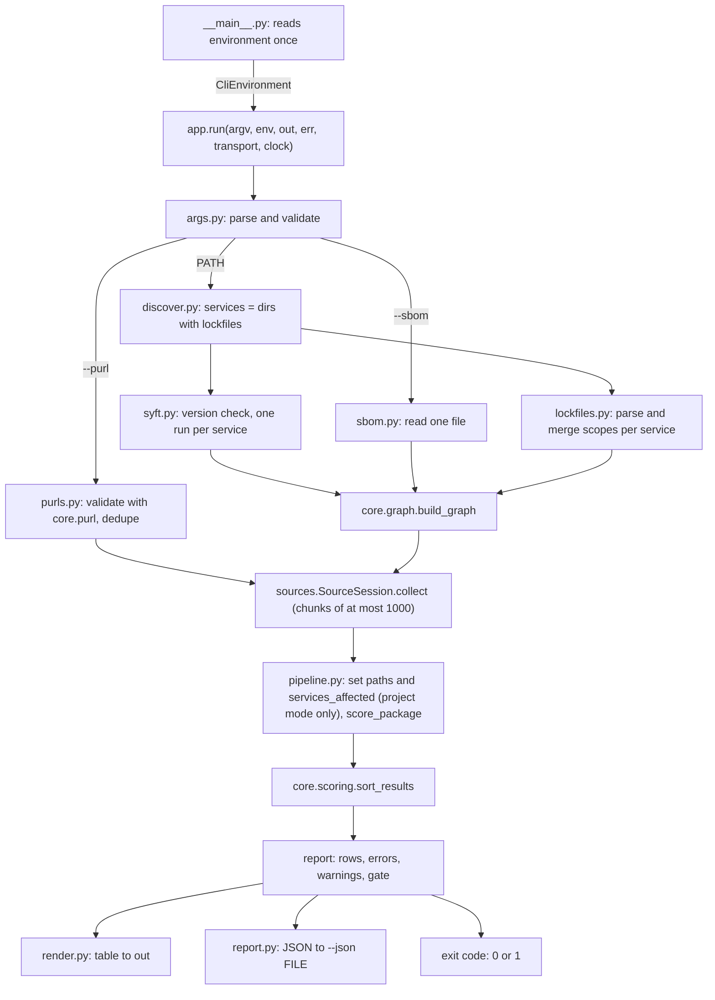

# Design: graveyard-cli

> **Implements:** `.kiro/specs/graveyard-cli/requirements.md` (CLI-DEP, CLI-CMD, CLI-DISC, CLI-SCOPE, CLI-SYFT, CLI-SBOM, CLI-PURL, CLI-PIPE, CLI-OUT, CLI-JSON, CLI-GATE, CLI-ENV, CLI-SEC, CLI-TEST).
> **Location:** `backend/cli/`. The CLI is glue. It owns files, a subprocess and two output streams. Everything it computes about packages comes from `core.graph`, `sources` and `core.scoring`.

---

## 1. Overview



In `--purl` mode the project-input stage (discovery, Syft, SBOM, lockfiles, graph) is skipped: validated purls go straight to `collect`, and no exposure is set.

Failure paths: `UsageError` → 2 (this includes an invalid purl), `CliError` → 3, any other `Exception` → 4. Only a completed analysis reaches the gate.

---

## 2. Facts checked while writing this design

| Fact | Evidence | Consequence |
|---|---|---|
| `syft --version` prints `syft 1.56.0`. | Ran `~/.local/bin/syft --version` on 11 Nov 2026. Syft is not on `PATH` on this machine, only in `~/.local/bin`. | CLI-SYFT-1 matches that line. `--syft PATH` is needed, and `shutil.which("syft")` is only the default. |
| `syft dir:<root>` recurses and lists the packages of nested directories. `--exclude './sub/**'` removes them. | Ran both on a temp tree with `requirements.txt` in `proj/` and `proj/sub/`: without the flag `idna` and `six` both appeared, with it only `six`. | Without exclusion a nested service's packages count in the parent too and `services_affected` is inflated. D4 and CLI-SYFT-2. |
| Syft runs with a cleared environment containing only `PATH` and `SYFT_CHECK_FOR_APP_UPDATE=false`. | Ran with `env -i`. | The Syft environment can be an allow-list; `GITHUB_TOKEN` is never passed. |
| Syft 1.56.0 emits CycloneDX 1.7; `core.graph` accepts 1.5–1.7. | Same run: `specVersion` `1.7`. | No conversion. |
| `SourceSession` sets `github_enabled` from `token is not None`; without a token every GitHub signal is missing with `GITHUB_DISABLED`. | `sources/session.py`. | CLI-ENV-4 needs no special code path in the CLI. |
| `SourceSession.collect` raises `ValueError` above `Limits.max_packages_per_call` (1,000). | `sources/api.py`, session docstring. | CLI-PIPE-2 chunks the request list. |
| `score_package` takes exposure from `Signals.paths` and `Signals.services_affected`. `sources` leaves them at their defaults (`autopsy-sources` D12). | `core/scoring/__init__.py`, `sources/tests/test_anchors_e2e.py` (`exposure_assumed is True`). | D8: the CLI must set them or ranking ignores the graph. |
| `ScoringResult.contributions` is keyed `r2, r3, r4, r5, r6, r8` (risk ids), not `s2…`. | `core/scoring/normalise.py`, `score.py`. | `why` maps `rN` to the signal `sN`. |
| With assumed exposure the nine anchors score (priority): pycrypto 150.0, request 135.0, nose 100.0, node-uuid 90.0, left-pad 90.0, six 43.72, uuid 7.6, moment 3.9, express 1.5. node-uuid and left-pad tie. | Ran `score_package` over `signals_from_fixture` on 11 Nov 2026. | The fixture graph must break the tie and reorder some packages, or the end-to-end test cannot show that exposure is plumbed (§9). |
| The cassette is keyed by method, URL and request body. The GitHub request body contains the repos and the `as_of` window. | `core/sources/tests/fixtures/recorded/README.md`, `sources/tests/test_anchors_e2e.py`. | The end-to-end test must request exactly the nine anchor purls with `--as-of 2026-11-03`. |
| A single-purl run cannot replay the cassette as it is. The cassette holds one OSV `querybatch` body with the nine anchors, one GitHub body with their seven repos, and one npm bulk-downloads URL with six names. A run for one package sends an OSV body with one query and a single-name downloads URL (`_fetch_single_missed`), neither of which is recorded. | `python` over `rec.cassette().entries` on 11 Nov 2026; `sources/clients/downloads.py` (`len(chunk) == 1` → single URL), `sources/clients/osv.py`. | The single-package tests use a transport that answers from the cassette and derives those two responses from the recorded batch ones (§9.4). The GitHub query is avoided by running without a token. Nine `--purl` arguments reproduce the recorded requests exactly. |
| Which exit codes block a Pre Tool Use hook is documented unevenly. [Hook actions](https://kiro.dev/docs/hooks/actions/) (updated 10 Oct 2026) says any non-zero exit blocks a Pre Tool Use hook and sends stderr to the agent; [Hook types](https://kiro.dev/docs/hooks/types/) gives no table for it; unofficial Kiro CLI v3 notes say exit 2 blocks and exit 1 only warns. | `web_fetch` of the kiro.dev pages on 11 Nov 2026; `kiro.dev/docs/cli/hooks/` redirects to `/docs/hooks/`. | The CLI exits 1 on a tripped gate and 2 on a usage error; neither reading is safe to rely on for exit 1, so the hook needs a wrapper that blocks with exit 2 and allows with exit 0. Recorded under "Belongs elsewhere"; the CLI's codes do not change. |
| `hatchling` is at 1.33.0 on PyPI on 11 Nov 2026. The weights loader reads `Path(__file__).parent / "weights.v1.yaml"`. | `curl https://pypi.org/pypi/hatchling/json`; `core/scoring/weights.py` line 20. | T0 re-checks the version and pins it exactly. The wheel must contain `core/scoring/weights.v1.yaml`, or an installed `graveyard` fails on first score. |
| `parse_requirements_txt` accepts a UTF-8 BOM in the text and treats every pinned line as runtime. | `core/graph/tests/fixtures/README.md`. | Read lockfiles with plain `utf-8`; do not strip the BOM. CLI-SCOPE-4 limitation follows. |

---

## 3. Module layout

```
backend/cli/
├── __init__.py       # docstring: purpose, D1/D7/D9/D17 summary
├── __main__.py       # main(): the ONLY reader of os.environ; builds CliEnvironment; sys.exit(run(...))
├── errors.py         # ExitCode (IntEnum), CliError, UsageError, ExitRequest
├── args.py           # build_parser(), parse_args() -> Options; parse_fail_on(); path-or-purl exclusivity
├── text.py           # sanitise()   (pure; used by purls, render, pipeline)
├── purls.py          # validate_purls(raw) -> tuple[str, ...] (core.purl, dedupe by package_key)   (pure)
├── env.py            # CliEnvironment dataclass, DEFAULT_CONTACT (no os import)
├── discover.py       # find_services(root) -> tuple[ServiceDir, ...]
├── lockfiles.py      # read_scopes(service) -> (ScopeResult | None, tuple[CliWarning, ...]); merge_scopes()
├── syft.py           # SYFT_VERSION, check_version(), run_syft(); the ONLY subprocess user
├── sbom.py           # load_sbom(path) -> dict
├── pipeline.py       # collect_inputs(), autopsy_graph(), rank() -> Report
├── why.py            # why(row inputs) -> str   (pure)
├── gate.py           # GateClass, matches(), evaluate()   (pure)
├── report.py         # report_to_dict(report) -> dict      (pure)
├── render.py         # render_table(report, width, show_all) -> str   (pure)
├── model.py          # Row, Report, CliWarning, ServiceDir (dataclasses)
├── app.py            # run(): wiring, streams, exit codes
├── README.md         # usage, exit-code table, schema v1, known limitations, manual smoke command
└── tests/
    ├── conftest.py   # autouse socket blocker; stub Syft factory; fixture paths
    ├── support.py    # subset_replay_transport(): cassette + derived OSV and npm-downloads answers (§9.4)
    ├── fixtures/
    │   ├── anchors-project/{README.md, web/package-lock.json, api/uv.lock}
    │   ├── sboms/{web.cdx.json, api.cdx.json, all.cdx.json}
    │   └── report_v1_shape.json
    └── test_*.py
```

Pure modules (`why`, `gate`, `report`, `render`, `purls`, and `lockfiles.merge_scopes`) import no I/O module, so they take the property tests.

---

## 4. Types

```python
class ExitCode(IntEnum):
    OK = 0; GATE_TRIPPED = 1; USAGE = 2; INPUT = 3; INTERNAL = 4

class CliError(Exception):            # message is a fixed template; never carries third-party text
    code: ExitCode                    # INPUT
class UsageError(Exception): ...      # code USAGE
class ExitRequest(Exception):         # --help / --version: carries exit code 0

GateClass = Literal["dead", "cursed", "ailing"]

@dataclass(frozen=True)
class Options:
    path: Path | None                 # resolved, exists, is a directory; None in --purl mode
    purls: tuple[str, ...]            # validated, canonical, de-duplicated; empty in project mode
    sbom: Path | None
    json_out: Path | None
    fail_on: frozenset[GateClass]     # may be empty
    as_of: date | None
    show_all: bool
    syft: str | None                  # None: shutil.which("syft")
    syft_timeout: float

@dataclass(frozen=True)
class CliEnvironment:                 # built only in __main__.py (D7)
    token: SecretToken | None
    token_rejected: bool              # GITHUB_TOKEN set but not a valid token; value dropped
    contact: str | None               # GRAVEYARD_CONTACT or None
    syft_env: Mapping[str, str]       # allow-listed variables + SYFT_CHECK_FOR_APP_UPDATE=false
    width: int                        # terminal columns; default 100

@dataclass(frozen=True)
class ServiceDir:
    path: str                         # relative POSIX path, "." for the root
    directory: Path                   # absolute
    lockfiles: tuple[str, ...]        # file names, sorted

@dataclass(frozen=True)
class CliWarning:
    code: str                         # LOCKFILE_UNREADABLE | GITHUB_TOKEN_MISSING | GITHUB_TOKEN_INVALID
    detail: str                       # fixed template; file name and service only
    service: str | None

@dataclass(frozen=True)
class Row:
    rank: int
    node: GraphNode | None            # None in --purl mode (no graph)
    source: SourceResult              # evidence, warnings, repo, versions
    scoring: ScoringResult
    signals: Signals                  # the signals actually scored (exposure set)
    why: str

@dataclass(frozen=True)
class Report:
    as_of: date
    input_mode: Literal["syft", "sbom", "purl"]
    syft_version: str | None
    services: tuple[str, ...]
    lockfiles: tuple[tuple[str, str, bool], ...]    # (service, file, used)
    rows: tuple[Row, ...]                           # rank order
    item_errors: tuple[tuple[str, ItemError], ...]  # (purl, error)
    graph_warnings: tuple[GraphWarning, ...]
    cli_warnings: tuple[CliWarning, ...]
    stats: SourceStats
    fail_on: frozenset[GateClass]
    matches: tuple[str, ...]                        # purls that match fail_on, rank order
    exit_code: ExitCode                             # OK or GATE_TRIPPED
```

`Row.scoring.purl` is unique across rows (`sort_results` enforces it), so the CLI re-attaches each `ScoringResult` to its node and source result through a dict keyed by purl.

---

## 5. Flow

### 5.1 `app.run`

```python
def run(argv, *, env, out, err, transport=None, clock=None) -> int:
    try:
        opts = parse_args(argv)                                   # UsageError, ExitRequest
        report = analyse(opts, env, transport, clock or SystemClock())   # CliError
        out.write(render_table(report, env.width, opts.show_all))
        write_stderr_notes(report, err)                           # warnings, gate message
        if opts.json_out: write_json(opts.json_out, report)       # CliError(INPUT) on OSError
        return int(report.exit_code)
    except ExitRequest as e:  return e.code
    except UsageError as e:   err.write(usage + message); return 2
    except CliError as e:     err.write(message); return 3
    except Exception as e:    err.write(f"internal error: {type(e).__name__}\n"); return 4
```

`__main__.main` is three lines: build the `CliEnvironment`, call `run(sys.argv[1:], env=…, out=sys.stdout, err=sys.stderr)`, `sys.exit` the result.

### 5.2 `pipeline.analyse`

```python
def analyse(opts, env, transport, clock) -> Report:
    as_of = opts.as_of or clock.now().astimezone(UTC).date()      # CLI-PIPE-6
    if opts.purls:                                                # --purl mode (D19)
        nodes: list[GraphNode | None] = [None] * len(opts.purls)
        requests = [(p, as_of) for p in opts.purls]
        inputs, graph = PURL_INPUTS, None                         # empty services, no warnings
    else:
        inputs = collect_inputs(opts, env)         # services, boms, scopes, cli warnings (sync, subprocess)
        graph = build_graph(inputs.services)       # ValueError -> CliError(INPUT)
        nodes = list(graph.nodes)
        requests = [(n.purl, as_of) for n in graph.nodes]
    results, stats = asyncio.run(autopsy(requests, env, transport, clock))   # chunks, one session
    return rank(nodes, results, stats, graph, inputs, opts, as_of)
```

`autopsy` is the only coroutine (named `autopsy_requests` in code to avoid clashing with `sources.autopsy`):

```python
async def autopsy_requests(requests, env, transport, clock) -> tuple[tuple[SourceResult, ...], SourceStats]:
    config = SourcesConfig.default(contact=_contact(env))
    size = config.limits.max_packages_per_call
    results, stats = [], []
    async with SourceSession(config, token=env.token, transport=transport, clock=clock) as s:
        for i in range(0, len(requests), size):
            batch = await s.collect(requests[i:i+size])
            results += batch.results; stats.append(batch.stats)
    return tuple(results), merge_stats(stats)     # sum of counters
```

`rank`:

1. Pair `nodes[i]` with `results[i]` (same order; `nodes[i]` is `None` in `--purl` mode).
2. If `result.error` is set, record `(purl, error)` and continue.
3. Project mode: `paths, affected = exposure_inputs(node)`; `signals = replace(result.signals, paths=paths, services_affected=affected)`. `--purl` mode: `signals = result.signals` unchanged, so `paths` and `services_affected` stay `None` and the score has `exposure_assumed = True`.
4. `scoring = score_package(signals)`.
5. `ordered = sort_results([scoring…])`; build `Row` with `rank = position + 1` and `why(...)`.
6. `matches = [r.scoring.purl for r in rows if gate.matches(r.scoring, opts.fail_on)]`; `exit_code = GATE_TRIPPED if matches else OK`.

`run` resolves `clock = clock or SystemClock()` once. That one clock gives the `as_of` default and is passed to `SourceSession`, so a test's `FakeClock` controls both.

### 5.2a `purls.validate_purls`

```python
def validate_purls(raw: Sequence[str]) -> tuple[str, ...]:
    seen: dict[str, str] = {}                      # package_key -> smallest canonical purl
    for position, text in enumerate(raw, start=1):
        try:
            p = parse_purl(text)                   # ValueError: not a purl, not npm/pypi
        except ValueError:
            raise UsageError(f"--purl #{position}: not a valid npm or PyPI package URL: {shown(text)}")
        if p.version is None:
            raise UsageError(f"--purl #{position}: the package URL needs a version: {shown(text)}")
        key = package_key(p); canonical = format_purl(p)
        seen[key] = min(seen.get(key, canonical), canonical)
    return tuple(sorted(seen.values()))
```

`shown(text)` is `sanitise(text)[:100]`. Validation runs inside `parse_args`, before anything else, so a bad purl costs no I/O (CLI-PURL-2). The `core.purl` error text is not echoed. The result is sorted so the request order, and the cache and request keys derived from it, do not depend on argument order.

### 5.3 `collect_inputs`

Syft mode:

```
services = find_services(opts.path)                  # CliError if 0 or > 50
exe = opts.syft or shutil.which("syft")              # CliError(INPUT) if None
check_version(exe, env.syft_env)                     # CliError if not "syft 1.56.0"
for s in services:
    nested = [t.path for t in services if t.path != s.path and is_under(t.path, s.path)]
    bom = run_syft(exe, s, nested, opts.syft_timeout, env.syft_env)
    scopes, warns = read_scopes(s)
    inputs.append(ServiceInput(s.path, bom, scopes))
```

`--sbom` mode: `ServiceInput(".", load_sbom(opts.sbom), read_scopes(root_service_only))`, where `root_service_only` is a `ServiceDir` built from the lockfiles directly in `PATH`, or none.

`is_under(child, parent)`: `parent == "."` and `child != "."`, or `child.startswith(parent + "/")`. For the root service the exclusion list holds every other service.

### 5.4 Syft call

```python
SYFT_VERSION: Final = "1.56.0"

def run_syft(exe, service, nested, timeout, syft_env) -> dict[str, Any]:
    argv = [exe, f"dir:{service.directory}", "-q", "-o", "cyclonedx-json"]
    for rel in nested_relative_to(service, nested):
        argv += ["--exclude", f"./{rel}/**"]
    try:
        proc = subprocess.run(argv, shell=False, stdin=subprocess.DEVNULL,
                              capture_output=True, timeout=timeout, check=False,
                              env=dict(syft_env))
    except (OSError, subprocess.TimeoutExpired):  raise CliError(...)
    if proc.returncode != 0 or len(proc.stdout) > MAX_SBOM_BYTES: raise CliError(...)
    doc = json.loads(proc.stdout)                 # ValueError/RecursionError -> CliError
    if not isinstance(doc, dict): raise CliError(...)
    return doc
```

Messages name the service (a relative path the user's own tree produced, sanitised) and never include stderr.

`nested_relative_to` turns `"web/sub"` under `"web"` into `"sub"`, and any service under `"."` into its own path.

### 5.5 `merge_scopes`

```python
def merge_scopes(results: Sequence[ScopeResult]) -> ScopeResult:
    # for each key: "runtime" if any input says runtime, else "dev"
    # warnings: finalise_warnings(concatenation)
```

`lockfiles.py` builds the result with the public `ScopeResult` dataclass: both maps are `MappingProxyType(dict(sorted(items)))`, and warnings are `tuple(sorted(set(all_warnings), key=…))` using `(service or "", code, detail, subjects)`. It imports nothing from `core.graph` beyond `__all__` names. `build_graph` runs its own warning finalisation afterwards, so the merged tuple only has to be deterministic. Input order does not change the result (commutative), merging a result with itself returns an equal result (idempotent), and a single input returns an equal result.

---

## 6. `why`, `gate`, `sanitise`

### 6.1 `why(scoring, signals) -> str`

Fragments, in order, joined by `"; "`. Each rule reads `ScoringResult` and `Signals` only.

| Condition | Fragment |
|---|---|
| `base_state == UNKNOWN` | `no scored signals` |
| `dead_reason == "declared"` | `declared dead` |
| `base_state in (DEAD, AILING)` and not declared | the two largest non-`None` `contributions`, each as below |
| `cursed` | `N advisories with no fix` (`N` = advisories in `signals.s7_advisories` with `has_fix` false; `1 advisory with no fix` for one) |
| `wounded` and not `cursed` | `fix available` if any advisory has a fix, then `upgrade advised` if `s1b_version_deprecated` |
| `base_state == RESTING` | `quiet but healthy` |
| none of the above | `—` |

Contribution fragments (risk id → raw value from `signals`; a missing raw value falls through to the next contribution):

| Id | Fragment |
|---|---|
| `r2` | `last release YYYY-MM` from `s2_latest_release_at` |
| `r3` | `last push YYYY-MM` from `s3_last_push_at` |
| `r4` | `Scorecard maintained X/10` |
| `r5` | `1 committer in 12 months` / `N committers in 12 months` |
| `r6` | `O open / C closed issues` |
| `r8` | `Scorecard overall X/10` |

Ties between equal contributions break by risk id ascending. No literal in `why` is a model parameter; numbers are formatted from `signals`, never recomputed.

### 6.2 `gate.matches(scoring, fail_on) -> bool`

```python
("dead"   in fail_on and scoring.base_state is BaseState.DEAD) or
("cursed" in fail_on and scoring.cursed) or
("ailing" in fail_on and scoring.base_state is BaseState.AILING)
```

Monotone in `fail_on` by construction.

### 6.3 `sanitise(text) -> str`

Replaces each character `c` with `\uFFFD` when `unicodedata.category(c) == "Cc"` (C0, `DEL` and C1 controls) or `c` is one of the bidi controls U+202A–U+202E and U+2066–U+2069. Other format characters (the zero-width joiner in an emoji sequence, for example) are kept. Idempotent: U+FFFD is neither a control nor a bidi control.

---

## 7. JSON report, schema version 1

Key order is fixed by the construction order in `report_to_dict`. Abbreviated example (values are from the anchor scenario; `…` marks a repeated shape):

```json
{
  "schema": "graveyard.autopsy",
  "schema_version": 1,
  "model_version": "v1",
  "as_of": "2026-11-03",
  "input": {
    "mode": "syft",
    "syft_version": "1.56.0",
    "services": ["api", "web"],
    "lockfiles": [
      {"service": "api", "file": "uv.lock", "used": true},
      {"service": "web", "file": "package-lock.json", "used": true}
    ]
  },
  "summary": {
    "packages": 9,
    "states": {"Dead": 5, "Ailing": 0, "Resting": 1, "Alive": 3, "Unknown": 0},
    "cursed": 2,
    "wounded": 3,
    "item_errors": 0,
    "degraded": false,
    "warnings": {"graph": 0, "cli": 0, "source": 0},
    "sources": {"requests": {"depsdev": 22, "…": 0}, "failures": {}, "cache_hits": 0, "cache_misses": 0, "s9_skipped": 2},
    "gate": {"fail_on": ["dead"], "tripped": true, "matches": ["pkg:pypi/pycrypto@2.6.1", "…"]},
    "exit_code": 1
  },
  "packages": [
    {
      "rank": 1,
      "purl": "pkg:pypi/pycrypto@2.6.1",
      "key": "pypi/pycrypto@2.6.1",
      "ecosystem": "pypi",
      "name": "pycrypto",
      "version": "2.6.1",
      "state": "Dead",
      "dead_reason": "score",
      "cursed": true,
      "wounded": false,
      "mortality": 100.0,
      "confidence": 0.25,
      "priority": 150.0,
      "exposure": 1.0,
      "exposure_assumed": false,
      "services_affected": 1,
      "direct": true,
      "scope": "runtime",
      "manifests": ["api"],
      "path_infos": [{"runtime": true, "direct": true}],
      "example_paths": [{"service": "api", "nodes": ["pypi/pycrypto@2.6.1"]}],
      "why": "last release 2014-06; 4 advisories with no fix",
      "normalised_risks": {"r2": 1.0, "…": null},
      "contributions": {"r2": 100.0, "…": null},
      "evidence": {
        "s2_latest_release_at": {
          "value": "2014-06-20",
          "source_url": "https://pypi.org/pypi/pycrypto/json",
          "fetched_at": "2026-11-10T09:00:00+00:00",
          "extra_source_urls": [],
          "note": null
        },
        "…": {}
      },
      "repo": null,
      "repo_via": null,
      "resolved_version": "2.6.1",
      "latest_version": "2.6.1",
      "warnings": []
    }
  ],
  "errors": [],
  "warnings": [
    {"origin": "cli", "code": "GITHUB_TOKEN_MISSING", "detail": "…", "service": null, "subjects": []}
  ]
}
```

Notes:

- `states` has all five keys, always, in `BaseState` definition order (`Dead`, `Unknown`, `Resting`, `Ailing`, `Alive`); the abbreviated example above lists them in display order for readability.
- `model_version` is the `model_version` of the scoring results. It is `null` only when no package was scored (every input was an item error), because the CLI holds no model constants (D9).
- `state` is `BaseState.value`; `dead_reason` is `"declared"`, `"score"` or `null`.
- `scope` is `GraphNode.scope`; `direct` is `GraphNode.direct`; `manifests`, `path_infos`, `example_paths` come from the node (through `graph_to_dict`, so the shapes are the ones `core.graph` already fixes).
- **`--purl` mode:** `input.mode` is `"purl"`, `services` and `lockfiles` are `[]`; for every package `manifests`, `path_infos` and `example_paths` are `[]`, and `services_affected`, `direct` and `scope` are `null`; `exposure_assumed` is `true`. These three fields are therefore `integer|null`, `boolean|null` and `string|null` in the schema.
- `warnings` at the top level holds `graph` and `cli` warnings. Source warnings sit on the package (`warnings: [{"code","source","signals","detail","status"}]`) and are counted in `summary.warnings.source`.
- `errors` entries are `{"purl", "code", "detail"}` from `ItemError`. `purl` is `SourceResult.input_purl` (already truncated to 200 characters).
- `fetched_at` is `datetime.isoformat()`; dates are `YYYY-MM-DD`.
- **Versioning (D12):** new optional keys keep `schema_version` at 1. Removing, renaming or retyping a key, or changing what a value means, requires 2 and a migration note in the README.
- `report_v1_shape.json` stores keys and, for each key, the list of allowed JSON types (`["integer", "null"]` where a field is null in `--purl` mode), recursively, with arrays reduced to the shape of their first element and `evidence` reduced to one representative signal. The shape test builds the skeleton from the project-mode report and from a `--purl` report, and checks that each actual type is in the allowed list and that the key sets are equal.

---

## 8. Table format

Default width 100, `--all` for every row. The example is the anchor scenario with `--all` (numbers from §9.2):

```
STATE             PACKAGE                  WHY                                        EXPOSURE              PRIORITY
Dead · Cursed     pypi pycrypto@2.6.1      last release 2014-06; 4 advisories with …  direct runtime             150.0
Dead              npm left-pad@1.3.0       declared dead                              direct runtime               90.0
Dead · Cursed     npm request@2.88.2       declared dead; 1 advisory with no fix      direct dev                   81.0
Dead              npm node-uuid@1.4.8      declared dead                              transitive runtime           72.0
Dead              pypi nose@1.3.7          last release 2015-06                       direct dev                   60.0
Resting           pypi six@1.17.0          quiet but healthy                          direct runtime               43.7
Alive · Wounded   npm uuid@3.4.0           fix available                              transitive dev                4.3
Alive · Wounded   npm moment@2.29.1        fix available                              direct runtime                3.9
Alive · Wounded   npm express@4.17.1       fix available                              direct runtime                1.5

9 packages · Dead 5 · Ailing 0 · Resting 1 · Alive 3 · Unknown 0 · Cursed 2 · Wounded 3 · 0 hidden
```

(The `why` strings above are illustrative. The exact text is fixed by the unit tests for `why`, which are written from the anchor fixtures, not from this sketch.)

Stderr, same run with `--fail-on dead`:

```
warning: no GITHUB_TOKEN set; GitHub signals (last push, committers, issues, archived) are missing and confidence is lower
gate: 5 packages match --fail-on dead: pkg:pypi/pycrypto@2.6.1, pkg:npm/left-pad@1.3.0, …
```

Column widths are the maximum content width, capped so the row fits `width`; `WHY` shrinks first with `…`. Priority is right-aligned. Every cell goes through `sanitise` before measuring.

---

## 9. Fixture project and the pinned expectation

### 9.1 Layout

`cli/tests/fixtures/anchors-project/` (all files hand-written; real package names and versions from the anchor fixtures; the relationships are chosen to exercise exposure and are **not** the packages' real dependencies):

| File | Content |
|---|---|
| `web/package-lock.json` | `lockfileVersion` 3. Root declares `dependencies`: `express`, `left-pad`, `moment`; `devDependencies`: `request`. Entries: `express@4.17.1`, `left-pad@1.3.0`, `moment@2.29.1`, `node-uuid@1.4.8` (no flag; required by `express`), `request@2.88.2` (`dev: true`), `uuid@3.4.0` (`dev: true`; required by `request`). |
| `api/uv.lock` | `version = 1`. Project package (`source = { virtual = "." }`) with `dependencies` = `pycrypto`, `six` and `[package.dev-dependencies]` `dev` = `nose`. Entries `pycrypto@2.6.1`, `six@1.17.0`, `nose@1.3.7`. |
| `../sboms/web.cdx.json` | CycloneDX 1.7, Syft-shaped (project component with a `?package-id=` bom-ref, `file` component, `dependencies`). Root → `express`, `left-pad`, `moment`, `request`; `express` → `node-uuid`; `request` → `uuid`. |
| `../sboms/api.cdx.json` | Same shape. Root → `pycrypto`, `six`, `nose`. |
| `../sboms/all.cdx.json` | One BOM with both ecosystems and root → all six direct packages, for the `--sbom` variant. |
| `README.md` | States that every file is synthetic, why, and how the expected figures in §9.2 were derived. |

The stub Syft maps the `dir:` argument's last path segment (`web`, `api`) to `sboms/<segment>.cdx.json`. The project directory itself holds only lockfiles, so it looks like a real project.

### 9.2 Expected outcome

Priority = mortality × (0.5 + 0.5 × exposure) × (1.5 if cursed). Exposure weights from `weights.v1.yaml`: runtime 1.0, dev 0.2, direct 1.0, transitive 0.6. Mortality and states are the values of §2 (the anchor fixtures at `as_of` 2026-11-03).

| Rank | Package | Path (max weight) | Exposure | Mortality | Factor | Cursed × | Priority | State |
|---|---|---|---|---|---|---|---|---|
| 1 | pycrypto 2.6.1 | direct, runtime | 1.0 | 100 | 1.0 | 1.5 | 150.0 | Dead (score), Cursed |
| 2 | left-pad 1.3.0 | direct, runtime | 1.0 | 90 | 1.0 | 1 | 90.0 | Dead (declared) |
| 3 | request 2.88.2 | direct, dev | 0.2 | 90 | 0.6 | 1.5 | 81.0 | Dead (declared), Cursed |
| 4 | node-uuid 1.4.8 | transitive, runtime (via express) | 0.6 | 90 | 0.8 | 1 | 72.0 | Dead (declared) |
| 5 | nose 1.3.7 | direct, dev | 0.2 | 100 | 0.6 | 1 | 60.0 | Dead (score) |
| 6 | six 1.17.0 | direct, runtime | 1.0 | 43.72 | 1.0 | 1 | 43.72 | Resting |
| 7 | uuid 3.4.0 | transitive, dev (via request) | 0.12 | 7.6 | 0.56 | 1 | 4.26 | Alive, Wounded |
| 8 | moment 2.29.1 | direct, runtime | 1.0 | 3.9 | 1.0 | 1 | 3.9 | Alive, Wounded |
| 9 | express 4.17.1 | direct, runtime | 1.0 | 1.5 | 1.0 | 1 | 1.5 | Alive, Wounded |

No ties, so the order does not depend on the tie-breakers. Against the exposure-assumed order (pycrypto, request, nose, left-pad/node-uuid, six, uuid, moment, express) this order moves request below left-pad, nose below node-uuid and node-uuid away from left-pad. A mutation in which the CLI forgets D8 therefore fails the ordering assertion.

The table is derived by hand from the formula and from the §2 run. The end-to-end test pins the literal order and states, not the arithmetic. If the run disagrees with this table, the table is wrong or the fixture is, and the task stops to investigate before the literal is edited.

### 9.3 Stub Syft

`conftest.make_stub_syft(tmp_path, *, version="1.56.0", mode="ok")` writes an executable Python script (shebang = `sys.executable`, mode 0o755). The script has these values baked in as literals when written: the SBOM directory, a log file path, the mode. It:

- on `["--version"]` prints `syft <version>`;
- otherwise appends `{"argv": …, "env_keys": sorted(os.environ)}` as one JSON line to the log, then by mode: `ok` prints the SBOM for the `dir:` segment; `fail` exits 2 with text on stderr; `sleep` sleeps 30 s; `garbage` prints `not json`.

Tests read the log to assert the argv (including `--exclude`) and that `GITHUB_TOKEN` is not among `env_keys`.

### 9.4 Single-package tests against the cassette

`tests/support.py: subset_replay_transport(cassette) -> (httpx.MockTransport, ReplayLog)` wraps `replay_transport`. A request that has a recording is answered from it. Two requests that cannot have one are derived from the recorded batch answers, and any other request is logged as unmatched and fails with `ConnectError`:

| Request | Derivation |
|---|---|
| `POST https://api.osv.dev/v1/querybatch` with `queries` Q | For each query in Q (without `page_token`), find the equal query in the recorded request's `queries`; answer `{"results": [recorded_results[i] for each]}`. A query with no recorded equal is unmatched. |
| `GET https://api.npmjs.org/downloads/point/last-week/<name>` | The recorded bulk answer has one flat entry per name (`{"downloads", "package", "start", "end"}`), which is the single-name document. Answer with `bulk[name]`; unmatched when the name is not in it. |

The derivation reads only the recorded JSON; it does not use the parsers under test. GitHub is not requested because the single-package tests run without a token (`GITHUB_DISABLED`). The nine-`--purl` test runs with a token and needs no derivation: the OSV body, the GitHub body and the npm bulk URL are those of the recording.

Expected outcomes, from the anchor fixtures (§2, §9.2) and the MM-ANC table:

| Command | Exit | Why |
|---|---|---|
| `--purl pkg:npm/request@2.88.2 --fail-on dead` | 1 | declared dead from deps.dev `isDeprecated`, which needs no GitHub data |
| `--purl pkg:npm/express@4.17.1 --fail-on dead` | 0 | Alive (mortality 1.5 with GitHub data; without it the remaining signals S2, S4 and S8 are present and low risk) |

The second row is stated for the token-less run and is checked by the test, not by this table: if the token-less express result is not Alive, the task stops and the finding is reported before the test is changed.

---

## 10. Requirement coverage

| Requirements | Where | Test |
|---|---|---|
| CLI-DEP-1…6 | `pyproject.toml`, module layout | `test_guards.py`, `test_packaging.py` (pyproject fields), `test_entrypoint.py` (`--version` through `app.run`); console script and wheel contents checked once by hand (CLI-TEST-12) |
| CLI-CMD-1…6 | `args.py` | `test_args.py` (each rejected form, `--help` exit 0, no token option exists, path-or-purl exclusivity) |
| CLI-PURL-1…6 | `purls.py`, `args.py`, `pipeline.py` | `test_purls.py` (valid, invalid, no version, `pkg:maven`, duplicates by `package_key`, hostile text in the message), `test_e2e_purl.py` (CLI-TEST-11 with `subset_replay_transport`) |
| CLI-DISC-1…3, CLI-SCOPE-1…5 | `discover.py`, `lockfiles.py` | `test_discover.py` (temp trees: nested, ignored dirs, symlinks), `test_lockfiles.py`, property `merge_scopes` |
| CLI-SYFT-1…4, CLI-SBOM-1…2 | `syft.py`, `sbom.py` | `test_syft.py` with the stub (§9.3), `test_sbom.py` |
| CLI-PIPE-1…8 | `pipeline.py` | `test_pipeline.py` (chunking with `max_packages_per_call` lowered through a test-only `SourcesConfig`, exposure plumbing, item error), `test_e2e.py` |
| CLI-OUT-1…10 | `why.py`, `render.py` | `test_why.py` (from anchor fixtures), `test_render.py` (golden table text for the anchor scenario; hostile names), property `sanitise`, `why` totality |
| CLI-JSON-1…9 | `report.py` | `test_report.py`, `test_e2e.py` (shape file, byte-identical reruns, no absolute path) |
| CLI-GATE-1…5 | `gate.py`, `errors.py`, `app.py` | `test_gate.py`, `test_e2e.py` matrix, `test_readme_exit_codes.py`, property gate monotone |
| CLI-ENV-1…6, CLI-SEC-1…5 | `__main__.py`, `env.py` | `test_env.py` (calls `__main__._environment(mapping)` with a plain dict), `test_e2e.py` token-absence assertion |
| CLI-TEST-1…12 | `conftest.py`, `support.py` and the files above | the suite itself; CLI-TEST-10 is the coverage gate `--cov-fail-under=85` on `cli` |

`__main__._environment(environ: Mapping[str, str], width: int) -> CliEnvironment` is a pure function of its arguments; `main()` passes `os.environ` and `shutil.get_terminal_size().columns`. That is what keeps the single `os.environ` reference in one line while the logic stays testable.

---

## 11. Risks and known limitations

| Risk | Effect | Handling |
|---|---|---|
| Syft catalogs more than the lockfile (for example an installed `node_modules`, or a `requirements.txt` next to a `uv.lock`). | Components exist that the lockfile parsers did not scope. | `core.graph` assumes `runtime` and warns `SCOPE_ASSUMED`. The warning reaches the JSON. |
| A `requirements-dev.txt` is treated as runtime (EX-8). | Exposure of dev-only requirements is overstated. | Documented in the README. A later spec can add a dev-file convention. |
| Local paths with unusual characters in service names. | A service path is part of messages and table cells. | `sanitise` on output; paths in JSON are relative and escaped by `json.dumps`. |
| One Syft run per service, sequential. | 50 services at 120 s each is the worst case. | `--syft-timeout`; parallelism is deferred. |
| `--exclude` globs use the relative service path. A path containing glob metacharacters (`[`, `*`, `?`) would match more than intended. | A package could be dropped from the parent service. | Services whose relative path contains `*?[]{}` exit 3 with a message to rename. Covered by a discovery test. |
| The cassette was recorded for `as_of` 2026-11-03. | The end-to-end scenario breaks if the fixture project changes its package set or versions. | The test asserts the graph purls equal `rec.anchor_purl(name)` first, so the failure is clear. |
| A personal `GITHUB_TOKEN` has more reach than the Reader app. | Local convenience, outside the product's auth model. | The CLI uses it only against `api.github.com` through `sources`. The README says the token needs no scopes for public repositories. |
| The wheel omits package data or includes tests. | An installed `graveyard` fails on the first score (`weights.v1.yaml` missing), or ships the cassette. | Hatch includes non-Python files of a listed package by default and `exclude` removes `tests`. CLI-DEP-6 checks the config and CLI-TEST-12 lists the built wheel once. |
| `package = true` changes `uv sync`: the project is installed editable. | A stale editable install could shadow a moved module. | `uv sync` after the pyproject change (T0). `pythonpath = ["."]` stays, so pytest resolves the source tree either way. |
| The install hook exits 1 on a dead package, and Kiro's documentation is inconsistent about whether exit 1 blocks (see §2). | A hook wired straight to `graveyard autopsy --purl …` might not block in the CLI, and a usage error (exit 2) would block in both. | Not a CLI change. The README shows the wrapper mapping, and the `kiro-power` spec owns it (requirements, "Belongs elsewhere"). |
| `--purl` mode runs a full autopsy (several HTTP calls) for one package. | Seconds of latency per install command, no GitHub signals without a token. | Accepted for the skeleton. The in-process cache does not persist between hook runs; a persistent cache is the DynamoDB/local cache work listed under "Belongs elsewhere". |

---

## 12. Changes outside `backend/cli/`

| File | Change | Requirement |
|---|---|---|
| `backend/pyproject.toml` | Add `cli` to `[tool.mypy] files`, `[tool.pytest.ini_options] testpaths`, `[tool.ruff.lint.isort] known-first-party`. Add the packaging block below and change `[tool.uv] package = false` to `true` (Q1). | CLI-DEP-2, CLI-DEP-3 |
| `backend/uv.lock` | Regenerated by `uv lock`: the build backend is not a project dependency, but the project package changes from `virtual` to `editable`. Review the diff. | CLI-DEP-3 |

**Recommended documentation follow-ups. The tasks of this spec do not make them; they are listed in the final report** (requirements, "Belongs elsewhere"):

| File | Change | Requirement |
|---|---|---|
| `.kiro/steering/structure.md` | `cli/` line: `graveyard CLI (autopsy; later check-install, scan)`; add the separation rule "`cli/` is glue: no scoring, no parsing, no HTTP; reads the environment only in `__main__.py`". | CLI-DEP-4, CLI-DEP-5, D1 |
| `.kiro/steering/testing.md` | Add `backend/cli` to the 85 % line-coverage gate row. | CLI-TEST-10 |
| `docs/PRD.md` §14 and hook H6 | Rename `check` to `autopsy`, and rewrite H6 as `graveyard autopsy <dir> --fail-on dead,cursed`. | D1 |

Packaging block (version re-checked at execution time):

```toml
[build-system]
requires = ["hatchling==1.33.0"]
build-backend = "hatchling.build"

[project.scripts]
graveyard = "cli.__main__:main"

[tool.uv]
package = true

[tool.hatch.build.targets.wheel]
packages = ["core", "sources", "cli"]
exclude = ["**/tests/**", "**/__pycache__/**"]
```

Nothing in `backend/core/` or `backend/sources/` changes.

---

## 13. Review round 2 (real-Syft findings)

Implements `requirements.md`, "Review round 2" (CLI-DEV, CLI-AUG, CLI-FIX, CLI-EVID, CLI-DOC, CLI-TEST-13, CLI-TEST-14). The facts behind it are in that section; the ones that shape the design are repeated here.

### 13.1 Facts that shape the design

| Fact | Consequence |
|---|---|
| `core.graph` treats an unreferenced `dependencies` entry that has targets and belongs to a component as a root (`core/graph/cyclonedx.py`: `roots = {ref ... if ref not in children and (ref == meta_ref or (ref in ref_to_key and targets))}`), and drops root components from the package list. | With dev dependencies on, the orphan `request` (edge `request -> uuid`) is a second root and disappears as a package. Augmentation must run **before** `build_graph` and must not choose `request` as the root. |
| In the real BOMs the project root is the one orphan whose package key is **not** a declared direct dependency. | Root choice: candidate roots minus those whose key is in `direct_scopes` (CLI-AUG-2). No second input is needed, so the signature stays `add_direct_edges(bom, direct_scopes)`. |
| A project with only dev dependencies has no `dependencies` entry for its root (Syft writes entries only for components that have dependencies). `metadata.component` carries a bom-ref (a directory hash) that is not a component. | Fallback root = the `metadata.component` bom-ref, with a new `dependencies` entry (CLI-AUG-2). `core.graph` accepts it (`ref == meta_ref`). |
| `SourceWarning.signals` lists the signals that ended up missing because of the failure. Repo-less packages have no `GITHUB_DISABLED` warning. | Evidence rule uses warnings only (CLI-EVID-2); no change to `sources` is needed, so the STOP condition of the review did not fire. |

### 13.2 Module changes

| Module | Change |
|---|---|
| `cli/syft.py` | `syft_environment(base) -> dict`: `dict(base)` plus the two fixed variables, applied in `check_version` and `run_syft`. Constants `SYFT_FIXED_ENV` (names and values) are exported for the tests. |
| `cli/augment.py` (new, pure) | `add_direct_edges`, `AugmentResult`. See 13.3. |
| `cli/model.py` | `CliWarning` gains `subjects: tuple[str, ...] = ()` (sorted, capped at `MAX_SUBJECTS = 20`); code `DIRECT_NOT_IN_SBOM`. `Row` gains `unverified: tuple[str, ...] = ()` and the properties `gate_eligible` and `unverified_reason`. `Report` gains `direct_edges_added: int = 0`. |
| `cli/gate.py` | `unverified_sources(scoring, warnings) -> tuple[str, ...]` (CLI-EVID-2); `evaluate` counts eligible rows only. |
| `cli/why.py` | `why(scoring, signals, unverified=())` puts `unverified: <sources> data unavailable` first. |
| `cli/pipeline.py` | `_from_syft` and `_from_sbom` call `add_direct_edges` after `read_scopes`; `Inputs` gains `direct_edges_added`; `rank` computes `unverified` per row. |
| `cli/render.py` | Second footer line for unverified packages (CLI-EVID-6); stderr note (CLI-EVID-8); `DIRECT_NOT_IN_SBOM` lines show up to five subjects. |
| `cli/report.py` | Package keys `gate_eligible`, `unverified_reason` after `why`; `summary.stats` after `summary.sources`; warning `subjects` for CLI warnings. |
| `pyproject.toml` | Register the `syft` marker. |

### 13.3 `add_direct_edges`

```python
class AugmentResult(NamedTuple):
    bom: Mapping[str, Any]
    added_keys: tuple[str, ...]
    missing_keys: tuple[str, ...]

def add_direct_edges(bom, direct_scopes) -> AugmentResult:
    parsed = _read(bom)                      # components -> (ref, package_key); dependencies entries; meta ref
    if parsed is None: return AugmentResult(bom, (), ())      # shape we cannot read: leave it to core.graph
    ref_for_key = {key: min(refs) for key, refs in parsed.refs_by_key.items()}   # components with a bom-ref only
    missing = sorted(k for k in direct_scopes if k not in ref_for_key)
    root = _choose_root(parsed, direct_keys=set(direct_scopes))
    if root is None: return AugmentResult(bom, (), tuple(missing))
    have = {parsed.key_of_ref.get(r) for r in parsed.children_of(root)}           # keys the root already reaches
    new_refs, added = [], []
    for key in sorted(direct_scopes):
        ref = ref_for_key.get(key)
        if ref is None or ref == root or key in have: continue
        new_refs.append(ref); added.append(key); have.add(key)
    if not new_refs: return AugmentResult(bom, (), tuple(missing))
    return AugmentResult(_with_edges(bom, root, new_refs), tuple(added), tuple(missing))
```

- `_read` flattens nested components with an explicit stack and maps each `purl` to `package_key(parse_purl(purl))`; a component whose purl does not parse has no key and cannot be a target. It reads `dependencies` as `ref -> ordered dependsOn`, and `metadata.component["bom-ref"]`.
- `_choose_root` applies CLI-AUG-2: candidates, minus those whose component key is in `direct_scopes`; one left is the root; none left falls back to the `metadata.component` ref; otherwise `None`.
- `_with_edges` builds a new top-level mapping with a new `dependencies` list: the root's entry is replaced by a copy whose `dependsOn` is the original list plus `new_refs` (a new entry is appended when the root had none); every other entry is shared with the input, unchanged.
- The loop is over `sorted(direct_scopes)` and `min(refs)` is used for duplicates, so the result does not depend on dict or document order.

Worked example on the real `web` BOM: components `anchors-web`, `express`, `left-pad`, `moment`, `node-uuid`, `request`, `uuid`; entries `anchors-web -> [express, left-pad, moment]`, `express -> [node-uuid]`, `request -> [uuid]`; `direct_scopes` = `express`, `left-pad`, `moment` (runtime), `request` (dev). Candidates: `anchors-web`, `request`; `request`'s key is a direct, so the root is `anchors-web`; the root already reaches three of the four directs; `request` is added. `core.graph` now finds one root, `request` is a direct of scope `dev`, `uuid` is a transitive dev dependency of it.

### 13.4 Gate eligibility

```python
_RISK_SIGNALS = {"r2": ("s2_latest_release_at",), "r3": ("s3_last_push_at",), "r4": ("s4_maintained",),
                 "r5": ("s5_committers",), "r6": ("s6_open_issues", "s6_closed_issues"), "r8": ("s8_overall",)}

def cursed_by_age(signals) -> bool:
    # advisories alone: every scored signal absent => base state Unknown => the Dead/Ailing bypass cannot apply
    return score_package(Signals(purl=signals.purl, as_of=signals.as_of, s7_advisories=signals.s7_advisories)).cursed

def unverified_sources(scoring, signals, warnings) -> tuple[str, ...]:
    on_score = scoring.dead_reason == "score" or scoring.base_state is BaseState.AILING
    if not on_score or (scoring.cursed and cursed_by_age(signals)): return ()
    missing = {sig for rid, risk in scoring.normalised_risks.items() if risk is None for sig in _RISK_SIGNALS.get(rid, ())}
    return tuple(sorted({w.source for w in warnings if missing & set(w.signals)}))
```

`_RISK_SIGNALS` only names which evidence keys belong to which risk id; it holds no weights or thresholds (D9). `cursed_by_age` asks the scoring package, so the `cursed_min_age_days` threshold stays in `weights.v1.yaml`. `normalised_risks` is the authority for "missing" because it is what the score was computed from. Verified on the token-less cassette replay: `six` (repo `benjaminp/six`) gets `{"github"}`; `pycrypto` and `nose` get `()` because nothing was skipped (`no GitHub repo resolved`).

- **WHY:** `unverified: no GitHub data; Scorecard maintained 0/10; last release 2024-12` (display labels in `model.SOURCE_LABELS`; the JSON `unverified_reason` keeps `github data unavailable`).
- **Footer:** `1 unverified, not gated; set GITHUB_TOKEN to verify` (token warning present) or `... rerun when the sources are reachable`.
- **JSON:** `gate_eligible: false`, `unverified_reason: "github data unavailable"`; `summary.stats = {"direct_edges_added": N, "unverified": M}`.

### 13.5 Real fixtures and the contract test

Regeneration (provenance goes into the fixture README):

```
SYFT_CHECK_FOR_APP_UPDATE=false SYFT_JAVASCRIPT_INCLUDE_DEV_DEPENDENCIES=true \
  ~/.local/bin/syft dir:<repo>/backend/cli/tests/fixtures/anchors-project/web -q -o cyclonedx-json > sboms/web.cdx.json
(the same for api), then one exact-string replacement of metadata.component.name by fixtures/web | fixtures/api
```

`test_fixture_project.py` (T3) keeps checking the lockfiles and the arithmetic of §9.2 but now builds its graph through `add_direct_edges`; its integrity checks on the SBOMs are rewritten for real output (spec version 1.7, tool `syft` 1.56.0, no absolute path, every `dependsOn` ref a component bom-ref). The stub's `all.cdx.json` is gone. The contract test calls `collect_inputs` with the real binary, so it exercises `syft.py`, discovery, scopes and augmentation together.

### 13.6 Risks and limits

| Risk | Handling |
|---|---|
| Root cannot be chosen (several orphan roots that are not declared directs). | Nothing is added; `core.graph` reports `MULTIPLE_ROOTS` or `ROOT_NOT_FOUND`. README limit (CLI-AUG-9). |
| `SYFT_JAVASCRIPT_INCLUDE_DEV_DEPENDENCIES` is a Syft configuration name that could change in a later Syft. | The pin test and the contract test fail when it stops working; the Syft version is pinned to 1.56.0 anyway. |
| A source warning that stops listing its signals would make the evidence rule silently permissive. | CLI-EVID-9 tests run a real replay and assert `six` is unverified. |
| `six`-like packages: a verdict that rests on the score (Dead by score, Ailing) on partial evidence is shown but not gated. | Final round-2 tweak: Ailing joined the rule. A Cursed that holds only through the Dead/Ailing bypass follows its base state; Cursed by the age rule is always gated. |
