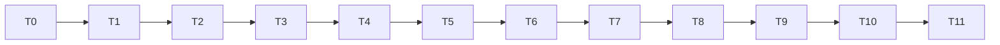

# Implementation Plan: graveyard-cli

## Overview

Implements `.kiro/specs/graveyard-cli/requirements.md` per `.kiro/specs/graveyard-cli/design.md`: the `graveyard autopsy` command in `backend/cli/`, in project mode (`PATH`, optionally `--sbom`) and single-package mode (`--purl`), with a terminal table, a versioned JSON report, `--fail-on` exit codes, and a hand-built fixture project that runs end to end against the recorded cassette. Each implementation task includes its own tests as sub-tasks. T0 is the packaging change (the only edit outside `backend/cli/`). T3 (fixture project) and T4 (test support: stub Syft and the cassette-derived transport) are their own tasks, and the last task is the gate.

Run every Python tool from `backend/` with `uv run` (`tech.md`). No task adds a dependency. No task edits `core/`, `sources/`, the PRD or steering; the documentation follow-ups are listed in T11.

## Task Dependency Graph

T2 needs only T1. T3 needs `core.graph` and `core.scoring`, not the CLI code, so it also validates the fixture arithmetic of design §9.2 before any pipeline code exists. T5 needs the stub from T4. T7 needs T2, T5 and T6. T9 and T10 need everything before them. The chain is kept linear so each task starts from a green suite.

## Tasks

- [x] T0 — Packaging and scaffold (D2; CLI-DEP-1, CLI-DEP-2, CLI-DEP-3, CLI-DEP-6; CLI-TEST-12)
  - [x] T0.1 — Baseline. From `backend/`: `git status --short pyproject.toml uv.lock` is empty, and `uv run ruff check`, `uv run ruff format --check`, `uv run mypy --strict core sources` and `uv run pytest -q` are green. **If anything is red or `pyproject.toml` / `uv.lock` have uncommitted changes, stop and ask.**
  - [x] T0.2 — Look up the newest `hatchling`: `curl -s https://pypi.org/pypi/hatchling/json | python3 -c 'import json,sys; print(json.load(sys.stdin)["info"]["version"])'`. The design records 1.33.0 (11 Nov 2026). Use the version printed now as an exact pin. If it is not 1.33.0, report the difference and use the newer one only if `requires-python` still admits 3.12.
  - [x] T0.3 — Create the scaffold so the build and the console script have something to resolve: `backend/cli/__init__.py` (module docstring only: purpose, D1 two modes, D7 environment, D9 no model logic, D17 no network of its own), `backend/cli/__main__.py` (a placeholder `def main() -> None` that writes `graveyard (scaffold)\n` with `sys.stdout.write`, and `if __name__ == "__main__": main()`), `backend/cli/tests/__init__.py` (empty, matching `core/scoring/tests/__init__.py`).
  - [x] T0.4 — Edit `backend/pyproject.toml` only as follows, leaving every other table unchanged: add `[build-system]` (`requires = ["hatchling==<T0.2 version>"]`, `build-backend = "hatchling.build"`), `[project.scripts]` (`graveyard = "cli.__main__:main"`), `[tool.hatch.build.targets.wheel]` (`packages = ["core", "sources", "cli"]`, `exclude = ["**/tests/**", "**/__pycache__/**"]`); change `[tool.uv] package` from `false` to `true` and update its comment (`# The backend is installed as a package so that the graveyard console script exists; core/, sources/ and cli/ are the wheel's top-level packages.`); add `"cli"` to `[tool.pytest.ini_options] testpaths`, `[tool.mypy] files` and `[tool.ruff.lint.isort] known-first-party`. Then run `uv lock` and `uv sync` from `backend/`.
  - [x] T0.5 — Review the lock change: `git diff --stat pyproject.toml uv.lock` and `git diff uv.lock`. Expected: the project package `graveyard-backend` changes from `source = { virtual = "." }` to `source = { editable = "." }`, and no third-party package is added, removed or re-versioned (`hatchling` and its build dependencies are build requirements and do not appear in the lock). **If any runtime or dev package changes version, or a package is added, stop and ask.** Report the diff stat.
  - [x] T0.6 — Verify the environment: `uv run graveyard` and `uv run python -m cli` both print `graveyard (scaffold)` and exit 0; `uv run python -c "import core, sources, cli"` works; `uv run ruff check`, `uv run ruff format --check`, `uv run mypy --strict core sources cli` and `uv run pytest -q` are green with the existing suites still collected.
  - [x] T0.7 — Wheel check (CLI-TEST-12, manual once): `uv build --wheel --out-dir "$(mktemp -d)"` and `unzip -l` the result. It must list `cli/__main__.py`, `core/scoring/weights.v1.yaml`, modules of `core/` and `sources/`, and no path containing `/tests/`. Delete the temporary directory. `git status --short` must show no `dist/` directory in the repo. Record the listing summary in `docs/KIRO_JOURNAL.md`. **If `weights.v1.yaml` is missing from the wheel, fix the hatch config before going on.**
  - [x] T0.8 — Write `cli/tests/test_packaging.py` (CLI-DEP-6): parse `pyproject.toml` with `tomllib` (path via `Path(__file__).resolve().parents[2] / "pyproject.toml"`) and assert the `hatchling` requirement matches `^hatchling==\d+(\.\d+)*$`, `build-backend` is `hatchling.build`, `tool.uv.package is True`, `project.scripts["graveyard"] == "cli.__main__:main"`, and the wheel `packages` list contains `core`, `sources` and `cli`. Include a test that the two bad cases (a `>=` pin, `package = false`) are rejected by the same checker function, so the guard cannot pass vacuously.
  - [x] T0.9 — `uv run pytest -q` is green.

- [x] T1 — `text.py`, `errors.py`, `env.py`, `purls.py`, `args.py`, `conftest.py`, guards + tests (CLI-CMD-1…6, CLI-PURL-1…3, CLI-OUT-8, CLI-DEP-5, CLI-TEST-1)
  - [x] T1.1 — Implement `text.py`: `sanitise(text: str) -> str` per design §6.3 (category `Cc` and U+202A–U+202E, U+2066–U+2069 become U+FFFD; other format characters kept).
  - [x] T1.2 — Implement `errors.py`: `ExitCode(IntEnum)` with `OK=0`, `GATE_TRIPPED=1`, `USAGE=2`, `INPUT=3`, `INTERNAL=4`; `EXIT_CODE_TABLE` (the five lines of CLI-GATE-4 as text, built from `ExitCode` and a description mapping, used by `--help`, the README test and the docs); `CliError(message)` (code `INPUT`), `UsageError(message)` (code `USAGE`), `ExitRequest(code)`.
  - [x] T1.3 — Implement `env.py`: frozen `CliEnvironment` (`token`, `token_rejected`, `contact`, `syft_env`, `width`) and `DEFAULT_CONTACT = "https://github.com/olajaido/graveyard"`. No `os` import.
  - [x] T1.4 — Implement `purls.py`: `validate_purls(raw) -> tuple[str, ...]` per design §5.2a (`parse_purl`, version required, de-duplicate by `package_key` keeping the smallest canonical purl, sorted result; messages use position and `sanitise(text)[:100]`; the `core.purl` error text is never echoed).
  - [x] T1.5 — Implement `args.py`: `Options` (design §4), `build_parser()` (an `argparse.ArgumentParser` subclass whose `error()` raises `UsageError` and whose `exit()` raises `ExitRequest`, so nothing calls `sys.exit` or writes to the process streams), `parse_fail_on(text)` (CLI-CMD-3), and `parse_args(argv, *, today: date) -> Options`: `PATH` is `nargs="?"`, `--purl` is `action="append"`, exactly one of `PATH` or `--purl` (CLI-PURL-1), `--sbom` with `--purl` or `PATH` missing → `UsageError`, `PATH` must be an existing directory (resolved), `--sbom` file must exist, `--as-of` ISO date not after `today` (CLI-CMD-4), `--syft-timeout` positive and finite, `--version` prints `graveyard <importlib.metadata.version("graveyard-backend")>`, `--help` epilog is `EXIT_CODE_TABLE`. There is no option that takes a token (CLI-CMD-6). `--syft` and `--syft-timeout` are accepted in `--purl` mode and have no effect.
  - [x] T1.6 — `cli/tests/conftest.py` (CLI-TEST-1): an autouse fixture that replaces `socket.socket.connect` and `socket.create_connection` with functions raising `AssertionError("network access in a cli test")`, restored after each test. A test in `test_conftest.py` proves it: `httpx.Client().get("https://example.org")` raises.
  - [x] T1.7 — `cli/tests/test_guards.py` (CLI-DEP-5, modelled on `sources/tests/test_silence.py`): one checker function over `ast`, parametrised by `glob("cli/*.py")` (the module list is read at collection time, so new modules are covered), with the five rules of CLI-DEP-5 and a bad-sample test for each rule, plus a test that the glob finds at least `__init__.py`, `__main__.py`, `args.py`. Rule for `__main__.py`: it may use `os.environ`; every other file may not. `core` and `sources` importing `cli` is checked by a second test over their globs (CLI-DEP-4).
  - [x] T1.8 — Unit tests. `test_text.py`: each forbidden class replaced (NUL, ESC, `\x7f`, C1 `\x85`, U+202E, U+2066), kept characters (letters, `é`, a zero-width joiner inside an emoji sequence, tab is `Cc` and replaced). `test_errors.py`: codes are 0…4, `EXIT_CODE_TABLE` has one line per code. `test_purls.py`: valid npm, scoped npm, PyPI with normalisation; invalid text, `pkg:maven/…`, no version, empty string, a 10,000-character string, a string with ESC (message shows U+FFFD and at most 100 characters); duplicates (`pkg:npm/Request@2.88.2` and `pkg:npm/request@2.88.2` collapse to one); result sorted and independent of argument order. `test_args.py`: every accepted form of CLI-CMD-1; each rejected form of CLI-CMD-3/4/5 and CLI-PURL-1 returns `UsageError` with a one-line message; `--fail-on Dead, CURSED` is accepted; `--fail-on ""`, `dead,` and `dead,zombie` are rejected; `--as-of` with a datetime, a future date and `2026-13-01` is rejected; no parser action takes a token (introspect `parser._actions` destinations for `token`, `secret`, `password`); `--help` and `--version` raise `ExitRequest(0)` and the help text contains `EXIT_CODE_TABLE`.
  - [x] T1.9 — Property tests (`@pytest.mark.property`) in `test_properties_text.py`: `test_sanitise_idempotent`, `test_sanitise_removes_forbidden` (any text, arbitrary Unicode including surrogate-free categories), `test_sanitise_length_preserving` (same number of characters); in `test_properties_purls.py`: `test_validate_purls_order_independent`, `test_validate_purls_idempotent` (validating the output gives the output), `test_validate_purls_rejects_or_returns_canonical` (for generated text, either `UsageError` or every result equals `format_purl(parse_purl(x))`).
  - [x] T1.10 — `uv run pytest -q cli` is green and `uv run mypy --strict core sources cli` is clean.

- [x] T2 — `discover.py`, `lockfiles.py` + tests (CLI-DISC-1…3, CLI-SCOPE-1…5; D3, D6)
  - [x] T2.1 — Implement `model.py` with `ServiceDir` and `CliWarning` only for now (the rest of the module is added in T6). `CliWarning.code` is validated against the closed set `LOCKFILE_UNREADABLE`, `GITHUB_TOKEN_MISSING`, `GITHUB_TOKEN_INVALID`; `detail` is cut to 200 characters and passed through `sanitise`.
  - [x] T2.2 — Implement `discover.py`: `find_services(root: Path) -> tuple[ServiceDir, ...]` per CLI-DISC-1…3 (`os.walk(followlinks=False)`, sorted `dirnames` and `filenames`, skip `node_modules`, `__pycache__`, `venv`, `site-packages` and dot-directories, recognise `package-lock.json`, `uv.lock`, `poetry.lock` and `requirements*.txt` as regular non-symlink files, POSIX relative paths with `"."` for the root). Raise `CliError` for more than `DEFAULT_MAX_SERVICES` (import the constant from `core.graph.model`), for no services (message names the lockfiles and `--sbom`), and for a service path containing any of `* ? [ ] { }`.
  - [x] T2.3 — Implement `lockfiles.py`: `read_scopes(service: ServiceDir) -> tuple[ScopeResult | None, tuple[CliWarning, ...], tuple[tuple[str, bool], ...]]` (the last value is `(file name, used)` for the JSON `input.lockfiles`), reading each file as UTF-8 with the parser's size limit in mind, calling the parser of CLI-SCOPE-1, turning `OSError`, `UnicodeDecodeError` and `ValueError` into a `LOCKFILE_UNREADABLE` warning (CLI-SCOPE-2), and merging with `merge_scopes(results)` (design §5.5: runtime wins, both maps `MappingProxyType(dict(sorted(...)))`, warnings `tuple(sorted(set(...)))` by `(service or "", code, detail, subjects)`; no import from `core.graph` beyond `__all__` names). A file larger than `MAX_LOCKFILE_BYTES = 40_000_000` (four bytes per character of the parser's 10,000,000-character limit; a constant local to `lockfiles.py`) is not read and gives the same warning. Returns `None` scopes when no file was usable.
  - [x] T2.4 — Unit tests. `test_discover.py` (temp trees built with `tmp_path`): root only; two services; a nested service under another; `node_modules/x/package-lock.json` and `.venv/uv.lock` and `.git/…` ignored; a symlinked lockfile ignored; a symlinked directory not followed; `requirements.txt` and `requirements-dev.txt` recognised, `requirements.txt.bak` and `my-requirements.txt` not; sorted output; the root is `"."`; 51 services → `CliError`; a directory named `a[1]` → `CliError`; an empty tree → `CliError` that mentions `--sbom`. `test_lockfiles.py` (fixtures read from `core/graph/tests/fixtures/` through `Path(__file__).resolve().parents[2] / "core" / "graph" / "tests" / "fixtures"`): each of the four parsers is called for the right file name and `used` is true; `lock_npm_dev.json` gives `is-number` dev; an invalid TOML `uv.lock`, a non-UTF-8 `package-lock.json`, an oversize file (`MAX_LOCKFILE_CHARS + 1` characters, and one above `MAX_LOCKFILE_BYTES` created sparsely with `truncate`) and a JSON v1 lockfile each give one `LOCKFILE_UNREADABLE` warning naming the file and no exception, and `used` false; a directory with a good `uv.lock` and a bad `requirements.txt` still returns the uv scopes; a directory whose files are all unusable returns `None`; merge cases for runtime-wins on a key present in both with `runtime` and `dev`.
  - [x] T2.5 — Property tests in `test_properties_lockfiles.py`: `test_merge_scopes_commutative`, `test_merge_scopes_associative`, `test_merge_scopes_idempotent`, `test_merge_scopes_runtime_wins` (generated `ScopeResult` values with keys from a small pool so collisions are frequent), `test_merge_scopes_single_input_unchanged`.
  - [x] T2.6 — `uv run pytest -q cli` is green; `mypy --strict` clean.

- [x] T3 — Fixture project: the nine anchors in two services (CLI-TEST-2; design §9.1, §9.2)
  - [x] T3.1 — Read `core/scoring/tests/fixtures/anchors/*.json` and write down the nine exact purls (`rec.anchor_purl(name)`). The fixture files must use exactly these versions.
  - [x] T3.2 — Create `cli/tests/fixtures/anchors-project/web/package-lock.json` (`lockfileVersion` 3). `packages[""]`: `name` `anchors-web`, `version` `0.0.1`, `dependencies` `express`, `left-pad`, `moment`; `devDependencies` `request`. Entries `node_modules/express` (4.17.1, `dependencies: {"node-uuid": "1.4.8"}`), `node_modules/left-pad`, `node_modules/moment`, `node_modules/node-uuid` (no flag), `node_modules/request` (2.88.2, `dev: true`, `dependencies: {"uuid": "3.4.0"}`), `node_modules/uuid` (3.4.0, `dev: true`). No `resolved` or `integrity` fields (none are fabricated).
  - [x] T3.3 — Create `…/anchors-project/api/uv.lock` (`version = 1`, `revision = 3`): project package `anchors-api` 0.0.1 with `source = { virtual = "." }`, `dependencies` `pycrypto`, `six`, and `[package.dev-dependencies]` `dev = [{ name = "nose" }]`; packages `pycrypto` 2.6.1, `six` 1.17.0, `nose` 1.3.7 with no `sdist`, `wheels` or hashes. Use `core/graph/tests/fixtures/lock_uv_edge.toml` as the layout model.
  - [x] T3.4 — Create `cli/tests/fixtures/sboms/web.cdx.json`, `api.cdx.json` and `all.cdx.json`: CycloneDX `specVersion` `1.7`, Syft-shaped, modelled on `core/graph/tests/fixtures/syft_py.cdx.json` (a project component with a `?package-id=<16 hex>` bom-ref, a `file` component for the lockfile, library components with `purl` and `bom-ref = purl + "?package-id=…"`, a `dependencies` array, `metadata.component.name` a relative placeholder such as `fixtures/web`). `web`: root → `express`, `left-pad`, `moment`, `request`; `express` → `node-uuid`; `request` → `uuid`. `api`: root → `pycrypto`, `six`, `nose`. `all`: one BOM with both ecosystems and a root that depends on all six direct packages plus the same two inner edges. No absolute path, no `/Users/`, no `/home/`.
  - [x] T3.5 — Create `cli/tests/fixtures/anchors-project/README.md` stating: every file is hand-written; names and versions are real and equal to the anchor fixtures; the relationships (`express` → `node-uuid`, `request` → `uuid`, the dev/runtime split) are chosen to exercise exposure and are not the packages' real dependencies; nothing was installed or generated by a tool; the SBOMs are shaped like Syft 1.56.0 output but were not produced by it (T11 compares them with a real run).
  - [x] T3.6 — `cli/tests/test_fixture_project.py` (integrity and self-check, no CLI code): no fixture contains `/Users/`, `/home/` or a drive letter; every `dependsOn` and `dependencies[].ref` is a component bom-ref; `build_graph([ServiceInput("web", web_bom, parse_package_lock(...)), ServiceInput("api", api_bom, parse_uv_lock(...))])` has exactly the nine anchor purls (`rec.anchor_purl`), an empty warning list (assert it exactly), and the `path_infos` and `services_affected` of each node equal design §9.2 (pycrypto `{runtime,direct}`; left-pad `{runtime,direct}`; request `{dev,direct}`; node-uuid `{runtime,transitive}`; nose `{dev,direct}`; six `{runtime,direct}`; uuid `{dev,transitive}`; moment, express `{runtime,direct}`; each `services_affected == 1`); `build_graph` over the `all.cdx.json` BOM with merged scopes gives the same nine purls. Then the offline arithmetic check: build `Signals` with `signals_from_fixture(rec.anchor_fixture(name))` and `dataclasses.replace(paths=…, services_affected=…)` from `exposure_inputs(node)`, `score_package` each, and assert `[r.purl for r in sort_results(results)]` equals the literal order of design §9.2 (`pycrypto, left-pad, request, node-uuid, nose, six, uuid, moment, express`) and differs from the order of the same signals scored with `paths=None`.
  - [x] T3.7 — **If T3.6's ordering or any `path_infos` disagrees with design §9.2, stop and report the difference.** Do not edit the literal order to make the test pass; either the fixture or the design table is wrong, and the user decides.

- [x] T4 — Test support: stub Syft, cassette-derived transport, builders (CLI-TEST-5, CLI-TEST-11 support; design §9.3, §9.4)
  - [x] T4.1 — Create `cli/tests/support.py` with `make_stub_syft(tmp_path, *, version="1.56.0", mode="ok", sbom_dir=<fixtures/sboms>) -> StubSyft` (a dataclass with `path`, `log_path` and `calls() -> list[dict]`). The script is written to `tmp_path`, has the shebang `#!<sys.executable>`, mode `0o755`, and literals baked in for the SBOM directory, log path, version and mode. On `["--version"]` it prints `syft <version>`. Otherwise it appends `{"argv": sys.argv[1:], "env_keys": sorted(os.environ)}` as one JSON line to the log, then by mode: `ok` prints `sboms/<last segment of the dir: argument>.cdx.json`; `fail` writes a sentinel string to stderr and exits 2; `sleep` sleeps 30 s; `garbage` prints `not json`; `array` prints `[]`; `big` prints more than 1 MiB of valid JSON.
  - [x] T4.2 — In the same file: `subset_replay_transport(cassette) -> (httpx.MockTransport, ReplayLog)` per design §9.4 (recorded answers first; OSV `querybatch` answered per query from the recorded batch; single-name npm downloads from the recorded bulk entry; everything else logged in `log.unmatched` and failed with `httpx.ConnectError`). It reads only the recorded JSON, not the parsers under test.
  - [x] T4.3 — In the same file: `make_source_result(signals, *, warnings=()) -> SourceResult` (all 11 `EVIDENCE_KEYS` present with `Evidence(None, None, None)`), `FakeClock` re-export from `sources.tests.clock` for the tests of this package, and `shape(value) -> object` (the recursive key/type skeleton used by the shape test of T9: objects map each key to its shape, arrays to the shape of the first element or `"empty"`, scalars to their JSON type name).
  - [x] T4.4 — `cli/tests/test_support.py`: stub `--version` output; `ok` mode prints a JSON object whose `components` include the anchors of that directory; the log records the argv and `env_keys` of a call; `fail`, `sleep`, `garbage`, `array`, `big` behave as described (the sleep test calls the script with `subprocess.run(..., timeout=0.5)` and expects `TimeoutExpired`); `subset_replay_transport` answers an OSV query for `request@2.88.2` with exactly the recorded `results[4]`, answers a two-query body in order, answers `…/last-week/request` with `bulk["request"]`, logs an unknown OSV query and an unknown npm name as unmatched, and passes recorded URLs through unchanged; the derived OSV answer is also accepted by the real `core.sources.parse.osv.parse_query_results` (shape check only).
  - [x] T4.5 — `uv run pytest -q cli` is green; `mypy --strict` clean. Confirm `test_guards.py` still passes (the support module is under `tests/` and outside the `cli/*.py` glob).

- [x] T5 — `syft.py`, `sbom.py` + tests (CLI-SYFT-1…4, CLI-SBOM-1…2, CLI-ENV-6, CLI-SEC-4, CLI-TEST-5, CLI-TEST-8)
  - [x] T5.1 — Implement `syft.py` per design §5.4: `SYFT_VERSION = "1.56.0"`, `MAX_SBOM_BYTES = 32 * 1024 * 1024`, `check_version(exe, syft_env)` (runs `[exe, "--version"]` with `shell=False`, a 10 s timeout, the cleared environment; requires `syft 1.56.0`; shows a found version only if it matches `[0-9A-Za-z.+-]{1,40}`), `nested_relative_to(service, nested)`, and `run_syft(exe, service, nested, timeout, syft_env) -> dict` with the exact argv of CLI-SYFT-2. Every failure is a `CliError` with a fixed message naming the service (sanitised); stderr is never read into a message. This is the only module that imports `subprocess`.
  - [x] T5.2 — Implement `sbom.py`: `load_sbom(path: Path) -> dict` per CLI-SBOM-1 (size check with `stat` before reading, UTF-8 `json.loads`, `RecursionError` and `ValueError` → `CliError`, non-object → `CliError`).
  - [x] T5.3 — Unit tests for `syft.py` with the stub (CLI-TEST-5): version accepted; a different version (`1.55.0`) and an unparsable `--version` output rejected, and the found version is echoed only when well-formed (a version line containing a space and an ESC is not echoed); the recorded argv equals `[f"dir:{dir}", "-q", "-o", "cyclonedx-json"]` for a service without nested services, and ends with `["--exclude", "./sub/**"]` for a parent of `sub`, and for the root service with two other services holds two `--exclude` pairs in sorted order; a service directory named `a b;c` (spaces and a semicolon, safe because there is no shell) is passed as one argv element; the environment is cleared: the test passes `syft_env = {PATH, HOME, SYFT_CHECK_FOR_APP_UPDATE}`, sets a decoy `GITHUB_TOKEN` in the pytest process with `monkeypatch.setenv`, and asserts the stub's `env_keys` do not contain `GITHUB_TOKEN` and are a subset of the passed keys plus the two the interpreter may add (`LC_CTYPE`, `__PYVENV_LAUNCHER__`); `fail` → `CliError` whose message does not contain the stderr sentinel; `sleep` with `timeout=0.5` → `CliError`; `garbage` and `array` → `CliError`; `big` with `MAX_SBOM_BYTES` patched to 1,024 → `CliError`; a nonexistent executable and a directory as executable → `CliError`; a `--syft` path is executed as given and `shutil.which` is not consulted when it is set (patch `shutil.which` to raise).
  - [x] T5.4 — Unit tests for `sbom.py`: a valid file returns the dict; a missing file, a directory, a file above a patched cap, invalid JSON, a JSON array, and 10,000 nested arrays each give `CliError`.
  - [x] T5.5 — `test_syft_pin.py` (CLI-TEST-8): `SYFT_VERSION == "1.56.0"` and `docs/SPIKES.md` (path from `__file__`) contains the text `Syft v1.56.0`.
  - [x] T5.6 — `uv run pytest -q cli` is green; `mypy --strict` clean; `test_guards.py` confirms `subprocess` is imported only by `syft.py` and no `shell=True` exists.

- [x] T6 — `model.py` (rest), `why.py`, `gate.py`, `report.py`, `render.py` + tests (CLI-OUT-1…10, CLI-JSON-1…9 shape, CLI-GATE-1…2; D13, D16)
  - [x] T6.1 — Complete `model.py` with `Row` and `Report` (design §4; `Row.node` is `GraphNode | None`, `Report.input_mode` is `"syft" | "sbom" | "purl"`).
  - [x] T6.2 — Implement `gate.py`: `matches(scoring, fail_on) -> bool` and `evaluate(rows, fail_on) -> tuple[str, ...]` (purls in rank order) per CLI-GATE-1.
  - [x] T6.3 — Implement `why.py`: `why(scoring, signals) -> str` per design §6.1 (contribution ids `r2…r8`, ties by id ascending, a missing raw value falls through, singular and plural forms). No number is recomputed; all come from `signals`.
  - [x] T6.4 — Implement `report.py`: `report_to_dict(report) -> dict` with the key order of design §7 (use `graph_to_dict`-shaped values for `path_infos` and `example_paths`; `fetched_at` via `isoformat()`; `--purl` rows get `manifests/path_infos/example_paths = []` and `direct/scope/services_affected = None`); `summary` with all five state keys in `BaseState` order, warning counts, `degraded` per CLI-JSON-6, `SourceStats` as plain dicts; no absolute path and no environment value can reach it (all inputs are relative or parsed).
  - [x] T6.5 — Implement `render.py`: `render_table(report, width, show_all) -> str` per CLI-OUT-1…10 and design §8 (state label with ` · Cursed` / ` · Wounded`, `<ecosystem> <name>@<version>` from `parse_purl`, exposure cell from the first `path_infos` member or `assumed`, priority to one decimal or `—`, `sanitise` on every cell before measuring, `WHY` shortened with `…` first, width at least 60, footer with counts and the number of hidden rows) and `render_stderr_notes(report) -> str` (token-missing warning once, gate message with up to 10 purls, partial-evidence message, `LOCKFILE_UNREADABLE` lines).
  - [x] T6.6 — Unit tests. `test_why.py`: the nine anchors scored from `signals_from_fixture(rec.anchor_fixture(name))`, each `why` compared with a literal derived by hand from the raw fixture values (for example `pycrypto` → `last release 2014-06; 4 advisories with no fix`, `nose` → `last release 2015-06`, `request` → `declared dead; 1 advisory with no fix`, `six` → `quiet but healthy`, `express` → `fix available`); Unknown → `no scored signals`; Alive without overlay → `—`; S1b alone → `upgrade advised`; one advisory is singular; tie between contributions breaks by id. `test_gate.py`: the truth table of CLI-GATE-1 over hand-built `ScoringResult` values (Dead declared, Dead by score, Ailing, Alive+cursed, Unknown, Resting); empty `fail_on` never matches. `test_report.py`: a hand-built project-mode report and a `--purl` report; key order of the top level and of a package; five state keys; nulls in `--purl` mode; `json.dumps(allow_nan=False)` succeeds; the dict contains no string starting with `/` or containing `/Users/`; `exit_code` equals `report.exit_code`. `test_render.py`: a golden table for hand-built rows of the nine anchors (default and `--all`), column order and alignment, hidden-row count in the footer, `—` priority for Unknown, `assumed` exposure, services suffix for `services_affected` 2, a hostile package name (`pkg:npm/\x1b[31mevil@1.0.0` built directly into a `ScoringResult`) shows U+FFFD and no ESC byte in the output, `width=60` truncates `WHY` with `…` and never splits a row, output is identical on two calls.
  - [x] T6.7 — Property tests: `test_why_total_and_clean` (generated valid `Signals` from `core/scoring/tests/strategies.py` scored with `score_package`: `why` never raises, is non-empty, and `sanitise(why) == why`); `test_gate_monotone` (adding a class to `fail_on` never turns a tripped gate into an untripped one); `test_gate_subset_of_rows` (matches ⊆ rows); `test_report_dict_json_safe` (generated rows serialise with `allow_nan=False` and all rows share the same key set); `test_render_has_no_control_chars` (generated names and warnings).
  - [x] T6.8 — `uv run pytest -q cli` is green; `mypy --strict` clean.

- [x] T7 — `pipeline.py` + tests (CLI-PIPE-1…7, CLI-PURL-4, CLI-SCOPE-2 integration; D8, D19)
  - [x] T7.1 — Implement `collect_inputs(opts, env) -> Inputs` (design §5.3): Syft mode (discover, locate the executable with `opts.syft or shutil.which("syft")`, `check_version` once, then `run_syft` and `read_scopes` per service, nested exclusion) and `--sbom` mode (one service `"."`, scopes from the lockfiles directly in `PATH`). `Inputs` carries `services`, `mode`, `syft_version`, `lockfiles`, `cli_warnings`.
  - [x] T7.2 — Implement `autopsy_requests(requests, env, transport, clock, *, config=None)` (the single coroutine, one `SourceSession`, chunks of `Limits.max_packages_per_call`, `merge_stats`) and `merge_stats` (sum of the counters of `SourceStats`). `config=None` builds `SourcesConfig.default(contact=env.contact or DEFAULT_CONTACT)` and falls back to `DEFAULT_CONTACT` when `SourcesConfig` rejects the contact (CLI-ENV-5).
  - [x] T7.3 — Implement `rank(nodes, results, stats, graph, inputs, opts, as_of) -> Report` (design §5.2): item errors recorded and skipped; project mode sets `paths` and `services_affected` from `exposure_inputs(node)` with `dataclasses.replace`; `--purl` mode leaves them unset; `score_package`; `sort_results`; rows with `rank` and `why`; `matches` and `exit_code`; `CliWarning` values for a missing or rejected token (`GITHUB_TOKEN_MISSING`, `GITHUB_TOKEN_INVALID`); `degraded` inputs. Implement `analyse(opts, env, transport, clock) -> Report` (design §5.2, `ValueError` from `build_graph` → `CliError`).
  - [x] T7.4 — Unit tests with the stub Syft and `replay_transport` where the full anchor set is needed, and with hand-built `SourceResult` values (`make_source_result`) otherwise. `test_pipeline.py`: `rank` sets `paths` and `services_affected` (a node with `path_infos=(PathInfo(False, True),)` gets exposure 0.2 and `exposure_assumed` false; a node of `None` gets assumed); an item error is reported and not ranked and `exit_code` stays `OK`; ties resolve through `sort_results` (two equal-priority packages in purl order); `matches` follow `--fail-on`; `merge_stats` sums per-source counters and rejects nothing; chunking: with a `SourcesConfig` whose `Limits(max_packages_per_call=2)` and a counting `httpx.MockTransport` that fails every request (no cassette; sources never raise), nine requests make five `collect` calls in one session (five OSV POSTs; one session means the limiter and cache objects are created once) and the nine results keep input order; `as_of` defaults to the `FakeClock` date and `--as-of` overrides it; `collect_inputs` in Syft mode over `fixtures/anchors-project` with the stub returns two services, passes `--exclude` only when services nest (build a temp tree with `web/` and `web/sub/`), checks the version once for two services (the stub log has one `--version` line), reads scopes from both lockfiles, and raises `CliError` for a failing stub on the second service without running a third; an unreadable lockfile in one service produces a `LOCKFILE_UNREADABLE` warning and the run continues; `--sbom` mode uses `all.cdx.json`, one service `"."`, and scopes only from lockfiles directly in `PATH` (none in the fixture root → the graph's `SCOPE_ASSUMED` warning); `--purl` mode never calls `collect_inputs` and never touches Syft (pass `--syft /nonexistent`).
  - [x] T7.5 — `uv run pytest -q cli` is green; `mypy --strict` clean.

- [x] T8 — `app.py`, `__main__.py` + tests (CLI-CMD-2, CLI-PIPE-8, CLI-JSON-1, CLI-GATE-3…5, CLI-ENV-1…5, D7, D18)
  - [x] T8.1 — Implement `app.run(argv, *, env, out, err, transport=None, clock=None) -> int` per design §5.1: resolve the clock once, `parse_args(argv, today=…)`, `analyse`, write the table to `out`, the notes to `err`, then the JSON file (UTF-8, `indent=2`, `allow_nan=False`, trailing newline; an `OSError` → `CliError`), and return the exit code. Mapping: `ExitRequest` → its code (`--help` and `--version` text goes to `out`), `UsageError` → message and usage line on `err`, 2; `CliError` → message on `err`, 3; any other `Exception` → `internal error: <ExceptionType>` on `err`, 4 (never the exception text). `KeyboardInterrupt` and `SystemExit` are not caught. The JSON is not written when the run ends with 2, 3 or 4.
  - [x] T8.2 — Replace the T0 placeholder in `__main__.py`: `_environment(environ: Mapping[str, str], width: int) -> CliEnvironment` (token wrapped in `SecretToken`, an invalid token → `token=None, token_rejected=True`, `GRAVEYARD_CONTACT` or `None`, `syft_env` from the allow-list of CLI-ENV-1 plus `SYFT_CHECK_FOR_APP_UPDATE=false`, `GITHUB_TOKEN` never included) and `main() -> None` which calls `_environment(os.environ, shutil.get_terminal_size().columns)` and `sys.exit(run(sys.argv[1:], env=…, out=sys.stdout, err=sys.stderr))`. This is the only file with `os.environ`.
  - [x] T8.3 — Unit tests. `test_env.py` (CLI-ENV-1…6): `_environment` with a plain dict — valid token, blank token, token with a space, a 300-character token, absent token; the `repr` of the result and of the `SecretToken` never contains the token text; `GRAVEYARD_CONTACT` set, blank and absent; `syft_env` contains only allow-listed keys and the fixed `SYFT_CHECK_FOR_APP_UPDATE`; width is passed through. `test_app.py`: `--version` and `--help` return 0 and write to `out`; a usage error returns 2, writes one line plus usage to `err`, writes nothing to `out` and no JSON file; a failing Syft returns 3; `--json` into a nonexistent directory returns 3 after the table was printed; a monkeypatched `analyse` raising `RuntimeError("do-not-print-this")` returns 4 and `err` contains `internal error: RuntimeError` but not `do-not-print-this`; `KeyboardInterrupt` propagates; the JSON file is written when the gate trips (exit 1) and has `summary.exit_code == 1` (this part is exercised end to end in T9). `test_entrypoint.py` (CLI-DEP-3): `subprocess.run([sys.executable, "-m", "cli", "--version"])` exits 0 and prints the line `graveyard <version>`, equal to the output of `app.run(["--version"], …)`; the same through `uv run graveyard --version` is checked by hand in T0.6 and again in T11.
  - [x] T8.4 — `uv run pytest -q cli` is green; `mypy --strict` clean; `test_guards.py` confirms `os.environ` appears only in `__main__.py`.

- [x] T9 — End-to-end tests, project mode (CLI-TEST-3, CLI-TEST-4, CLI-TEST-7, CLI-SEC-5, CLI-JSON-8, CLI-JSON-9)
  - [x] T9.1 — `cli/tests/test_e2e_project.py` with a module-level helper that calls `app.run(["autopsy", <fixtures/anchors-project>, "--syft", <stub>, "--as-of", "2026-11-03", "--json", <tmp>/report.json, "--all", *extra], env=<CliEnvironment with SecretToken("e2e-sentinel-4f1c9a")>, out=<StringIO>, err=<StringIO>, transport=<replay_transport(rec.cassette())>, clock=FakeClock(2026-11-10T09:00Z))` and returns `(code, out, err, report_dict, log)`. Every test asserts `log.unmatched == []` (CLI-TEST-1) and that the stub log shows two `dir:` calls.
  - [x] T9.2 — Main scenario (CLI-TEST-3): exit 0; the nine states, dead reasons and overlays equal the MM-ANC table written out as a literal in the test (do not read it from the scoring code); the rank order equals the literal `pycrypto, left-pad, request, node-uuid, nose, six, uuid, moment, express` and differs from the exposure-assumed order; for at least four packages `services_affected`, `direct` and `scope` equal the §9.2 table; `exposure_assumed` is false for all nine; the table (`out`) and `report["packages"]` list the same purls in the same order; `input.mode == "syft"`, `input.syft_version == "1.56.0"`, `input.services == ["api", "web"]`, both lockfiles `used`; `summary.states` counts match; every `evidence` has the 11 keys; no `/Users/` or other absolute path anywhere in the JSON text; the token sentinel appears in none of `out`, `err` or the JSON text (CLI-SEC-5).
  - [x] T9.3 — Gate matrix (CLI-TEST-4): with the same setup, `--fail-on dead` → 1, `--fail-on cursed` → 1, `--fail-on ailing` → 0, `--fail-on ailing,cursed` → 1, no `--fail-on` → 0; on exit 1 the JSON is written, `summary.gate.tripped` is true, `matches` lists the five Dead packages for `dead` in rank order, `summary.exit_code` is 1, and `err` names the count and the first purls (at most 10).
  - [x] T9.4 — Variants: (a) `--sbom <sboms/all.cdx.json>` with `PATH` the project root (which has no lockfile directly in it) → exit 0, `input.mode == "sbom"`, `input.services == ["."]`, the same nine states, a `SCOPE_ASSUMED` graph warning in the JSON, all exposure paths runtime; (b) no token (`token=None`) with the replay transport → exit 0, `GITHUB_TOKEN_MISSING` in `warnings` and on `err`, `GITHUB_DISABLED` source warnings on the packages that have a repo, `summary.degraded` true, at least one package with `confidence` lower than in T9.2, and `log.unmatched == []` because no GitHub request is sent; (c) a `shutil.copytree` copy of the project with `web/package-lock.json` replaced by invalid JSON → exit 0, one `LOCKFILE_UNREADABLE` warning (JSON and `err`), `web` packages assumed runtime with a `SCOPE_ASSUMED` warning; (d) a stub in `fail` mode → exit 3, `out` empty, no JSON file; (e) an invalid `--fail-on` → exit 2, nothing run (the stub log does not exist).
  - [x] T9.5 — Determinism and shape (CLI-TEST-7, CLI-JSON-8, CLI-JSON-9): two runs of T9.2 give byte-identical `out` and JSON text. Generate `cli/tests/fixtures/report_v1_shape.json` from the T9.2 report with `support.shape`, widen the fields that are null in `--purl` mode (`services_affected`, `direct`, `scope`) to their `[type, "null"]` form by hand, review it, and commit it. `test_report_shape.py` compares the project-mode report to it (equal key sets; each actual type in the allowed list). The `--purl` half of the comparison is added in T10.5.
  - [x] T9.6 — `uv run pytest -q cli` is green. **If a state, an exposure figure or the order differs from the literals, stop and report; do not change a literal to match a run until the cause is understood** (the fixture, the stub mapping, or the cassette key).

- [x] T10 — End-to-end tests, single-package mode (CLI-TEST-11; CLI-PURL-1…6)
  - [x] T10.1 — `cli/tests/test_e2e_purl.py` with a helper like T9.1 using `subset_replay_transport(rec.cassette())`, no token, `--as-of 2026-11-03`, `--json`, and asserting `log.unmatched == []`.
  - [x] T10.2 — `autopsy --purl pkg:npm/request@2.88.2 --fail-on dead` → exit **1**; the JSON has `input.mode == "purl"`, `input.services == []`, one package, `state == "Dead"`, `dead_reason == "declared"`, `exposure_assumed` true, `services_affected`, `direct` and `scope` null, `manifests` `[]`; `err` has the gate message and the `GITHUB_TOKEN_MISSING` warning. `autopsy --purl pkg:npm/express@4.17.1 --fail-on dead` → exit **0**, `state == "Alive"`. **If the token-less express run is not Alive, stop and report before changing the test** (design §9.4).
  - [x] T10.3 — Nine `--purl` arguments (the anchor purls in a shuffled order) with `SecretToken("e2e-sentinel-4f1c9a")` and `replay_transport(rec.cassette())` (no derivation; the request bodies equal the recording): exit 0 without `--fail-on`, the exposure-assumed order `pycrypto, request, nose, left-pad, node-uuid, six, uuid, moment, express` (the `left-pad` / `node-uuid` tie resolves by purl), the MM-ANC states, every `exposure_assumed` true, `log.unmatched == []`, and the same result for two different argument orders.
  - [x] T10.4 — Rejections (all exit 2, `out` empty, no JSON file, no HTTP request sent: a transport that fails the test if called, and a nonexistent `--syft`): `--purl not-a-purl`, `--purl pkg:npm/request` (no version), `--purl pkg:maven/org.x/y@1`, `--purl` with `PATH`, `--purl` with `--sbom`, and no input at all. A repeated `--purl` is analysed once (the JSON has one package). `--syft /nonexistent --purl …` succeeds.
  - [x] T10.5 — Extend `test_report_shape.py` with the `--purl` report from T10.2 against the same shape file.
  - [x] T10.6 — `uv run pytest -q cli` is green.

- [x] T11 — README, exit-code consistency, real-Syft smoke run, final gate (CLI-DEP-1…6, CLI-GATE-4, CLI-JSON-9, CLI-TEST-8…10, CLI-TEST-12). Run from `backend/`; fix and re-run until all pass.
  - [x] T11.1 — Write `backend/cli/README.md`: purpose and the two modes; install and run (`uv run graveyard …`, `uv run python -m cli …`); every option; environment variables (`GITHUB_TOKEN` needs no scopes for public repositories and is optional, `GRAVEYARD_CONTACT`); the exit-code table (CLI-GATE-4); the `--fail-on` set semantics with the example `dead,cursed,ailing`; the JSON schema v1 (keys, nullability by mode, versioning rule of D12); the table columns; the hook usage `graveyard autopsy --purl <purl> --fail-on dead,cursed` and the wrapper mapping (the Kiro docs disagree on whether exit 1 blocks a Pre Tool Use hook; fail open, block only when sure: CLI 0 → 0, CLI 1 → 2 with the reason on stderr, CLI 2/3/4 → 0 with one stdout line `graveyard could not check <purl>: <reason>`, never exit 1; link the two kiro.dev pages cited in requirements "Belongs elsewhere"); known limitations (requirements files are runtime, Syft catalogues more than lockfiles, in-memory cache only, one Syft run per service, nested service exclusion, `--purl` needs the network for several calls); the manual smoke command of CLI-TEST-9.
  - [x] T11.2 — `cli/tests/test_readme.py`: the exit-code table parsed from `README.md` equals `ExitCode` (every code and its meaning key word), and the README mentions every option the parser defines (introspect `parser._actions`).
  - [x] T11.3 — Real Syft smoke run (CLI-TEST-9, manual, uses the network): `uv run graveyard autopsy cli/tests/fixtures/anchors-project --syft ~/.local/bin/syft --as-of 2026-11-03 --json /tmp/anchors-smoke.json --all`. Check that Syft 1.56.0 is accepted, that it finds the same nine package purls as `fixtures/sboms/*.cdx.json` (compare the sets, ignoring Syft's extra `file` components), and report the table and any difference in states or order (live data may differ from the cassette; differences in `request`, `left-pad` or `node-uuid` being Dead are not expected). Also run `uv run graveyard autopsy --purl pkg:npm/request@2.88.2 --fail-on dead; echo $?` (expect 1). Record both in `docs/KIRO_JOURNAL.md`. Delete `/tmp/anchors-smoke.json` afterwards. **If the real SBOM differs in package set from the stub BOMs, report it; do not edit the stub BOMs silently.**
  - [x] T11.4 — `uv run ruff check` and `uv run ruff format --check` are clean.
  - [x] T11.5 — `uv run mypy --strict core sources cli` is clean, and `grep -rn "type: ignore" cli` finds nothing.
  - [x] T11.6 — `uv run pytest -q` is green for the whole backend (`core`, `sources`, `cli`).
  - [x] T11.7 — `HYPOTHESIS_PROFILE=ci uv run pytest -m property -q` is green. `grep -rn "deadline=None" cli` finds nothing.
  - [x] T11.8 — Coverage (CLI-TEST-10): `uv run pytest cli --cov=cli --cov-report=term-missing --cov-fail-under=85` passes. Report the actual percentage per module and any uncovered branch that is not a defensive guard.
  - [x] T11.9 — Dependency and packaging check: `git diff --stat backend/pyproject.toml backend/uv.lock` shows only the T0 changes and `git diff backend/uv.lock` shows no third-party version change (CLI-DEP-1). `uv run graveyard --version` and `uv run python -m cli --version` print the same line.
  - [x] T11.10 — Traceability check: every CLI-* requirement ID appears in a test docstring or module docstring, or in design §10; every test named in CLI-TEST-1…12 exists. Report any gap instead of closing it silently.
  - [x] T11.11 — Network check (CLI-TEST-1): `grep -rn "AsyncClient(\|httpx.Client(" cli/tests` finds only `test_conftest.py`, and the socket blocker of T1.6 is active in every test (no `--noconftest`). Report the result.
  - [x] T11.12 — Final report: list the documentation follow-ups this spec does not make (`structure.md` cli line and separation rule, `testing.md` coverage row for `backend/cli`, PRD §14 and hook H6 renamed to `autopsy`, hook exit-code mapping for H9 and KP-3, Lambda packaging notes for `infra-serverless`), the coverage figures, the wheel listing, and the smoke-run result.
