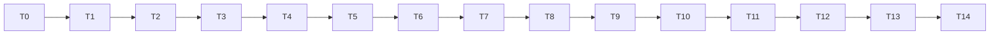

# Implementation Plan: infra-edge (LEAN)
## Overview
Implements `.kiro/specs/infra-edge/requirements.md` per `design.md`. Order: spec bookkeeping, bootstrap permissions (T1) and then **STOP** for the maintainer's bootstrap apply (T2), then the five modules, the env roots, the web CSP check, the workflows, guards, docs, a final check, and two MANUAL tasks after the first deploys. The review decisions R1 to R13 are applied (`design.md` §1, 25 Nov 2026).

**Working rules (every task):**
- **The agent never runs `terraform init` against a backend, `terraform plan`, `terraform apply` or the `aws` CLI**, and never reads `~/.aws` or `AWS_*` variables. Terraform checks run only through `scripts/ci/local-checks.sh` (fmt, `init -backend=false`, validate, test, tflint, checkov, actionlint, guards; pinned images). CI deploys. A scratch copy of a module with `env -i` and a fake `HOME` is fine for `terraform test` with mocked providers.
- Before each task read the requirement IDs it names. Requirements win over the design.
- Lean: normal tests only (`terraform test` with mocks, python unit tests, `node --test`). No mutation checks, no bad-sample suites beyond the two guards of T11, no verification register.
- A permission the roles lack is **listed**, never worked around. If a task finds a call that design §13 missed, stop and add it to the list for the maintainer.
- Nothing is committed by the agent. No account ID, token or zone ID value in any file: tests use the placeholders `123456789012` and `Z0123456789ABCDEFGHIJ`.
- Every new or changed `.tf` file follows the repo style: `jsonencode` policies in `locals`, no data source in modules, descriptions and validations on variables.
- After each Terraform task: `scripts/ci/local-checks.sh all` green for the touched directories. After each python task: `python3 -m unittest discover -s scripts/ci/tests`.

## Task Dependency Graph

T3 to T7 need only T2's apply for the CI plan, not for local tests, so they can be written while waiting for T2. The chain is kept linear so each task starts green. T9 can move before T8 if the web CSP check is wanted early.

## Tasks
- [x] T0 — Bookkeeping: amendment A5 (EDGE-IAM-8). **Done with T1.**
  - [x] T0.1 — "Amendment A5" appended to `.kiro/specs/infra-foundation/requirements.md`: INF-APPLY-2 gains Route 53; INF-SHARED-4 and INF-REG-2 list E11 and E12; INF-SHARED-3 is unchanged (R2 dropped E13); "the approved exceptions are now E1 to E12".
  - [x] T0.2 — `.kiro/steering/terraform.md` and `infra/README.md` say "E1 to E12"; the S3 line records the SSE-S3 exception for the site bucket (R6).
  - [x] T0.3 — Done in T12.0: module lists in `.kiro/steering/structure.md` and `docs/PRD.md` §14 (the modules do not exist yet).
- [x] T1 — `github-oidc`: permissions for the edge (EDGE-IAM-1 to EDGE-IAM-7, EDGE-TEST-4). **Done 25 Nov 2026. STOP: the maintainer applies the bootstrap (T2) before T3 is merged.**
  - [x] T1.1 — Variables `edge_domain_name` (default `lastrites.dev`) and `route53_zone_id` (no default, `^Z[A-Z0-9]+$`) in the module and in `infra/bootstrap` (`variables.tf`, `main.tf` call, `terraform.tfvars.example` with a placeholder). Added to the `variables {}` block of every existing test file.
  - [x] T1.2 — `main.tf`: `region_us_east_1_actions` and `region_deny_ci`. Apply guard and plan guard use `region_deny_ci`. `boundary.tf` and `local.region_deny` unchanged.
  - [x] T1.3 — `policies_actions.tf`: edge host names, `res.alarm_us_east_1`, `res.topic_us_east_1`, `res.site_objects`, `star_reads.edge` gains `cloudfront:ListOriginRequestPolicies` and `cloudfront:GetOriginRequestPolicy`.
  - [x] T1.4 — New `policies_apply_edge_extra.tf` (key `edge-extra`, policy `graveyard-<env>-apply-edge-extra`: E12, `Route53Read`, `Route53Change`, `SiteObjects`, `EdgeAlarms`, `EdgeTopic`; no E13) and `graveyard-plan-read-edge-extra`. The prod apply guard gets `DenyProdChangingDevRecords` (design §12.2b).
  - [x] T1.5 — New `tests/edge.tftest.hcl`; `shared_account` and `services` tests updated (E1 to E12). Measured sizes in `design.md` §12.5.
  - [x] T1.6 — Design §13 re-read row by row against the policy JSON (result in the T1 report).
  - [x] T1.7 — Bootstrap steps and H12 to H20 appended to `docs/runbooks/terraform-bootstrap.md`.
- [x] T2 — MANUAL: zone tag and bootstrap apply (EDGE-MAN-1, EDGE-MAN-2, EDGE-TAG-2) **Done by the maintainer, 25 Nov 2026: 6 added, 6 changed, 0 destroyed; Access Analyzer: only the 4 known apigateway tagging false positives and 2 suggestions; the follow-up plan shows no changes.**
  - [x] T2.1 — **MANUAL (maintainer).** Tag the hosted zone `Project=graveyard` in the console.
  - [x] T2.2 — **MANUAL (maintainer).** Put `route53_zone_id` in `infra/bootstrap/terraform.tfvars` (git-ignored). Run the bootstrap plan and the Access Analyzer check (V9) as in the runbook. Apply. Tell the agent the plan summary (counts only, no account ID) and any V9 finding.
- [x] T3 — Module `edge-cert` (EDGE-CERT-1, EDGE-CERT-2, EDGE-DNS-1, EDGE-TEST-1)
  - [x] T3.1 — `versions.tf` (`aws = 6.73.0`, `configuration_aliases = [aws.us_east_1]`), `variables.tf`, `main.tf`, `outputs.tf` per design §5.1. Lock file via `scripts/ci/local-checks.sh lock infra/modules/edge-cert` (three platforms).
  - [x] T3.2 — `tests/cert.tftest.hcl`: two `mock_provider "aws"` blocks (default and alias), `override_resource` for the certificate's `domain_validation_options` with `override_during = plan`; assert names and SANs, validation method `DNS`, one record per name with the type `CNAME`, no record for a name outside the list, the output equals the validation resource's certificate ARN, and an upper-case name is rejected by the variable validation. (`create_before_destroy` cannot be asserted by `terraform test`; it is checked in review of the diff.)
- [x] T4 — Module `edge-waf` (EDGE-WAF-1 to EDGE-WAF-3, EDGE-COST-1)
  - [x] T4.1 — Module per design §5.2 and §9.1 (the module is always one ACL; the root decides by `count`, R7); rate limit and window variables with the validations of design §5.2.
  - [x] T4.2 — `tests/waf.tftest.hcl` per design §14.
- [x] T5 — Module `edge-site` (EDGE-SITE-1 to EDGE-SITE-4, EDGE-HDR-1, EDGE-HDR-2, EDGE-HDR-4, EDGE-CACHE-1, EDGE-DNS-3)
  - [x] T5.1 — Module per design §5.3, §7, §8: two functions (viewer-request and headers), no response headers policy. Provider `random` pinned to the version in `infra/modules/state/versions.tf`. The CSP is a `local` built from `var.api_host`. Expected inline checkov skips, each with its reason: `CKV_AWS_145` (SSE-S3 by R6), `CKV_AWS_18` and `CKV2_AWS_62` (no access logging or notifications, H16), `CKV_AWS_144` (no replication), `CKV_AWS_86` (no CloudFront logging, H16), `CKV_AWS_310` (no origin failover), `CKV_AWS_374` (no geo restriction). Add only the skips checkov actually reports, and none without a reason.
  - [x] T5.2 — `functions/viewer-request.js.tftpl`, `functions/viewer-response.js.tftpl` and `viewer-request.test.mjs`, `viewer-response.test.mjs` (`node --test`, load the rendered code in a `vm` context; cases of design §8.1 and §8.2; the test reads the real `.js.tftpl` file and replaces the two template placeholders by string substitution, so the test and the template cannot drift).
  - [x] T5.3 — `tests/site.tftest.hcl` per design §14 (bucket policy statements, the headers function with the exact CSP string, distribution settings, rendered function for prod and dev, records). Lock file with `random` for three platforms.
- [x] T6 — Module `edge-api` (EDGE-API-1 to EDGE-API-3)
  - [x] T6.1 — Module per design §5.4, including the API headers function (`functions/viewer-response.js.tftpl`, an identical copy of the site file) and its Node test reference. Managed policy IDs are named locals with a comment giving the AWS policy name.
  - [x] T6.2 — `tests/api_edge.tftest.hcl`: origin host without scheme and no path; all seven methods; `https-only`; `CachingDisabled` and `AllViewerExceptHostHeader` IDs; the distribution has no `custom_error_response`, no viewer-request association, exactly one viewer-response association, no `response_headers_policy_id`; the function sets HSTS and nosniff only; `web_acl_id` set; aliases; records.
- [x] T7 — Module `edge-alarms` (EDGE-OBS-1, EDGE-OBS-2)
  - [x] T7.1 — Module per design §5.5. If R1 was rejected, skip this task and remove the alarm items from T8 and T10.
  - [x] T7.2 — `tests/alarms.tftest.hcl` per design §14.
- [x] T8 — Env roots (EDGE-DNS-2, EDGE-CERT-2, EDGE-CORS-1, EDGE-TAG-1, EDGE-TEST-2)
  - [x] T8.1 — `providers.tf` alias, `variables.tf` (with `enable_waf`), `locals.tf`, `main.tf` (`edge_waf` with `count`), `outputs.tf` and `terraform.tfvars.example` in **both** roots, identical except for the env (design §6). Remove the "infra-edge will also add" comment from `main.tf`. Lock files: `scripts/ci/local-checks.sh lock infra/envs/dev` and `prod`.
  - [x] T8.2 — `tests/root.tftest.hcl` in both roots: second `mock_provider` for the alias; `override_resource` for the new certificate, web ACL, distributions (ARN and `domain_name`) and topic; assertions of EDGE-TEST-2 (prod has the ACL on both distributions, dev has none, dev with `enable_waf = true` has one).
- [x] T9 — Web: CSP drift check (EDGE-HDR-2, design §7.2). Small change in `web/`, spec `ui-core` is not reopened.
  - [x] T9.1 — Extend `web/scripts/check-build.mjs` (and its test `check-build.test.ts`) so it fails when an `out/**/*.html` file has an inline `<script>` that is not one of the three known shapes (chunk registry, `__next_f` init, `__next_f.push`), an inline event handler attribute, a `<style>` tag, a `style=` attribute, or a `javascript:` URL. The test gets one good and one bad fixture string.
  - [x] T9.2 — Run `npm run lint`, `typecheck`, `test`, `build`, `check:build` in `web/` (needs `NEXT_PUBLIC_API_URL`; use the example value). Report if `out/` has anything new.
- [x] T10 — Workflows (EDGE-DEP-1 to EDGE-DEP-5, EDGE-CACHE-1, EDGE-DNS-1)
  - [x] T10.1 — `.github/actions/terraform-plan/action.yml`: input `route53-zone-id`, exported as `TF_VAR_route53_zone_id`; `ci.yml` plan jobs pass `${{ vars.ROUTE53_ZONE_ID }}`. Add the five modules to the `tf-validate` and `tf-test` matrices and a job `edge-function` (`actions/setup-node` at the pinned SHA already in `ci.yml`, `node --test infra/modules/edge-site/functions`).
  - [x] T10.2 — `ci.yml` job `deploy` and `deploy.yml`: the trigger fix of design §11.1 (`needs`, `if`, input `web_changed`), `build-web-dev` and `build-web-prod`, the apply-job changes of §11.2. `upload-artifact` and `download-artifact` pinned by full commit SHA with the version in a comment (look up the SHA with `git ls-remote`; if it cannot be read, stop and ask).
  - [x] T10.3 — `.github/actions/deploy-site/action.yml` per design §11.3, including the output validation, the two `Cache-Control` values, the delete order, the invalidation path list and the smoke checks (successful responses only; the headers function does not run on the 404 page, EDGE-HDR-4). All values arrive as `env:` entries, never interpolated into `run:`.
  - [x] T10.4 — Update `scripts/ci/tests/workflow_rules.py`, `test_ci_workflow.py`, `test_actions.py` for the new shapes and add the rules of design §14 (build jobs hold no credentials and no `id-token`; API URL literals equal the host rule applied to the `domain_name` default; `deploy-site` carries both `Cache-Control` values, `--delete` on the right syncs, and no `GetObject`). `actionlint` green.
- [x] T11 — Guards, python tests, checkov, tflint (EDGE-TEST-5, EDGE-TEST-6, EDGE-DNS-1)
  - [x] T11.1 — `scripts/ci/guards.py`: two new checks with a good and a bad sample each (no bad-sample suites beyond these two): no `aws_route53_zone` resource and no `data "aws_route53_zone"` under `infra/`; every `aws_cloudfront_distribution` has `web_acl_id`. Register them in the guard table and the `guards` docstring.
  - [x] T11.2 — `scripts/ci/tests/test_env_roots.py`: provider alias allowed, new variables, the new CORS defaults, still no resource and no data source in the roots; `infra_text.py` helpers adjusted where they reject an aliased provider.
  - [x] T11.3 — `scripts/ci/local-checks.sh all` and the python tests green. Fix findings; every skip is inline with a reason.
- [x] T12 — Documentation (EDGE-DEP-4, EDGE-MAN-3 to EDGE-MAN-5)
  - [x] T12.1 — `docs/runbooks/edge.md`: order of the first deploys (bootstrap, variable, dev, prod), the first-deploy checks (list below), what to do when the certificate stays pending, rollback (re-sync the previous artifact; the bucket is versioned), how to re-run only the web deploy, the unverified items of design §2.3 and what a failure of each looks like.
  - [x] T12.0 — Module lists: `.kiro/steering/structure.md` and `docs/PRD.md` §14 gain `edge-cert`, `edge-waf`, `edge-site`, `edge-api`, `edge-alarms` and `.github/actions/deploy-site/` (was T0.3).
  - [x] T12.2 — `docs/runbooks/github-environments.md`: variable `ROUTE53_ZONE_ID` (name, where the value comes from, no value). `infra/README.md`: the five modules and the zone rule.
  - [x] T12.3 — Journal entry in `docs/KIRO_JOURNAL.md` if the file exists (decisions R1 to R13 as taken).
- [ ] T13 — Final check and report
  - [x] T13.1 — `scripts/ci/local-checks.sh all`, `python3 -m unittest discover -s scripts/ci/tests`, `node --test infra/modules/edge-site/functions`, the `web/` checks of T9.2. Report: counts of tests, the measured policy sizes, the list of design §13 rows and what covers each, the unverified items, and any call found missing.
  - [ ] T13.2 — **MANUAL (maintainer), before merging:** set the repository variable `ROUTE53_ZONE_ID` (EDGE-MAN-3). Merge. CI plans, applies dev, waits for the prod approval.
- [ ] T14 — MANUAL: after the first deploys (EDGE-MAN-4, EDGE-MAN-5)
  - [ ] T14.1 — **MANUAL (maintainer).** In the console, region us-east-1: subscribe an email to `graveyard-dev-edge-alerts` and confirm; the same for prod after its deploy.
  - [ ] T14.2 — **MANUAL (maintainer).** Run the checks of `docs/runbooks/edge.md` for dev, then prod, and tell the agent the result:
    1. `https://dev.lastrites.dev/` loads, `/scan` and `/grave` load, `/nope` shows the 404 page with status 404, and a reload of `/scan?id=…` works.
    2. Response headers on `/` (a 200): `strict-transport-security: max-age=63072000; includeSubDomains`, the CSP of EDGE-HDR-2, `x-content-type-options`, `referrer-policy`. On `/nope` (the 404 page) the headers are **expected to be missing** (EDGE-HDR-4); report what you see. On a 200 from the API: `strict-transport-security` and `x-content-type-options` only, no CSP.
    3. Browser console on `/`, `/scan`, `/grave`: no CSP violation (this proves `style-src 'self'`, design §7.2).
    4. A scan from the page reaches `https://api.dev.lastrites.dev` (no CORS error); `curl -i https://api.dev.lastrites.dev/v1/scans/<bad id>` returns the API's own problem document and status, not an HTML page.
    5. Prod only: `curl -I 'https://www.lastrites.dev/scan?id=a%20b'` returns 301 with `location: https://lastrites.dev/scan?id=a%20b` (R13).
    6. Prod only (dev has no web ACL): the WAF console (us-east-1) shows sampled requests and metrics for `graveyard-prod-edge`; 25 quick `POST /v1/scans` calls from one IP start returning 429. Dev: there is no web ACL; the API stage throttle is the only limit.
    7. Cache: a hashed asset answers with `cache-control: public, max-age=31536000, immutable` and a second request shows `x-cache: Hit from cloudfront`; `/` shows `cache-control: no-cache`.
    8. The CloudWatch alarms in us-east-1 are in state OK or Insufficient data, not in an error state.

- [ ] T15 — Region guards apply to direct calls only (amendment A6 of `infra-foundation`; E11 amendment; found by the maintainer after the first dev apply)
  - [x] T15.1 — `github-oidc`: `region_deny_ci` adds `Bool aws:ViaAWSService = false` to both region denies (plan guard and both apply guards); the boundaries and every other Deny are untouched. `tests/edge.tftest.hcl` asserts the condition on the six region denies, that exactly those six statements mention `ViaAWSService` over every policy, that no other Deny gained it, and that the boundaries are unchanged; the guard tests of `apply_core` and `plan_role` carry the new condition. Amendment A6 in `infra-foundation/requirements.md`; note in `docs/runbooks/edge.md` 4b; bootstrap steps in `terraform-bootstrap.md` section 16.
  - [ ] T15.2 — **MANUAL (maintainer).** Apply the bootstrap change (`terraform-bootstrap.md`, section 16: expect 0 add, 3 change, 0 destroy; V9 on the three guards), then re-run the failed dev deploy jobs.

- [ ] T16 — Managed rule groups in the web ACL (exception E14, amendment A7 of `infra-foundation`; found by the first prod apply)
  - [x] T16.1 — `github-oidc`: statement `ExceptionE14` in `apply-edge-extra` of both envs (`wafv2:CreateWebACL`, `wafv2:UpdateWebACL` on `global/managedruleset/*/*` in us-east-1, no condition); the `Waf` statement is unchanged. Audit of the rest of the WAF and the CloudFront link in design 12.6 (no further permission documented). Tests in `edge.tftest.hcl` (exact statement in both envs, `Waf` unchanged, only the two E14 statements name `managedruleset`, no wafv2 write for the plan role or the boundaries, no wafv2 wildcard) and the exception lists of `shared_account` and `services`. Amendment A7, `edge.md` 4b, `terraform-bootstrap.md` section 17.
  - [ ] T16.2 — **MANUAL (maintainer).** Apply the bootstrap change (`terraform-bootstrap.md`, section 17: expect 0 add, 2 change, 0 destroy; V9 on the two policies), then re-run the failed prod deploy jobs.

## Report of T1 (25 Nov 2026)
- `github-oidc`: 99 tests pass (89 before plus `edge.tftest.hcl`, 10 runs); `scripts/ci/local-checks.sh all` green (fmt, validate, test, tflint, checkov 190 passed 0 failed, actionlint, guards); python tests 240 OK.
- Sizes (design §12.5): `apply-edge` 5,720 and 5,739 of 6,144; `apply-guard` 3,042 and 3,273; `plan-guard` 1,975; new `apply-edge-extra` 1,503 and 1,514; new `plan-read-edge-extra` 658; boundaries unchanged at 6,066 and 6,084 (pinned by a test). Managed policies per role: apply 8, plan 8 (limit 10).
- Audit (design §13): every row has a statement; the open items are the unverified ones of design §2.3 (WAF managed rule groups, CloudFront checks on the web ACL, certificate and function at distribution create, `RequestedRegion` of Route 53, the SNS same-region rule, the query string encoding, the 404 page and the headers function). No call found missing.
- Beyond the plan: E12 got `Null` checks on its three condition keys (ForAllValues is true when a key is absent); the E11 and alarm and topic action lists are exact, without dashboard or subscription actions.

## Report (T13.1, 25 Nov 2026)
- **Terraform, offline:** `scripts/ci/local-checks.sh all` is green: fmt, validate, 257 `terraform test` runs in 17 directories (new: edge-cert 6, edge-waf 8, edge-site 16, edge-api 8, edge-alarms 5; github-oidc 99; dev root 10; prod root 9; bootstrap 9), tflint, checkov (228 passed, 0 failed, every skip inline with a reason), actionlint, guards. The `validate` warnings are the existing `range_key` deprecation in `modules/data`.
- **Other tests:** 283 python tests (new `test_deploy_site.py`, the new guards, the workflow rules for the new jobs, the artifact rule); 13 `node --test` tests of the three CloudFront Functions; web: lint, format, typecheck, 634 tests, `npm run build` and `npm run check:build` green.
- **Changes against the design, found while building:**
  1. `edge-cert` has one provider (the root passes us-east-1), not two: a module with `configuration_aliases` cannot be validated on its own, and Route 53 is global. EDGE-CERT-2 and design 5.1 say so.
  2. The production build had one `style=` attribute on the landing page. Decision of the maintainer: no `style-src-attr` exception. It is now the CSS class `gy-cursed-shape`, the CSP is `style-src 'self'` only, and `check:build` fails on any style attribute (design 7.2, R5).
  3. `upload-artifact` and `download-artifact` are used for the web build only (`site-<env>`, `web/out`), which meant narrowing the old rule "no artifact anywhere" to those two files and that name and path (`actions_text.artifact_problems`, with bad samples). Pinned by SHA: upload-artifact v7.0.2, download-artifact v8.0.2 (read from `git ls-remote`; review the pins).
  4. The `deploy` job also requires both plans to have succeeded whenever infra changed: a failed static check skips the plans, and a skipped plan would otherwise read as "nothing to apply" on a push that also changed `web/`.
  5. `deploy.yml`: `*_version_id` and `*_sha256` inputs are optional (empty when a plan did not run); `terraform-apply` still refuses an empty value.
  6. The plan summary also masks the zone ID as `<zone>`.
  7. Root variables `price_class` and `scan_rate_limit` were added (design 6 listed them); the WAF rules are four static blocks (checkov could not read a dynamic block).
- **Audit (design 13):** every row has a statement, re-checked against the policy JSON in `edge.tftest.hcl`. No call found missing. The unverified items of design 2.3 stay open until the first dev deploy.
- **Not done by the agent, by rule:** no `terraform plan/apply`, no real backend, no `aws` CLI; the `ROUTE53_ZONE_ID` variable (T13.2) and everything in T14.
