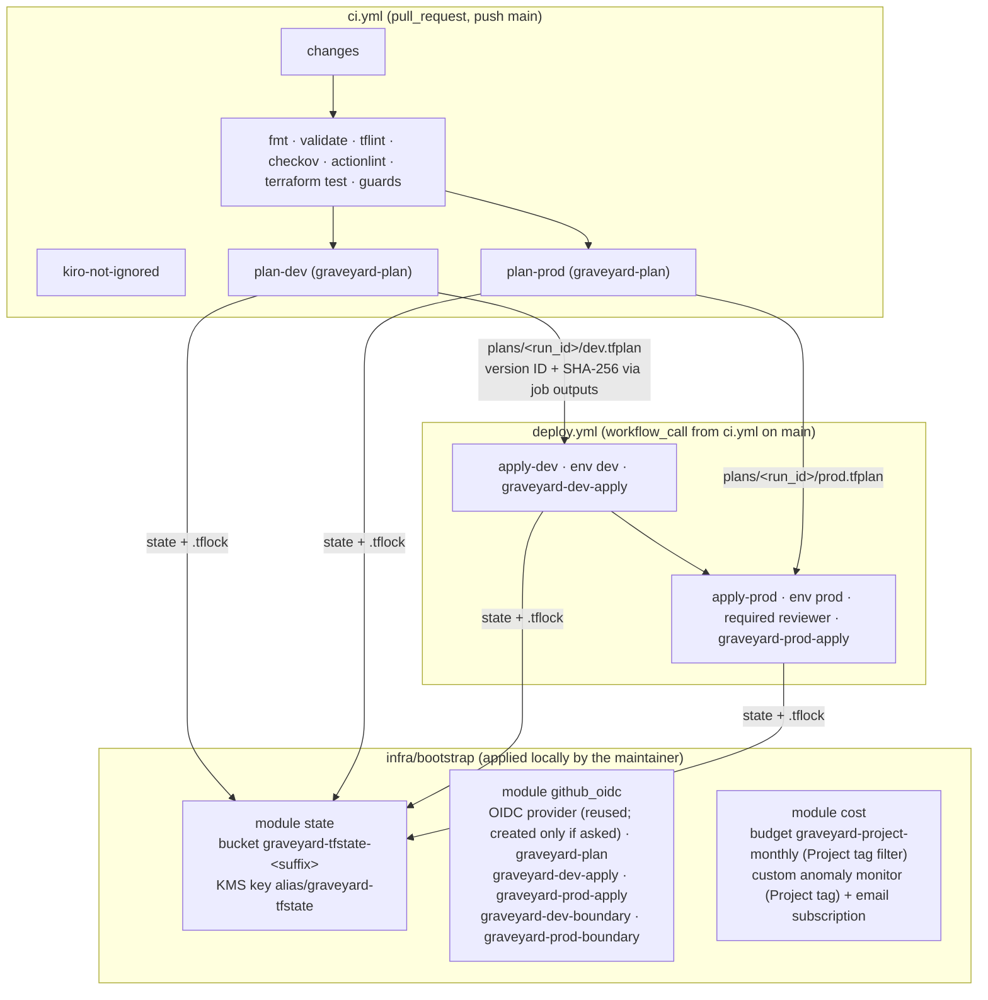

# Design: infra-foundation

> **Status:** reviewed (18 Nov 2026, rounds 2 and 3). Open points O1–O9, the shared-account decisions SA1–SA5 and the round-3 flags F1–F7 are decided (§13, §13.1); exceptions E1–E6 are approved. Tasks in `tasks.md`.
>
> **Implements:** `.kiro/specs/infra-foundation/requirements.md` (INF-LAY, INF-VER, INF-STATE, INF-BOOT, INF-TAG, INF-NAME, INF-CFG, INF-REG, INF-OIDC, INF-PLAN, INF-APPLY, INF-CI, INF-KIRO, INF-COST, INF-DOC, INF-POL, INF-SHARED, INF-TEST) and the review decisions C1–C8, O1–O9 and SA1–SA5.
>
> **Location:** `infra/` (three roots, three modules), `.github/workflows/{ci.yml,deploy.yml}`, `.github/actions/`, `scripts/ci/`, `docs/runbooks/`, `infra/README.md`, `.gitignore`.

---

## 0. Working rule

**The agent never runs `terraform init`, `plan` or `apply` against a real backend or AWS, never runs the `aws` CLI, and never reads `~/.aws` or any `AWS_*` environment variable. The agent's Terraform commands are limited to `terraform fmt`, `terraform init -backend=false`, `terraform validate`, `terraform providers lock` and `terraform test`; `terraform test` runs offline, with `mock_provider` blocks, no credentials and no backend. The agent runs Terraform, tflint, checkov and actionlint from the images pinned by digest in §2, through `scripts/ci/local-checks.sh`, which mounts only the repository and a plugin cache and passes no host environment variables into the container. The only network the agent uses is reading public release metadata and downloading the pinned providers, plugins and images from public registries (Terraform Registry, GitHub, Docker Hub, GHCR). Every real `init`, `plan` or `apply`, every AWS CLI call, and every change to GitHub settings (environments, variables, secrets) is a MANUAL task done by the maintainer.**

---

## 1. Overview



The bootstrap root owns everything that serves both envs. The env roots start empty: a backend, a provider with `default_tags`, locals and no module calls. `infra-serverless`, `infra-edge` and `observability` add module calls later.

`ci.yml` plans both envs on every pull request and every push to `main`. On `main` it saves each plan with changes to the state bucket and calls `deploy.yml`, which applies dev and then, after approval, prod.

---

## 2. Facts checked while writing this design

| Fact | Evidence | Consequence |
|------|----------|-------------|
| Terraform current release is **1.17.2**; the maintainer has 1.15.6 locally. | `checkpoint-api.hashicorp.com/v1/check/terraform`, 18 Nov 2026; `terraform version`. | Pin 1.17.2 in `infra/.tool-versions`. The maintainer upgrades locally (the lock file and saved plans need one version). |
| `hashicorp/aws` latest is **6.73.0** (11 Nov 2026); `hashicorp/random` latest is **3.9.1**. | Terraform Registry API; GitHub releases. | Exact pins `= 6.73.0`, `= 3.9.1`. |
| tflint **0.66.0**, tflint-ruleset-aws **0.50.0**, checkov **3.4.5**, actionlint **1.7.12**. | GitHub releases API. | Pinned in `infra/.tool-versions` and `.tflint.hcl`. |
| Pinned images (multi-arch index digests): `hashicorp/terraform:1.17.2@sha256:6e9c1e647c31a960dc9b59e13272f9111d90010c10b717f77ffb324767660475`; `ghcr.io/terraform-linters/tflint:v0.66.0@sha256:65b9944a9274c4989492c1d79998c2801664bf8a55fddb4bd3a9e6d73a006ddc`; `bridgecrew/checkov:3.4.5@sha256:122602cf32cc72286155d39f1f234b7b594818f7b8d7fdf490701620e521368b`; `rhysd/actionlint:1.7.12@sha256:b1934ee5f1c509618f2508e6eb47ee0d3520686341fec936f3b79331f9315667`. Docker 29.8.2 is installed locally. | `docker buildx imagetools inspect`, 18 Nov 2026. | The agent's offline checks use these images (§0), so its runs do not depend on the local Terraform 1.15.6. CI uses the same checkov and actionlint images; Terraform and tflint in CI come from the pinned setup actions with the same versions. |
| Action SHAs: `actions/checkout` v7.0.1 `3d3c42e5aac5ba805825da76410c181273ba90b1`; `actions/cache` v6.1.0 `55cc8345863c7cc4c66a329aec7e433d2d1c52a9`; `hashicorp/setup-terraform` v4.0.1 `dfe3c3f87815947d99a8997f908cb6525fc44e9e`; `aws-actions/configure-aws-credentials` v6.3.0 `e1253824e5c10ff9df46874f81ed3ec929e19cfd`; `terraform-linters/setup-tflint` v6.3.2 `6ffdbaa3be476b3431f7275c26966ef32ff60337`. | `gh api repos/<r>/git/ref/tags/<t>` (annotated tags dereferenced). | Used verbatim. Re-checked by the first task. |
| S3 backend with `use_lockfile = true` needs `s3:GetObject`, `s3:PutObject`, `s3:DeleteObject` on `<key>.tflock`; `s3:ListBucket`; `GetObject`/`PutObject` on the state key. `kms_key_id` is an **ARN** and encrypts **state and lock files**, and needs `kms:Encrypt`, `kms:Decrypt`, `kms:GenerateDataKey`. Values given with `-backend-config` are stored in `.terraform/` and in plan files. | `developer.hashicorp.com/terraform/language/backend/s3`, read 18 Nov 2026. | INF-PLAN-3 and INF-STATE-9 grant exactly these. The KMS ARN contains the account ID, so CI builds it at run time from a masked value (§8.3). Plan files hold the backend config, so they must stay in the encrypted bucket (C5). The lock-file encryption question from the first draft is answered: the lock file gets the same SSE-KMS, so the bucket policy can also deny a `PutObject` with no SSE-KMS header. |
| A `*_override.tf` file with `backend "local" {}` replaces a committed `backend "s3" {}` block, and removing it makes `terraform init` ask for migration. | Run locally with Terraform 1.15.6 on 18 Nov 2026 in a scratch directory (no AWS). | First bootstrap apply uses a gitignored `local_backend_override.tf` (§6.2). |
| `aws_ce_anomaly_subscription` takes `frequency` `DAILY`, `IMMEDIATE` or `WEEKLY` and subscribers of type `EMAIL` or `SNS`; every provider example with `IMMEDIATE` uses SNS. | `terraform-provider-aws` docs, `ce_anomaly_subscription`. | Email-only (C6) means `DAILY`. Register V6; `DAILY` is kept either way (fewer emails). |
| `aws_budgets_budget` filters by tag with `cost_filter { name = "TagKeyValue", values = ["TagKey$TagValue"] }`; the provider's own examples write user-defined tags as `user:business-unit$human_resources`. | provider v6.73.0 `budgets_budget` docs, read 18 Nov 2026. | The Graveyard filter value is `user:Project$graveyard` (SA1), built with `format("user:%s$%s", key, value)` so the `$` is not read as interpolation. Register V14. |
| `aws_ce_anomaly_monitor` with `monitor_type = "CUSTOM"` takes `monitor_specification` as a JSON Cost Explorer Expression. The provider example writes `Tags = { Key, MatchOptions = null, Values }` with `And`, `CostCategories`, `Dimensions`, `Not`, `Or` all `null`. | provider v6.73.0 `ce_anomaly_monitor` docs, read 18 Nov 2026. | The monitor uses exactly that form (§5.3), with `MatchOptions` null so the API default (`EQUALS`, `CASE_SENSITIVE`) applies. Register V15 checks that the second plan shows no diff. |
| `aws_ce_cost_allocation_tag` takes `tag_key` and `status`; it can take up to 24 hours for a key to appear for activation after tagged resources exist. The page says nothing about what destroy does to the status. | provider v6.73.0 `ce_cost_allocation_tag` docs. | F2, V7, V16. |
| **Maintainer-checked, not re-verified by the agent:** the account already has an OIDC provider for `token.actions.githubusercontent.com`, owned by another project, and its client ID list includes `sts.amazonaws.com`. | Maintainer, 18 Nov 2026. | SA3. The module reuses it by ARN and never reads or manages it (INF-OIDC-10). The agent cannot check it (§0). |
| **Dropped (SA2, 18 Nov 2026):** the one-services-monitor-per-account question. The monitor is `CUSTOM`, and the account's existing monitors are never read or changed. | — | Register V5 is closed. |
| **Not verified:** whether the account bills in GBP. | — | Default USD 40 per C8, with the switch documented. Register V10. |

---

## 3. Files

```
infra/
├── .tool-versions                 # terraform 1.17.2, tflint 0.66.0, checkov 3.4.5, actionlint 1.7.12 (the single place, INF-VER-1)
├── .tflint.hcl                    # aws ruleset 0.50.0, recommended preset, aws_resource_missing_tags
├── README.md                      # INF-DOC-3
├── bootstrap/
│   ├── versions.tf                # required_version, required_providers (aws, random), backend "s3" {}
│   ├── providers.tf               # aws provider: region, allowed_account_ids, default_tags
│   ├── locals.tf                  # tags (Env = "shared"), names
│   ├── variables.tf
│   ├── main.tf                    # module "state", module "github_oidc", module "cost"
│   ├── outputs.tf                 # bucket name, key ID, role names (no ARNs printed in CI; this root never runs in CI)
│   ├── backend.hcl.example
│   ├── terraform.tfvars.example
│   └── .terraform.lock.hcl
├── envs/
│   ├── dev/  {versions.tf, providers.tf, locals.tf, variables.tf, main.tf, backend.hcl.example, terraform.tfvars.example, .terraform.lock.hcl}
│   └── prod/ {same files}
└── modules/
    ├── state/        {main.tf, kms.tf, policy.tf, variables.tf, outputs.tf, versions.tf, tests/state.tftest.hcl}
    ├── github-oidc/  {main.tf, plan_role.tf, apply_roles.tf, boundary.tf, policies_*.tf, variables.tf, outputs.tf, versions.tf, tests/*.tftest.hcl}
    └── cost/         {main.tf, variables.tf, outputs.tf, versions.tf, tests/cost.tftest.hcl}
.github/
├── workflows/ci.yml
├── workflows/deploy.yml
└── actions/
    ├── terraform-init/action.yml  # setup-terraform, plugin cache, init with backend config
    ├── terraform-plan/action.yml  # plan, summary, upload to plans/
    └── terraform-apply/action.yml # fetch by version ID, verify, apply
scripts/ci/
├── guards.py                      # account IDs, forbidden tracked files, workflow triggers, action pins (stdlib only)
├── check_kiro_not_ignored.py      # INF-KIRO-1 (stdlib only)
├── changed_paths.py               # path filter for ci.yml (stdlib only)
├── local-checks.sh                # offline checks from pinned images, no host env (§0); used by the agent and the maintainer
└── tests/test_*.py                # unittest, temp git repos
docs/runbooks/
├── terraform-bootstrap.md         # INF-DOC-1
└── github-environments.md         # INF-DOC-2
```

**No committed tfvars.** The existing `.gitignore` rule `*.tfvars` ignores every tfvars file, including `*.auto.tfvars`. So the env name is a `locals` value in each env root (`local.env = "dev"`), not a tfvar. The only env-root variable without a default is `allowed_account_ids`, supplied as `TF_VAR_allowed_account_ids` in CI or from a gitignored `terraform.tfvars` on the maintainer's machine. The `terraform.tfvars` in the tree above is that local, ignored file, and `terraform.tfvars.example` is the committed shape. No `.gitignore` exception is needed.

**`.gitignore` additions (INF-STATE-8):** `*.tfplan`, `backend.hcl`, `*_override.tf`, `.terraform.d/`.

**Module directory names** are hyphenated, as `structure.md` requires (O6): `infra/modules/github-oidc`. The label in code stays an HCL identifier: `module "github_oidc" { source = "../modules/github-oidc" }`. `structure.md` itself lists a planned module `github_app` with an underscore, which breaks its own rule; the §11 edit lists it as `github-app` (no such directory exists yet).

---

## 4. Conventions in every root

### 4.1 Versions (INF-VER-1…3)

```hcl
terraform {
  required_version = ">= 1.10, < 2.0"
  required_providers {
    aws    = { source = "hashicorp/aws",    version = "= 6.73.0" }
    random = { source = "hashicorp/random", version = "= 3.9.1" }   # bootstrap and module state only
  }
  backend "s3" {
    key          = "envs/dev/terraform.tfstate"   # per root (INF-STATE-6)
    region       = "eu-west-2"
    use_lockfile = true
    encrypt      = true
    # bucket and kms_key_id come from -backend-config (INF-STATE-7)
  }
}
```

Backend blocks cannot read variables, so `region` is written here. It is the one region literal per root besides the variable default and the CI variable. Each root **and each module directory** commits a `.terraform.lock.hcl`, because `tf-validate` and `tf-test` run `init -lockfile=readonly` in module directories too. Every lock file is generated with `terraform providers lock -platform=linux_amd64 -platform=darwin_arm64 -platform=linux_arm64`. The third platform is needed because the pinned container images run as `linux_arm64` on an arm64 host (found at T6): with only two platforms, `init -lockfile=readonly` fails there.

### 4.2 Provider and tags (INF-TAG-1…2, INF-CFG-2, INF-REG-1)

```hcl
provider "aws" {
  region              = var.region
  allowed_account_ids = var.allowed_account_ids
  default_tags { tags = local.tags }
}

locals {
  env  = "dev"                                      # "prod" in envs/prod, "shared" in bootstrap
  tags = {
    Project    = "graveyard"
    Env        = local.env
    Owner      = "olajide"
    ManagedBy  = "terraform"
    CostCentre = "kiroween-2026"
    Repo       = "github.com/olajaido/graveyard"
  }
  name_prefix = "graveyard-${local.env}"            # env roots only
}

variable "region" {
  type        = string
  default     = "eu-west-2"
  description = "AWS region. Only eu-west-2 is allowed (PRD §10.2)."
  validation {
    condition     = var.region == "eu-west-2"
    error_message = "Graveyard runs in eu-west-2 only."
  }
}

variable "allowed_account_ids" {
  type        = list(string)
  description = "The one AWS account this root may touch. Supplied at run time, never committed."
  validation {
    condition     = length(var.allowed_account_ids) == 1 && can(regex("^[0-9]{12}$", var.allowed_account_ids[0]))
    error_message = "Exactly one 12-digit account ID."
  }
}
```

The tag set lives in `locals` because `structure.md` keeps environment values out of modules and tfvars would be gitignored. The same six lines appear in three roots. A `terraform test` in each module cannot see provider `default_tags`, so tag presence is checked by tflint's `aws_resource_missing_tags` rule, which understands `default_tags` (configured in `.tflint.hcl` with the six keys).

**INF-TAG-3 (resources that do not inherit tags):** none in this spec. `aws_ce_cost_allocation_tag` is not taggable. The budget and anomaly resources accept `tags` and inherit `default_tags`. `infra-serverless` must note Lambda@Edge, ECR images, Step Functions executions and log groups created by services.

### 4.3 Policies as `jsonencode` in `locals` (INF-POL-1)

Every IAM policy, trust policy, permissions boundary, KMS key policy and S3 bucket policy is a `jsonencode()` value in a module's `locals`. No module uses `data "aws_iam_policy_document"`, and **no module declares any `data` source**. The account ID and partition are module inputs; only the roots read them:

```hcl
# infra/bootstrap/main.tf (roots only)
data "aws_caller_identity" "current" {}
data "aws_partition" "current" {}

module "github_oidc" {
  source     = "../modules/github-oidc"
  account_id = data.aws_caller_identity.current.account_id
  partition  = data.aws_partition.current.partition
  # …
}
```

```hcl
# infra/modules/github-oidc/policies_plan.tf
locals {
  arn = {
    state_bucket = "arn:${var.partition}:s3:::${var.state_bucket_name}"
    oidc         = "arn:${var.partition}:iam::${var.account_id}:oidc-provider/token.actions.githubusercontent.com"
    boundary     = { for e in var.envs : e => "arn:${var.partition}:iam::${var.account_id}:policy${var.ci_path}graveyard-${e}-boundary" }
  }
  plan_trust = jsonencode({
    Version   = "2012-10-17"
    Statement = [{ Effect = "Allow", Principal = { Federated = local.arn.oidc }, Action = "sts:AssumeRoleWithWebIdentity", Condition = { … } }]
  })
}
```

ARNs in policies are built from names, the partition and the account ID input, never read from resource attributes. So every policy is known at plan time, a test passes `account_id = "123456789012"` as a plain variable, and `terraform test` asserts the exact JSON with `jsondecode()`. Creation order that a string ARN would lose is restored with `depends_on` inside the module (for example the roles depend on `aws_iam_openid_connect_provider.github`). The one cross-module ordering, the state key policy naming the CI roles, takes the role ARNs from `module.github_oidc` outputs in the root (§5.1), and the `state` tests pass them as plain strings.

---

## 5. Modules

### 5.1 `state`

| Input | Type | Notes |
|-------|------|-------|
| `account_id`, `partition` | string | From the root's data sources (§4.3). |
| `bucket_name_prefix` | string | `"graveyard-tfstate"`. |
| `ci_role_arns` | object({ plan = string, apply = map(string) }) | For the key policy. Built from names in the bootstrap root, so no module cycle. |
| `state_noncurrent_days` | number | Default 90. |
| `state_noncurrent_keep` | number | Default 10. |
| `plans_expiry_days` | number | Default 7 (C5). Validation: 1–7. |

| Output | |
|--------|-|
| `bucket_name`, `bucket_arn`, `kms_key_arn`, `kms_key_id` | |

Resources:
- `random_id.suffix` (4 bytes, 8 hex characters) → bucket `graveyard-tfstate-<hex>`.
- `aws_kms_key.state` (`enable_key_rotation = true`, `deletion_window_in_days = 30`, `prevent_destroy`), `aws_kms_alias` `alias/graveyard-tfstate`, `aws_kms_key_policy.state`.
- `aws_s3_bucket.state` (`prevent_destroy`), `aws_s3_bucket_versioning`, `aws_s3_bucket_server_side_encryption_configuration` (`aws:kms`, the key, `bucket_key_enabled = true`), `aws_s3_bucket_public_access_block` (all four true), `aws_s3_bucket_ownership_controls` (`BucketOwnerEnforced`), `aws_s3_bucket_policy`, `aws_s3_bucket_lifecycle_configuration`.

**Key policy (INF-STATE-9):**

| Sid | Principal | Actions | Condition |
|-----|-----------|---------|-----------|
| `AccountAdmin` | account root | `kms:*` | none (standard; IAM admins, including the maintainer, keep control) |
| `CiUseViaS3` | the three CI role ARNs | `kms:Encrypt`, `kms:Decrypt`, `kms:GenerateDataKey`, `kms:DescribeKey` | `kms:ViaService = s3.eu-west-2.amazonaws.com` |

The CI roles exist before the key policy is written (Terraform orders `aws_kms_key_policy` after the roles through the `ci_role_arns` input, which `main.tf` builds from `module.github_oidc` outputs). KMS rejects a policy that names a role that does not exist yet, so the input must come from the role resources, not from a string. This makes `state` depend on `github_oidc` for the key policy only, while `github_oidc` depends on `state` for names; Terraform resolves this at resource level because the key policy is a separate resource.

**Bucket policy (INF-STATE-2):**

| Sid | Effect | Action | Condition |
|-----|--------|--------|-----------|
| `DenyInsecureTransport` | Deny | `s3:*` on bucket and objects | `Bool aws:SecureTransport = false` |
| `DenyWrongEncryption` | Deny | `s3:PutObject` | `StringNotEquals s3:x-amz-server-side-encryption = aws:kms` (covers a missing header too, since §2 shows the backend sends it for state and lock files) |
| `DenyWrongKey` | Deny | `s3:PutObject` | `StringNotEqualsIfExists s3:x-amz-server-side-encryption-aws-kms-key-id = <key ARN>` |

**Lifecycle (INF-STATE-3):**

| Rule | Filter | Action |
|------|--------|--------|
| `state-versions` | prefix `envs/` and a second rule for `bootstrap/` | noncurrent expiry after `state_noncurrent_days`, `newer_noncurrent_versions = state_noncurrent_keep` |
| `plans` | prefix `plans/` | current expiry after `plans_expiry_days`; noncurrent expiry after 1 day |
| `housekeeping` | whole bucket | `expired_object_delete_marker = true`; abort incomplete multipart uploads after 7 days |

S3 does not allow `expired_object_delete_marker` and a current-version `expiration.days` in the same rule, which is why `plans` and `housekeeping` are separate.

**Expected checkov skips** (inline, with reason, INF-CI-4): `CKV_AWS_18` (access logging: a second bucket for one maintainer's state is cost and noise; CloudTrail data events are the hardening path), `CKV_AWS_144` (cross-region replication: single-region by design, versioning covers recovery), `CKV2_AWS_62` (event notifications: nothing consumes them). The final list is whatever checkov 3.4.5 reports; each skip is reviewed in the PR.

### 5.2 `github-oidc` (label `github_oidc`)

| Input | Type | Notes |
|-------|------|-------|
| `account_id`, `partition` | string | From the root's data sources (§4.3). |
| `repo_owner`, `repo_name` | string | `olajaido`, `graveyard` (INF-OIDC-5). |
| `envs` | set(string) | `["dev", "prod"]`. Validation: subset of those two. |
| `ci_path` | string | `/graveyard-ci/`. IAM path for the CI roles and the boundaries. |
| `state_bucket_name`, `state_kms_key_arn` | string | From `state`. |
| ~~`protected_arns`~~ | | **Dropped at T7 (YAGNI).** Nothing needed a list: the state bucket, state key and OIDC provider are denied by name in `DenyStateConfig`, `DenyStateKeyAdmin` and `DenyCiIdentity`, and Budgets and Cost Explorer are denied wholesale by `DenyCost`. |
| `create_oidc_provider` | bool | Default `false` (SA3). `false`: no provider resource; the ARN is built from `account_id` and `partition`. `true`: create one, with `prevent_destroy`. |
| `bedrock_narrate_profile_id`, `bedrock_rites_profile_id` | string | Defaults `eu.anthropic.claude-haiku-5-5` and `eu.anthropic.claude-sonnet-5-5` (PRD §10.2). Validation: starts with `eu.` (never `global.`). Used only by exception E5 (§5.2.7). A change of the SSM model ID needs the same change here (a reviewed bootstrap change). |
| `bedrock_foundation_model_regions` | list(string) | Default: the seven regions `eu-central-1`, `eu-north-1`, `eu-south-1`, `eu-south-2`, `eu-west-1`, `eu-west-2`, `eu-west-3`, which the maintainer read from `list-inference-profiles` in eu-west-2 on 18 Nov 2026 for both `eu.anthropic.claude-haiku-5-5` and `eu.anthropic.claude-sonnet-5-5` (the IDs match PRD §10.2 exactly). Validation: each is an exact `eu-` region, never a wildcard. A routing change needs a reviewed bootstrap change. |
| ~~`apply_services`~~ | | **Dropped at T9 (YAGNI).** The service list of INF-APPLY-2 lives in the policies and in the `services.tftest.hcl` test, which fails if an action outside it appears. |

| Output | |
|--------|-|
| `plan_role_arn`, `apply_role_arns` (map by env), `boundary_arns` (map by env), `oidc_provider_arn` | |

**OIDC provider (INF-OIDC-1, INF-OIDC-10, SA3).** The module has no `data` source and never looks the provider up (§4.3). The ARN is always the string `local.arn.oidc` of §4.3, built from `account_id` and `partition`, and is what the trust policies and the `DenyCiIdentity` statement use. The `oidc_provider_arn` output is that string.

```hcl
resource "aws_iam_openid_connect_provider" "github" {
  count          = var.create_oidc_provider ? 1 : 0
  url            = "https://token.actions.githubusercontent.com"
  client_id_list = ["sts.amazonaws.com"]
  lifecycle { prevent_destroy = true }
}
```

The roles use `depends_on = [aws_iam_openid_connect_provider.github]`, which is an empty list when `count = 0`. With the default `false`, a bootstrap plan has no OIDC provider resource at all, so it cannot adopt or change the existing one. Setting `true` while a provider exists fails at apply with an "already exists" error, which is safe (F3). Flipping `true` back to `false` after creation is blocked by `prevent_destroy`, which is the wanted protection. No `thumbprint_list`: AWS validates GitHub's certificate through its own trusted CAs, and provider 6.x makes the argument optional (V4a; V4b applies only when `create_oidc_provider` is `true`).

**Names and paths (INF-NAME-1):**

| Resource | Name | Path | ARN pattern |
|----------|------|------|-------------|
| Plan role | `graveyard-plan` | `/graveyard-ci/` | `role/graveyard-ci/graveyard-plan` |
| Apply roles | `graveyard-dev-apply`, `graveyard-prod-apply` | `/graveyard-ci/` | `role/graveyard-ci/graveyard-<env>-apply` |
| Boundaries | `graveyard-dev-boundary`, `graveyard-prod-boundary` | `/graveyard-ci/` | `policy/graveyard-ci/graveyard-<env>-boundary` |
| CI policies | `graveyard-plan-*`, `graveyard-<env>-apply-*` | `/graveyard-ci/` | `policy/graveyard-ci/…` |
| Workload roles (later specs) | `graveyard-<env>-<function>` | `/graveyard-<env>/` | `role/graveyard-<env>/graveyard-<env>-*` |
| Workload policies (later specs) | `graveyard-<env>-*` | `/graveyard-<env>/` | `policy/graveyard-<env>/graveyard-<env>-*` |

An apply role's IAM write statements cover only `role/graveyard-<env>/*` and `policy/graveyard-<env>/*`. The CI roles and boundaries are on `/graveyard-ci/`, so the name prefix `graveyard-dev-` on `graveyard-dev-apply` does not bring it into reach. The explicit denies of §5.2.4 are a second layer.

#### 5.2.1 Trust policies (INF-OIDC-2…4)

```json
{
  "Version": "2012-10-17",
  "Statement": [{
    "Effect": "Allow",
    "Principal": { "Federated": "<oidc provider ARN>" },
    "Action": "sts:AssumeRoleWithWebIdentity",
    "Condition": {
      "StringEquals": {
        "token.actions.githubusercontent.com:aud": "sts.amazonaws.com",
        "token.actions.githubusercontent.com:sub": [
          "repo:olajaido/graveyard:pull_request",
          "repo:olajaido/graveyard:ref:refs/heads/main"
        ]
      }
    }
  }]
}
```

The apply roles have the same shape with one subject each: `repo:olajaido/graveyard:environment:dev` or `…:environment:prod`. `max_session_duration = 3600` (INF-OIDC-6).

How the subjects map to jobs:
- A `ci.yml` job with no `environment:` on a pull request gets `…:pull_request`; on a push to `main` it gets `…:ref:refs/heads/main`. Both may assume the plan role.
- A `deploy.yml` job with `environment: dev` gets `…:environment:dev`, whatever the branch. The branch limit comes from the environment's deployment-branch rule (`main` only, INF-CI-9). A reusable workflow called by `ci.yml` keeps the caller repo in the subject.
- A fork pull request gets no OIDC token (`id-token: write` is not granted to fork runs), and no secrets.

#### 5.2.2 Plan role policy (INF-PLAN-1…4)

Managed policies on the plan role:

| Policy | Content |
|--------|---------|
| `graveyard-plan-state` | `s3:ListBucket` on the state bucket with `s3:prefix` in `envs/dev/`, `envs/prod/`, `plans/`; `s3:GetObject` on `envs/dev/terraform.tfstate`, `envs/prod/terraform.tfstate` and both `.tflock` keys; `s3:PutObject`, `s3:DeleteObject` on the two `.tflock` keys; `s3:PutObject` on `plans/*`; `kms:Encrypt`, `kms:Decrypt`, `kms:GenerateDataKey`, `kms:DescribeKey` on the state key with `kms:ViaService`. |
| `graveyard-plan-read-iam`, `-read-compute`, `-read-data`, `-read-edge`, `-read-ops` | Read actions on the services of INF-APPLY-2, scoped by the same matrix as §5.2.3 for **both** env prefixes, as explicit action lists (no data-plane reads of tables or objects, because the plan role is reachable from a pull-request branch, O8). `List*`/`Describe*` calls that AWS only offers on `*` are listed and commented. Split into five policies to stay under 6,144 characters; the plan role then has seven managed policies. |
| `graveyard-plan-guard` | Explicit denies: `secretsmanager:GetSecretValue`; `kms:Decrypt` where the resource is not the state key; `s3:GetObject*` outside the state bucket; `s3:GetObject` on `bootstrap/*`; every action outside eu-west-2 except global services (§5.2.5). |

Consequence for later specs, recorded in "Belongs elsewhere" of `infra-serverless`: a Terraform-managed SSM `SecureString` cannot be refreshed by the plan role (no `kms:Decrypt` on the app key). Runtime config in SSM must be `String`, which matches `security.md` ("SSM holds runtime config. These are not secrets").

#### 5.2.3 Apply role policies (INF-APPLY-1…6)

Each env gets the same set of managed policies with its own prefix. AWS's default quota is 10 managed policies per role and 6,144 characters per policy, so the services are split:

| Policy | Services |
|--------|----------|
| `graveyard-<env>-apply-state` | Own state key and `.tflock`; `plans/*` read; state key use via S3 |
| `graveyard-<env>-apply-iam` | IAM (workload roles and policies), `iam:PassRole` |
| `graveyard-<env>-apply-compute` | Lambda, Step Functions, ECR, EventBridge Scheduler, X-Ray |
| `graveyard-<env>-apply-data` | S3, DynamoDB, KMS, SSM, Secrets Manager |
| `graveyard-<env>-apply-edge` | API Gateway, CloudFront, WAFv2, ACM |
| `graveyard-<env>-apply-ops` | CloudWatch Logs, CloudWatch, Synthetics, SNS, Bedrock |
| `graveyard-<env>-apply-guard` | Explicit denies (§5.2.4) and region deny (§5.2.5) |

**Scoping matrix** (`<p>` = `graveyard-<env>`, `<e>` = `<env>`). "Tag" means **both** `aws:RequestTag/Project = graveyard` and `aws:RequestTag/Env = <e>` on create, and `aws:ResourceTag/Project = graveyard` and `aws:ResourceTag/Env = <e>` on every other action (INF-APPLY-3, INF-SHARED-1); the provider `default_tags` sets both on create, so this works without extra code. The scoping column is not enough on its own: §5.2.7 states the rules that every row must also pass.

| Service | Scope | Resource or condition | `*` needed for |
|---------|-------|-----------------------|----------------|
| S3 | prefix | `arn:aws:s3:::<p>-*`, `arn:aws:s3:::<p>-*/*` | none (the provider does not need `s3:ListAllMyBuckets` for a named bucket) |
| DynamoDB | prefix | `table/<p>-*`, `table/<p>-*/index/*`, `table/<p>-*/stream/*` | none |
| Lambda | prefix | `function:<p>-*`, `layer:<p>-*`; includes `lambda:PutFunctionConcurrency` so `infra-serverless` can set reserved concurrency (SA5) | none. **`lambda:ListFunctions` is dropped:** it is not needed to manage named functions, and I believe it returns the configuration of every function in the account, environment variables included, which would expose other projects to a plan role that a pull-request branch can use (not verified). Event source mappings are dropped too: the PRD §10.1 architecture has none (YAGNI). |
| Step Functions | prefix | `stateMachine:<p>-*`, `activity:<p>-*` | none (`states:ListStateMachines` is dropped: not needed for named machines) |
| ECR | prefix | `repository/<p>-*` | `ecr:GetAuthorizationToken` (exception E4) |
| EventBridge Scheduler | prefix | `schedule/<p>-*/*`, `schedule-group/<p>-*` | none |
| X-Ray | prefix | `group/<p>-*/*`, `sampling-rule/<p>-*` | `xray:GetSamplingRules` |
| SSM | path | `parameter/graveyard/<e>/*` (`security.md` naming) | `ssm:DescribeParameters` |
| Secrets Manager | path | `secret:graveyard/<e>/*`; deny `GetSecretValue`, `PutSecretValue` | none |
| KMS | tag + alias | `kms:CreateKey` on `*` with both RequestTag conditions; key actions with both ResourceTag conditions; `alias/<p>-*` | `kms:CreateKey` (create with RequestTag, INF-SHARED-2(b)), `kms:ListAliases` (read) |
| IAM | path | `role/<p>/*`, `policy/<p>/*` (§5.2) | none. `iam:CreateServiceLinkedRole` is removed (INF-SHARED-3, F4). |
| CloudWatch Logs | prefix | `log-group:/aws/lambda/<p>-*`, `/aws/vendedlogs/states/<p>-*`, `/graveyard/<e>/*`, `aws-waf-logs-<p>-*` | `logs:DescribeLogGroups` (read). `logs:CreateLogDelivery` and related delivery actions and `logs:PutResourcePolicy` are removed (INF-SHARED-3, F4). |
| CloudWatch | prefix | `alarm:<p>-*`, `dashboard/<p>-*` | `cloudwatch:DescribeAlarms` |
| Synthetics | prefix | `canary:<p>-*` | `synthetics:DescribeCanaries` |
| SNS | prefix | `<p>-*` | none |
| Bedrock | tag | guardrails (IDs are random): create with both RequestTag conditions, other actions with both ResourceTag conditions | `bedrock:ListGuardrails`, `bedrock:ListFoundationModels`, `bedrock:ListInferenceProfiles` (read) |
| API Gateway (HTTP API) | tag | `arn:aws:apigateway:eu-west-2::/apis*`: `POST` on `/apis` with both RequestTag conditions, `PUT`/`PATCH`/`DELETE`/`GET` on `/apis/*` with both ResourceTag conditions (IDs are random) | `apigateway:GET` on `/apis` (read) |
| CloudFront | tag + name | **IAM actions (V8, 18 Nov 2026):** `CreateDistributionWithTags` is an API operation, not an IAM action; it needs `cloudfront:CreateDistribution` (supports `aws:RequestTag`; no resource type, so `*` with the tags) and `cloudfront:TagResource` (on `distribution/*` with `aws:RequestTag`). Other distribution actions use `distribution/*` with `aws:ResourceTag`. `cloudfront:CreateFunction` also supports only `aws:RequestTag` (`*` with the tags); the other function actions use `function/<p>-*`. **Origin access controls on `*` under exception E6** (the five actions of the table in 5.2.7 exist under exactly those names; `GetOriginAccessControlConfig` also exists and is **not** in E6). Cache policies and response-headers policies are **not created**: `infra-edge` uses the AWS-managed ones (F4) | `cloudfront:List*` and metadata `Get*` (read), including `ListCachePolicies`, `GetCachePolicy`, `ListResponseHeadersPolicies`, `GetResponseHeadersPolicy` for the managed policies |
| WAFv2 | prefix | `webacl/<p>-*/*`, `ipset/<p>-*/*`, `rulegroup/<p>-*/*` in eu-west-2 and us-east-1 (`global`) | `wafv2:ListWebACLs`, managed rule group reads |
| ACM | tag | certificates (IDs are random): `RequestCertificate` with both RequestTag conditions, other actions with both ResourceTag conditions | `acm:ListCertificates` (read) |

Every `*` row becomes a statement with an inline `# AWS requires * for <action>: <reason>` comment. **V8 results (T9.1, 18 Nov 2026, Service Authorization Reference and the `apigateway` service reference JSON): no create lacks `aws:RequestTag`, so nothing was dropped and the stop condition did not fire.** ACM `RequestCertificate`: `aws:RequestTag` supported (plus `acm:AddTagsToCertificate`). Bedrock `CreateGuardrail`: `aws:RequestTag` is listed for the action, and `bedrock:TagResource` on `guardrail` supports `aws:RequestTag` and `aws:ResourceTag`; the guardrail itself is not listed as a required resource type, so the create is on `*` with the tags. API Gateway (`apigateway:POST` on `/apis`): `aws:RequestTag` and `aws:TagKeys`; every `/apis/...` resource type, including routes, stages and integrations, supports `aws:ResourceTag`; `/tags/...` has no resource tag key, so tag writes there carry the request-tag condition and tag removal (`DELETE /tags/*`) is **not allowed** (it cannot be scoped). **Not verified by a real call:** these are documentation readings; the first real create in each service (in `infra-serverless` and `infra-edge`) is the proof. **Residual risk (ABAC):** create-time tagging (`TagResource` with the request-tag condition) cannot tell a new resource from an existing one, so a job that can run Terraform could tag another project's resource `Project=graveyard` and then change it; the pipeline runs reviewed code on `main`, which is the control. Event source mappings and `lambda:ListFunctions` are dropped (no event source in the PRD architecture; `ListFunctions` is believed to expose other functions' configuration, not verified). IAM Access Analyzer `validate-policy` (V9) is MANUAL.

**IAM statements (INF-APPLY-4, INF-APPLY-5):**

```json
[
  { "Sid": "CreateWorkloadRoles", "Effect": "Allow",
    "Action": ["iam:CreateRole", "iam:PutRolePermissionsBoundary"],
    "Resource": "arn:aws:iam::<acct>:role/graveyard-<e>/graveyard-<e>-*",
    "Condition": { "StringEquals": { "iam:PermissionsBoundary": "<boundary ARN for <e>>" } } },
  { "Sid": "ManageWorkloadRoles", "Effect": "Allow",
    "Action": ["iam:GetRole", "iam:UpdateRole", "iam:DeleteRole", "iam:TagRole", "iam:UntagRole",
               "iam:UpdateAssumeRolePolicy", "iam:PutRolePolicy", "iam:DeleteRolePolicy",
               "iam:GetRolePolicy", "iam:ListRolePolicies", "iam:ListAttachedRolePolicies",
               "iam:ListInstanceProfilesForRole"],
    "Resource": "arn:aws:iam::<acct>:role/graveyard-<e>/graveyard-<e>-*" },
  { "Sid": "AttachOnlyOwnPolicies", "Effect": "Allow",
    "Action": ["iam:AttachRolePolicy", "iam:DetachRolePolicy"],
    "Resource": "arn:aws:iam::<acct>:role/graveyard-<e>/graveyard-<e>-*",
    "Condition": { "ArnLike": { "iam:PolicyARN": "arn:aws:iam::<acct>:policy/graveyard-<e>/graveyard-<e>-*" } } },
  { "Sid": "ManageWorkloadPolicies", "Effect": "Allow",
    "Action": ["iam:CreatePolicy", "iam:DeletePolicy", "iam:CreatePolicyVersion", "iam:DeletePolicyVersion",
               "iam:GetPolicy", "iam:GetPolicyVersion", "iam:ListPolicyVersions", "iam:TagPolicy", "iam:UntagPolicy"],
    "Resource": "arn:aws:iam::<acct>:policy/graveyard-<e>/graveyard-<e>-*" },
  { "Sid": "PassWorkloadRoles", "Effect": "Allow",
    "Action": "iam:PassRole",
    "Resource": "arn:aws:iam::<acct>:role/graveyard-<e>/graveyard-<e>-*",
    "Condition": { "StringEquals": { "iam:PassedToService": ["lambda.amazonaws.com", "states.amazonaws.com",
      "scheduler.amazonaws.com", "apigateway.amazonaws.com", "synthetics.amazonaws.com"] } } }
]
```

`AttachOnlyOwnPolicies` stops an apply role from attaching an AWS managed policy such as `AdministratorAccess` to a workload role. The boundary would cap it anyway, but the narrower rule fails earlier and is easier to read. If a later spec needs an AWS managed policy (for example `AWSLambdaBasicExecutionRole`), it adds that ARN to the condition in a reviewed bootstrap change.

#### 5.2.4 Explicit denies (INF-APPLY-1, INF-APPLY-5)

`graveyard-<env>-apply-guard`:

| Sid | Action | Resource |
|-----|--------|----------|
| `DenyCiIdentity` | `iam:*` | `role/graveyard-ci/*`, `policy/graveyard-ci/*`, the OIDC provider ARN |
| `DenyIdentityCreation` | `iam:CreateUser`, `iam:CreateGroup`, `iam:CreateAccessKey`, `iam:CreateLoginProfile`, `iam:CreateOpenIDConnectProvider`, `iam:CreateSAMLProvider`, `iam:DeleteRolePermissionsBoundary`, `iam:DeleteUserPermissionsBoundary` | `*` |
| `DenyStateConfig` | `s3:PutBucket*`, `s3:DeleteBucket*`, `s3:PutLifecycleConfiguration`, `s3:PutEncryptionConfiguration`, `s3:PutBucketPolicy`, `s3:DeleteObjectVersion` | the state bucket |
| `DenyOtherState` | `s3:GetObject`, `s3:PutObject`, `s3:DeleteObject` | `bootstrap/*` and the other env's `envs/<other>/*` |
| `DenyStateKeyAdmin` | every KMS action except `Encrypt`, `Decrypt`, `GenerateDataKey`, `DescribeKey` (`NotAction`) | the state key |
| `DenyOtherEnv` | `*` | ARN patterns of the other env (`*graveyard-<other>-*`, `*graveyard/<other>/*`), written once per service in `guard_services` (`arn:<p>:<service>:*:*:*graveyard-<other>-*`); IAM rejects a wildcard in the service segment (V21) |
| `DenyOtherEnvTag` | `*` | `*`, condition `StringEquals aws:ResourceTag/Env = <other>` |
| `DenyCost` | `budgets:*`, `ce:*` | `*` |

`DenyOtherEnv` and `DenyOtherEnvTag` make the separation of C3 hold even where an allow statement had to use `*`.

#### 5.2.5 Region deny (INF-REG-2)

In the plan guard, both apply guards and both boundaries:

```json
{ "Sid": "DenyOutsideRegion", "Effect": "Deny",
  "NotAction": ["iam:*", "sts:*", "cloudfront:*", "wafv2:*", "acm:*", "budgets:*", "ce:*",
                "s3:ListAllMyBuckets", "s3:GetBucketLocation"],
  "Resource": "*",
  "Condition": { "StringNotEquals": { "aws:RequestedRegion": "eu-west-2" } } },
{ "Sid": "DenyGlobalOutsideUsEast1", "Effect": "Deny",
  "Action": ["cloudfront:*", "wafv2:*", "acm:*"],
  "Resource": "*",
  "Condition": { "StringNotEquals": { "aws:RequestedRegion": ["eu-west-2", "us-east-1"] } } }
```

**Workload boundaries only (V20, open until the first live Bedrock call):** the AWS documentation does not support the earlier claim that this deny leaves cross-region inference alone. For a geographic profile it says to allow every destination region, and to grant the foundation-model ARN in each destination region, so the deny very likely blocks the six non-eu-west-2 routes. In the two boundaries, `bedrock:InvokeModel` is therefore added to the `NotAction` list of `DenyOutsideRegion` and handled by one more statement:
```json
{ "Sid": "DenyInvokeModelOutsideRegion", "Effect": "Deny", "Action": ["bedrock:InvokeModel"], "Resource": "*",
  "Condition": { "StringNotEquals": {
    "aws:RequestedRegion": "eu-west-2",
    "bedrock:InferenceProfileArn": ["<narrate profile ARN>", "<rites profile ARN>"] } } }
```
It denies `InvokeModel` outside eu-west-2 unless the call came through one of the two approved profiles. The plan and apply roles never invoke Bedrock and keep the plain deny. `InvokeModelWithResponseStream` stays under the general deny, so streaming outside eu-west-2 is denied; `narrate` and `rites` must not stream ("Belongs elsewhere").

#### 5.2.6 Workload boundary (INF-APPLY-7)

`graveyard-<env>-boundary` allows the runtime actions the PRD §13.2 roles need, at most on the env's resources: CloudWatch Logs writes on the env's log groups; `xray:PutTraceSegments`, `xray:PutTelemetryRecords` (`*`; exceptions E1 and E2, approved); `ssm:GetParameter*` on `parameter/graveyard/<e>/*`; `kms:Decrypt`, `kms:GenerateDataKey` with `aws:ResourceTag/Env = <e>`; DynamoDB and S3 on `<p>-*`; `states:StartExecution` and the Distributed Map actions on `<p>-*`; `lambda:InvokeFunction` on `<p>-*`; `secretsmanager:GetSecretValue` on `secret:graveyard/<e>/*`; `bedrock:InvokeModel` and `bedrock:InvokeModelWithResponseStream` on the exact inference-profile ARNs of the two configured profile IDs in eu-west-2 and the exact foundation-model ARNs (profile ID without `eu.`, in each configured region) with `bedrock:InferenceProfileArn` equal to the profile ARN (exception E5, approved, INF-SHARED-6), and `bedrock:ApplyGuardrail` with ResourceTag; `cloudwatch:PutMetricData` with `cloudwatch:namespace = Graveyard/<e>` (exception E3, approved); `sns:Publish` on `<p>-*`. Plus the region deny and `Deny iam:*`, `Deny budgets:*`, `Deny ce:*`. The exact action list is set in the task and reviewed with `infra-serverless`, which may narrow it but not widen it without a bootstrap change.

#### 5.2.7 Shared-account scoping (INF-SHARED-1…5, SA4)

The account is shared with other projects, so a CI role or boundary that can write outside Graveyard's names, paths or tag is a risk to them. §5.2.3's matrix is the scoping, and this section states the rules it must pass and how the tests check them. The tests read the real policy JSON (§4.3, §10.1).

**Classification.** An action is a **read** if its name starts with `Get`, `List` or `Describe`; every other action is a **write** (`Put`, `Create`, `Delete`, `Update`, `Tag`, `Pass`, `Invoke`, `Start`, `Publish`, `Encrypt`, `Decrypt`, `GenerateDataKey`, `Query`, `Scan`, `AssumeRole` and so on). `Query` and `Scan` are writes by this rule on purpose: they are data-plane reads that must not be on `*` (INF-SHARED-2), and treating them as writes makes the name, path or tag rule apply to them too.

**Rule for every Allow statement that has a write action (INF-SHARED-1).** Every resource in the statement matches one of:

| Pattern | Meaning |
|---------|---------|
| contains `graveyard-` | a name or an IAM path such as `role/graveyard-ci/…`, `graveyard-dev-…`, `graveyard-tfstate-…` |
| contains `graveyard/` | the `/graveyard/<env>/` SSM, Secrets Manager and log-group paths of `security.md` |

or the statement's `Condition` has `aws:ResourceTag/Project` = `graveyard`, or (for a create) `aws:RequestTag/Project` = `graveyard`. The key and value are compared exactly (`Project`, `graveyard`).

**Rule for Allow statements on `*` or on a generated identifier (INF-SHARED-2).** The test holds one fixed list of `(policy, Sid)` pairs. A pair may be on the list only if every action in it is a `List*`, a `Describe*` or a `Get*` from the list of metadata `Get` actions kept in the test, or the statement is a create with the `aws:RequestTag/Project` condition. The list of metadata `Get` actions excludes the data-plane reads of INF-SHARED-2.

**Never allowed (INF-SHARED-3).** The test asserts that none of these appears in an Allow statement of any CI role policy or boundary: `iam:CreateServiceLinkedRole`, `iam:UpdateAccountPasswordPolicy`, `iam:CreateAccountAlias`, `s3:PutAccountPublicAccessBlock`, `logs:PutResourcePolicy`, `logs:CreateLogDelivery`, `logs:UpdateLogDelivery`, `logs:DeleteLogDelivery`, `organizations:*`, `account:*`.

**Exceptions (INF-SHARED-4), approved by the maintainer on 18 Nov 2026 (F5, F4).** Each is one statement with a Sid `ExceptionE<n>`. The test contains this list verbatim and fails if a statement outside it breaks the rules above:

| ID | Action | Where | Why AWS gives no scoping | Limit |
|----|--------|-------|--------------------------|-------|
| E1 | `xray:PutTraceSegments` | workload boundaries only | no resource-level permissions or condition keys | Boundary only. A write to the account's X-Ray trace store from the caller's own role. |
| E2 | `xray:PutTelemetryRecords` | workload boundaries only | same | same |
| E3 | `cloudwatch:PutMetricData` | workload boundaries only | no resource ARN | condition `cloudwatch:namespace` equals `Graveyard/<env>` |
| E4 | `ecr:GetAuthorizationToken` | apply roles | no resource-level permissions | returns a registry token and changes nothing; pushing or pulling still needs repository permissions, which are scoped to `repository/<p>-*` |
| E5 | `bedrock:InvokeModel` and `bedrock:InvokeModelWithResponseStream` | workload boundaries only | the `eu.` system inference profile and its foundation models are AWS-owned: no Graveyard name, not taggable | **Exact ARNs only (INF-SHARED-6):** `arn:<p>:bedrock:<r>:<a>:inference-profile/<profile id>` for the two configured profile IDs, and `arn:<p>:bedrock:<region>::foundation-model/<profile id without "eu.">` for each configured region, with `bedrock:InferenceProfileArn` equal to the profile ARN. No `eu-*`, no `foundation-model/*`. Spend through them is not attributed by the `Project` tag until `narrate` uses a tagged application inference profile (F1). |
| E6 | `cloudfront:CreateOriginAccessControl`, `cloudfront:GetOriginAccessControl`, `cloudfront:ListOriginAccessControls`, `cloudfront:UpdateOriginAccessControl`, `cloudfront:DeleteOriginAccessControl` | apply roles | origin access controls cannot be tagged and carry a generated ID; the Resource must be `*` | Maintainer's justification: AWS refuses to delete an OAC that is attached to a distribution. **Residual risk:** an unattached OAC of another project can be updated or deleted, and updating an attached one can change how its distribution signs requests. |

E1 to E3 stay account-wide for X-Ray and CloudWatch quotas and cost. E5 is exact, so a model change needs a reviewed bootstrap change. E6 is the only create on `*` without a `Project` tag condition.

**State key.** The plan and apply statements for `kms:Encrypt`, `Decrypt`, `GenerateDataKey` and `DescribeKey` on the state key name a key ARN with no Graveyard name, so they carry `aws:ResourceTag/Project = graveyard` (the key is tagged by `default_tags`) as well as `kms:ViaService`.

**What the rules remove from the first draft (F4).** `iam:CreateServiceLinkedRole` (created by hand once instead); the log-delivery actions and `logs:PutResourcePolicy` (a later spec asks for its own exception); creating CloudFront cache policies and response-headers policies (`infra-edge` uses the AWS-managed ones); event source mappings and `lambda:ListFunctions`; any create that V8 finds without RequestTag support. CloudFront origin access controls are not removed: they are exception E6.


### 5.3 `cost`

| Input | Type | Default | Notes |
|-------|------|---------|-------|
| `budget_name` | string | `graveyard-project-monthly` | |
| `budget_limit` | object({ amount = string, unit = string }) | `{ amount = "40", unit = "USD" }` | Description: "Switch to { amount = \"30\", unit = \"GBP\" } if the account's billing currency is GBP (PRD §12: £30/month)." Validation: unit in `USD`, `GBP`. (C8) |
| `alert_emails` | list(string) | none (required) | From the gitignored `terraform.tfvars`. Validation: 1–10 addresses (Budgets limit per notification). |
| `project_tag_key`, `project_tag_value` | string | none (required) | From the bootstrap root's `locals`, the same source as the `Project` entry of `default_tags` (INF-COST-6). Case-sensitive. |
| `anomaly_monitor_name` | string | `graveyard-project` | The name of the monitor this module creates. Nothing is imported (INF-COST-4). |
| `anomaly_threshold_amount` | number | `10` | Absolute impact, in the account's currency. Open point O2. |
| `activate_cost_allocation_tag_keys` | set(string) | `[]` | §6.3, F2. The keys to activate, from `Project` and `Env` (validation). A key that is already active is left out, and Graveyard never manages it. |

Resources:
- `aws_budgets_budget.monthly`: `budget_type = "COST"`, `time_unit = "MONTHLY"`, `limit_amount`/`limit_unit` from the input; `cost_filter { name = "TagKeyValue", values = [local.budget_tag_filter] }` where `local.budget_tag_filter = format("user:%s$%s", var.project_tag_key, var.project_tag_value)` is `user:Project$graveyard` (SA1, V14); four `notification` blocks: `ACTUAL` `GREATER_THAN` 50, 80, 100 `PERCENTAGE`, and `FORECASTED` 100; each with `subscriber_email_addresses = var.alert_emails`.
- `aws_ce_anomaly_monitor.project`: `monitor_type = "CUSTOM"`, `monitor_specification = local.monitor_specification` (SA2, V15) and `tags = {}`. The local is the form AWS stores and returns (V15, found by the first real re-plan, 19 Nov 2026):
  ```hcl
  locals {
    user_tag_key = format("user:%s", var.project_tag_key)   # one source; the budget filter uses it too
    monitor_specification = jsonencode({
      And               = null
      CostCategories    = null
      Dimensions        = null
      Not               = null
      Or                = null
      ProductAttributes = null       # AWS returns it as null
      Tags = {
        Key          = local.user_tag_key   # AWS stores "user:Project"
        MatchOptions = null                 # API default: EQUALS and CASE_SENSITIVE
        Values       = [var.project_tag_value]
      }
    })
  }
  ```
  `tags = {}` matches what AWS returns, so the plan shows no `{}` to `null` change; `default_tags` still apply through `tags_all`.
- `aws_ce_anomaly_subscription.email`: `monitor_arn_list = [aws_ce_anomaly_monitor.project.arn]` (only our monitor), `frequency = "DAILY"`, one `EMAIL` subscriber per address, `threshold_expression` on `ANOMALY_TOTAL_IMPACT_ABSOLUTE` `GREATER_THAN_OR_EQUAL` the threshold.
- `aws_ce_cost_allocation_tag.key` with `for_each = var.activate_cost_allocation_tag_keys`, `tag_key = each.key`, `status = "Active"`, and `lifecycle { prevent_destroy = true }` (F2). Only keys that are not active yet are put in the set, so Terraform never takes over a key that another project may rely on.

The budget and the monitor cover **Graveyard-tagged spend only**, not the account (SA1, SA2). They read 0 until `Project` is an active cost allocation tag and tagged resources have billed (V7), and they do not see untagged or untaggable spend (F1). The account total in Cost Explorer stays the cross-check.

---

## 6. Roots

### 6.1 `infra/bootstrap/main.tf`

```hcl
data "aws_caller_identity" "current" {}
data "aws_partition" "current" {}

module "state" {
  source             = "../modules/state"
  account_id         = data.aws_caller_identity.current.account_id
  partition          = data.aws_partition.current.partition
  bucket_name_prefix = "graveyard-tfstate"
  ci_role_arns       = { plan = module.github_oidc.plan_role_arn, apply = module.github_oidc.apply_role_arns }
}

module "github_oidc" {
  source            = "../modules/github-oidc"
  account_id        = data.aws_caller_identity.current.account_id
  partition         = data.aws_partition.current.partition
  repo_owner        = var.repo_owner          # default "olajaido"
  repo_name         = var.repo_name           # default "graveyard"
  envs              = ["dev", "prod"]
  ci_path           = "/graveyard-ci/"
  state_bucket_name = module.state.bucket_name
  state_kms_key_arn = module.state.kms_key_arn
  create_oidc_provider = var.create_oidc_provider   # default false: reuse the shared account's provider (SA3)
}

module "cost" {
  source                        = "../modules/cost"
  alert_emails                  = var.alert_emails
  budget_limit                  = var.budget_limit
  project_tag_key               = local.project_tag_key
  project_tag_value             = local.project_tag_value
  anomaly_monitor_name          = var.anomaly_monitor_name
  anomaly_threshold_amount      = var.anomaly_threshold_amount
  activate_cost_allocation_tag_keys = var.activate_cost_allocation_tag_keys
}
```

Bootstrap variables with no default (`allowed_account_ids`, `alert_emails`) live in the gitignored `terraform.tfvars`; `terraform.tfvars.example` shows the shape with the placeholder account `123456789012` and `alerts@example.com`. The bootstrap `locals` define `project_tag_key = "Project"` and `project_tag_value = "graveyard"` once, and build the `Project` entry of `local.tags` from them with `merge({ (local.project_tag_key) = local.project_tag_value }, { … })`, so the budget filter, the monitor and `default_tags` cannot drift (INF-COST-6). V11 checks that tflint still resolves `default_tags` in this form; if it does not, the tags map is written literally and a `check` block asserts the equality.

### 6.2 Bootstrap first apply and migration (INF-BOOT-2)

Written step by step in `docs/runbooks/terraform-bootstrap.md`:

1. `aws sts get-caller-identity` and confirm the account. Copy `terraform.tfvars.example` to `terraform.tfvars` and fill it in.
2. Shared-account checks (INF-OIDC-10, INF-TAG-4). Confirm in the console or CLI that the account's GitHub OIDC provider is still there and lists `sts.amazonaws.com`; leave `create_oidc_provider = false`. In the Billing console check which of the cost allocation tag keys `Project` and `Env` are already active, and set `activate_cost_allocation_tag_keys` to the keys that are **not** active yet (§6.3). Do not list, import or change any anomaly monitor. If a service-linked role is missing (an apply fails with a message that names one), the maintainer creates it by hand once with `aws iam create-service-linked-role --aws-service-name <service>.amazonaws.com`; the CI roles never do (INF-SHARED-3).
3. Create `infra/bootstrap/local_backend_override.tf` with `terraform { backend "local" {} }` (gitignored by `*_override.tf`).
4. `terraform init`, then `terraform plan` and check the plan creates no `aws_iam_openid_connect_provider` and changes nothing that Terraform did not create (a plan that wants to modify or delete an existing resource is a stop), then `terraform apply`.
5. Write `backend.hcl` from the outputs: `bucket = "<bucket_name>"`, `kms_key_id = "<kms_key_arn>"`.
6. Delete `local_backend_override.tf`, run `terraform init -migrate-state -backend-config=backend.hcl` and answer yes.
7. Check `aws s3api head-object --bucket <bucket> --key bootstrap/terraform.tfstate` succeeds and `terraform plan` shows no changes (INF-BOOT-5), then delete `terraform.tfstate` and `terraform.tfstate.backup` from the directory.
8. Set the GitHub repository variables and secret of §8.3 and the environments of §8.4.
9. Run the hand checks of §10.3.

Later bootstrap changes: `terraform init -backend-config=backend.hcl`, `plan`, `apply`, from the workstation only.

Recovery when the bucket exists but local state was lost before migration: import the bucket, key, alias and roles by name (`terraform import module.state.aws_s3_bucket.state <bucket>` and so on, with the list in the runbook), or delete them by hand if the bucket is empty. `prevent_destroy` stops an accidental `destroy`.

### 6.3 Cost allocation tags (INF-TAG-4, F2, V7, V16)

The anomaly monitor needs no command: it is a new custom monitor, and the runbook has no step that lists or imports existing monitors (INF-COST-4).

1. Before the first apply, in the Billing console under Cost allocation tags, note which of the keys `Project` and `Env` are already listed as active. **Graveyard does not manage an active key at all.** Put in `activate_cost_allocation_tag_keys` only the keys that are not active (V16).
2. A user-defined key can only be activated after AWS has seen it on a billed resource (up to 24 hours after the first tagged resource). For keys that are not active, apply once with the set empty, then put them in the set the next day and apply again. **To verify** (V7): what error the API returns for an unseen key; write it in the runbook. **Result (T20, 19 Nov 2026):** `Project` is listed but Inactive, so AWS has already seen it and the first apply activates it with `activate_cost_allocation_tag_keys = ["Project"]`; T25 only checks that it shows Active. `Env` is not active, is not needed and is not managed.
3. **Existing budget (found at the first apply, 19 Nov 2026):** the account has a hand-made, account-wide budget `graveyard-monthly` (USD 30, no filters). Graveyard never manages, imports or deletes it. Graveyard's budget is named `graveyard-project-monthly` (default of `budget_name`), keeps the Project tag filter and the 40 USD default. AWS Budgets names are unique per account, so a clash fails with `DuplicateRecordException`; the answer is a new name, never an import.
4. Until `Project` is active, and until tagged resources have billed, the budget and the monitor read 0. Tag attribution starts from activation and is not retroactive.

### 6.4 Env roots

`infra/envs/dev/main.tf` has no module calls yet and a comment that `infra-serverless`, `infra-edge` and `observability` add them. The root still declares the backend, provider, tags and the two variables, so `init`, `validate`, `plan` and `apply` work and the CI path is exercised end to end from day one: a pull request shows "No changes" for both envs, and the deploy jobs are skipped.

`infra-edge` will add, in both env roots:

```hcl
provider "aws" {
  alias               = "us_east_1"
  region              = "us-east-1"          # CloudFront ACM certificates must be in us-east-1
  allowed_account_ids = var.allowed_account_ids
  default_tags { tags = local.tags }
}
```

This spec records it (INF-REG-3) and does not create it, because tflint flags an unused provider alias.

---

## 7. Tool configuration

### 7.1 `infra/.tool-versions`

```
terraform 1.17.2
tflint 0.66.0
checkov 3.4.5
actionlint 1.7.12
```

The asdf/mise format, so the maintainer's local tools can read it too. CI reads it with a small `awk` step and passes each version to its installer. tflint-ruleset-aws is pinned in `.tflint.hcl`, because tflint reads plugin versions only from there.

### 7.2 `.tflint.hcl`

```hcl
config {
  call_module_type = "local"
}
plugin "terraform" { enabled = true, preset = "recommended" }
plugin "aws" {
  enabled = true
  version = "0.50.0"
  source  = "github.com/terraform-linters/tflint-ruleset-aws"
}
rule "aws_resource_missing_tags" {
  enabled = true
  tags    = ["Project", "Env", "Owner", "ManagedBy", "CostCentre", "Repo"]
}
```

tflint runs with `--recursive` from `infra/`, with `GITHUB_TOKEN` set so plugin download is not rate-limited and the plugin's signature is checked.

### 7.3 checkov and actionlint

Both run from their official container images pinned by digest (§2), in CI and in `local-checks.sh` (O7). The first task re-resolves the digests and stops if one changed. An image pinned by digest fixes every transitive Python dependency of checkov, which `pip install checkov==3.4.5` would not (T8, `tech.md` "images pinned by digest"). checkov runs with `--framework terraform,github_actions --directory infra --directory .github --compact --quiet`.

---

## 8. Workflows

### 8.1 `ci.yml`

```yaml
on:
  pull_request:
  push:
    branches: [main]
permissions: {}
concurrency:
  group: ci-${{ github.event_name }}-${{ github.ref }}
  cancel-in-progress: ${{ github.event_name == 'pull_request' }}
```

| Job | Needs | Runs when | Permissions | What it does |
|-----|-------|-----------|-------------|--------------|
| `kiro-not-ignored` | — | always | `contents: read` | `python3 scripts/ci/check_kiro_not_ignored.py` (INF-KIRO-1) |
| `changes` | — | always | `contents: read` | `scripts/ci/changed_paths.py` → output `infra` (`true`/`false`) for `infra/**`, `.github/**`, `scripts/ci/**`, `docs/runbooks/**` (the guards scan the runbooks, INF-TEST-3). Checkout with `fetch-depth: 0`. PR: diff `base.sha...head.sha`. Push: diff `before..sha`; if `before` is all zeros or the diff fails, `true`. |
| `guards` | `changes` | `infra == true` | `contents: read` | `python3 -m unittest discover scripts/ci/tests`, then `python3 scripts/ci/guards.py` (INF-TEST-3, INF-OIDC-9, INF-VER-4) |
| `tf-fmt` | `changes` | `infra == true` | `contents: read` | `terraform fmt -check -recursive -diff infra` |
| `tf-validate` | `changes` | `infra == true` | `contents: read` | matrix over the 3 roots and 3 modules: `init -backend=false -lockfile=readonly`, `validate` |
| `tf-test` | `changes` | `infra == true` | `contents: read` | matrix over the 3 modules: `init -backend=false`, `terraform test` |
| `tflint` | `changes` | `infra == true` | `contents: read` | `tflint --init`, `tflint --recursive` |
| `checkov` | `changes` | `infra == true` | `contents: read` | container by digest (§7.3) |
| `actionlint` | `changes` | `infra == true` | `contents: read` | container by digest |
| `plan-dev`, `plan-prod` | all static jobs | `infra == true` and an OIDC token is available (below) | `contents: read`, `id-token: write` | `.github/actions/terraform-plan` with the plan role. Outputs `has_changes`, `version_id`, `sha256`. |
| `deploy` | `plan-dev`, `plan-prod` | push to `main` and either plan has changes | `contents: read`, `id-token: write` | `uses: ./.github/workflows/deploy.yml` with the plan outputs as inputs and `secrets: { AWS_ACCOUNT_ID: ${{ secrets.AWS_ACCOUNT_ID }} }` (not `inherit`) |

The plan jobs are two named jobs, not a matrix, because a matrix job's outputs overwrite each other and the deploy needs both envs' version IDs.

**When the plan jobs run (INF-CI-10):**

```yaml
if: >-
  needs.changes.outputs.infra == 'true' &&
  (github.event_name == 'push' ||
   (github.event.pull_request.head.repo.full_name == github.repository &&
    github.actor != 'dependabot[bot]'))
```

A skipped plan writes `Plan skipped: no OIDC token for fork or Dependabot pull requests` to the job summary through a small companion step in `changes`.

Application jobs (lint, tests, eval) are added to this file by their own specs; the `changes` job can grow more outputs for them.

### 8.2 `deploy.yml`

```yaml
on:
  workflow_call:
    inputs:
      dev_has_changes:   { type: string, required: true }
      dev_version_id:    { type: string, required: true }
      dev_sha256:        { type: string, required: true }
      prod_has_changes:  { type: string, required: true }
      prod_version_id:   { type: string, required: true }
      prod_sha256:       { type: string, required: true }
    secrets:
      AWS_ACCOUNT_ID: { required: true }
permissions: {}
```

| Job | Needs | `if` | Environment | Concurrency | Steps |
|-----|-------|------|-------------|-------------|-------|
| `apply-dev` | — | `inputs.dev_has_changes == 'true'` | `dev` | `deploy-dev`, no cancel | `.github/actions/terraform-apply` with `graveyard-dev-apply` |
| `apply-prod` | `apply-dev` | `always() && inputs.prod_has_changes == 'true' && (needs.apply-dev.result == 'success' \|\| needs.apply-dev.result == 'skipped')` | `prod` (required reviewer) | `deploy-prod`, no cancel | same, with `graveyard-prod-apply` |

`workflow_call` only: there is no `workflow_dispatch`, because a dispatch would have no saved plan. The `always()` lets prod run when dev had nothing to do, and the `result` checks stop prod when dev failed (INF-CI-8).

`workflow_call` is chosen over `workflow_run` because the run ID, the commit SHA and the job outputs carry over directly. With `workflow_run`, the plan outputs would have to cross workflows through artifacts or the API, and C5 rules artifacts out.

**Two plans waiting for prod:** if a second push reaches `apply-prod` while the first is waiting for approval, GitHub cancels the older pending job in the `deploy-prod` group. The newer plan is the one to apply, so that is the wanted result. The cancelled plan expires with the `plans/` lifecycle.

### 8.3 GitHub values and masking (INF-STATE-7, INF-CI-13, INF-CI-14)

| Name | Kind | Value | Why this kind |
|------|------|-------|---------------|
| `TF_STATE_BUCKET` | repository variable | `graveyard-tfstate-<hex>` | C7: not a secret. Contains no account ID. |
| `TF_STATE_KMS_KEY_ID` | repository variable | the key's UUID | Contains no account ID. |
| `AWS_REGION` | repository variable | `eu-west-2` | |
| `AWS_ACCOUNT_ID` | repository **secret** | 12 digits | So GitHub masks it in every log line. Role ARNs and the key ARN are built from it, so they are masked too. Open point O3. |

The role ARNs are built in the workflow, never stored:

```yaml
role-to-assume: arn:aws:iam::${{ secrets.AWS_ACCOUNT_ID }}:role/graveyard-ci/graveyard-plan
mask-aws-account-id: true
```

The backend KMS ARN is written to a temporary `backend.hcl` in `$RUNNER_TEMP` by `terraform-init` from the same secret, so it never appears on a command line. `TF_VAR_allowed_account_ids` is set from the secret as `["<id>"]`.

A step summary is not guaranteed to apply log masking, so `terraform-plan` replaces the account ID with `<account>` (`sed`) in the plan text before it writes the summary, and truncates the text to 900 KB (the summary limit is 1 MiB per step).

### 8.4 GitHub environments (INF-CI-9)

Set by hand from `docs/runbooks/github-environments.md` (open point O1):

| Environment | Deployment branches | Required reviewers | Prevent self-review | Wait timer |
|-------------|--------------------|--------------------|---------------------|------------|
| `dev` | `main` only | none | — | 0 |
| `prod` | `main` only | `olajaido` | off (the maintainer is the only reviewer) | 0 |

No environment secrets or variables; the values of §8.3 are repository-level, because the plan jobs have no environment and must read them too.

### 8.5 Composite actions

**`terraform-init`** (inputs: `root`, `role`, `account-id`, `with-backend`):
1. Read versions from `infra/.tool-versions`.
2. `hashicorp/setup-terraform` with that version and `terraform_wrapper: false` (the wrapper changes exit codes and stdout, which `-detailed-exitcode` needs).
3. `actions/cache` for `~/.terraform.d/plugin-cache`, key `tf-${{ runner.os }}-${{ hashFiles('infra/**/.terraform.lock.hcl') }}`, with `TF_PLUGIN_CACHE_DIR` set (INF-CI-12).
4. If `with-backend`: `configure-aws-credentials` with the role; write `$RUNNER_TEMP/backend.hcl`; `terraform init -input=false -lockfile=readonly -backend-config=$RUNNER_TEMP/backend.hcl`. Otherwise `terraform init -backend=false -lockfile=readonly`.

**`terraform-plan`** (inputs: `env`, `upload`):
1. `terraform-init` with the plan role.
2. `terraform plan -input=false -lock-timeout=5m -detailed-exitcode -out=$RUNNER_TEMP/<env>.tfplan`. Exit 0 → `has_changes=false`; 2 → `true`; 1 → fail.
3. `terraform show -no-color <planfile>` → mask account ID → job summary.
4. If `upload` and `has_changes`: compute `sha256sum`; `aws s3api put-object --bucket $TF_STATE_BUCKET --key plans/${{ github.run_id }}/<env>.tfplan --body <planfile> --server-side-encryption aws:kms --ssekms-key-id <key ARN> --checksum-algorithm SHA256 --metadata commit-sha=${{ github.sha }},run-id=${{ github.run_id }},env=<env>`; output the returned `VersionId` and the SHA-256.
5. Delete the local plan file.

**`terraform-apply`** (inputs: `env`, `version-id`, `sha256`):
1. Checkout `${{ github.sha }}` (the same commit; `workflow_call` keeps the caller's `github.sha`).
2. `terraform-init` with the env's apply role.
3. `aws s3api get-object --bucket … --key plans/${{ github.run_id }}/<env>.tfplan --version-id <version-id> <planfile>`; read `Metadata`.
4. Fail without applying if `sha256sum` differs from the input, or `commit-sha` ≠ `github.sha`, or `run-id` ≠ `github.run_id`, or `env` ≠ the input env (INF-CI-7).
5. `terraform apply -input=false -lock-timeout=5m <planfile>`. Terraform itself refuses a stale plan.
6. Delete the local plan file.

Why the version ID and SHA-256 travel in job outputs: the plan role can write any key under `plans/*` and can be used from a pull request, so a PR job could replace a `main` run's plan with one carrying the right metadata. Job outputs of the `main` run cannot be written by another run, and an S3 version ID names one immutable object version. The commit-SHA check stays as asked; it catches a plan from another commit even if the other two checks were ever dropped.

---

## 9. Guards and the `.kiro` check (`scripts/ci/`)

All scripts use the Python 3 standard library only, run with the runner's `python3`, and exit 0 (pass) or 1 (fail, with one line per finding on stderr). `guards.py` reads the file list from `git ls-files -z --cached --others --exclude-standard`: tracked files plus new files that are not git-ignored, which is what a commit would contain. On a CI checkout that is exactly the tracked set. Git-ignored local files (`terraform.tfvars`, `backend.hcl`, `*_override.tf`) are not scanned. `check_kiro_not_ignored.py` uses tracked files only (INF-KIRO-1).

| Check (`guards.py` subcommand or script) | Rule | Requirement |
|------------------------------------------|------|-------------|
| `account-ids` | In tracked files under `infra/`, `.github/`, `scripts/ci/`, `docs/runbooks/` and every tracked `*.tf`, `*.tfvars*`, `*.hcl`: a token of exactly 12 digits bounded by non-alphanumeric characters (`(?<![0-9A-Za-z])[0-9]{12}(?![0-9A-Za-z])`), or `arn:aws[a-z-]*:[a-z0-9-]*:[a-z0-9-]*:[0-9]{12}:`. `123456789012` is allowed only in `*.tftest.hcl`, `*.example` and `scripts/ci/tests/`. `.terraform.lock.hcl` hashes are 64-character hex tokens and do not match the bounded pattern. | INF-CFG-1, INF-TEST-3 |
| `tracked-files` | No tracked path matches `*.tfstate`, `*.tfstate.*`, `*.tfplan`, `backend.hcl`, `*_override.tf`, `terraform.tfvars`. | INF-STATE-8 |
| `workflow-triggers` | No file in `.github/workflows/` has the key `pull_request_target` (a line-based check of the `on:` block, since the standard library has no YAML parser; a test covers the inline, list and map forms). | INF-OIDC-9 |
| `module-policies` | No `.tf` file under `infra/modules/` contains a `data "…" "…"` block or the string `aws_iam_policy_document`; no `.tf` file anywhere under `infra/` contains `aws_iam_policy_document`. | INF-POL-1 |
| `action-pins` | Every `uses:` in `.github/` that is not `./…` or `docker://…@sha256:…` ends in `@<40 hex>`. | INF-VER-4 |
| `check_kiro_not_ignored.py` | `git ls-files .kiro` is not empty; `git check-ignore --no-index -v .kiro .kiro/` prints nothing; `git ls-files .kiro \| git check-ignore --no-index --stdin -v` prints nothing. `--no-index` makes git apply ignore rules to tracked files too, which is how a newly added `.kiro/` line would be caught. | INF-KIRO-1 |

**Tests** (`scripts/ci/tests/`, `unittest`): each check runs against a temporary git repo built in the test (`git init`, write files, `git add`), with one passing sample and at least one failing sample per rule: a 12-digit ID in a `.tf` file, an ARN with an account in a workflow, the placeholder outside a test file, a tracked `backend.hcl`, `pull_request_target` in each YAML form, a tag-pinned action, `.kiro/` in `.gitignore`, `.kiro` in a nested `.gitignore`, `.kiro/*` in `.git/info/exclude` (which `--no-index` also reads), and an empty `.kiro`. A final test runs every check against the real repo and expects a pass.

---

## 10. Verification

### 10.1 `terraform test` (INF-TEST-2)

Each module has `tests/<module>.tftest.hcl`. Modules declare no data sources (§4.3), so the only mock is the provider itself, which stops the real AWS provider from being configured. Nothing is mocked that a policy depends on:

```hcl
mock_provider "aws" {}
mock_provider "random" {}          # state module only

variables {
  account_id = "123456789012"      # AWS documentation placeholder, allowed in test files only (INF-CFG-1)
  partition  = "aws"
  # module-specific inputs as plain strings
}

run "plan_trust_has_exact_subjects" {
  command = plan
  assert {
    condition     = jsondecode(aws_iam_role.plan.assume_role_policy).Statement[0].Condition.StringEquals["token.actions.githubusercontent.com:sub"] == ["repo:olajaido/graveyard:pull_request", "repo:olajaido/graveyard:ref:refs/heads/main"]
    error_message = "Plan role trust must list exactly the two subjects."
  }
}
```

`command = plan` is enough: every asserted value is a `jsonencode` local built from inputs, so it is known at plan time. Tests also assert, for every managed policy, `length(<policy json>) <= 6144` (IAM ignores whitespace and `jsonencode` emits none) and that each role has at most 10 managed policies. **To verify** in T5 (V3), before any module is written: that this holds under Terraform 1.17.2 and provider 6.73.0 in the pinned image.

| Module | Runs and assertions |
|--------|---------------------|
| `state` | versioning `Enabled`; SSE `aws:kms` with the module's key and `bucket_key_enabled`; all four public-access-block flags; ownership `BucketOwnerEnforced`; key rotation on; bucket policy has `DenyInsecureTransport` with `aws:SecureTransport = false` and the two encryption denies; lifecycle has the `plans/` expiry at `plans_expiry_days` and the noncurrent rules; a `plans_expiry_days = 8` run fails validation (`expect_failures`); key policy grants the CI roles only the four KMS actions and only with `kms:ViaService`. |
| `github-oidc` | plan trust: exactly the two subjects, `StringEquals`, audience; each apply trust: exactly its one environment subject; no `*` or `?` in any subject; `max_session_duration = 3600`; **`create_oidc_provider = false` (default): no `aws_iam_openid_connect_provider` resource, and every trust principal equals `arn:aws:iam::123456789012:oidc-provider/token.actions.githubusercontent.com` built from the inputs; `create_oidc_provider = true`: exactly one provider with `client_id_list = ["sts.amazonaws.com"]`; the output `oidc_provider_arn` is the same string in both runs**; `CreateWorkloadRoles` requires the env's boundary ARN; dev policies contain no `graveyard-prod` resource and prod policies no `graveyard-dev` resource outside `Deny` statements; `DenyCiIdentity` (including the OIDC provider ARN), `DenyIdentityCreation`, `DenyStateConfig`, `DenyOtherState`, `DenyOtherEnv` present; region deny present in plan guard, apply guards and boundaries; plan role has no `secretsmanager:GetSecretValue` allow and a deny for it, and its only `s3:PutObject` resources are `plans/*` and the two `.tflock` keys; **the INF-SHARED checks of §5.2.7 over every CI role policy and both boundaries: each write Allow statement meets the name, path or `Project` tag rule; the `*` allow-list equals the fixed list in the test and contains only reads and RequestTag creates; none of the INF-SHARED-3 actions is allowed; the exceptions E1 to E6 are exactly the table of §5.2.7**. |
| `cost` | limit and unit pass through; **the budget has exactly one `cost_filter` named `TagKeyValue` whose only value is `user:Project$graveyard`, built from the inputs (a run with `project_tag_value = "Graveyard"` yields `user:Project$Graveyard`, proving the case is passed through unchanged)**; exactly four notifications (`ACTUAL` 50/80/100, `FORECASTED` 100), all `PERCENTAGE` with the email list; **the anomaly monitor has `monitor_type = "CUSTOM"`, no `monitor_dimension`, and a `monitor_specification` whose decoded `Tags` equal `{ Key = "Project", Values = ["graveyard"], MatchOptions = null }` and whose other five keys are null; there is no `DIMENSIONAL` monitor**; subscription `DAILY`, `EMAIL`, threshold on `ANOMALY_TOTAL_IMPACT_ABSOLUTE`, `monitor_arn_list` has only the module's monitor; no cost allocation tag resource when the flag is `false`, two when `true`; `unit = "EUR"` fails validation. |

### 10.2 Static and AWS-side checks

- `terraform fmt`, `validate`, tflint and checkov in CI (INF-TEST-1).
- IAM Access Analyzer `aws accessanalyzer validate-policy` on every CI and boundary policy, run once by the maintainer before the first bootstrap apply, with zero errors and zero security warnings, and the result recorded in the runbook. It needs AWS credentials, so it is not in CI.
- A second `terraform plan` on all three roots after apply shows no changes (INF-TEST-4, INF-BOOT-5).

### 10.3 Hand checks (INF-OIDC-8, INF-TEST-5): deferred to the ship-week security review (PRD §16 W4)

**Deferred (18 Nov 2026).** These checks are not on this spec's critical path (tasks T27). The table and the runbook keep them so the review can run them. Until then the denies are asserted by the policy tests and V9.

Run from a throwaway branch and workflow file, then delete both. Record each result (pass/fail and the error text, with the account ID removed) in the runbook and the journal.

| # | Attempt | Expected |
|---|---------|----------|
| H1 | assume `graveyard-dev-apply` from a job with no environment | `AccessDenied` on `AssumeRoleWithWebIdentity` |
| H2 | assume `graveyard-prod-apply` from a job with `environment: dev` | `AccessDenied` |
| H3 | a job with `environment: prod` on a non-`main` branch | job blocked by the deployment-branch rule before it runs |
| H4 | assume the plan role from a branch push (not `main`, not a PR) | `AccessDenied` |
| H5 | with the plan role: `aws s3api put-object` to `envs/dev/terraform.tfstate` | `AccessDenied` |
| H6 | with the plan role: `aws s3api get-object` on `bootstrap/terraform.tfstate` | `AccessDenied` |
| H7 | with `graveyard-dev-apply`: create an SNS topic `graveyard-prod-x` | `AccessDenied` |
| H8 | with `graveyard-dev-apply`: read `envs/prod/terraform.tfstate` | `AccessDenied` |
| H9 | with `graveyard-dev-apply`: create a role `graveyard-dev/graveyard-dev-x` without the boundary | `AccessDenied` |
| H10 | with `graveyard-dev-apply`: `iam:UpdateAssumeRolePolicy` on `graveyard-dev-apply` | `AccessDenied` |

---

## 11. Documentation edits recorded (INF-LAY-5)

Made by a task, listed here so the change is visible:

- **`structure.md` layout:** `infra/modules/{state,github-oidc,cost,web,api,workflow,data,ai,github-app,observability}` (the planned `github_app` becomes `github-app` under the hyphen rule, O6); `infra/bootstrap/` comment becomes "account-level resources: state bucket and key, GitHub OIDC provider, plan and apply roles, permissions boundaries, budget and anomaly monitor; applied locally by the maintainer"; add `infra/.tool-versions`, `infra/.tflint.hcl`, `.github/actions/{terraform-init,terraform-plan,terraform-apply}/`, `scripts/ci/`, `docs/runbooks/{terraform-bootstrap,github-environments}.md`.
- **`structure.md` naming:** "Terraform module directories are hyphenated; module labels in code may be snake_case" (O6). Add `scripts/ci/local-checks.sh` to the layout.
- **PRD §14:** the same layout change; §14.1 gains "`plans/` prefix in the state bucket, 7-day expiry" and "policies as `jsonencode` in locals"; §17.1's "tf plan (dev+prod, PR comment)" becomes "tf plan (dev+prod, job summary)", marked as a deviation (O4); and §17.1's "apply role restricted to `main` and the `prod` environment" becomes "one apply role per env, trusted only from the GitHub environment of the same name; both environments limited to `main`".
- **PRD §10.3 and §2.4:** "the same personal AWS account" and "personal accounts" become "an AWS account shared with other projects", marked as a deviation (F6); §12's Cost row notes that the budget is filtered to the `Project` tag.
- **`terraform.md` State section:** "Separate bootstrap root for state bucket and OIDC role" becomes "for all account-level resources".

---

## 12. Requirement traceability

| Requirement | Design | Verified by |
|-------------|--------|-------------|
| INF-LAY-1…4 | §3, §6 | `tf-validate`; review |
| INF-LAY-5 | §11 | review of the edit |
| INF-VER-1…4 | §2, §4.1, §7, §8.5 | `-lockfile=readonly` in CI; `guards.py action-pins` |
| INF-STATE-1…4 | §5.1 | `state` tests; checkov |
| INF-STATE-5…7 | §4.1, §8.3, §8.5 | `tf-validate`; first CI plan |
| INF-STATE-8 | §3 | `guards.py tracked-files` |
| INF-STATE-9 | §5.1 key policy | `state` tests; Access Analyzer |
| INF-POL-1 | §4.3, §9, §10.1 | `guards.py module-policies`; module tests |
| INF-BOOT-1…5 | §6.1–6.3 | runbook; INF-TEST-4 |
| INF-TAG-1…3 | §4.2 | tflint `aws_resource_missing_tags` |
| INF-TAG-4 | §5.3, §6.3 | `cost` tests; runbook step |
| INF-NAME-1 | §5.2 names table | `github-oidc` tests; H7, H10 |
| INF-CFG-1 | §4.3, §8.3, §9 | `guards.py account-ids` |
| INF-CFG-2 | §4.2 | variable validation; wrong-account plan fails (manual once) |
| INF-CFG-3, INF-CFG-4 | §4.2, §5 | tflint `terraform_documented_variables`, `terraform_typed_variables` (recommended preset) |
| INF-REG-1…3 | §4.2, §5.2.5, §6.4 | variable validation; `github-oidc` tests |
| INF-OIDC-1…7, 10 | §5.2, §5.2.1, §8.3 | `github-oidc` tests (both settings of `create_oidc_provider`); H1–H4 (deferred, V13) |
| INF-OIDC-8 | §10.3 | H1–H4 (deferred, V13) |
| INF-OIDC-9 | §8.1, §8.2, §9 | `guards.py workflow-triggers` |
| INF-PLAN-1…4 | §5.2.2 | `github-oidc` tests; H5, H6 (deferred, V13) |
| INF-APPLY-1…7 | §5.2.3–5.2.6 | `github-oidc` tests; Access Analyzer; H7–H10 (deferred, V13) |
| INF-SHARED-1…5 | §5.2.7, §5.2.3, §5.2.6 | `github-oidc` tests (shared-account checks); Access Analyzer (V9) |
| INF-CI-1…14 | §8 | actionlint; checkov `github_actions`; first PR and first `main` run |
| INF-KIRO-1 | §9 | `check_kiro_not_ignored.py` and its tests |
| INF-COST-1…6 | §5.3, §6.1, §6.3 | `cost` tests; budget visible in the console |
| INF-DOC-1…4 | §6.2, §6.3, §8.4, §10.3 | review |
| INF-TEST-1…5 | §10 | — |

---

## 13. Decisions on the open points (rounds 2 and 3, 18 Nov 2026)

| ID | Point | Decision |
|----|-------|----------|
| O1 | GitHub environments by hand or by Terraform | By hand from `docs/runbooks/github-environments.md`, as a MANUAL task (§8.4). |
| O2 | Anomaly alert threshold | USD 10 (`anomaly_threshold_amount = 10`). |
| O3 | `AWS_ACCOUNT_ID` as a repository secret | Agreed (§8.3). |
| O4 | Plan in the job summary, not a PR comment | Agreed; recorded as a PRD deviation (requirements "PRD deviations", §11). |
| O5 | Version ID and SHA-256 check on saved plans | Agreed as designed (§8.5). |
| O6 | Module directory naming | Hyphenated directories per `structure.md` (`github-oidc`); labels in code may stay snake_case (§3, §11). |
| O7 | checkov and actionlint from images pinned by digest | Agreed (§2, §7.3). |
| O8 | Plan role usable from a PR branch | Accepted; documented in the bootstrap runbook (INF-DOC-1). |
| O9 | Synthetics canary name length | Added to "Belongs elsewhere" for `observability`. |
| R2 | Policy construction | Every policy is `jsonencode()` in `locals`; modules declare no data sources (§4.3, §10.1). |
| SA1 | Budget scope in a shared account | Cost filter `TagKeyValue` = `user:Project$graveyard`, not account-wide (§5.3). Reads 0 until the tag is active (V7). |
| SA2 | Anomaly monitor in a shared account | `CUSTOM` monitor on the `Project` tag, `monitor_specification` as `jsonencode` in `locals` (§5.3). No import logic; existing monitors are never touched. |
| SA3 | Existing GitHub OIDC provider | `create_oidc_provider` (default `false`); ARN built from `account_id` and `partition`; never imported or managed (§5.2). Tests cover both settings (§10.1). |
| SA4 | Blast radius in a shared account | Name, path or `Project` tag limit on every write action; strict `*` allow-list (§5.2.7). |
| SA5 | Shared service quotas | `infra-serverless` sets reserved concurrency (requirements "Belongs elsewhere"); the apply roles allow `lambda:PutFunctionConcurrency` on `function:<p>-*` (§5.2.3). |

### 13.1 Round-3 flags and decisions (18 Nov 2026)

Full text in `requirements.md` ("Flags raised in round 3 and the maintainer's decisions").

| ID | Decision | Where in the design |
|----|----------|---------------------|
| F1 | Accepted. `narrate` uses a `Project`-tagged application inference profile (requirements "Belongs elsewhere"). | §5.3 closing paragraph; V14, V18 |
| F2 | An already-active key is not managed at all; Terraform activates only inactive keys, with `prevent_destroy`; the runbook checks the Billing console first. | §5.3, §6.2, §6.3; V16 |
| F3 | Accepted. | §5.2 OIDC paragraph; V17 |
| F4 | Removals accepted. `infra-edge` uses AWS-managed cache and response-headers policies. E6 (origin access controls) added. Missing service-linked roles created by hand once. Log delivery gets its own exception later. | §5.2.3 matrix; §5.2.7; §6.2 |
| F5 | E1 to E5 approved verbatim; E5 limited to the exact PRD §10.2 profile and foundation-model ARNs, IDs as variables. T9.0 passed. | §5.2.7; §5.2 inputs; V19 |
| F6 | Recorded as a PRD deviation. | §11 |
| F7 | Agreed. | §5.2.7 |

## 14. Verification register

Every "to verify" item, who checks it and what stops the work. Tasks refer to these IDs.

| ID | Item | Who | Stop condition |
|----|------|-----|----------------|
| V1 | Action tags still point at the SHAs of §2 | agent (`gh api`, read-only) | A tag resolves to a different SHA, or a newer major version exists that the design does not name: stop and report; do not change a pin. |
| V2 | Image tags still resolve to the digests of §2 | agent (`docker buildx imagetools inspect`) | A digest differs: stop and report. |
| V3 | `mock_provider "aws" {}` with `command = plan` gives known `jsonencode` policy values under Terraform 1.17.2 and provider 6.73.0, with no mocked data sources | agent (pinned image, scratch module, offline) | Any asserted value is unknown at plan, or the test needs credentials: stop; do not switch to `aws_iam_policy_document` or mock data. |
| V4a | `thumbprint_list` is optional for `aws_iam_openid_connect_provider` in provider 6.73.0 (matters only for the `create_oidc_provider = true` path) | agent (provider docs) | Docs say it is required: stop and ask. |
| V4b | The first bootstrap plan shows no thumbprint error or diff **when `create_oidc_provider = true`** (not the default; with `false` there is no provider resource to check) | MANUAL (T21, only if the variable is `true`) | Plan errors or wants a thumbprint: stop; tell the agent the message. |
| V5 | **Closed (SA2, 18 Nov 2026).** An existing `DIMENSIONAL`/`SERVICE` anomaly monitor no longer matters: the monitor is `CUSTOM` and existing monitors are never touched. | — | — |
| V6 | Email anomaly subscriptions accept `DAILY` (and whether `IMMEDIATE` needs SNS) | agent (AWS docs, read-only) | Docs say email cannot be `DAILY`: stop and ask. Otherwise record the finding only. |
| V7 | The error for activating a cost allocation tag AWS has not seen yet | MANUAL (T25) | Record the message in the runbook. Activation still fails after 48 hours: stop and report. |
| V8 | Tag-condition support per service (§5.2.3): `aws:RequestTag` on the create actions of Bedrock guardrails, API Gateway v2, ACM and CloudFront (`CreateDistributionWithTags`); `aws:ResourceTag` on their other actions; and the exact action names of the five origin-access-control actions of E6 | agent (Service Authorization Reference, read-only) | A create lacks `aws:RequestTag` support: **drop it from the policy, never fall back to `*`**, list it in the report and in "Belongs elsewhere", and stop before writing the policies (each is needed by PRD §10.1). An E6 action name differs from the maintainer's list: use the documented name and report it. | **Done 18 Nov 2026 (T9.1): no drops; see 5.2.3.**
| V9 | IAM Access Analyzer `validate-policy` on every CI and boundary policy | MANUAL (T21, before apply) | Any error or security warning: stop before apply; tell the agent the finding. |
| V10 | The account's billing currency | MANUAL (T20) | GBP: set `budget_limit = { amount = "30", unit = "GBP" }` in the local tfvars. **Closed 19 Nov 2026: USD; the default 40 USD stands.** |
| V11 | tflint `aws_resource_missing_tags` honours provider `default_tags` through local module calls, **including a tags map built with `merge({ (local.project_tag_key) = local.project_tag_value }, {...})`** | agent (pinned image, offline bad sample) | The rule flags resources that `default_tags` covers, or misses an untagged sample: stop and report. If only the `merge` form fails, write the map literally and add a `check` block (§6.1) and report it. |
| V12 | checkov 3.4.5 findings match the expected skips of §5.1 | agent (pinned image, offline) | A finding outside the expected list: stop and ask before adding a skip. |
| V13 | Live denial checks H1–H10 (§10.3) | MANUAL, **deferred to the ship-week security review (PRD §16 W4)**, tasks T27 | Any call that should be denied succeeds: stop, delete what it created, record the check number. Not a gate for this spec. |
| V14 | The budget tag filter format is `user:<Key>$<Value>` | agent (provider docs, read 18 Nov 2026: the provider's own example is `user:business-unit$human_resources`) | Docs show another format: stop and ask. Whether the budget then counts any spend is MANUAL and only possible once tagged resources exist and `Project` is active (V7), so it is checked first in `infra-serverless`. |
| V15 | The `CUSTOM` monitor specification form is accepted by AWS and stable | agent (provider docs, read 18 Nov 2026) and MANUAL (the plan after apply shows no diff on the monitor) | **Found by the first real re-plan (19 Nov 2026): a perpetual diff that forces replacement.** AWS stores `Tags.Key` as `user:Project` (the config had `Project`) and returns `ProductAttributes` as null (the config omitted it); `tags` came back `{}` against a null config. Fixed in the module: `Tags.Key` is `user:` plus the one `project_tag_key` source, `ProductAttributes = null` is included, `tags = {}`. Tests assert the exact rendered JSON; mutations (drop `user:`, drop `ProductAttributes`, drop `tags`) are each caught. **Closed only when the maintainer's next plan shows no diff on `module.cost.aws_ce_anomaly_monitor.project`.** If it still differs: send the agent the diff with the account ID removed. |
| V16 | Whether the cost allocation tag keys `Project` and `Env` are already active in the shared account | MANUAL (T20) | A key is already active: leave it out of `activate_cost_allocation_tag_keys`; Graveyard does not manage it. **Closed 19 Nov 2026: `Project` listed, Inactive (activated by the first apply); `Env` not active, not managed.** |
| V17 | The shared account's GitHub OIDC provider exists and lists `sts.amazonaws.com` (maintainer-checked 18 Nov; not checkable by the agent) | MANUAL (T20, again before T21) | Missing, or the audience is gone: stop. Do not set `create_oidc_provider = true` until the maintainer has confirmed the provider is really absent (F3). **Closed 19 Nov 2026 (maintainer): present with `sts.amazonaws.com`; `create_oidc_provider = false`. Re-check before T21 only if time has passed.** |
| V18 | Whether Bedrock on-demand spend appears under the `Project` tag filter (F1) | deferred to `infra-serverless`, MANUAL | Not attributed: the token caps are the only control; record it. Not a gate for this spec. |
| V20 | Whether the region deny (INF-REG-2) blocks Bedrock cross-region inference in the workload boundaries | agent (AWS docs, read 19 Nov 2026) and MANUAL (first live Bedrock call in `infra-serverless`) | **Open until the first live call from `narrate` or `rites` succeeds with the boundary attached.** Docs read: `cross-region-inference.html` (SCP: "allow all destination Regions in profile"); `geographic-cross-region-inference.html` (grant the foundation model in all destination regions); `inference-profiles-prereq.html`; Service Authorization Reference, Amazon Bedrock (`bedrock:InferenceProfileArn` is a condition key of `bedrock:InvokeModel` on the `foundation-model`, `inference-profile` and `application-inference-profile` resource types, and of `InvokeModelWithResponseStream`); IAM condition operators page: "If the policy condition requires that the key is *not* matched, such as `StringNotLike` or `ArnNotLike`, and the right key is not present, the condition is *true*" (it applies to all operators except `...IfExists` and `Null`). Reasoning: in a Deny, `StringNotEquals` on `bedrock:InferenceProfileArn` is true when the key is absent, so a direct foundation-model call with no profile is still denied outside eu-west-2; `StringNotEquals` with a list means "none of these", so only the two approved profiles are exempt; the two keys are ANDed. The docs do not state the value of `aws:RequestedRegion` for the destination-region check (read as the destination region) and do not say that `bedrock:InferenceProfileArn` is set on that check (the AWS examples for geographic profiles use it in the Allow, so it is assumed). Built 19 Nov 2026 as in 5.2.5; dev boundary 5,495 of 6,144 characters; 70 github-oidc tests; mutations (wildcard profile, region condition dropped, streaming added) each fail the tests. If the first live call is denied: send the agent the CloudTrail denial, then widen to the 14 foundation-model ARNs (no room: it needs a size decision) or remove the exemption. |
| V21 | IAM accepts the ARNs of every policy at `CreatePolicy` | found at the first real apply (T21.5, 19 Nov 2026): `graveyard-dev-apply-guard` and `graveyard-prod-apply-guard` were refused with `MalformedPolicyDocument: Resource vendor must be fully qualified and cannot contain regexes`; `graveyard-plan-guard` was accepted | **Fixed.** Cause: `DenyOtherEnv` used `arn:<p>:*:*:*:*graveyard-<other>-*`, a wildcard in the service (vendor) segment. The plan guard was accepted because every ARN in it has a literal service. Wildcards in the region, account and resource segments are legal. These two policies were deferred in V9 because they contain after-apply values (the state bucket name and key ARN), so Access Analyzer never saw them. Now: one pattern per service (`guard_services`, a test checks it covers every service in an apply-role Allow), a test over every Resource and NotResource of every policy (`arn_segments.tftest.hcl`, with four bad samples), and the guard `arn-segments` in `scripts/ci/guards.py` over every `.tf` file in `infra/`. The tests and the guard see ARN text, not IAM's validation: V9 part 2 (after the next apply) and a successful `CreatePolicy` remain the proof. |
| V19 | The regions the two `eu.` inference profiles route to | **Closed 18 Nov 2026:** read by the maintainer with `aws bedrock list-inference-profiles --region eu-west-2`; both profiles route to the same seven regions. The output is a point-in-time reading: AWS can add a region to a profile. | A call is denied because AWS added a routing region: add it to `bedrock_foundation_model_regions` in a reviewed bootstrap change. Not a gate. |

**Deferral record (18 Nov 2026).** H1–H10 (V13) are out of this spec's critical path by maintainer decision. They stay in the runbook with empty result columns and the line "Deferred to the ship-week security review (PRD §16 W4)". **First exercise of the apply path:** the env roots are empty, so the saved-plan, version-ID check and apply steps of §8.5 are first run by `infra-serverless`, not here; no test-only resource is added (INF-LAY-2).
