# Implementation Plan: infra-foundation

## Overview

Implements `.kiro/specs/infra-foundation/requirements.md` per `.kiro/specs/infra-foundation/design.md`: the CI guards and the `.kiro` check, the modules `state`, `github-oidc` and `cost`, the bootstrap and env roots, the composite actions, `ci.yml` and `deploy.yml`, and the runbooks. T0 to T19 are agent tasks and end with everything green offline. The AWS account is shared with other projects (decision of 18 Nov 2026): the budget and anomaly monitor are filtered to the `Project` tag, the existing GitHub OIDC provider is reused and never managed, and every CI write is limited to Graveyard names, paths or tags (INF-SHARED). T20 to T25 are **MANUAL** tasks for the maintainer (prerequisites, bootstrap apply, backend migration, GitHub settings, first CI run, hand checks). T26 records the results.

**Working rule (design §0), for every task:**
- **The agent never runs `terraform init`, `plan` or `apply` against a real backend or AWS, never runs the `aws` CLI, and never reads `~/.aws` or any `AWS_*` environment variable.** The agent's Terraform commands are `terraform fmt`, `terraform init -backend=false`, `terraform validate`, `terraform providers lock` and `terraform test`. `terraform test` runs offline: `mock_provider` blocks, no credentials, no backend.
- The agent runs Terraform, tflint, checkov and actionlint only from the images pinned by digest in design §2, through `scripts/ci/local-checks.sh` once T2 has created it (T3 uses the same `docker run` form by hand). The container gets the repository and a plugin cache mounted and no host environment variables.
- The only network the agent uses: public release metadata (`gh api` reads, registry pages, AWS and Terraform documentation) and downloads of the pinned providers, plugins and images. No GitHub setting is read through an authenticated settings API or changed.
- **Every real `init`, `plan` or `apply`, every AWS CLI call, and every change to GitHub settings (environments, variables, secrets) is a MANUAL task.** When execution reaches a task marked MANUAL, stop and hand over to the maintainer. Do not carry out its steps.
- Nothing is committed by the agent. Commits named in manual tasks are the maintainer's.
- **Shared account:** the agent never writes an `import` block or a `terraform import` command, a data source or a runbook step for the existing OIDC provider or any existing anomaly monitor, and never lets an allow statement break INF-SHARED-1…4. The exceptions E1 to E6 (design §5.2.7) were approved by the maintainer on 18 Nov 2026 and are written exactly as listed there.
- Before each task, read the requirement IDs it names; requirements win over the design if they differ.
- **Stop conditions are marked in bold. When one fires, stop and report instead of changing a pin, a policy or a threshold.**
- Python in `scripts/ci/` uses the standard library only and runs with `python3`; its tests run with `python3 -m unittest discover scripts/ci/tests`. No task adds a dependency to `backend/`.
- After each agent task from T6 on: `scripts/ci/local-checks.sh all` is green (fmt, validate, test, tflint, guards; checkov and actionlint from T14 and T16).

## Task Dependency Graph

```mermaid
graph LR
  T0 --> T1 --> T2 --> T3 --> T4 --> T5 --> T6 --> T7 --> T8 --> T9 --> T10 --> T11 --> T12 --> T13 --> T14 --> T15 --> T16 --> T17 --> T18 --> T19
  T19 --> T20 --> T21 --> T22 --> T23 --> T24 --> T25 --> T26
  T26 -.-> T27["T27 deferred to W4"]
```

T3 (the V3 spike) gates every module task: if `mock_provider` with `command = plan` cannot show the `jsonencode` policies, the test approach changes before any module is written. T4 and T5 need only T2. T7 to T10 build one module in four steps so each step has a green test file. T15 to T17 need the roots (T12, T13) for their paths. T20 to T25 are manual and strictly ordered; T27 is deferred.

## Tasks

- [x] T0 — Baseline (no requirement; protects existing work)
  - [x] T0.1 — `git status --short` and report it. `ls infra .github docs/runbooks scripts/ci` (expected: all absent). `docker version --format '{{.Server.Version}}'` (expected: 29.x). **If `infra/`, `.github/`, `docs/runbooks/` or `scripts/ci/` exists, or there are uncommitted changes outside `.kiro/specs/infra-foundation/`, stop and ask.**
  - [x] T0.2 — Read `.gitignore`. Confirm it has `*.tfstate`, `*.tfstate.*`, `*.tfvars`, `!*.tfvars.example`, `.terraform/` and the `.kiro` warning line, and no rule that matches `.kiro`.

- [x] T1 — Re-check pins (V1, V2; INF-VER-4)
  - [x] T1.1 — V1: for each action in design §2, `gh api repos/<owner>/<repo>/git/ref/tags/<tag>` (dereference annotated tags with `git/tags/<sha>`), and `gh api repos/<owner>/<repo>/releases/latest --jq .tag_name`. **If a tag resolves to a different SHA than design §2, stop and report.** If a newer release exists, report it and keep the design pin.
  - [x] T1.2 — V2: `docker buildx imagetools inspect <image:tag>` for the four images of design §2. **If a digest differs, stop and report.**
  - [x] T1.3 — Report a table: item, design value, observed value, match.

- [x] T2 — Scaffold, `.gitignore`, tool versions, `local-checks.sh` (INF-LAY-1, INF-STATE-8, INF-VER-1, INF-VER-4, design §0, §3, §7)
  - [x] T2.1 — Append to `.gitignore` under the Terraform block: `*.tfplan`, `backend.hcl`, `*_override.tf`, `.terraform.d/`. Do not touch any other line. `git check-ignore --no-index -v .kiro/specs` prints nothing.
  - [x] T2.2 — Create `infra/.tool-versions` (design §7.1) and `infra/.tflint.hcl` (design §7.2). Create empty directories with a `.gitkeep` only where a later task does not create a file in the same task: none expected, so create no `.gitkeep`.
  - [x] T2.3 — Create `scripts/ci/local-checks.sh` (`#!/usr/bin/env bash`, `set -euo pipefail`). Subcommands: `fmt`, `validate`, `test`, `tflint`, `checkov`, `actionlint`, `guards`, `lock <dir>`, `all`. Each Terraform-family command is `docker run --rm --user "$(id -u):$(id -g)" -v "$REPO:/repo" -v "$CACHE:/plugin-cache" -e TF_PLUGIN_CACHE_DIR=/plugin-cache -e TF_IN_AUTOMATION=1 -e CHECKPOINT_DISABLE=1 -e HOME=/tmp -w /repo/<dir> <image@digest> …`, where `CACHE` is `${XDG_CACHE_HOME:-$HOME/.cache}/graveyard-tf-plugins`. Image references are read from one block at the top of the script, and versions must match `infra/.tool-versions` (the script exits 2 if they differ). `validate` and `test` iterate the roots and modules that exist; `init` is always `-backend=false -lockfile=readonly` (`lock` is the only command that writes lock files: `terraform providers lock -platform=linux_amd64 -platform=darwin_arm64`). `guards` runs the unittest suite and `guards.py` (from T4) and `check_kiro_not_ignored.py` (from T5) if present. The script never references `AWS_`, `.aws`, `-backend-config` or `plan`/`apply`.
  - [x] T2.4 — Tests `scripts/ci/tests/test_local_checks.py`: the script text contains no `AWS_`, no `.aws`, no `backend-config`, no ` plan` or ` apply` Terraform subcommand, no `-e` that forwards a host variable (`-e NAME` without `=`), and no `--env-file`; every `docker run` line names an image with `@sha256:`; the image versions equal `infra/.tool-versions` (parse both). A bad-sample test per rule on a modified copy of the text.
  - [x] T2.5 — Run `scripts/ci/local-checks.sh fmt` (passes with no `.tf` files) and the unittest suite. Report.

- [x] T3 — Spike V3: `jsonencode` policies are known at plan under `mock_provider` (INF-POL-1, INF-TEST-2; design §4.3, §10.1)
  - [x] T3.1 — In a temp directory outside the repo (`mktemp -d`), write a scratch module: `required_providers` aws `= 6.73.0`; variables `account_id`, `partition`; `aws_iam_openid_connect_provider`, one `aws_iam_role` whose `assume_role_policy` is a `jsonencode` local using `account_id`, one `aws_iam_policy` with a `jsonencode` policy, one `aws_s3_bucket` plus `aws_s3_bucket_policy` with a `jsonencode` policy built from the bucket **name**; no `data` blocks. A `tests/spike.tftest.hcl` with `mock_provider "aws" {}`, `variables { account_id = "123456789012", partition = "aws" }`, and one `run` with `command = plan` that asserts on `jsondecode(...)` of the role trust, the policy document and the bucket policy, plus `length(aws_iam_policy.x.policy) <= 6144`.
  - [x] T3.2 — Run it with the pinned Terraform image (`docker run … hashicorp/terraform:1.17.2@sha256:6e9c… init -backend=false` then `test`), mounting only the temp directory and the plugin cache, with no `-e` for any AWS variable. **If any assertion fails because a value is unknown at plan, or the run asks for credentials or a region, stop and report the exact error; do not switch to `aws_iam_policy_document`, mock data or `command = apply`.**
  - [x] T3.3 — Report: Terraform and provider versions printed, the pass output, and whether `jsonencode` key order is stable (run twice and compare `terraform test -verbose` output). Delete the temp directory.

- [x] T4 — `guards.py` (INF-CFG-1, INF-STATE-8, INF-OIDC-9, INF-VER-4, INF-POL-1, INF-TEST-3; design §9)
  - [x] T4.1 — `scripts/ci/guards.py` with subcommands `account-ids`, `tracked-files`, `workflow-triggers`, `action-pins`, `module-policies` and `all` (default). It reads the file list from `git ls-files -z` run in the repository root (found with `git rev-parse --show-toplevel`), prints one line per finding to stderr as `<check>: <path>:<line>: <reason>` and exits 1 on any finding, 0 otherwise. Rules exactly as design §9; `123456789012` allowed only in `*.tftest.hcl`, `*.example` and `scripts/ci/tests/`.
  - [x] T4.2 — Tests `scripts/ci/tests/test_guards.py`: each check against a temp git repo with one passing and at least one failing sample per rule (design §9 list: 12-digit ID in a `.tf`, ARN with an account in a workflow, placeholder outside a test file, placeholder inside a `.tftest.hcl` passes, a 64-hex lock-file hash passes, tracked `backend.hcl`, tracked `x_override.tf`, `pull_request_target` in inline, list and map forms, a tag-pinned action, a `./` local action passes, a `docker://…@sha256:` passes, a `data "aws_caller_identity"` in `infra/modules/x/main.tf`, `aws_iam_policy_document` in a root). A test that `all` runs every subcommand. A final test runs `all` on the real repository and expects exit 0.

- [x] T5 — `.kiro` check and path filter (INF-KIRO-1, INF-CI-1; design §8.1, §9)
  - [x] T5.1 — `scripts/ci/check_kiro_not_ignored.py` per design §9: fails if `git ls-files .kiro` is empty, or `git check-ignore --no-index -v .kiro .kiro/` prints anything, or any tracked `.kiro` file is reported by `git check-ignore --no-index --stdin -v`. Message names the matching rule and file (from `-v`).
  - [x] T5.2 — `scripts/ci/changed_paths.py --base <sha> --head <sha> [--merge-base]`: prints `infra=true` or `infra=false` (for `$GITHUB_OUTPUT`) for the patterns `infra/`, `.github/`, `scripts/ci/` and `docs/runbooks/` (INF-CI-1). Prints `infra=true` when `--base` is empty or 40 zeros, or when `git diff` fails. `--merge-base` diffs `base...head` (pull requests); without it `base head` (pushes).
  - [x] T5.3 — Tests `scripts/ci/tests/test_kiro_check.py` and `test_changed_paths.py` with temp git repos: `.kiro/` in `.gitignore`, `.kiro` in a nested `.gitignore`, `.kiro/*` in `.git/info/exclude`, `**/.kiro` pattern, an empty `.kiro`, a clean repo passes; real repository passes. Path filter: change under each pattern → true; change only under `backend/` → false; zero base → true; unknown base SHA → true.

- [x] T6 — Module `state` (INF-STATE-1…4, INF-STATE-9, INF-POL-1, INF-TEST-2; design §5.1)
  - [x] T6.1 — `infra/modules/state/{versions.tf,variables.tf,main.tf,kms.tf,policy.tf,outputs.tf}` per design §5.1: inputs with descriptions, types and validations (`plans_expiry_days` 1–7); `random_id`, KMS key, alias, `aws_kms_key_policy`, bucket and its six configuration resources, `prevent_destroy` on bucket and key. Key and bucket policies are `jsonencode` locals. No `data` blocks.
  - [x] T6.2 — `scripts/ci/local-checks.sh lock infra/modules/state` to create the module's `.terraform.lock.hcl` (aws 6.73.0, random 3.9.1, two platforms).
  - [x] T6.3 — `infra/modules/state/tests/state.tftest.hcl`, `command = plan`, `mock_provider "aws" {}`, `mock_provider "random" {}`: every assertion in the `state` row of design §10.1, plus a run with `plans_expiry_days = 8` using `expect_failures`. The bucket name used in policies comes from the module's naming local, not from `aws_s3_bucket.state.arn`. **T3 found that `random_id.suffix.hex` is unknown at plan under a plain `mock_provider "random" {}`, so any assertion on the bucket name or on a policy that contains it fails with "Unknown condition value" (a `startswith` check does not help).** The test file therefore declares `override_resource { target = random_id.suffix, override_during = plan, values = { hex = "abcd1234" } }`, which T3 showed makes those assertions pass with `command = plan`. This is not mock data and not `command = apply`.
  - [x] T6.4 — `local-checks.sh validate`, `test`, `tflint`, `guards`. Report the test count and any value that was unknown at plan. **If a policy assertion can only pass with `command = apply`, stop and report (it contradicts V3).**

- [x] T7 — Module `github-oidc`, part 1: trust policies, optional OIDC provider, plan role (INF-OIDC-1…6, INF-OIDC-10, INF-PLAN-1…4, INF-NAME-1; design §5.2, §5.2.1, §5.2.2)
  - [x] T7.1 — V4a: read the `aws_iam_openid_connect_provider` page for provider 6.73.0 (`https://raw.githubusercontent.com/hashicorp/terraform-provider-aws/v6.73.0/website/docs/r/iam_openid_connect_provider.html.markdown`). It matters only for the `create_oidc_provider = true` path. **If `thumbprint_list` is required, stop and ask.**
  - [x] T7.2 — `infra/modules/github-oidc/{versions.tf,variables.tf,main.tf,plan_role.tf,policies_plan.tf,outputs.tf}`: inputs of design §5.2 (with `account_id`, `partition` and `create_oidc_provider`, bool, default `false`); the provider resource with `count = var.create_oidc_provider ? 1 : 0`, `prevent_destroy` and no `thumbprint_list`; the provider ARN as the string `local.arn.oidc` built from `account_id` and `partition` and used by every trust policy, `DenyCiIdentity` and the `oidc_provider_arn` output; the plan role on `/graveyard-ci/` with `max_session_duration = 3600` and `depends_on` the provider; and the three plan policies of design §5.2.2 as `jsonencode` locals. **No `data` source, no `import` block, and nothing that reads or changes the existing provider (INF-OIDC-10).** `graveyard-plan-read` is a placeholder with only the state-independent reads that T9 will fill from the scoping matrix; say so in a comment. The state-key statements carry `aws:ResourceTag/Project = graveyard` (design §5.2.7).
  - [x] T7.3 — Lock file for the module (`local-checks.sh lock`).
  - [x] T7.4 — `tests/trust.tftest.hcl`, `tests/oidc_provider.tftest.hcl` and `tests/plan_role.tftest.hcl` (`command = plan`): plan trust has exactly the two subjects with `StringEquals` and the audience; no `*` or `?` in any subject; `max_session_duration`; **`create_oidc_provider = false` (default): no `aws_iam_openid_connect_provider` resource and the trust principal is exactly `arn:aws:iam::123456789012:oidc-provider/token.actions.githubusercontent.com` built from the inputs; `create_oidc_provider = true`: exactly one provider with `client_id_list = ["sts.amazonaws.com"]`; `oidc_provider_arn` is the same string in both runs; a run with `partition = "aws-us-gov"` changes the ARN prefix (proves it is built from the input)**; the plan role's only `s3:PutObject` resources are `plans/*` and the two `.tflock` keys; no allow of `secretsmanager:GetSecretValue` and an explicit deny of it; `kms:Decrypt` only on the state key; no `s3:GetObject` on `bootstrap/*`; a run with `repo_owner = "someone-else"` changes every subject (proves INF-OIDC-5).

- [x] T8 — Module `github-oidc`, part 2: apply roles, state, IAM, guard and region policies (INF-OIDC-4, INF-APPLY-1, INF-APPLY-4…6, INF-REG-2; design §5.2.3 IAM statements, §5.2.4, §5.2.5)
  - [x] T8.1 — `apply_roles.tf` and `policies_apply_core.tf`: one role per env (`for_each = var.envs`), trust with exactly `…:environment:<env>`, and the policies `graveyard-<env>-apply-state`, `-iam` and `-guard` as `jsonencode` locals. The region deny of design §5.2.5 is a shared local used by the plan guard, both apply guards and (in T10) the boundaries.
  - [x] T8.2 — `tests/apply_core.tftest.hcl`: each apply trust has exactly its one subject; `CreateWorkloadRoles` requires the env's boundary ARN; `AttachOnlyOwnPolicies` condition; `PassWorkloadRoles` service list; `DenyCiIdentity`, `DenyIdentityCreation`, `DenyStateConfig`, `DenyOtherState`, `DenyStateKeyAdmin`, `DenyOtherEnv`, `DenyOtherEnvTag`, `DenyCost` present with the resources of design §5.2.4; the dev policies name no `graveyard-prod` resource outside `Deny` statements and the reverse for prod; the region deny is present in the plan guard and both apply guards, with the `NotAction` list of design §5.2.5; every policy is at most 6,144 characters.

- [x] T9 — Module `github-oidc`, part 3: service policies (INF-APPLY-2, INF-APPLY-3, INF-PLAN-1, INF-SHARED-1…3; design §5.2.3 matrix, §5.2.7)
  - [x] T9.0 — **Gate: exceptions E1 to E5 (F5). PASSED 18 Nov 2026.** The maintainer approved E1 to E5 verbatim with E5 limited to the exact PRD §10.2 profile and foundation-model ARNs (IDs as variables, defaults `eu.anthropic.claude-haiku-5-5` and `eu.anthropic.claude-sonnet-5-5`), and added E6 (CloudFront origin access controls on `*`). Nothing to ask; write E1 to E6 as design §5.2.7 lists them.
  - [x] T9.1 — V8: for Bedrock (`CreateGuardrail` and the guardrail actions), API Gateway v2 (`POST /apis` and friends) and ACM (`RequestCertificate`) and CloudFront (`CreateDistributionWithTags`), read the Service Authorization Reference pages (`https://docs.aws.amazon.com/service-authorization/latest/reference/list_<service>.html`) and record, per action, whether `aws:RequestTag/${TagKey}` and `aws:ResourceTag/${TagKey}` are listed; also confirm the exact names of the five `OriginAccessControl` actions of E6. **Where a create lacks `aws:RequestTag` support, drop it from the policy; never fall back to `*`. If any of the four lacks it, stop and report before writing the policies (INF-SHARED-2, F4).** An E6 action name that differs from the maintainer's list: use the documented name and report it.
  - [x] T9.2 — `policies_apply_services.tf`: `graveyard-<env>-apply-compute`, `-data`, `-edge`, `-ops` per the matrix, with both `Project` and `Env` tag conditions where the matrix says tag, `lambda:PutFunctionConcurrency` on `function:
-*`, every `Resource = "*"` statement with an inline `# AWS requires * for <action>: <reason>` comment, E4 (Sid `ExceptionE4`) and E6 (Sid `ExceptionE6`) in the apply roles, and none of the actions removed by INF-SHARED-3 (`iam:CreateServiceLinkedRole`, the log-delivery actions, CloudFront cache-policy and response-headers-policy creation), no event source mapping and no `lambda:ListFunctions`. Fill the five `graveyard-plan-read-*` policies with the read actions of the same matrix for both env prefixes, as explicit action lists with no data-plane read on `*` and no table or object read.
  - [x] T9.3 — `tests/services.tftest.hcl`: the set of `(policy, Sid)` pairs that allow `*` as a resource equals a fixed list in the test, copied from design §5.2.3's last column and §5.2.7, and every action in those statements is a `List*`, a `Describe*`, a `Get*` from the test's metadata list, a create with `aws:RequestTag/Project`, or an approved exception (E4, E6 here); every write Allow statement's resources contain `graveyard-` or `graveyard/`, or the statement has the `Project` ResourceTag or RequestTag condition (design §5.2.7); no action outside the services of INF-APPLY-2; the plan read policies contain no write verb (`Create`, `Put`, `Delete`, `Update`, `Attach`, `Detach`, `Tag`, `Untag`, `Pass`, `Invoke`, `Start`) outside the state statements; each policy ≤ 6,144 characters; each apply role has at most 10 managed policies attached. **If a policy exceeds 6,144 characters, stop and report the size; do not drop actions to fit.**
  - [x] T9.4 — Update design §5.2.3 with the T9.1 results (one line per dropped create) in the same task.

- [x] T10 — Module `github-oidc`, part 4: workload boundaries (INF-APPLY-7, INF-REG-2; design §5.2.6)
  - [x] T10.1 — `boundary.tf`: one `aws_iam_policy` per env on `/graveyard-ci/`, named `graveyard-<env>-boundary`, as a `jsonencode` local with the actions of design §5.2.6, the region deny and `Deny iam:*`, `budgets:*`, `ce:*`. Outputs `boundary_arns`. The boundary ARN used by `CreateWorkloadRoles` (T8) is the same string local. Write E1 to E3 and E5 (design §5.2.7, approved) with Sids `ExceptionE1`, `ExceptionE2`, `ExceptionE3`, `ExceptionE5`. E5 names the exact inference-profile and foundation-model ARNs built from the variables `bedrock_narrate_profile_id`, `bedrock_rites_profile_id` and `bedrock_foundation_model_regions` (INF-SHARED-6), never `eu-*` or `foundation-model/*`; each exception carries its condition (`cloudwatch:namespace`, `bedrock:InferenceProfileArn`).
  - [x] T10.2 — `tests/boundary.tftest.hcl`: no IAM, Budgets or Cost Explorer allow; the three denies; region deny present; dev boundary names no `graveyard-prod` resource and the reverse; `CreateWorkloadRoles`' boundary condition equals this module's `boundary_arns[env]`; size ≤ 6,144.
  - [x] T10.3 — `tests/shared_account.tftest.hcl` (INF-SHARED-1…5): over the JSON of every CI role policy (plan, both apply roles) and both boundaries, using the classification and patterns of design §5.2.7: each write Allow statement meets the name, path or `Project` tag rule; the `*` allow-list equals the fixed list in the test and holds only reads and RequestTag creates; none of the INF-SHARED-3 actions is allowed; the exception list in the test equals the design's table of E1 to E6 (approved); E5's resources are exactly the profile and foundation-model ARNs built from the defaults, and a run with `bedrock_narrate_profile_id = "global.anthropic.x"` fails validation. Bad-sample runs, using `override_resource` or variables that add a statement: an unscoped `s3:PutObject` on `*`, a `lambda:CreateFunction` on `function:other-*`, an allow of `iam:CreateServiceLinkedRole`, and a `Project` condition with `Graveyard` (wrong case) must each fail the rule they break.
  - [x] T10.4 — Full module run: `local-checks.sh validate test tflint guards` on `github-oidc`. Report the number of runs and assertions.

- [x] T11 — Module `cost` (INF-COST-1…6, INF-TAG-4, SA1, SA2; design §5.3)
  - [x] T11.1 — V6: read the AWS Cost Anomaly Detection documentation on alert subscriptions and record whether email subscribers allow `DAILY` and whether `IMMEDIATE` requires SNS. **If email cannot be `DAILY`, stop and ask.** V14 and V15 were read on 18 Nov 2026 (budget filter `user:Project$graveyard`; `CUSTOM` monitor specification form); re-read the two provider pages for v6.73.0 and **stop and ask if either differs from design §2**.
  - [x] T11.2 — `infra/modules/cost/{versions.tf,variables.tf,main.tf,outputs.tf}` per design §5.3: defaults `budget_limit = { amount = "40", unit = "USD" }` with the GBP note in its description, `anomaly_threshold_amount = 10`, `anomaly_monitor_name = "graveyard-project"`, required inputs `project_tag_key` and `project_tag_value` (no defaults, INF-COST-6); `activate_cost_allocation_tag_keys` (set(string), default `[]`, validation: only `Project` and `Env`); `local.budget_tag_filter = format("user:%s$%s", …)`; `local.monitor_specification` as `jsonencode` in the form of design §5.3; a budget with the one `TagKeyValue` cost filter; a `CUSTOM` monitor and no `DIMENSIONAL` monitor; the subscription lists only this module's monitor; `prevent_destroy` on the tag resource (`for_each` over the keys); validations (unit `USD` or `GBP`; 1 to 10 emails; threshold > 0; both tag inputs non-empty). Outputs: budget name, monitor ARN, subscription ARN. **No `import` block, no data source, nothing that reads other monitors (INF-COST-4).** Lock file.
  - [x] T11.3 — `tests/cost.tftest.hcl`: every assertion in the `cost` row of design §10.1, with `alert_emails = ["alerts@example.com"]`, `project_tag_key = "Project"`, `project_tag_value = "graveyard"`; a run with `project_tag_value = "Graveyard"` gives `user:Project$Graveyard` (case passed through); the monitor specification decodes to the expected `Tags` with the five null siblings; `unit = "EUR"`, an empty email list and an empty tag key fail validation (`expect_failures`).

- [x] T12 — Bootstrap root (INF-BOOT-1, INF-BOOT-3, INF-TAG-1…2, INF-CFG-2, INF-CFG-4, INF-REG-1, INF-STATE-5…7; design §4.1, §4.2, §6.1)
  - [x] T12.1 — `infra/bootstrap/{versions.tf,providers.tf,locals.tf,variables.tf,main.tf,outputs.tf}` per design §4 and §6.1: `backend "s3"` with `key = "bootstrap/terraform.tfstate"`, `region`, `use_lockfile`, `encrypt` (no bucket, no key); `Env = "shared"`; `project_tag_key` and `project_tag_value` locals that feed both the `Project` entry of `local.tags` (through `merge`) and the `cost` module; data sources for the caller identity and partition in `main.tf`; variables `allowed_account_ids`, `region`, `repo_owner`, `repo_name`, `create_oidc_provider` (bool, default `false`, description naming the shared provider and the "already exists" failure of the `true` path), `alert_emails`, `budget_limit`, `anomaly_monitor_name`, `anomaly_threshold_amount`, `activate_cost_allocation_tag_keys`, `bedrock_narrate_profile_id`, `bedrock_rites_profile_id`, `bedrock_foundation_model_regions`. Outputs: bucket name, KMS key ID and ARN, role names (not ARNs).
  - [x] T12.2 — `backend.hcl.example` (`bucket = "graveyard-tfstate-xxxxxxxx"`, `kms_key_id = "arn:aws:kms:eu-west-2:123456789012:key/00000000-0000-0000-0000-000000000000"`) and `terraform.tfvars.example` (placeholder account, `alerts@example.com`, `create_oidc_provider = false` with its comment, a comment on the GBP switch, `activate_cost_allocation_tag_keys = []` with the account-wide warning of F2, and the three Bedrock variables with their defaults).
  - [x] T12.3 — Lock file (`local-checks.sh lock infra/bootstrap`). `local-checks.sh validate` (with `-backend=false`) and `tflint`.
  - [x] T12.4 — V11: in a temp copy of the bootstrap root (outside the repo), add one resource of a taggable type with no tags and remove `default_tags` from the provider; run the pinned tflint. Expect a finding. Then restore `default_tags` (built with the `merge` form of design §6.1); expect none. **If either result is wrong, stop and report; if only the `merge` form fails, write the map literally with a `check` block and report it.**

- [x] T13 — Env roots (INF-LAY-2…4, INF-STATE-6, INF-TAG-2, INF-NAME-1, INF-REG-3; design §6.4)
  - [x] T13.1 — `infra/envs/dev/` and `infra/envs/prod/` with `versions.tf` (keys `envs/<env>/terraform.tfstate`), `providers.tf`, `locals.tf` (`env`, tags, `name_prefix`), `variables.tf` (`allowed_account_ids`, `region`), `main.tf` (comment only: later specs add module calls; the `aws.us_east_1` alias of design §6.4 is added by `infra-edge`), `backend.hcl.example`, `terraform.tfvars.example`. No `resource` blocks, no unused data sources.
  - [x] T13.2 — Lock files for both roots. A test in `scripts/ci/tests/test_env_roots.py`: the two roots' file lists are identical and, after replacing `dev`/`prod` and `graveyard-dev`/`graveyard-prod`, every file's text is identical (INF-LAY-4); no `resource "` in either root (INF-LAY-2).
  - [x] T13.3 — `local-checks.sh validate tflint guards`.

- [x] T14 — checkov and the full offline gate (INF-CI-3, INF-CI-4, INF-TEST-1; V12; design §5.1 expected skips)
  - [x] T14.1 — `local-checks.sh checkov` on `infra/` with the pinned image. List every finding.
  - [x] T14.2 — V12: for each finding in design §5.1's expected list, add an inline `#checkov:skip=<ID>:<reason>` on the resource with the reason from the design. **For any finding outside the expected list, stop and ask before adding a skip or changing a resource.**
  - [x] T14.3 — `local-checks.sh all` green. Report the counts per check.

- [x] T15 — Composite actions (INF-CI-6, INF-CI-7, INF-CI-12…14; design §8.3, §8.5)
  - [x] T15.1 — `.github/actions/terraform-init/action.yml`, `terraform-plan/action.yml`, `terraform-apply/action.yml` per design §8.5: actions pinned by the SHAs of design §2; `terraform_wrapper: false`; plugin cache key from all lock files; `$RUNNER_TEMP/backend.hcl` built from `TF_STATE_BUCKET`, `AWS_REGION` and the KMS ARN assembled from the `account-id` input and `TF_STATE_KMS_KEY_ID`; `mask-aws-account-id: true`; the account-ID `sed` before the summary; the 900 KB truncation; `put-object` with SSE-KMS, `--checksum-algorithm SHA256` and the three metadata keys; apply fetches by version ID and checks SHA-256, `commit-sha`, `run-id`, `env` before `terraform apply <planfile>`; plan files deleted at the end. Inputs are passed to shell steps only through `env:`, never interpolated into `run:` text (script-injection rule).
  - [x] T15.2 — `scripts/ci/tests/test_actions.py`: every `uses:` is SHA-pinned (reuse the guard); no `${{ inputs.* }}` or `${{ github.event.* }}` inside a `run:` block; the apply action's verification step runs before the apply step and exits non-zero on each mismatch (static check of step order and of the four comparisons); no `upload-artifact` anywhere.

- [x] T16 — `ci.yml` (INF-CI-1…5, INF-CI-10, INF-KIRO-1, INF-OIDC-3, INF-OIDC-9; design §8.1)
  - [x] T16.1 — `.github/workflows/ci.yml` per design §8.1: triggers `pull_request` and `push` to `main` only; `permissions: {}`; concurrency; jobs `kiro-not-ignored`, `changes`, `guards`, `tf-fmt`, `tf-validate`, `tf-test`, `tflint`, `checkov`, `actionlint`, `plan-dev`, `plan-prod`, `deploy`, with the `if` conditions, permissions and outputs of the design. Plan jobs have no `environment:`. `deploy` passes only `AWS_ACCOUNT_ID` as a secret.
  - [x] T16.2 — `local-checks.sh actionlint` and `checkov` (framework `github_actions`) on `.github/`. `guards.py workflow-triggers action-pins`.
  - [x] T16.3 — `scripts/ci/tests/test_ci_workflow.py` (line-based, standard library): the trigger set; no job outside `plan-*` and `deploy` has `id-token`; `kiro-not-ignored` has no `needs` and no `if`; plan jobs have no `environment`; `deploy` is conditioned on `push` and `refs/heads/main`.

- [x] T17 — `deploy.yml` (INF-CI-7…9, INF-CI-11, INF-OIDC-4; design §8.2)
  - [x] T17.1 — `.github/workflows/deploy.yml` per design §8.2: `on: workflow_call` only, inputs and the one secret; `apply-dev` (`environment: dev`, concurrency `deploy-dev`, `cancel-in-progress: false`), `apply-prod` (`environment: prod`, concurrency `deploy-prod`, the `always()` condition); each uses `terraform-apply` with its own role name.
  - [x] T17.2 — actionlint, checkov and guards on `.github/`. Extend `test_ci_workflow.py` for `deploy.yml`: only `workflow_call`; the two environments; the `apply-prod` condition checks `needs.apply-dev.result` for `success` or `skipped`; role names `graveyard-dev-apply` and `graveyard-prod-apply`.

- [x] T18 — Documentation and recorded edits (INF-DOC-1…4, INF-LAY-5; design §6.2, §6.3, §8.4, §10.3, §11)
  - [x] T18.1 — `docs/runbooks/terraform-bootstrap.md`: design §6.2 steps 1–9 (with the shared-account checks of step 2), §6.3 (cost allocation tags: check first, two-day activation; **no anomaly monitor commands**), the recovery paragraph, the Access Analyzer step (V9), the F3 paragraph (what to do if the shared OIDC provider is removed or loses its audience), the one-off manual creation of a missing service-linked role (`aws iam create-service-linked-role --aws-service-name <service>.amazonaws.com`), the hand checks H1–H10 as a table with empty result columns and the line "Deferred to the ship-week security review (PRD §16 W4)" (T27), the O8 accepted risk, and the note that local plans need Terraform 1.17.2. No `terraform import` for the OIDC provider or any monitor.
  - [x] T18.2 — `docs/runbooks/github-environments.md`: design §8.3 table (names, kind, source of each value, no values) and §8.4 table, with the click path in GitHub settings for each.
  - [x] T18.3 — `infra/README.md` (INF-DOC-3) and the README "production hardening" note (INF-DOC-4; add the section if it does not exist, and report which).
  - [x] T18.4 — The edits of design §11 to `.kiro/steering/structure.md`, `.kiro/steering/terraform.md` and `docs/PRD.md` §14, §14.1, §17.1, with the PRD deviations marked. In the report, list each edit as old line and new line.
  - [x] T18.5 — `guards.py all` (runbooks are in its scope; placeholders only).

- [x] T19 — Agent gate and hand-over (all agent-side requirements)
  - [x] T19.1 — `scripts/ci/local-checks.sh all` and `python3 -m unittest discover scripts/ci/tests` green. `git status --short` lists only files this spec created or the edits of T2.1 and T18.4. `git ls-files --others --exclude-standard | grep -E 'tfstate|tfplan|backend\.hcl$|_override\.tf|terraform\.tfvars$'` prints nothing.
  - [x] T19.2 — Report: files created, test and assertion counts, the V-items done (V1–V3, V4a, V6, V8, V11, V12) with results, and the list of files for the maintainer to commit. **Stop here and hand over to T20.**

- [x] T20 — **MANUAL (maintainer): prerequisites** (V10, V16, V17; INF-COST-2, INF-OIDC-10, INF-TAG-4, INF-CFG-2)
  - [ ] T20.1 — Install Terraform 1.17.2 locally (or run the pinned image with your credentials mounted; your choice). `terraform version` prints 1.17.2.
  - [ ] T20.2 — Sign in to the AWS account you will use with an IAM admin session. `aws sts get-caller-identity`: confirm the account.
  - [ ] T20.3 — V10: Billing console → Preferences: note the billing currency. If GBP, plan to set `budget_limit = { amount = "30", unit = "GBP" }`.
  - [ ] T20.4 — V17 and V16: confirm the shared account's GitHub OIDC provider exists and lists `sts.amazonaws.com` (you checked it on 18 Nov; check again now). In the Billing console, Cost allocation tags: note which of the keys `Project` and `Env` are already active (Graveyard will not manage those). Do not list or change any anomaly monitor.
  - [ ] T20.5 — `cp infra/bootstrap/terraform.tfvars.example infra/bootstrap/terraform.tfvars` and fill in `allowed_account_ids`, `alert_emails`, and (if T20.3 says so) `budget_limit`. Keep `create_oidc_provider = false`. Set `activate_cost_allocation_tag_keys = ["Project"]` (T20 result: `Project` is listed but Inactive, so the first apply activates it; `Env` is not active and Graveyard does not manage it). Confirm `git status` does not list the file.
  - [ ] T20.6 — Tell the agent the currency, whether the OIDC provider is present with the audience, and whether `Project` and `Env` are already active (no ARN, no account ID).
  - T20 result (maintainer, 19 Nov 2026): billing currency USD, so the default budget (40 USD) stands (V10 closed). The shared OIDC provider exists and lists `sts.amazonaws.com`, so `create_oidc_provider = false` (V17 closed). `Project` is listed in Cost allocation tags but **Inactive** (AWS has already seen it), so the first bootstrap apply activates it with `activate_cost_allocation_tag_keys = ["Project"]`. `Env` is not active and is not needed (V16 closed).

- [ ] T21 — **MANUAL (maintainer): bootstrap first apply with local state** (INF-BOOT-2, INF-OIDC-10, V9; V4b only if `create_oidc_provider = true`; design §6.2 steps 3–4)
  - [ ] T21.1 — Create `infra/bootstrap/local_backend_override.tf` with `terraform { backend "local" {} }`. `cd infra/bootstrap && terraform init`.
  - [ ] T21.2 — Do not import anything. Run `terraform plan -out=bootstrap.tfplan` and check the plan: it creates **no** `aws_iam_openid_connect_provider` (with `create_oidc_provider = false`), creates one custom anomaly monitor and no other monitor, and changes or destroys nothing that Terraform did not create. **If the plan touches an existing resource, stop and send the agent the resource address.**
  - [ ] T21.3 — If, and only if, you set `create_oidc_provider = true` (the shared provider is really gone): V4b, no thumbprint error or diff on the new provider. **If the plan errors, stop and send the agent the message with the account ID removed.**
  - [ ] T21.4 — V9: `terraform show -json bootstrap.tfplan > /tmp/bootstrap-plan.json`, then, in two parts, validate each IAM policy, trust policy and boundary. Part 1, before apply: every policy present in the plan JSON (the plan omits policies whose values are known only after apply, such as ones containing the bucket name or KMS key ARN). Part 2, after apply: the remaining policies, read from state. For each, run `aws accessanalyzer validate-policy --policy-type IDENTITY_POLICY` (or `RESOURCE_POLICY` for trust and bucket policies). **If any result has `findingType` `ERROR` or `SECURITY_WARNING`, stop before apply and send the agent the finding.** Record the counts of `WARNING` and `SUGGESTION` findings. Delete `/tmp/bootstrap-plan.json`.
  - [ ] T21.5 — `terraform apply bootstrap.tfplan`, then delete `bootstrap.tfplan`. Note the outputs (bucket name, key ID).

- [ ] T22 — **MANUAL (maintainer): backend migration** (INF-BOOT-2, INF-BOOT-5, INF-STATE-5…7; design §6.2 steps 5–7)
  - [ ] T22.1 — Write `infra/bootstrap/backend.hcl` from the outputs (format of `backend.hcl.example`). Delete `local_backend_override.tf`.
  - [ ] T22.2 — `terraform init -migrate-state -backend-config=backend.hcl` and answer yes.
  - [ ] T22.3 — `aws s3api head-object --bucket <bucket> --key bootstrap/terraform.tfstate` succeeds and shows `ServerSideEncryption: aws:kms`. `terraform plan` shows no changes (INF-BOOT-5, INF-TEST-4). V15: no diff on the anomaly monitor's `monitor_specification`. **If there is a diff, stop and send the agent the plan diff with the account ID removed.**
  - [ ] T22.4 — Delete `terraform.tfstate` and `terraform.tfstate.backup` from `infra/bootstrap/`. `git status` lists neither `backend.hcl` nor any state file.
  - [ ] T22.5 — Optional local check of an env root: write `infra/envs/dev/backend.hcl` and `terraform.tfvars`, `terraform init -backend-config=backend.hcl`, `terraform plan` shows no changes.

- [ ] T23 — **MANUAL (maintainer): GitHub environments, variables and secret** (INF-CI-9, INF-CI-13, INF-STATE-7; O1, O3; `docs/runbooks/github-environments.md`)
  - [ ] T23.1 — Repository variables: `TF_STATE_BUCKET` (bucket name), `TF_STATE_KMS_KEY_ID` (key UUID), `AWS_REGION` (`eu-west-2`).
  - [ ] T23.2 — Repository secret: `AWS_ACCOUNT_ID`.
  - [ ] T23.3 — Environment `dev`: deployment branches `main` only; no reviewers. Environment `prod`: deployment branches `main` only; required reviewer `olajaido`; prevent self-review off.
  - [ ] T23.4 — Tell the agent "T23 done" and anything that differed from the runbook.

- [ ] T24 — **MANUAL (maintainer): commit and first CI run** (INF-CI-1…14, INF-KIRO-1)
  - [ ] T24.1 — Commit the files listed in T19.2 on a branch and open a pull request.
  - [ ] T24.2 — Check the PR run: `kiro-not-ignored`, `changes` (`infra=true`) and every static job green; `plan-dev` and `plan-prod` green with "No changes" in the job summary; the summary and logs show `***` or `<account>` where the account ID would be; no `deploy` job.
  - [ ] T24.3 — Merge. Check the `main` run (T24 update, 19 Nov 2026): both env roots show `Changes to Outputs: + name_prefix` on the first run, so the plans have changes (exit code 2, now a success: `has_changes = true`). Each plan is uploaded to `plans/<run id>/<env>.tfplan`, and `deploy.yml` runs. `apply-dev` applies the saved plan without waiting; `apply-prod` waits for the `prod` environment reviewer. The apply is output-only and creates no resource. Check that after it a new run shows no changes and deploy is skipped.
  - [ ] T24.4 — **If any job fails, stop and send the agent the job name and log excerpt with the account ID removed.**

- [ ] T25 — **MANUAL (maintainer): check that the `Project` cost allocation tag is Active** (INF-TAG-4, F2, V7, V16)
  - [ ] T25.1 — The first apply (T21) activates `Project`, because T20 found it listed but Inactive and already seen by AWS. In the Billing console, Cost allocation tags, check that `Project` shows **Active**. Do nothing for `Env`. V7: if T21 failed because AWS rejected the activation, record the error text in the runbook, then retry the apply the next day; **if it still fails after 48 hours, stop and send the agent the error.** The budget and the monitor read 0 until tagged resources have billed, which first happens after `infra-serverless` deploys.
  - [ ] T25.2 — Send the agent the V7 outcome, and the V9 warning and suggestion counts from T21.4.

- [ ] T27 — **DEFERRED to the ship-week security review (PRD §16 W4): hand checks H1–H10** (INF-OIDC-8, INF-TEST-5; design §10.3)
  - Not on this spec's critical path. This spec is complete without it. The H1–H10 table stays in the runbook with empty result columns and the line "Deferred to the ship-week security review (PRD §16 W4)". The review runs H1–H4 on a throwaway branch and workflow, and H5–H10 as design §10.3 describes. H7–H10 need a temporary `dev` deployment-branch rule for the throwaway branch: add it, run the checks, remove it at once, and never edit an IAM trust policy by hand (it would drift from Terraform). **If any call that should be denied succeeds, stop, delete what it created, and record the check number.**

- [ ] T26 — Record results (INF-DOC-1, INF-TEST-5)
  - [ ] T26.1 — Fill the V4b (if applicable), V7, V9, V10, V15, V16, V17 results (not the H1–H10 table, which is deferred, T27) in `docs/runbooks/terraform-bootstrap.md` from the maintainer's report (no account IDs). Add a `docs/KIRO_JOURNAL.md` entry (date from `date +%F`).
  - [ ] T26.2 — `guards.py all` green on the edited runbook. Tick the spec complete in the report.

## Report

Decisions recorded at approval (18 Nov 2026):

- **The apply path is exercised by the first merge to `main`, with an output-only apply (T24 update, 19 Nov 2026).** The env roots are empty (INF-LAY-2 forbids resources in them) and this spec adds no test-only resource, but the roots declare an output (`name_prefix`). The first CI run therefore plans `Changes to Outputs: + name_prefix` (exit code 2 of `-detailed-exitcode`). The `terraform-plan` action treats 2 as success with `has_changes = true` (the first version read the code after GitHub's errexit had already ended the step; fixed, with tests for exit codes 0, 1, 2 and mutations). On the merge to `main` the plan is saved to `plans/`, `deploy.yml` runs, and saving the plan, the version-ID and SHA-256 check and `terraform apply <planfile>` through `graveyard-<env>-apply` run for the first time, but with nothing to create. That proves the plumbing (OIDC to the apply roles, the environment gate for prod, the saved-plan check, the state write), not the IAM permissions for creating resources: those are first proved by the first real module call of `infra-serverless`, whose first dev apply must record the result. A run after the output-only apply must show no changes and skip `deploy`.
- **Hand checks H1–H10 are deferred to the ship-week security review (PRD §16 W4)** (T27). Until then INF-OIDC-8 and INF-TEST-5 rest on the policy tests of T7 to T10 and Access Analyzer (V9), not on live denials.
- **Shared account (SA1 to SA5, 18 Nov 2026).** The account is used by other projects. The budget and the anomaly monitor are filtered to the `Project` tag and read 0 until the tag is active and tagged resources have billed; the existing OIDC provider is reused by ARN and never imported or managed; every CI write is limited to Graveyard names, paths or the `Project` tag, with the exceptions E1 to E6 approved by the maintainer (F4, F5). Lambda concurrency and other service quotas are shared, so `infra-serverless` must set reserved concurrency and must not assume the account quota. Flags F1 to F7 are in `requirements.md`.
