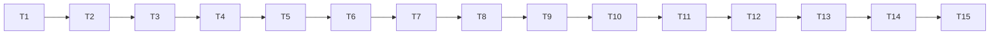

# Implementation Plan: kiro-power

## Overview

Implements `.kiro/specs/kiro-power/requirements.md` per `.kiro/specs/kiro-power/design.md`: the renderer polish, `graveyard check-install`, the `graveyard-mcp` server, the Power (Agent Plugins format) and its dogfood install. Each implementation task carries its own tests as sub-tasks. **T1 is the spike (KP-S1) and nothing else starts before it is done**, because it fixes the hook payload field names that every later task uses. T2 is the renderer polish. The last task is the gate.

Run every Python tool from `backend/` with `uv run` (`tech.md`). Before implementing a task, read the requirement IDs it names in `requirements.md` (requirements win over steering). Tests use the cassette and never the network; the autouse socket guard of `cli/tests/conftest.py` applies. After each task: `uv run ruff check`, `uv run ruff format --check`, `uv run mypy --strict core sources cli` (plus `mcp_server` once it exists) and `uv run pytest -q` are green. Property tests run under `HYPOTHESIS_PROFILE=ci uv run pytest -m property -q` from T5 on.

Documentation edits to the PRD and steering files are made only in T13, listed in its report. No task edits the cassette. No task adds a dependency except T3 (`mcp==2.3.0`).

## Task Dependency Graph

T4 to T6 need only T1 (field names) and T3. T7 (`sources`) needs nothing from T4 to T6 and may be done earlier, but the chain is kept linear so each task starts from a green suite. T9 needs T4 to T8. T11 needs T3 and the pipeline only.

## Tasks

- [x] T1 — Spike KP-S1: what a Pre Tool Use hook really receives and whether exit 2 blocks (KPW-SPK-1, KPW-SPK-2, KPW-SPK-3)
  - [x] T1.1 — Baseline: `git status --short .kiro docs`, `ls .kiro/hooks` (expected: `kiro-journal.json` only), `ls /tmp/graveyard-kp-s1` (expected: absent). Record the Kiro version if it can be read (`kiro --version`, or the About dialog value the user gives); if it cannot, write "not recorded".
  - [x] T1.2 — Create the probe with the **`createHook` tool** (never `fs_write`): id `kp-s1-probe`, name `kp-s1-probe`, trigger `PreToolUse`, matcher `shell`, action `command`, `timeout` 10. Command (one line, POSIX `sh`): `d=/tmp/graveyard-kp-s1; mkdir -p "$d"; f="$d/stdin-$(date +%s)-$$.json"; cat > "$f"; python3 -c 'import os; print("\n".join(sorted(os.environ)))' > "$d/env-names-$$.txt"; pwd > "$d/cwd-$$.txt"; if grep -q GRAVEYARD_KP_S1_SENTINEL "$f"; then echo "graveyard kp-s1 probe: sentinel blocked" >&2; exit 2; fi; exit 0`. It writes the raw stdin and the environment variable **names only** (never values) under the scratch directory, and exits 2 only when the raw stdin contains the sentinel. **While the probe exists, no shell command may contain the full sentinel text except T1.5's sentinel command** (the probe would block it); when searching the captures use a fragment such as `KP_S1_SENT`.
  - [x] T1.3 — Does it fire? Run the harmless command `echo kp-s1-harmless` with the shell tool and list `/tmp/graveyard-kp-s1`. **If no `stdin-*.json` exists, stop here, leave the probe in place, and tell the user exactly what to trigger**: hooks are documented as activating when a session starts, so ask them to start a new session (or toggle the hook in the Agent Hooks panel) and reply "continue"; say that the next step is T1.4. Do not go on, do not guess.
  - [x] T1.4 — Read the captures and report, in the task report, **without printing any environment value or session id**: the top-level keys of the payload; `hook_event_name`, `tool_name`; the keys of `tool_input`; whether a command field is present and its key; the key and value of the working directory (`cwd`) and whether it equals the workspace root; whether `cat` returned (that is, whether stdin was closed after the write: yes if the file is complete); the list of environment variable **names** and whether any name suggests it carries the tool call (`TOOL_*`, `COMMAND`, `HOOK_*`); the probe's own working directory from `cwd-*.txt`. **If the payload has no command field at all, stop and ask: the hook cannot work as designed.**
  - [x] T1.5 — Exit 2: run the sentinel command `touch /tmp/graveyard-kp-s1/sentinel-ran # GRAVEYARD_KP_S1_SENTINEL`. Report: whether the tool call was blocked, the exact text the model received back (the stderr line, or something else), whether `sentinel-ran` exists (it must not if the call was blocked), and whether a `stdin-*.json` capture exists for that call. **If the call ran (marker present), stop and ask: the blocking assumption (D3) is wrong.**
  - [x] T1.6 — Remove the probe: `delete_file` on `.kiro/hooks/kp-s1-probe.json`, then `ls .kiro/hooks` shows only `kiro-journal.json`. Delete `/tmp/graveyard-kp-s1` only after T1.7 has copied what it needs.
  - [x] T1.7 — Record the findings in `docs/SPIKES.md` under a `KP-S1` heading (create the file's structure to match its existing sections if it exists): Kiro version, date, tool name, a **redacted** sample payload (session id and absolute paths replaced; the command text may stay), and an **Observed fields** table with the rows `COMMAND_FIELD`, `CWD_FIELD`, `tool_name`, `stdin closed`, `exit 2 blocks`, `stderr reaches the model`, and a list of unmeasured items (exit 1, hook timeout, unapproved `${VAR}`, MCP server cwd), each marked "not documented, not measured". Add a short entry to `docs/KIRO_JOURNAL.md` (use `date +%F`). Then `rm -r /tmp/graveyard-kp-s1`.
  - [x] T1.8 — Tests (paired): `backend/tests/unit/test_spike_kp_s1.py` (run with `uv run pytest tests/unit/test_spike_kp_s1.py -q`; `tests` joins `testpaths` in T3): `.kiro/hooks/kp-s1-probe.json` does not exist; no file under `.kiro/hooks/` contains `GRAVEYARD_KP_S1`; `docs/SPIKES.md` has a `KP-S1` section with the six Observed-fields rows and a non-empty value for `COMMAND_FIELD` and `CWD_FIELD`.
  - [x] T1.9 — **Constants for later tasks.** State in the report the values to use for `COMMAND_FIELD`, `CWD_FIELD` and whether `cwd` is in the envelope or in `tool_input`. If they differ from `command` / `cwd` or the design's location of `cwd`, list the sentences of `requirements.md` and `design.md` that name them (KPW-PAY-3, design §5.1, §10.3) and fix them in the same task. Every later task imports the constants from `core.install.payload` and never types the literals.

- [x] T2 — Renderer polish: shrink order, Unknown clause, joins (KPW-POL-1…6)
  - [x] T2.1 — Baseline green. Before changing anything, render the anchors project (stub Syft, replay transport, `--as-of 2026-11-03`) with and without a token at widths 60, 80 and 100 and keep the outputs in a temp directory as "before" (stdout and stderr).
  - [x] T2.2 — Reproduce the two reported strings from the "before" outputs: search for `\S·` / `·\S` in every footer and note line and for `issuecounts`. Report what is found. The source search of 11 Nov 2026 found neither (`TOKEN_MISSING_DETAIL` has `issue counts`), so expect "not reproduced"; if one **is** found, find the source and fix it in T2.5.
  - [x] T2.3 — (a) In `cli/render.py` replace the two-step shrink by the `_SHRINK_ORDER` loop of design §14: `EXPOSURE` (floor 12), then `PACKAGE` (floor 20), then `WHY` (floor 8); `STATE` and `PRIORITY` never shrink.
  - [x] T2.4 — (b) The partial-evidence note omits the `; N packages Unknown` clause when `unknown_count` is 0 (design §14).
  - [x] T2.5 — (c) Add `_join(fragments, sep=" · ")` and rebuild `_footer` and `_unverified_line` from fragment lists through it. Fix only a real join found in T2.2.
  - [x] T2.6 — Tests (KPW-POL-5, KPW-POL-3), in `cli/tests/test_render.py` and a new `cli/tests/test_render_polish.py`: shrink order at widths 60, 70, 80, 100, 120 with rows that have a long `WHY`, a long `PACKAGE` and a long `EXPOSURE` (assert which cell changed first and that `WHY` is untouched while `PACKAGE` or `EXPOSURE` is above its floor); the Unknown clause for N = 0, 1, 2; the join tests at 60, 80 and 100 with and without a token (every `·` has a space on both sides; ` · ` count equals segments minus one; `TOKEN_MISSING_DETAIL` and `TOKEN_INVALID_DETAIL` equal their expected text and contain `issue counts`); a `@pytest.mark.property` test that output is deterministic, no line exceeds `max(width, floors + gaps)`, and `WHY` shrinks last.
  - [x] T2.7 — Update every existing expectation that depends on the old order or on `0 packages Unknown` (`test_render.py`, `test_e2e_*`, `test_readme.py` if it embeds output). In the report list each changed expectation as old line and new line. **If a change cannot be explained by (a), (b) or (c), stop and ask.**
  - [x] T2.8 — Add the "Amended by kiro-power" row for CLI-OUT-9 and CLI-GATE-3 to `.kiro/specs/graveyard-cli/requirements.md` (KPW-POL-6). `graveyard autopsy` exit codes and JSON are unchanged: run the existing exit-code and shape tests.
  - [x] T2.9 — Gate for T2: ruff, format, `mypy --strict core sources cli`, `pytest -q` green.

- [ ] T3 — Packaging, dependency and environment refactor (KPW-DEP-1, KPW-DEP-4, KPW-DEP-5, KPW-SEC-6, KPW-MCP-7 rule)
  - [~] T3.1 — Baseline: `git status --short pyproject.toml uv.lock` is empty (T2 does not touch them).
  - [~] T3.2 — Edit `backend/pyproject.toml`: add `[project.optional-dependencies] mcp = ["mcp==2.3.0"]`; add `"mcp==2.3.0"` to `[dependency-groups] dev`; add `graveyard-mcp = "mcp_server.__main__:main"` to `[project.scripts]`; add `"mcp_server"` to the wheel `packages`, `testpaths`, `[tool.mypy] files` and `known-first-party`; add `"tests"` to `testpaths`. Create `backend/mcp_server/__init__.py` (docstring only) and `backend/mcp_server/__main__.py` (placeholder `main()` that raises `SystemExit(0)`), `backend/mcp_server/tests/__init__.py`, `backend/tests/__init__.py` only if the repository's pytest layout needs it (check how `core/*/tests` do it). Check the newest `mcp` first: `curl -s https://pypi.org/pypi/mcp/json | python3 -c 'import json,sys; print(json.load(sys.stdin)["info"]["version"])'`; the design records 2.3.0 (11 Nov 2026); if it differs, use 2.3.0 anyway (the decision is exact) and report the difference.
  - [~] T3.3 — `uv lock` and `uv sync --all-extras` from `backend/`. Review `git diff --stat uv.lock` and `git diff uv.lock`: the only changes should be `mcp` and its transitive packages (expected from the dry run: `httpx2`, `starlette`, `uvicorn`, `sse-starlette`, `pydantic`, `pydantic-core`, `pyjwt`, `cryptography`, `cffi`, `python-multipart`, `jsonschema`, `opentelemetry-api`, `mcp-types`, `anyio`, `click`, …). **Stop and ask if an existing package (`httpx` 0.28.1, `packageurl-python`, `pyyaml`, a dev tool) changes version.** Report the added names, their licenses (`uv pip show` / PyPI metadata) and the diff stat.
  - [~] T3.4 — Run `pip-audit` (or the repository's equivalent from `tech.md`/CI) on the lock and report the result: `uv run --with pip-audit pip-audit --strict --disable-pip` is not assumed to work; if the tool cannot run offline or at all, say so and record it in the report as unverified.
  - [~] T3.5 — Move `_environment` from `cli/__main__.py` to `cli/env.py` as `environment_from_mapping(variables, width)` (parameter not named `environ`); `__main__.py` calls it with `os.environ`. Add the rule: a token or contact whose stripped value matches `^\$\{[A-Za-z_][A-Za-z0-9_]*\}$` is treated as absent (not "rejected"). Behaviour is otherwise unchanged.
  - [~] T3.6 — Tests: `cli/tests/test_packaging.py` extended (`mcp==2.3.0` exact in the extra and the dev group; `graveyard-mcp` script; `mcp_server` in the wheel packages; `tests` in `testpaths`); `cli/tests/test_env.py` and `test_properties_env.py` gain cases for `${GITHUB_TOKEN}` and `${GRAVEYARD_CONTACT}` (absent, no `GITHUB_TOKEN_INVALID` warning) and keep every existing case; a test that `import cli.__main__` works when `mcp` is blocked (`sys.modules["mcp"] = None` in a subprocess-free way via `monkeypatch`) (KPW-DEP-2). The CLI-DEP-5 guard still passes (no `environ` outside `__main__.py`).
  - [~] T3.7 — Verify: `uv run graveyard --version`, `uv run python -m cli --version`, `uv run python -c "import mcp.server.mcpserver"`; `uv build --wheel --out-dir "$(mktemp -d)"` lists `mcp_server/__main__.py` and no `/tests/` path; delete the temp directory; no `dist/` in the repo. Gate: ruff, format, mypy (add `mcp_server`), pytest green.

- [ ] T4 — `core/install`: model, payload, segmentation (KPW-PAY-3, KPW-PAY-4, KPW-PARSE-1…3, KPW-PARSE-11, KPW-PARSE-13 guard)
  - [~] T4.1 — Create `core/install/{__init__,model,payload,segments}.py` per design §3, §4.1, §4.2, §5.1. `COMMAND_FIELD` and `CWD_FIELD` take the values recorded by T1.9. `Target.purl_text(version)` builds the purl through `core.purl.Purl` + `format_purl`.
  - [~] T4.2 — First verify the `shlex` assumptions of design §4.2 in a scratch script (not committed): custom `punctuation_chars`, `whitespace` reassigned after construction, newline as a token, `2>&1`, `$(`, unbalanced quote. Pin each observed behaviour as a row in `test_segments.py`. If `shlex` cannot keep newline as a separator, implement the quote-aware operator scanner of the design fallback and say so in the report.
  - [~] T4.3 — Tests: `core/install/tests/test_payload.py` (valid payload with the observed names; missing `tool_input`; `tool_input` not an object; command not a string; empty command; 64 KiB + 1 command; `cwd` non-string, with NUL, over 4 096; depth > 16; invalid JSON; arrays; very large text; payload built with the constants); `test_segments.py` (table of command → segments: `&&`, `||`, `;`, `|`, `&`, newline, quoted operators stay inside a word, redirection tails dropped with a preceding digit token, `(`/`)`/`<<` poisoned, unbalanced quote, control characters, comment `# …`); `test_guards.py` (KPW-PARSE-13) with bad-sample tests for each rule; a `@pytest.mark.property` totality test for `split` and `extract_payload` over `st.text()` and recursive JSON.
  - [~] T4.4 — Gate for T4: ruff, format, mypy strict, pytest green.

- [ ] T5 — `core/install`: option tables, npm and Python argument classification, `parse_install` (KPW-PARSE-4…12; KPW-TEST-1…4)
  - [~] T5.1 — Write `profiles.py` (design §4.4 tables as data), `npmish.py` and `pyish.py` (design §4.5, with `Pinned`, `Latest`, `Range` per D12), and `parse.py` (design §4.3: prefix, program, verb, options, packages, `-r` refs, caps, de-duplication where `Pinned` beats `Latest` beats `Range` for the same key).
  - [~] T5.2 — Example tests `test_parse_examples.py`: every row of the design §4.5 table (including the `-r`, `-c`, range, `sudo -E`, unknown-option, registry-option and `bash -c` rows), plus: `npm ci`, `npm run build`, `pip uninstall x`, `uv sync`, `yarn install`, `poetry install` yield nothing; `npm install` / `pip install` alone yield nothing; the 21st distinct target sets `truncated`; the 6th `-r` is dropped; a custom registry flag drops the segment's `-r` files.
  - [~] T5.3 — Property tests `test_parse_property.py` + `strategies.py` (design §10.1, KPW-TEST-1…4): round trip over rendered commands for every program/verb, every option in `profiles.py` before/between/after packages in both `--o v` and `--o=v` forms, `--`, quoting, scoped names, all `Pinned`/`Latest`/`Range` spellings, extras, markers, prefixes, tails, noise segments; skipped forms alone and mixed (KPW-TEST-2); non-install commands (KPW-TEST-3); totality and determinism (KPW-TEST-4); order preserved; a coverage test that iterates the option tables and asserts each option parses like its absence. `max_examples=500` in CI.
  - [~] T5.4 — Record in the report any option or form found missing while writing the strategies, and whether it was added to the tables.
  - [~] T5.5 — Gate for T5 including `HYPOTHESIS_PROFILE=ci uv run pytest -m property -q core/install`.

- [ ] T6 — `cli/requirements_file.py` (D19; KPW-REQ-1…7, KPW-SEC-7, KPW-TEST-11)
  - [~] T6.1 — Implement `load_requirements` and `base_directory` per design §7.2. No other module reads a `-r` file. Extend `cli/tests/test_guards.py` (file reads allowed in `lockfiles.py`, `sbom.py`, `requirements_file.py` and the JSON writer only) with bad-sample tests.
  - [~] T6.2 — Tests `cli/tests/test_requirements_file.py` (`tmp_path`): the list of KPW-TEST-11, namely a valid file; relative path against the payload `cwd`; absolute inside/outside; `..` escape; escaping symlink; directory; FIFO (`os.mkfifo`, never opened); oversized file (assert it is not read in full: wrap `open` or check bytes requested); `~`, `$`, glob, `://` paths; nested `-r`/`-c` lines counted; URL/path and unpinned lines counted; binary junk; a `.env`-style file whose lines never appear in the returned object's `repr` or any rendered note; more than 5 files; duplicate targets across files; 25 pinned lines; the fragment text of KPW-REQ-7 for each reason.
  - [~] T6.3 — Property test: `load_requirements` never raises for arbitrary file content (written to `tmp_path`) and arbitrary path text, and every returned target is `Pinned` with a name accepted by `core.purl`.
  - [~] T6.4 — Gate for T6.

- [ ] T7 — `sources.resolve_latest` (D11; KPW-RES-1…6)
  - [~] T7.1 — Read `sources/session.py`, `sources/clients/registry.py`, `core/sources/parse/registry.py`, `core/sources/assemble.py` (`resolve_latest`). Add `LatestResult` (`core/sources/model.py`), `RegistryLatest` (`core/sources/facts.py`), `parse_npm_latest` / `parse_pypi_latest`, `core/sources/latest.py::pick_latest` and make `assemble.resolve_latest` call it; add `registry.npm_latest` / `registry.pypi_latest` (own namespaces, design §6) and `SourceSession.resolve_latest`. Keep `core/sources` free of I/O (its guard test).
  - [~] T7.2 — Tests (cassette replay, `log.unmatched == []`): `express` → `5.3.0` (and not `4.22.3`), `request` → `2.88.2`, `six` → `1.17.0`; registry 404 → `error`, no deps.dev request; registry failure → deps.dev default version (use a transport that fails the registry URL only); invalid / versioned / non-npm-PyPI purls → `ValueError`; input order and duplicates; `pick_latest` unit and property tests (a usable registry version always wins; `None` only when neither is usable); existing `assemble.resolve_latest` tests pass unchanged.
  - [~] T7.3 — Confirm in the report whether the gateway coalesces the second registry read (KPW-RES-4 does not require it). Gate for T7: the whole `sources` and `core/sources` suites green.

- [ ] T8 — `cli/hook.py` and `cli/stdin.py` (KPW-MAP-1…7, KPW-PAY-1, KPW-PAY-2, KPW-TEST-5, KPW-TEST-10)
  - [~] T8.1 — `cli/hook.py` per design §7.4: `HookExit`, outcome types, `blocks`, `decide`, the block message and the joined note (fragments in the order of KPW-MAP-5, 200-character cut, "and N more" beyond two). Pure; no I/O.
  - [~] T8.2 — `cli/stdin.py` per design §5.2 (daemon thread, `read1`, incremental UTF-8 decoder, stop on a complete JSON object, 1 MiB cap, `isatty` shortcut).
  - [~] T8.3 — Tests: `cli/tests/test_hook_decide.py` (exact texts of the block message and every note fragment; one, several and more than ten blocking packages; the 200-character cap; hostile names with control characters, bidi overrides and ANSI sequences; range cases: declared-Dead gate-eligible range blocks, Cursed range and score-Dead range do not and give the `range not checked against` fragment; unverified Dead gives the unverified fragment; timeout > could-not-check > range > unverified > files > truncated ordering in the joined note); `test_hook_property.py` (`@pytest.mark.property`, KPW-MAP-6 against the oracle in design §10.2, including permutation, monotonicity, exit ∈ {0, 2}, one line, `sanitise`-stable); a consistency test that builds real `Report`s from the cassette via `rank` and asserts `decide(...).exit == BLOCK` iff `bool(report.matches)` for non-range targets; `test_stdin.py` (KPW-TEST-10 with `os.pipe()`: closed pipe; never-closed pipe returns the payload; never-written pipe returns `None` after 0.2 s; over 1 MiB; terminal-like stream; invalid UTF-8; a payload split across two writes); a test that `HookExit` equals the exit-code table text used in `--help` (the table is added in T9, so this test lands there).
  - [~] T8.4 — Extend `test_guards.py` for `hook.py` (no I/O, no `asyncio`) and `stdin.py` (`threading` only here). Gate for T8.

- [ ] T9 — `cli/check_install.py`, dispatch, help and entry-point guard (KPW-CMD-1…6, KPW-BUD-1…4, KPW-PAY-1, KPW-TEST-6, KPW-TEST-14…16)
  - [~] T9.1 — Implement `parse_check_args`, `evaluate` and `run` per design §7.1 to §7.3: payload or `COMMAND`, `parse_install`, requirement files, one session, `resolve_latest` for non-pinned targets, one task per target, a single deadline, `Checked` built from `rank` rows (with `dead_reason` and `is_range`), `decide`. Top-level guard exit 0 with the internal-error note.
  - [~] T9.2 — Wire `app.run(..., stdin=None)`: dispatch `check-install` before the `autopsy` parser; `graveyard --help` lists it and shows the check-install exit-code table (generated from `HookExit`); `autopsy --help` unchanged. `cli/__main__.py`: for `check-install`, pass `lambda: read_hook_payload(sys.stdin.buffer)` and wrap the call in the `BaseException` guard of design §7.5 (a `SystemExit` from `--help` is re-raised; everything else prints the internal-error line and exits 0).
  - [~] T9.3 — Tests `cli/tests/test_check_install_cli.py`: option parsing (`--budget` bounds, `--as-of`, two `COMMAND`s, unknown option → exit 0 with the usage note, never exit 2 from a usage error); `--help` / `--version` exit 0; the exit-code table text equals `HookExit` (KPW-TEST-16) and appears in `--help`; `autopsy` exit codes 0 to 4 and its epilog unchanged (KPW-TEST-15); a `COMMAND` argument reads nothing from stdin (stdin callable that fails the test if called); an empty / non-install / no-target payload prints nothing and makes **no network request** (transport that fails the test if called).
  - [~] T9.4 — Budget tests (KPW-BUD-3): a transport whose handler awaits `asyncio.sleep(3600)` with `--budget 0.5` returns exit 0 and the timeout fragment in under 3 s; a two-package command where one package is answered from the cassette (declared Dead, gate-eligible) and one never answers exits 2 and the block message names only the first; resolution timing out leaves pinned targets running.
  - [~] T9.5 — Never-raises tests `test_check_install_never_raises.py` (KPW-TEST-6): arbitrary text / binary-derived / JSON payloads (with `cwd` text) and arbitrary `argv` with a failing transport: exit 0 (or 2 only from a generated block), at most one stdout line of ≤ 200 characters, nothing on stderr unless it is a block; fault injection of `parse_install`, `load_requirements`, `evaluate`, `rank`, `decide` and `clock.now` raising `RuntimeError("secret-text")`: exit 0, the internal-error note, `secret-text` absent from all output; a `KeyboardInterrupt` through the entry point gives exit 0.
  - [~] T9.6 — Red-team test (KPW-SEC-3): package names, commands and requirement-file lines carrying control characters, bidi overrides, ANSI escapes, shell metacharacters and injection phrases; assert no raw control character or URL in any output.
  - [~] T9.7 — Guard tests (KPW-TEST-14): `check_install.py` imports no `subprocess`, `httpx`, `threading`; no `environ`; no `print`/`input`/`logging`. Gate for T9 including `uv run graveyard check-install --help` and `echo '{}' | uv run graveyard check-install; echo $?` (prints nothing, exit 0).

- [ ] T10 — End to end against the recorded cassette (KPW-TEST-7, KPW-TEST-8)
  - [~] T10.1 — In `cli/tests/support.py` add the version-agnostic OSV wrapper (answers an OSV query for a recorded package at another version with that package's recorded answer; counts uses). Do not touch the cassette. Unit-test the wrapper in `test_support.py`.
  - [~] T10.2 — `cli/tests/test_check_install_e2e.py` through `app.run`, `--as-of 2026-11-03`, `log.unmatched == []`: `npm install request` → 2 (stderr has `npm request@2.88.2`, `Dead`, `Cursed`, `declared dead`; stdout empty); `npm install express` with a token → 0, silent, structured result `express@5.3.0` not blocked (read the actual state from the `Checked` outcome through the `evaluate` seam, record it in the report; if it is not Alive, assert "not blocked" and say what it is); `pip install six` without a token → 0 and stdout exactly `graveyard: six@1.17.0 unverified (no GitHub data), not gated`; ranges `npm install request@^2` → 2, `npm install express@^5` → 0, `pip install "six<2"` no token → 0; the Cursed / Dead-by-score range case (`pip install "pycrypto<3"` with a token if the cassette answers it, otherwise a seam test with a hand-built row; say which); compound (`cd web && npm install request`), `sudo pip install six==1.17.0`, `yarn add request@2.88.2 -D`, `pnpm add -D express`; `-r` cases with files under `tmp_path` and the payload `cwd` set to it (the file holds `six==1.17.0`, `-r other.txt`, a `git+https://…` line, an unpinned `requests`, a comment → exit 0, one stdout line with the `six` fragment and `requirements.txt: 3 lines not checked (unpinned, URL or path, nested -r)`); `-r` pointing outside the base → no read, note `not read (outside)`; non-install / unsupported forms (`npm install`, `npm install ./local`, `npm install git+https://…`, `ls`) → 0, empty stdout, `log.matched == []` and no request.
  - [~] T10.3 — The same three headline commands delivered as the hook payload, built with `COMMAND_FIELD` / `CWD_FIELD` and `tool_name` as observed by T1, through the `stdin` seam; results identical. Determinism: two runs give byte-identical output.
  - [~] T10.4 — Token test (extends CLI-SEC-5 to this command): a distinctive token value appears nowhere in stdout or stderr. Gate for T10.

- [ ] T11 — `mcp_server` (D9, D10, D17, D20; KPW-MCP-1…10, KPW-TEST-12)
  - [~] T11.1 — Before writing, read the installed SDK (`backend/.venv/.../mcp/server/mcpserver/server.py`, `exceptions.py`) and confirm: the `MCPServer` constructor arguments (`name`, `instructions`), `tool(...)` parameters (`annotations`, `structured_output`), `ToolAnnotations` import path, `ToolError`, the in-memory client/server pairing for tests (name and import path), and what a `dict[str, Any]` return becomes. Record any difference from design §8.1 and adapt.
  - [~] T11.2 — Implement `paths.py` (`confine`), `output.py` (`sanitise_tree`, `cap_packages` with the always-present `truncated`), `tools.py` (`run_package`, `run_project`, `ToolFailure`), `server.py` (`build_server`, semaphore, `anyio.to_thread`), `__main__.py` (the only `os.environ` reader; `environment_from_mapping`; `GRAVEYARD_MCP_ROOT` rules; stdio run).
  - [~] T11.3 — Tests `mcp_server/tests/`: `test_paths.py` (inside, outside, `..`, escaping symlink, file, missing, unreadable; the error never contains the path); `test_output.py` (sanitising of keys and values, bidi / control characters, `truncated: false` shape, `truncated: true` with the first 50 packages in rank order, counts, `summary` kept; under the limit the document equals the CLI's plus `truncated`); `test_tools.py` (invalid, versionless, `pkg:maven/…` purls give the CLI messages; internal-error text has no exception text; token never in any result or error); `test_server_inmemory.py` (exactly two tools with the read-only annotations; `autopsy_package("pkg:npm/request@2.88.2")` through the in-memory pair with the cassette transport equals `report_to_dict` plus `truncated: false` and passes the committed shape file extended with `truncated`; `autopsy_project` on the anchors project with the stub Syft returns the nine packages; two concurrent calls are serialised; `${GITHUB_TOKEN}` literal treated as absent); `test_guards.py` (environment only in `__main__.py`; no `subprocess`; no file writes), each with a bad-sample test.
  - [~] T11.4 — Start the real server over stdio from a scratch script (not committed): send `initialize`, `tools/list` and one `tools/call` for `autopsy_package` with the cassette transport unavailable, so expect a degraded result or a tool error and not a crash; report what happened. Gate for T11: ruff, format, mypy strict including `mcp_server`, pytest green.

- [ ] T12 — The Power, the dogfood install and their tests (D1; KPW-PWR-1…8, KPW-INST-1…6, KPW-TEST-9, KPW-TEST-13)
  - [~] T12.1 — Confirm the `uvx --from "graveyard-backend[mcp] @ git+…@<sha>#subdirectory=backend" graveyard-mcp` spelling with uv's current CLI against the **local checkout** (`--from "graveyard-backend[mcp] @ file://…/backend"` stands in for the git URL); and the bare form without the extra for `graveyard check-install`. Record what works; adapt design §9.1 and the README.
  - [~] T12.2 — Create `powers/graveyard/plugin.json`, `mcp.json`, `skills/check-before-adding-dependency/SKILL.md`, `skills/reading-a-verdict/SKILL.md`, `skills/install-blocker-hook/SKILL.md` and `references/dead-install-blocker.json` per design §9.1 and §9.2 (final wording; the pin is the placeholder of KPW-PWR-8). **Do not create `POWER.md`.** Skill names equal their folders; descriptions ≤ 1 024 characters; no skill states a weight, threshold or percentage of the model.
  - [~] T12.3 — `powers/graveyard/README.md` (KPW-PWR-7): clone + *Import power from a folder* (documented path), *Import power from GitHub* (sub-folder URL not documented), `GITHUB_TOKEN` approval, the hook through the skill, the dry-run check (`graveyard check-install "npm install request"` exits 2), the exit-code table, and every limit: token, Windows, build-dependent payload delivery (cite the spike result), the stdout note, the latest-version approximation and the range rule, redirections, `-r` handling and its confinement, fail open, `uv tool install` advice. Cite the Install-powers page for "`plugin.json` alone suffices".
  - [~] T12.4 — `scripts/hooks/sync-power.py` (stdlib only; `--check`; table in design §9.3; merges into an existing `.kiro/settings/mcp.json`). Run it to create `.kiro/hooks/dead-install-blocker.json`, `.kiro/skills/check-before-adding-dependency/SKILL.md`, `.kiro/skills/reading-a-verdict/SKILL.md` and `.kiro/settings/mcp.json`. Check `git status`: no other `.kiro` file changed; `kiro-journal.json` untouched.
  - [~] T12.5 — Tests `backend/tests/integration/test_power_package.py`, `test_power_hook_command.py`, `test_power_drift.py` (KPW-TEST-9, KPW-TEST-13, KPW-INST-4, KPW-INST-5): `plugin.json` fields and keyword set; no `POWER.md`; `mcp.json` rules (references only, pinned, no `autoApprove`, no token-like literal, `RELEASE_PIN_REQUIRED` constant); skill front matter and size; hook template and in-repo hook schema fields (`trigger == "PreToolUse"`, `matcher == "shell"`, `timeout == 20`); the hook command strings run through `sh -c` with fakes exiting 0, 1, 2, 3, 126, 127, 139 and a missing executable (2 only for 2; missing → 0; output passes through; stdin reaches the fake) and a fake `uv run` that exits 2 (documents D4; if real `uv run` can be shown offline to exit 2 on a failure, record it); drift test (`sync-power.py --check`); README mentions each limit.
  - [~] T12.6 — Dry-run the installed pieces by hand from `backend/`: `echo '{"tool_input":{"<COMMAND_FIELD>":"npm install request"}}' | .venv/bin/graveyard check-install` with the **network available** and no token: report the exit code (expected 2 if the live registry still marks `request` deprecated; if it is 0, say why) and the elapsed time. Gate for T12.

- [ ] T13 — Documentation and amendments (KPW-INST-6, KPW-TEST-16; "Belongs elsewhere" edit row)
  - [~] T13.1 — `cli/README.md`: add `check-install` (usage, exit-code table from `HookExit`, the fail-open statement, the range rule, `-r` handling). A test (extends `test_readme.py`) compares the table with `HookExit`.
  - [~] T13.2 — Edit, and list in the report with the old and new sentence: `docs/PRD.md` (H9 command and description: stdin payload, no `"$COMMAND"`, mapping now in the snippet and `check-install`; KP-1/KP-2/KP-3 and §14: `mcp_server/`, Agent Plugins format with skills, hook template; mark H9 implemented), `.kiro/steering/structure.md` (`mcp_server/`, `core/install/`, `cli` may import `core.install`, `powers/graveyard/`, `.kiro/skills/`, `scripts/hooks/sync-power.py`), `.kiro/steering/testing.md` (coverage gate adds the new modules), `.kiro/specs/graveyard-cli/requirements.md` ("Belongs elsewhere" rows for *Hook exit-code mapping*, *check-install and scan*, *Rename* marked done by `kiro-power`, with the spike result). **Do not edit anything else.**
  - [~] T13.3 — `README.md` (repository root): a short "Kiro Power" install section pointing at `powers/graveyard/README.md` (KP-4).
  - [~] T13.4 — `docs/KIRO_JOURNAL.md`: the entry for this spec's parent tasks in the format of the existing `kiro-journal` hook (use `date +%F`), noting the spike, the polish, the `-r` decision and the range rule. Gate for T13: markdown links resolve (`grep` for paths), the README table test passes.

- [ ] T14 — Live smoke and in-Kiro observation (manual, not CI; KPW-TEST-17)
  - [~] T14.1 — With the network and the hook installed from T12, from `backend/`: ten timed runs of `.venv/bin/graveyard check-install "npm install request"` and ten of `"npm install express"`; record exit codes, p50 and p95 against the 10 s budget in `docs/KIRO_JOURNAL.md`. If p95 exceeds 10 s, report the dominant source from the autopsy stats and stop to ask.
  - [~] T14.2 — In Kiro, in a scratch directory outside the repository, ask the agent to run `npm install request` (the hook is workspace-level, so run it in this workspace's terminal tool with a throw-away `--prefix /tmp/kp-live` command: `npm install --prefix /tmp/kp-live request`). Observe: the call is blocked, the model sees the reason, nothing is installed. Then `npm install --prefix /tmp/kp-live express` is allowed. **Do not actually install `request`: if the first call is not blocked, stop immediately and report.** Delete `/tmp/kp-live` afterwards.
  - [~] T14.3 — Observe and record what the hook does when no token is set in the IDE's environment (expected: `request` still blocks; score-based verdicts are unverified). Record the observations in `docs/SPIKES.md` under KP-S1.

- [ ] T15 — Final gate (all `KPW-*`; coverage ≥ 85 % on the new modules). Run from `backend/`; fix and re-run until all pass.
  - [~] T15.1 — `uv run ruff check` and `uv run ruff format --check` clean.
  - [~] T15.2 — `uv run mypy --strict core sources cli mcp_server` clean, no blanket `type: ignore`.
  - [~] T15.3 — `uv run pytest -q` green (including `tests/`), and `uv run pytest -m "not syft" -q` green.
  - [~] T15.4 — `HYPOTHESIS_PROFILE=ci uv run pytest -m property -q` green.
  - [~] T15.5 — **Coverage:** `uv run pytest --cov=core.install --cov=cli.hook --cov=cli.check_install --cov=cli.requirements_file --cov=cli.stdin --cov=mcp_server --cov-report=term-missing --cov-fail-under=85` passes; report the per-module percentages (KPW-TEST-18). The existing `cli` and `core` gates still pass: `uv run pytest cli --cov=cli --cov-fail-under=85`.
  - [~] T15.6 — Requirements check: for every `KPW-*` ID, name the test or task that covers it (a table in the report); list every ID with no test and why. Confirm: `POWER.md` absent; `.kiro/hooks/` holds `dead-install-blocker.json` and `kiro-journal.json` only (no probe); `git status` shows no `dist/`, no `.hypothesis` additions committed, no secrets (`gitleaks` if installed).
  - [~] T15.7 — Report what was **not** verified: anything marked "to be confirmed" in the design that T1, T4.2, T11.1 or T12.1 did not settle, the unmeasured items of the spike, the live-smoke results if T14 was not run, and `pip-audit` if it could not run.
