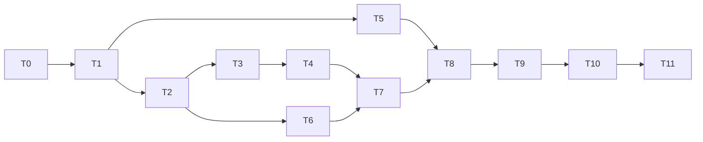

# Implementation Plan: mortality-model-v2
## Overview
Implements `.kiro/specs/mortality-model-v2/requirements.md` (rev 3, amendments A1 to A7) per `.kiro/specs/mortality-model-v2/design.md`. Order: lock v1, probe moved repositories, build and run the failure analysis, **stop for the maintainer's conclusion and the mechanism amendment**, build the held-out tooling (not run), change the capture path, implement v2 per the approved amendment, freeze, then the manual held-out steps, then one run per model.

**Working rules for every task the agent runs:**
- Run every Python tool from `backend/` with `uv run` (`tech.md`). No `PYTHONPATH`.
- No task adds a dependency. `uv.lock` must not change. New scripts use the standard library and the `httpx` pin already used by `scripts/capture_eval.py` (PEP 723 header).
- **Locked files are never edited.** The files of `eval/V1_LOCK.json` (design 3.1) are frozen. If a task seems to need an edit to one, stop and ask (design 3.3).
- **No v2 code before T4.5.** That means nothing under `core/scoring/v2/`, no `versions.py`, no `weights.v2.yaml`, no v2 entry in any registry, and no v2 test file.
- **Network and credentials.** The agent never runs `scripts/heldout_pin.py`, `heldout_draw.py`, `heldout_fpool.py`, `heldout_batch.py`, `probe_moved_repo.py`, `capture_eval.py` or `capture_anchors.py`, never runs the coroner, never runs `check_still_works.py` (Docker), and never reads `GITHUB_TOKEN`. Offline commands, `make_v1_lock.py` (local `git` reads only) and `python -m eval ...` are allowed.
- **The agent never commits or tags.** Commits and tags named in MANUAL tasks are the maintainer's.
- **No real held-out data exists until T9.** Tests build synthetic data in `tmp_path`. A real-data test skips only when its whole data group is absent, with an explicit skip reason; T8.1 lists which tests skip.
- Before each task, read the `MV2-*` IDs it names in `requirements.md` and the amendments A1 to A7; requirements win over the design if they differ.
- **Stop conditions are marked in bold. When one fires, stop and report instead of changing a literal, a threshold or a locked file.**
- **When execution reaches a task marked MANUAL, stop and hand over to the maintainer. Do not carry out its steps.**
- **STOP checkpoints** are marked `STOP`. Execution does not pass one until the maintainer says so.
- After the `mortality-v2-frozen` tag: a harness change needs a prior, dated, named entry in `eval/heldout/AMENDMENTS.md`; any other frozen file is a new model version. After a held-out result exists, nothing about v2 changes.
- The journal hook writes entries after tasks; MANUAL tasks end with the maintainer's own journal line.

## Task Dependency Graph

T2 (probe) runs early because the `GITHUB_TOKEN` expires about 20 Nov 2026. T5 (held-out tooling) needs only the closure tool of T1 and may run while T4 waits for the maintainer. T7 needs the approved amendment of T4 and the capture change of T6. T8 to T11 are strictly ordered.

## Tasks
- [ ] T0 — Baseline, guards, requirements tag (existing)
  - [ ] T0.1 — Baseline. From `backend/`: `git status --short pyproject.toml uv.lock` is empty; `git tag --list eval-v1-result` prints the tag; `uv run ruff check`, `uv run ruff format --check`, `uv run mypy --strict core sources cli eval` and `uv run pytest -q` are green; `make eval` exits 1 (the recorded gate failure) and `git diff --quiet eval/results.json` shows no change. **If anything is red, the tag is missing, or `results.json` changed, stop and ask.**
  - [ ] T0.2 — Make the eval guards recursive (design 5). In `backend/eval/tests/test_guards.py`, change the module glob from `*.py` to `**/*.py` excluding `tests/`, and add a bad-sample test that puts a banned import in a nested module (for example `eval/heldout/x.py`) and checks it is caught. `uv run pytest -q backend/eval` is green. No other file changes.
  - [ ] T0.3 — **MANUAL (maintainer): confirm the existing requirements tag. Do not create a second one.** The tag `v2-requirements` already exists (commit `2f3c3ab`, pushed 14 Nov 2026, holding `requirements.md` revision 3). Check `git tag --list v2-requirements` and `git ls-remote --tags origin v2-requirements`; note the commit in the journal. `design.md`, `tasks.md` and the amendments A1 to A8 to `requirements.md` come after the tag and are committed normally; they are included by the `mortality-v2-analysis` tag (T4.3). The order script does not exist yet, so `mortality-v2-analysis` (T4.3) is the only tag created by hand; `check_heldout_order.py --verify-all` checks both afterwards (T5.22 to T5.24, T8.2).

- [ ] T1 — v1 lock (MV2-ISO-1, ISO-3, LAB-1; design 3, 4.2)
  - [ ] T1.1 — Create `backend/eval/manifest.py` with `ManifestError` and `closure(entry_module, root) -> tuple[Path, ...]` per design 4.2: first-party (`core.*`) imports only; parent `__init__.py` files included; star imports, `importlib`, `__import__`, `exec`, `eval`, `compile` and unresolvable first-party imports raise `ManifestError`; sorted by repo-relative path. Pure Python (the guards apply). Tests in `backend/eval/tests/test_manifest_closure.py` on synthetic package trees in `tmp_path`: parent inits, relative imports, third-party and standard library not followed, one test per rejected construct, and a property test that the result does not depend on file listing or import order.
  - [ ] T1.2 — Test `closure("core.scoring", <backend dir>)` on the real tree: it contains `__init__.py`, `classify.py`, `constants.py`, `normalise.py`, `priority.py`, `score.py`, `sort.py`, `types.py`, `weights.py` under `core/scoring/` and nothing under `core/sources`, `core/graph` or `cli`. **If the real closure holds anything else, stop and report it; the lock must list exactly what v1 executes.**
  - [ ] T1.3 — Add `labelling_section(text, number) -> str` to `eval/manifest.py` (text from the `## <number>.` heading to the next `## ` heading, LF endings) with tests (sections 1, 2, 6 and 8 of the real `LABELLING.md` are non-empty and distinct; a missing section raises).
  - [ ] T1.4 — Write `scripts/make_v1_lock.py` (standard library plus `sys.path` insertion of `backend/` to import `eval.manifest`). It builds the file list of design 3.1 (frozen v1 data, v1 closure, the nine anchor fixtures), reads each file's bytes with `git show eval-v1-result:<path>`, aborts if a closure file differs between the working tree and the tag, hashes `labelling_sections` 1, 2 and 6 from the tagged `LABELLING.md`, and writes `eval/V1_LOCK.json` by exclusive create (refuses to overwrite; `--out` for tests). Tests in `backend/tests/unit/test_make_v1_lock.py` use a temporary git repository with a fake tag: good case, missing tag, tree/tag mismatch, existing output refused, deterministic bytes.
  - [ ] T1.5 — Run `python3 scripts/make_v1_lock.py` (local git only) to create `eval/V1_LOCK.json`. Report the file count per group and the three section hashes. **If the tag is absent or the script aborts on a mismatch, stop and report.**
  - [ ] T1.6 — Write `backend/eval/tests/test_v1_lock.py` (design 3.2): `test_lock_matches_disk`; `test_lock_matches_tag` (skipped, with a reason, when `git` or the tag is absent; no new pytest marker); `test_labelling_sections_unchanged`; `test_v1_closure_excludes_v2` (asserts `versions.py` and `v2/` are not in the v1 closure; passes now because they do not exist); `test_default_scoring_is_v1` over the nine anchors and every v1 fixture.
  - [ ] T1.7 — Gate: `uv run pytest -q`, `uv run ruff check`, `uv run ruff format --check`, `uv run mypy --strict core sources cli eval` are clean; `make eval` leaves `eval/results.json` byte-identical; `git status --short` shows only the new files of T1 and the T0.2 edit.

- [ ] T2 — MV2-SRC-2 probe (D10; MV2-SRC-2; design 12.2). Do this early: the token expires about 20 Nov 2026.
  - [ ] T2.1 — Create `backend/eval/probe.py` (pure): a frozen dataclass for one measurement (S3, S4, S5, S6 open, S6 closed, S8, archive flag; each a scalar or `None`) keyed by `(subject, path, key)` where `path` is `capture` or `library` and `key` is `old` or `current`, and `decide(measurements) -> Verdict` with `FOLLOWS`, `FAILS` (naming the failing sources and signals) and `INCONCLUSIVE`, exactly the table in design 12.2. The `library` path never decides. Tests: fewer than 2 confirmed-moved subjects gives INCONCLUSIVE; all equal and present gives FOLLOWS; one missing or different signal on the capture path gives FAILS; a library-only difference does not change the verdict; seeds marked not moved are ignored; the result does not depend on input order (property).
  - [ ] T2.2 — Create `eval/analysis/moved-repo-probe/seeds.tsv` (columns `old_name, repository_id, observed`): `visionmedia/debug` 2871998, `mishoo/UglifyJS2` 5569059, `substack/node-browserify` 931039, `visionmedia/express` 237159, each with the note "REST GET /repos/<old> returned 301 on 14 Nov 2026". Read `scripts/capture_eval.py` and `scripts/capture_anchors.py` and write down, in the script's module docstring, the exact functions used for the GitHub phase, the deps.dev project lookup and the Scorecard lookup. **If the capture path cannot be called per repository without running a whole capture, stop and report before writing the script.**
  - [ ] T2.3 — Write `scripts/probe_moved_repo.py`, part 1: PEP 723 header with the pins of `capture_eval.py`; environment `GITHUB_TOKEN` and `GRAVEYARD_CONTACT` (scrubbed errors, token never written anywhere); subject building (the four seeds resolved with `GET /repositories/<id>`; every distinct `repo` of `eval/fixtures/**` checked with GraphQL `nameWithOwner`; a mismatch is a subject); confirmation (REST `GET /repos/<old>` read as a non-followed 301, `Location` host `api.github.com` and path `^/repositories/[0-9]+$`, then `GET /repositories/<id>` for `full_name`); write `subjects.tsv`. Network I/O only through one function so tests can fake it.
  - [ ] T2.4 — Probe script, part 2: for each confirmed-moved subject, call the capture-path functions named in T2.2 keyed by the old and by the current name back to back; repeat a pair once if S3 differs; store parsed scalars only (no response text); optional `--library` adds an informational measurement with the `backend/sources` clients (it never decides); write `results.json` and `result.md` with the verdict from `eval.probe.decide`. Exit 0 for FOLLOWS or FAILS, 1 for INCONCLUSIVE, 2 for usage or missing environment.
  - [ ] T2.5 — Tests in `backend/tests/unit/test_probe_script.py` with a fake transport in the style of `test_capture_script.py`: a 301 is not followed; a `Location` with another host or an unexpected path is rejected; a seed whose current name equals the old name is recorded as not moved; no response body text and no token appear in any output file; the S3 repeat rule; exit codes; missing environment gives exit 2.
  - [ ] T2.6 — **MANUAL (maintainer, `GITHUB_TOKEN`, before 20 Nov 2026): run the probe.** Check the token expiry first. Trial: run with the seeds only. Then run in full from the repo root and commit `eval/analysis/moved-repo-probe/`. Read `result.md`. **STOP**: record the verdict in the journal. FOLLOWS: T6.3 is not needed. FAILS: T6.3 is required. INCONCLUSIVE: rerun or fix before T8.

- [ ] T3 — Failure-analysis tooling and run (MV2-FA-1 to FA-7; design 6)
  - [ ] T3.1 — `backend/eval/analysis.py`, part 1 (pure): `build_row_detail(row, fixture, weights) -> dict` with the `identity`, `verdict`, `raw`, `risks`, `groups` and `dominant_signal` blocks of design 6.2, using only public scoring functions and `months_between`. Tests: `effective_weight * risk * 100` equals the contribution for every present signal and contributions sum to `mortality_pre_s1` (property over generated signals); group shares sum to 1 when mortality is positive; `s1_override_applied` is true exactly when S1 raises the score; ties for the dominant signal go to the lowest risk id.
  - [ ] T3.2 — `analysis.py`, part 2: the missing-cause classifier (`scorecard_404`, `unavailable_other`, `no_repo`, `absent`, and `github_failed` for a failed GitHub batch note) read from fixture notes and flags; `build_analysis(rows, fixtures, weights, all_rows=False)` assembling `summary`, `rows`, `score_based_dead` (with `correct`), `missing_causes`. Tests on synthetic fixtures covering each cause class and the misclassified selection.
  - [ ] T3.3 — `analysis.py`, part 3: the two fixed counterfactuals (`staleness_missing`: r2 and r3 treated as missing; `scorecard_missing`: r4 and r8 treated as missing), each giving predicted-class counts by label, computed with the public scoring functions on altered risks. Tests: the `Weights` object and `weights.v1.yaml` hash are unchanged; counts sum to the row count; with no r2, r3, r4 or r8 present the counterfactuals equal the actual result.
  - [ ] T3.4 — `render_markdown(doc) -> str` per design 6.3: banner first line; recorded result table; confusion matrix; misclassified table; score-based Dead table; per-row blocks; counterfactual table; missing-cause table; no conclusion text. Tests: the banner is line 1; output is deterministic; a synthetic document renders every section.
  - [ ] T3.5 — Add the `analysis` subcommand to `eval/__main__.py` (reads through the loaders `run()` uses, same exit 3 conditions; writes `eval/analysis/v1-failures.json` and `.md` by temporary file and rename; `--all` flag) and the Makefile target `eval-analysis`. Update `test_makefile.py` to pin the new target and keep the `eval` and `eval-merge` recipes literal. Tests: `test_read_only` on a temporary copy of the data folder (the MV2-ISO-1 groups are unchanged and exactly two files are created), `test_deterministic`, `test_banner_present`, `test_conclusion_current` is written in T4.1, not here.
  - [ ] T3.6 — Run `make eval-analysis` (offline) and verify on the real data: 37 misclassified rows, and 30 score-based Dead rows split 13 correct and 17 incorrect. Add `test_misclassified_count` and `test_score_based_split` (real data, skipped with a reason if the lock does not match). **If a count differs from the recorded result, stop and report; do not adjust the code to match.** Print the list of misclassified row names and the counterfactual table in the report. Draw no conclusion.

- [ ] T4 — STOP: conclusion and the v2 mechanism amendment (MV2-FA-5, MV2-MOD-3, D11)
  - [ ] T4.1 — Write `test_conclusion_current` in `backend/eval/tests/test_analysis.py`: `eval/analysis/conclusion.md` must start with `report_sha256: <hash>` equal to the SHA-256 of `eval/analysis/v1-failures.json`; skipped with a reason only while the file does not exist.
  - [ ] T4.2 — **MANUAL (maintainer) STOP: review the report and write `eval/analysis/conclusion.md`.** First line `report_sha256: <sha256 of v1-failures.json>`. State whether "the score treats inactivity as death" is supported, and if not, which mechanism the rows point to, citing row names. Say "T4.3" to continue.
  - [ ] T4.3 — **MANUAL (maintainer): analysis tag.** Run `uv run pytest -q backend/eval` (the conclusion test must pass), commit `design.md`, `tasks.md`, `eval/V1_LOCK.json`, `eval/analysis/**` (report, conclusion and the probe record from T2.6), the analysis and manifest tooling and the T1 to T3 tests, then `git tag -a mortality-v2-analysis -m "failure analysis and conclusion"`.
  - [ ] T4.4 — Draft the design amendment for section 7 as a dated subsection of `design.md` ("7.5 Amendment, <date>, <name>") with the six items of design 7.3: the mechanism in plain words with the rows that motivate each change; every parameter with its rationale (none fitted to the v1 key); the files added to the closure, one entry per module; the property tests; how declared-Dead is preserved; the in-sample note; and any `types.py` change (default: none). End with a proposed list of sub-tasks for T7.4, one per module and one per property-test file, each small enough for one turn. Write no code. **If the conclusion supports no mechanism, stop and report instead of inventing one.**
  - [ ] T4.5 — **MANUAL (maintainer) STOP: approve the amendment.** Edit the amendment to add the line `Approved <date>` (or request changes). Nothing under `core/scoring/v2/`, `versions.py` or `weights.v2.yaml` is written before this line exists. Say "T7" to release the v2 tasks.

- [ ] T5 — Held-out tooling: built and tested on synthetic data, not run on real populations. May run while T4 waits. **Create no file under `eval/heldout/` except those named in T5.9, T5.20 and T5.21's tests.**
  - [ ] T5.1 — `backend/eval/heldout/__init__.py` (docstring) and `draw.py` (design 8.2): `normalise_name`, `draw_key`, `draw_order`, `quiet_cutoff`, `is_quiet`, `select_q`. Tests: syntax cases for npm and PyPI (scoped, uppercase, PEP 503 forms); `draw_key` pinned to two literal SHA-256 values computed by hand in the test; February 29 handling; properties: order independent of input order, adding an excluded name never changes the others' relative order, the lazy walk equals filter-then-take, `quiet_cutoff` monotone.
  - [ ] T5.2 — `heldout/exclusions.py` (design 8.4): `parse_plan(text)` for `LABELLING.md` section 9 (checks 54, 47 and 15), pool TSV reader by header, anchor ecosystems from fixture purls, `build_exclusions(...)`, `exclusions_tsv(...)`. Tests on synthetic texts (wrong count raises; missing column raises; names that fail the syntax are reported) and one real-data test that parses the real section 9 and the nine anchors and reaches counts 54, 47, 15 and 9, and that every key of `eval/labelled_packages.csv` is in the result.
  - [ ] T5.3 — `heldout/pins.py` (pure): `parse_hugovk(bytes, top_n)` (strict JSON, 5 MB cap, row shape, non-increasing counts), `parse_npm_top_js(bytes)` (exact shape `export const <id> = [` then one `'name',` per line then `];`; names validated), `verify_pins(pins_json, files)`. Tests with good and bad samples for each shape rule and hash mismatches.
  - [ ] T5.4 — `scripts/heldout_pin.py` (design 8.3): resolves the commit-pinned raw URL for the PyPI file, downloads the npm tarball from `registry.npmjs.org`, checks `dist.integrity`, reads one member in memory with `tarfile`, writes `snapshot/*.json` and `pins.json`, `--verify` re-hashes. Hosts allow-listed, no redirects off host, size caps. Tests with a fake transport and a synthetic tarball: integrity mismatch aborts; extra members are never read; wrong member shape aborts; no file is written on failure.
  - [ ] T5.5 — `scripts/heldout_draw.py` (design 8.5, 8.6): exclusions, the lazy Q walk in draw order, `q-examined.tsv` (resumable), `q-candidates.tsv`, `draw.json`, `--draw-date` not in the future; a 404 is `unpublished`; any other failure retries 3 times then stops with a non-zero exit and no skipping. Tests with a fake registry: stop on failure and resume gives the same candidates as an uninterrupted run; short population records `short_of_budget`; `test_q_replay.py` replays `q-candidates.tsv` from `q-examined.tsv` on synthetic data.
  - [ ] T5.6 — `heldout/fpool.py`, grid and build (design 9.1, 9.4): `build_grid()` (8 phrases × 5 filenames × 5 byte bands = 200 rows, ids stable) and `build_pool(mapped, exclusions, q_candidates, seed, owner_cap)`. Tests: phrases and filenames are exactly the sets of the design; bands are disjoint and cover every integer from 0; 200 rows with no duplicates; pool dedupe keeps the lowest query id; exclusions and Q candidates removed; owner cap applied in draw order; byte-for-byte rebuild from fixed inputs.
  - [ ] T5.7 — `scripts/heldout_fpool.py` subcommands `calibrate` and `search` (design 9.2; `search` refuses to run until `calibration.tsv` records a pass): `gh search code "<phrase>" size:<band> --filename <file> --limit 100 --json repository,path,url` as an argument list through an injectable runner; unit calibration first (5 sampled hits per band, size read in bytes from the contents API, any hit outside its band aborts and writes `calibration.tsv`); `query-log.tsv` with one line per cell including zero-result cells and the `saturated` flag; retry 3 times then stop; resumable; 7 s gap. Tests with a fake runner and fake contents API: calibration pass and fail; zero-result cell logged; saturated flag at 100; resume skips completed cells; a failing cell stops the run and is not skipped.
  - [ ] T5.8 — `scripts/heldout_fpool.py map` and `build` (design 9.3, 9.4): candidate names (repo name, PEP 503 form, without `python-` or `py` prefix), exact match of the parsed `owner/repo` through `core.purl.normalise_repo_url` and `repo_key`, scoped and invalid names skipped and counted, `mapped.tsv`, then `fpool.build_pool`, `f-pool.tsv`, `strata.tsv` and the extra `draw.json` counts. Tests: a package pointing at `foo/bar-baz` does not match `foo/bar`; scoped names skipped; a fake registry end to end on a toy grid.
  - [ ] T5.9 — Create the step 3 configuration files under `eval/heldout/`: `dataset.yaml` (design 8.1), `gate.yaml` (0.90, 0.10, 25, 20), `f/queries.tsv` (the 200 rows written by `build_grid()`), `README.md` (what the folder is, the tag order, "no data before the draw"), and `AMENDMENTS.md` (header and the entry format, no entry). Tests in `backend/eval/tests/test_heldout_config.py`: seed equals the literal in the requirements; numbers equal MV2-SMP-1 and SMP-3; `gate.yaml` loads with `load_gate_config` to `GateConfig(0.90, 0.10, 25, 20)`; `queries.tsv` equals `build_grid()`; `AMENDMENTS.md` has no entry; the set of paths under `eval/heldout/` equals the allowed list of design 13.2 check 2 (plus `FROZEN_HARNESS.json` once T8.1 writes it).
  - [ ] T5.10 — `heldout/strata.py` (pure): read and write `strata.tsv`, `join_strata(rows, strata)`, error on a labelled key missing from the strata. Tests, including a missing key and a duplicate.
  - [ ] T5.11 — `heldout/coverage.py` and the `coverage` subcommand (MV2-SMP-6, MV2-LAB-6): from `draw.json`, `strata.tsv`, `labelled_packages.csv` and `no-label.tsv`, write `eval/heldout/coverage.json` and `.md`: per stratum and ecosystem, population counts and which filters they cover (whole snapshot or examined prefix), candidates drawn, rows by label, `no label` by reason, the F query grid summary (cells, zero-hit, saturated), the limits text. Tests on synthetic inputs; deterministic bytes.
  - [ ] T5.12 — `heldout/batches.py` (pure, design 10.1): batch layout (Q 25 per ecosystem, F up to 20), `can_release(state)` returning the blocking reason, `effective_finished_healthy(rows, still_works)` (F-stratum rows only, `reviewed=true`, `pass` or recorded hand check), the F stopping rule (20 effective, 120 released, pool exhausted). Tests: each blocking rule; a row removed at review still counts against 120; Q rows never count for the F rule; stop at exactly 20.
  - [ ] T5.13 — `scripts/heldout_batch.py` with `next` and `status` (design 10.1): `next` fetches current registry latest versions, appends `batch-log.tsv`, prints `ecosystem,name,version` sorted by name with no stratum or rank; `status` prints counts (released, labelled, reviewed, effective F rows, floors, staging empty). Tests with a fake registry: a blocked release prints the reason; the printed batch carries no stratum, rank or source; the log line holds the SHA-256 of the printed text.
  - [ ] T5.14 — `backend/eval/models.py` (`ModelSpec` registry with the `v1` entry only) and `backend/eval/heldout/datasets.py` (`Dataset` registry: `v1` and `heldout`, paths relative to the eval root); extend `run.py` and `__main__.py` with `--model`, `--dataset`, `--insample` parsing and the usage errors of design 11.1 (`--model v2` is rejected as unknown until T7.7). The default path must stay unchanged. Update the pinned usage string in the existing tests only. Tests for the new parsing; `test_run.py` and `test_real_results_fresh.py` pass without other edits.
  - [ ] T5.15 — `heldout/verdict.py` (design 11.3): `evaluate_verdict(gate)`, NOT EVALUABLE rules, `confirmed` flags from `metrics.wilson`. Tests: floors met and missed; FPR exactly 0.10 and precision exactly 0.90 pass; zero predicted Dead gives INCONCLUSIVE; a clear FPR miss with a missed floor is INCONCLUSIVE and still lists all four values; Wilson values pinned to 2/20 upper 0.301 and 0/20 upper 0.161.
  - [ ] T5.16 — `heldout/report.py` and `heldout/provenance.py` (design 11.2 to 11.4): the `heldout` object, `provenance` (hashes include `capture-log.tsv`, `FROZEN_HARNESS.json`, `AMENDMENTS.md` or `null`), the console renderer, the limits text. Tests on a synthetic 60-row set; the AST test that the report modules do not import `evaluate_gate` or `evaluate_verdict`.
  - [ ] T5.17 — Held-out run flow in `run.py` (design 11.1, 11.2): reviewed check (exit 3), strata check (exit 3), NOT CAPTURED rows (no fixture, listed, not scored), exclusive-create output `eval/heldout/results.<model>.json` (exit 3 if present), `--out` for rerun proof, exit codes 0, 1, 3 and 4, document = unchanged `build_results` plus `provenance` and `heldout`. End-to-end pipeline tests on a synthetic dataset in `tmp_path`: PASS, FAIL, INCONCLUSIVE (exit 4), unreviewed row, missing strata, NOT CAPTURED lowering a floor, a second run refused, orphan fixture exit 3, byte-identical `--out` rerun.
  - [ ] T5.18 — `heldout/compare.py` and the `compare` subcommand plus Makefile targets `eval-heldout`, `eval-compare`, `heldout-order` (design 11.5; extend `test_makefile.py`): checks that the two result files share `labels_sha256`, the fixture-set hash and `as_of`, and writes `comparison.json` and `.md` (counts of v1 predicted to v2 predicted per label). Tests, including mismatched hashes refused.
  - [ ] T5.19 — `eval/merge.py` `--dataset heldout` (design 10.2): staging stays `eval/staging/coroner_rows.csv`, target `eval/heldout/labelled_packages.csv`; every staged key must be in a released batch of `batch-log.tsv` and its version must equal the logged version; all existing rules unchanged; default behaviour unchanged. Tests, including an unreleased key rejecting the whole batch.
  - [ ] T5.20 — Docs before any labelling (MV2-LAB-1, MV2-PROC-2): add the held-out addendum under `LABELLING.md` section 3 and one section 8 row; add a held-out section to `eval/README.md` (draft; finalised in T11.6). Do not touch sections 1, 2 or 6. `test_labelling_sections_unchanged` and the coroner agent tests are green. **If a coroner agent guard test fails because of the edit, stop and report.**
  - [ ] T5.21 — Generic model and harness manifests in `eval/manifest.py` (design 4.3, 11.8): `build_manifest`, `verify_manifest`, `closure_sha256`, and `python -m eval manifest --harness [--write|--check]` using the roots, the `backend/cli/gate.py` addition and the exclusions of design 11.8. `--write` is exclusive create. Do not write `FROZEN_HARNESS.json` yet (T8.1). Tests: round trip; each tamper case (changed byte, added file, removed file, edited `closure_sha256`) fails verification; `--write` refuses an existing file; `test_frozen_harness_boundary` (nothing outside the set is imported by a module inside it except the two report modules).
  - [ ] T5.22 — `scripts/check_heldout_order.py`, part 1: the tag sequence constant (`v2-requirements`, `mortality-v2-analysis`, `mortality-v2-frozen`, `eval-heldout-draw`, `eval-heldout-answer-key`, `eval-heldout-capture`, `eval-heldout-result`; `v2-requirements` is never created: `--step v2-requirements --tag` is rejected), argument parsing (`--verify-all`, `--step <tag>`, `--tag`), git helpers (commit dates in UTC, ancestor tests, first-add commit), checks 1 to 3 of design 13.2. Tests in `backend/tests/integration/test_check_heldout_order.py` with temporary git repositories: `--step v2-requirements --tag` is rejected and creates nothing; tags out of order; a fixture added before the answer-key tag; a draw file or an `AMENDMENTS.md` entry at the frozen tag.
  - [ ] T5.23 — `check_heldout_order.py`, part 2: checks 4 and 5 (category A never amendable; category B amendable with `AMENDMENTS.md` parsing, header regex, `paths:` and `reason:` lines, the entry's first-appearance commit being a strict ancestor of the change commit, entry date not after the change date, append-only). Tests: A file edited after the frozen tag fails even with an amendment; B file edited with no amendment, with an amendment in the same commit, with a later-dated amendment, with an amendment naming another path all fail; with an earlier amendment it passes; a deleted or edited amendment line fails; report-module and test edits pass with a notice.
  - [ ] T5.24 — `check_heldout_order.py`, part 3: checks 6 to 9 (draw record and query-log coverage; capture window `F <= as_of <= F + 3 days`; `capture-log.tsv` rules with `form=not_captured` lines listing rows that were never captured; result files added by exactly one commit with matching provenance hashes; `V1_LOCK.json` files unchanged) and `--tag` mode (creates an annotated tag at `HEAD` only when the checks pass). Tests: `as_of` four days after the freeze date; a second re-capture of one row; a missing grid cell; a result file amended twice; a provenance mismatch; a locked file edited; `--tag` creates nothing on failure.
  - [ ] T5.25 — Gate for T5: `uv run pytest -q`, ruff, `uv run mypy --strict core sources cli eval` are clean; `git status --short` shows no file under `eval/heldout/` outside the allowed list; none of the network scripts has been run. List every script built and not yet run.

- [ ] T6 — Source changes in the capture path (MV2-SRC-1, MV2-SRC-2, MV2-SRC-3; design 12)
  - [ ] T6.1 — MV2-SRC-1 in `scripts/capture_anchors.py::collect_scorecard`: catch `NotFoundError` before `FetchError` and return `missing("not scanned", url)` for S4 and S8 with no `unavailable` key; leave the `FetchError` branch unchanged. Tests in `backend/eval/tests/test_capture_script.py`: a fake `Http` raising `NotFoundError` gives value `None`, note `not scanned`, no `unavailable` key, for S4 and S8; a fake raising `FetchError` still gives `unavailable: True`; the deps.dev-first path is unchanged. **Stop if `collect_scorecard` has another 404 handling site that the design did not list.**
  - [ ] T6.2 — Pin the behaviour that needs no change: `backend/sources/tests/test_scorecard_404_pin.py` (the Scorecard client returns `Absent` for a 404 and the assembled result has no warning for S4 or S8); an eval fixture test that a fixture with "not scanned" S4 gives no `SourceWarning` and an empty `unverified_sources`; confirm `--refetch-unavailable` selection ignores such a fixture; the existing cassette replay tests are green. No `backend/sources` code changes.
  - [ ] T6.3 — **Only if the probe verdict (T2.6) is FAILS; otherwise mark this task and T6.3a to T6.3c "not needed: probe FOLLOWS" with a link to `result.md` and go on.**
    - [ ] T6.3a — In the capture path, resolve the current `owner/name` once per repository, before the keyed lookups, by the method design 12.3 names (GraphQL `nameWithOwner`, then a non-followed REST 301 with `Location` host and path validation, then `GET /repositories/<id>`), at most 2 extra requests per repository. Tests with a fake `Http`: rename resolved; invalid `Location` rejected; no other redirect followed.
    - [ ] T6.3b — Use the current name for exactly the sources the probe recorded as failing; record `repo_moved_from` as an additive top-level fixture key; test that the fixture loader ignores unknown top-level keys (or add the key to its allow-list with a test). Add the SRC-TEST-6 fault property: a failure never turns a signal into a different known value.
    - [ ] T6.3c — Change `backend/sources` only if the probe recorded a library failure that the held-out capture path does not share; otherwise leave it and note this in the journal. If changed: cassette from recorded probe responses, purity and silence guards green.
  - [ ] T6.4 — Add a dated amendment note to `.kiro/specs/autopsy-sources/requirements.md` describing the capture-path change (and the library change if T6.3c ran), citing MV2-SRC-3. Edit nothing else in that spec.
  - [ ] T6.5 — Gate: `uv run pytest -q`, ruff, mypy clean; `make eval` leaves `eval/results.json` byte-identical; V1 lock tests green; list the files changed under `scripts/` and `backend/sources/`.

- [ ] T7 — v2 implementation per the approved amendment (MV2-MOD-1 to MOD-7, MV2-IN-1, IN-2, MV2-ISO-2, ISO-4; design 4, 7). **Starts only after T4.5 ("Approved" line present).**
  - [ ] T7.1 — **Stop unless the amendment in `design.md` section 7.5 carries `Approved <date>` and T6.5 is done.** Insert the approved sub-task list of the amendment (one per module, one per property-test file) as T7.4a, T7.4b and so on, each small enough for one turn. Change nothing else.
  - [ ] T7.2 — Write the data-independent tests of design 7.4 first; they fail until `v2/` exists: `test_v2_declared_dead_property` (Hypothesis), `test_v2_declared_fixtures` (every v1 fixture and anchor that is declared Dead under v1), `test_v2_input_set` (literals of the `Signals` field names, the `Signals` attributes read by the v1 modules, the 11 evidence keys and the `core.sources` URL builders, generated once from commit `00c373e` with `git show` and pasted as literals; `ALLOWED_NEW_SIGNALS == ()`), `test_v2_no_text_features`, `test_v2_purity`, `test_v2_total_and_deterministic`, `test_v2_manifest_current`. Place them under `core/scoring/v2/tests/`.
  - [ ] T7.3 — `core/scoring/v2/params.py` (`V2Weights`, `load_v2_weights`, cached, `yaml.safe_load`, immutable, strict validation) and `core/scoring/weights.v2.yaml` (`model_version: v2`, every parameter with its rationale comment from the amendment). Tests: valid file loads; each invalid case raises (missing key, wrong type, non-finite number, out-of-range value). Do not edit `core/scoring/weights.py` (locked).
  - [ ] T7.4 — Mechanism modules, one sub-task each as listed in the amendment (inserted by T7.1). Each task: the module, its unit tests, and its entry in `core/scoring/v2/`. **Stop if any sub-task needs a change to a locked file; follow design 3.3 instead.**
  - [ ] T7.5 — `core/scoring/v2/__init__.py`: `score_package_v2(signals, weights=None) -> ScoringResult` wiring the modules, with the declared-Dead rule (`s1_declared_death is True` gives `BaseState.DEAD` and `"declared"`), `model_version == "v2"`. The tests of T7.2 are green after this task (except the manifest test, T7.8).
  - [ ] T7.6 — Mechanism property tests named in the amendment, one sub-task per test file if the amendment lists several (`@pytest.mark.property`), including totality, determinism and the rule of MV2-MOD-3 if the amendment adopts it.
  - [ ] T7.7 — `core/scoring/versions.py` (`Model`, `load_model("v1"|"v2")`, the v2 import inside the function) and the `v2` entry of `eval/models.py`; `--model v2` accepted by the harness. Tests: `load_model("v1").score(s) == score_package(s)`; `load_model("v2").version == "v2"`; an unknown version raises; `test_v1_closure_excludes_v2` still passes with `versions.py` and `v2/` present; `test_v1_lock` green.
  - [ ] T7.8 — Model manifest (design 4.3): `python -m eval manifest --model v2 [--write|--check]` built on the generic functions of T5.21, `eval/FROZEN_WEIGHTS.v2.sha256` support, and `verify(spec)` before scoring in `run.py` (exit 3 with the design's message on any mismatch). Tests: round trip; tamper cases; `--write` refuses overwrite; the harness exits 3 on a one-byte change in a closure file. Do not write the real manifest yet (T8.1).
  - [ ] T7.9 — In-sample run: `python -m eval --model v2 --dataset v1 --insample` writes `eval/results.v2-insample.json` with `"insample": true`, the banner, no `gate` object, no pass or fail line, exit 0. Tests per design 11.1 (file name, flag, absent gate key, `results.json` unchanged, the two usage errors). Run it once offline and put the figures in the journal labelled "in-sample on the v1 key, not validation". **Stop if `eval/results.json` changes.**
  - [ ] T7.10 — Pre-freeze gate: `uv run ruff check`, `uv run ruff format --check`, `uv run mypy --strict core sources cli eval` (no `type: ignore`), `uv run pytest -q`, `HYPOTHESIS_PROFILE=ci uv run pytest -m property -q`, coverage at least 85% on `core/scoring/v2` and on the new `eval` modules (separately reported), V1 lock tests, `make eval` byte-identical. Report counts.

- [ ] T8 — Freeze v2
  - [ ] T8.1 — Write `eval/FROZEN_WEIGHTS.v2.sha256`, run `python -m eval manifest --model v2 --write` and `python -m eval manifest --harness --write`, then `--check` for both. Confirm `eval/heldout/` holds exactly `README.md`, `dataset.yaml`, `gate.yaml`, `f/queries.tsv`, `FROZEN_HARNESS.json`, `AMENDMENTS.md` (no entry). Run the full gate of T7.10. List the tests that skip because held-out data is absent. **STOP and hand over; report anything unexpected.**
  - [ ] T8.2 — **MANUAL (maintainer): freeze tag.** Run `python3 scripts/check_heldout_order.py --verify-all` (checks `v2-requirements` and the hand-made `mortality-v2-analysis`). Commit everything from T5 to T8.1. Run `python3 scripts/check_heldout_order.py --step mortality-v2-frozen --tag`. Journal line. From here: category A files are frozen for good, harness files change only through `AMENDMENTS.md`. Before T9, check that `GITHUB_TOKEN` is valid (it expires about 20 Nov 2026; create a new public-read token with no scopes if needed) and `gh auth status` is logged in.

- [ ] T9 — Held-out draw, labelling and answer-key freeze (all MANUAL; maintainer)
  - [ ] T9.1 — **MANUAL: pins.** `uv run scripts/heldout_pin.py` (PEP 723). Inspect `eval/heldout/snapshot/pins.json` (PyPI commit SHA and hashes; npm version, integrity, 17,338-ish names). **If the npm member shape check aborts, stop: the fix is a design amendment, not a looser parser.**
  - [ ] T9.2 — **MANUAL: exclusions and Q draw.** `uv run scripts/heldout_draw.py --draw-date <today>`; resumable. Read `draw.json` (`short_of_budget`, examined counts). Run `uv run pytest -q backend/eval/tests/test_q_replay.py` against the real files. **If a labelled key is missing from the exclusions, stop (MV2-POP-1).**
  - [ ] T9.3 — **MANUAL: F search.** `uv run scripts/heldout_fpool.py calibrate`, then `search` (about 25 minutes, resumable). **If calibration finds a hit outside its band, stop: the bands need a requirements amendment before any query runs.** Review `query-log.tsv` (zero-hit and saturated cells).
  - [ ] T9.4 — **MANUAL: F map, build, strata.** `heldout_fpool.py map`, `build`; run the byte-for-byte rebuild test; note the pool size in the journal. Commit the draw files.
  - [ ] T9.5 — **MANUAL: draw tag.** `python3 scripts/check_heldout_order.py --step eval-heldout-draw --tag`.
  - [ ] T9.6 — **MANUAL: Q batches (6).** For each batch: `uv run scripts/heldout_batch.py next` and paste the printed `ecosystem,name,version` lines to the `coroner` agent; check `eval/staging/coroner_rows.csv`; `make eval-merge ARGS="--dataset heldout --dry-run"` then without `--dry-run`; record each `no label: <reason>` in `draw/no-label.tsv`; review with `verify_evidence.py`, `check_versions.py`, `check_still_works.py` (Docker) and `apply_review.py` using `--csv eval/heldout/labelled_packages.csv` and outputs under `eval/heldout/review/`; set `reviewed=true`; commit. `next` refuses the following batch until the previous one is complete and reviewed.
  - [ ] T9.7 — **MANUAL: F batches (up to 6).** The same loop as T9.6. `heldout_batch.py status` shows the effective F finished-healthy count; stop releasing when `next` says the rule fired (20 effective, or 120 released, or pool exhausted). A still-works failure removes the row and adds a `LABELLING.md` section 8 row.
  - [ ] T9.8 — **MANUAL: answer-key freeze.** `heldout_batch.py status` shows every row reviewed, staging header-only, and the counts against the floors (informational; no model output exists). `uv run python -m eval coverage`; commit labels, `review/`, `batch-log.tsv`, `no-label.tsv`, `coverage.*`; `python3 scripts/check_heldout_order.py --step eval-heldout-answer-key --tag`. Journal line with the counts. No row is added, dropped or relabelled after this tag.

- [ ] T10 — Held-out capture (MANUAL; maintainer; within 3 days of the answer-key tag date)
  - [ ] T10.1 — **MANUAL: token and trial.** Check `GITHUB_TOKEN` expiry and replace it if it expires before the capture; set `GRAVEYARD_CONTACT`. Run a trial: `uv run scripts/capture_eval.py --csv eval/heldout/labelled_packages.csv --out-dir eval/heldout/fixtures --as-of <date> --only <three rows>`; delete nothing; inspect one fixture for a "not scanned" Scorecard note if any 404 occurs.
  - [ ] T10.2 — **MANUAL: full capture.** The same command without `--only`, with `--skip-existing`, `--as-of` equal to a date from the answer-key tag date to three days after it (UTC). Note the failed rows and their failure classes from the script's output.
  - [ ] T10.3 — **MANUAL: re-captures and the log.** For each transient failure (429, 5xx, timeout, network), allow one re-capture with the same `--as-of`: `--refetch-unavailable` for a fixture with `unavailable` signals, `--only <ecosystem/name>` for a row with no fixture. Add one line per re-capture to `eval/heldout/capture-log.tsv` (`ecosystem, name, attempt, form, failure_class, as_of, date`). Add a `form=not_captured` line for each row still without a fixture. A non-transient failure is not re-captured. No capture of any kind after the first model run.
  - [ ] T10.4 — **MANUAL: capture tag.** Commit fixtures and `capture-log.tsv`; `python3 scripts/check_heldout_order.py --step eval-heldout-capture --tag`. The script verifies the window, one `as_of`, and the log rules.

- [ ] T11 — One run per model, report, final checks (MV2-GATE, MV2-ORD-4; no change to v2 after this point)
  - [ ] T11.1 — Preflight (offline): `python -m eval manifest --model v2 --check`, `--harness --check`, `python3 scripts/check_heldout_order.py --step eval-heldout-result` (preconditions only; no result files exist), and a count of labelled rows, fixtures and NOT CAPTURED rows. **If anything fails, stop and report. Do not run a model. A harness fix needs an `AMENDMENTS.md` entry committed first (maintainer); a model or source change is a new model version.**
  - [ ] T11.2 — Run v2 once: `cd backend && uv run python -m eval --dataset heldout --model v2`. Record the exit code (0 PASS, 1 FAIL, 4 INCONCLUSIVE, 3 input error) and the console output verbatim. **A second run is allowed only with `--out` to another path to prove byte-identity, or after an infrastructure failure that left no file; say which in the journal.**
  - [ ] T11.3 — Run v1 once on the same set: `uv run python -m eval --dataset heldout --model v1`. Same recording and rerun rule.
  - [ ] T11.4 — `uv run python -m eval compare` and print the v1-to-v2 transition table by label.
  - [ ] T11.5 — Write the result report to hand over (and the journal entry text if the hook does not write it): verdict for each model; both gated proportions with 95% Wilson intervals and whether each is "confirmed" or "point estimate only"; floors; score-based Dead precision and count beside the headline; declared slice; per-stratum and per-ecosystem figures; the already-deprecated slice; changed-since-draw and NOT CAPTURED counts; amendments and re-captures; the limits text; the in-sample figures from T7.9 labelled in-sample. State the result whatever it is. Do not suggest or make a model change.
  - [ ] T11.6 — Finalise the docs (MV2-PROC-2): the held-out section of `eval/README.md` (both strata, their limits, the in-sample status of the v1 key) and the README "Third-party components" line for the two lists (hugovk `top-pypi-packages`, wooorm `npm-high-impact`, with their licences read from the pinned sources). **Stop if a licence cannot be read from the pinned source; report it.**
  - [ ] T11.7 — **MANUAL (maintainer): result tag.** Commit `results.v1.json`, `results.v2.json`, `comparison.*` and the docs; `python3 scripts/check_heldout_order.py --step eval-heldout-result --tag`; journal entry with the verdict, intervals and the harness commit the script prints.
  - [ ] T11.8 — Final gate: `uv run ruff check`, `uv run ruff format --check`, `uv run mypy --strict core sources cli eval`, `uv run pytest -q`, `HYPOTHESIS_PROFILE=ci uv run pytest -m property -q`, coverage at least 85% (new modules, reported separately), `python3 scripts/check_heldout_order.py --verify-all`, V1 lock tests, `make eval` byte-identical to `eval/results.json`. Report the counts and the final verdicts. The spec ends here; any later model change is v3 with a new seed and a new draw (MV2-POP-6).
