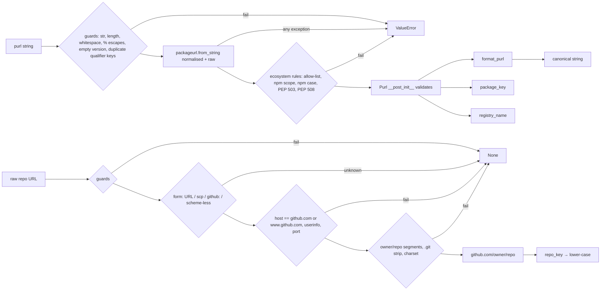

# Design: purl-and-versions

> **Implements:** `.kiro/specs/purl-and-versions/requirements.md` (PV-DEP, PV-PURL, PV-KEY, PV-REG, PV-REPO, PV-RKEY, PV-INV, PV-NFR).
> **Location:** `backend/core/purl/` (pure; no I/O).

---

## 1. Overview

The package has two independent halves that share nothing but a directory:

1. **Purls.** `parse_purl` wraps `packageurl-python` for grammar and decoding, then applies our ecosystem rules and builds a canonical, frozen `Purl`. `format_purl` assembles the canonical string itself, using the library's `quote`, `normalize_qualifiers` and `normalize_subpath`. `package_key` and `registry_name` are derived from a `Purl`.
2. **Repo URLs.** `normalise_repo_url` is a hand-written, rule-based normaliser that returns `github.com/<owner>/<repo>` or `None`. `repo_key` lower-cases a normalised repo for dedupe.



---

## 2. Library behaviour (probed, packageurl-python 0.17.6)

Before writing this design I ran probes against 0.17.6 in a throwaway environment (`uv run --no-project --with packageurl-python==0.17.6`); the project dependencies were not changed. Each finding below drives a requirement. A contract test (§6.3) pins these behaviours, so a future upgrade that changes them fails loudly instead of silently changing our keys.

| Input / call | Library result | Consequence |
|---|---|---|
| `from_string("pkg:npm/JSONStream@1.3.5")` | `name="jsonstream"`; `to_string()` → `pkg:npm/jsonstream@1.3.5` | npm names are lower-cased on parse **and** on format. We recover the name from a raw parse and never use `to_string()` (D3, PV-PURL-4). |
| `from_string(s, normalize_purl=False)` | components left percent-encoded (`'%40Babel'`); `to_string()` double-encodes | The raw parse is used only to recover the npm name's case, which we then `unquote`. |
| `from_string("pkg:npm/@babel/core@7")` and `…/%40babel/…` | namespace `"@babel"` (case kept), `to_string()` → `%40babel` | Namespace handling is fine; only the name is lower-cased. |
| `from_string("pkg:pypi/zope.interface@6.0")`; `PackageURL(type="pypi", name="Zope.Interface__x")` | `zope.interface`; `zope.interface--x` | The library maps `_`→`-` only. We apply full PEP 503 (PV-PURL-5). |
| `from_string("pkg:npm/left-pad@")` | `version=None` | Empty version is silently accepted; we reject it (PV-PURL-7). |
| `from_string("pkg:npm/x?a=1&a=2")` | `{'a': '2'}` | Duplicate keys are silently collapsed; we reject them (PV-PURL-8). |
| `from_string("pkg:npm/x%2Fy@1")` → `to_string()` | name `x/y` → `pkg:npm/x/y@1` (re-parses as namespace `x`) | A round-trip break; we reject `/` in names (PV-PURL-11). |
| `from_string("pkg:npm/x@@1")`, `"pkg:npm/x@1@2"` | names `x@`, `x@1` | We reject `@` in npm names (PV-PURL-11). |
| `from_string("pkg:npm/%zz@1")` | name `%zz`, formats as `%25zz` | Malformed escapes are kept literally; we reject them (PV-PURL-11). |
| `from_string("pkg:npm/ x @1")` | name `x` | Spaces are silently stripped; we reject raw whitespace (PV-PURL-11). |
| `from_string("pkg:npm/\ud800@1")` | `UnicodeEncodeError` | Already a `ValueError` subclass, but the wrapper still catches broadly (PV-PURL-13). |
| `from_string("PKG:npm/x@1")` | `ValueError` | The scheme must be lower-case; we keep that behaviour (PV-PURL-2). |
| `from_string("pkg://npm/x@1")` | accepted | Kept (PV-PURL-2). |
| `from_string("pkg:npm/a@1?B=2&a=&c=x#sub/../p")` | qualifiers `{'b':'2','c':'x'}`, subpath `sub/p` | Canonicalisation we adopt as-is (PV-PURL-8). |
| `quote(s)` | `urllib.parse.quote(s, safe="/")`, then `%3A`→`:` | This defines canonical encoding. The test oracle uses `urllib.parse.quote(s, safe="/:")` directly. |
| `from_string(123)` | `ValueError` | Fine; we still guard with `isinstance`. |

The library ships `py.typed`, and `from_string`, `quote`, `unquote`, `normalize_qualifiers` and `normalize_subpath` are annotated, so `mypy --strict` needs no suppressions (PV-DEP-2).

---

## 3. Module layout

```
backend/core/purl/
├── __init__.py          # re-exports the public API (§1); module docstring documents package_key/repo_key usage
├── model.py             # Ecosystem, Purl (+ __post_init__ validation), shared regexes and constants
├── purl.py              # parse_purl, format_purl, normalise_purl, normalise_pypi_name, package_key, registry_name
├── repo_url.py          # normalise_repo_url, repo_key
└── tests/
    ├── __init__.py
    ├── strategies.py              # purls(), purl_strings(), invalid_purl_strings(), repo_urls(), adversarial_repo_urls()
    ├── fixtures/real_repo_urls.json
    ├── fixtures/syft_jsonstream.json  # Syft v1.56.0 component for JSONStream (PV-SYFT-2)
    ├── test_packageurl_contract.py  # pins the §2 library behaviours and the Syft-emitted purl
    ├── test_model.py              # Purl validation (unit)
    ├── test_purl.py               # example tables (unit)
    ├── test_purl_properties.py    # PV-INV-1..8, 14
    ├── test_repo_url.py           # real + synthetic examples, repo_key (unit)
    └── test_repo_url_properties.py  # PV-INV-9..13
```

`core/purl` does not import `core/scoring`, and `core/scoring` is unchanged. `scripts/capture_anchors.py` keeps its own `parse_github_repo`: scripts are standalone, and replacing it is not in scope.

### Constants (`model.py`)

These are formula-shape constants, not runtime configuration, so they live in code and not in SSM:

```python
MAX_INPUT_LEN = 2048
SUPPORTED: frozenset[str] = frozenset({"npm", "pypi"})
PEP508_NAME = re.compile(r"[A-Za-z0-9]|[A-Za-z0-9][A-Za-z0-9._-]*[A-Za-z0-9]")   # used with fullmatch
PEP503_SEP = re.compile(r"[-_.]+")
QUALIFIER_KEY = re.compile(r"[a-z.\-_][a-z0-9.\-_]*")       # canonical (lower-case) key; mirrors the library's check
BAD_ESCAPE = re.compile(r"%(?![0-9A-Fa-f]{2})")
WS_OR_CTRL = re.compile(r"[\s\x00-\x1f\x7f]")
REPO_OUT = re.compile(r"github\.com/[A-Za-z0-9_.-]+/[A-Za-z0-9_.-]+")   # used with fullmatch
SEGMENT = re.compile(r"[A-Za-z0-9_.-]+")
```

---

## 4. Purl design

### 4.1 `Purl` (`model.py`)

This is the frozen dataclass from the requirements. `__post_init__` calls `_validate(self)`, which raises `ValueError` on the first violation found:

| Check | Requirement |
|---|---|
| `ecosystem in SUPPORTED` | PV-PURL-2 |
| npm: `namespace is None` or (`namespace.startswith("@")`, `len > 1`, no `@` after index 0, no `/`) | PV-PURL-3 |
| pypi: `namespace is None` | PV-PURL-5 |
| `name` non-empty; no `/`; npm: no `@`; pypi: `name == normalise_pypi_name(name)` and `PEP508_NAME.fullmatch(name)` | PV-PURL-3, -5, -11 |
| `namespace`, `name`, `version`: no `WS_OR_CTRL` match; `version != ""` | PV-PURL-7, -11 |
| qualifiers: keys match `QUALIFIER_KEY`, strictly increasing (sorted and unique); values non-empty and equal to `value.strip()` | PV-PURL-8, -11 |
| subpath: `None` or every `/`-segment non-empty, not `.`/`..`, equal to `segment.strip()` | PV-PURL-8, -11 |

Because a `Purl` can only exist in canonical form, `format_purl` never has to re-validate, and every property can generate `Purl` values directly.

### 4.2 `parse_purl(s)` (`purl.py`)

1. **Guards (no library call yet).**
   - `if not isinstance(s, str)`: raise `ValueError`.
   - `len(s) > MAX_INPUT_LEN` → raise `ValueError` (PV-PURL-12).
   - `WS_OR_CTRL.search(s)` → raise `ValueError`; `BAD_ESCAPE.search(s)` → raise `ValueError` (PV-PURL-11).
   - Split the raw string the way the purl spec does: `head, _, subpath_raw = s.partition("#")`, then `head, _, quals_raw = head.partition("?")`. If `head.endswith("@")`, raise `ValueError` (empty version, PV-PURL-7). If `quals_raw` has a repeated key after `strip().lower()`, raise `ValueError` (PV-PURL-8).
2. **Library parse.** `norm = PackageURL.from_string(s)` and `raw = PackageURL.from_string(s, normalize_purl=False)`. Both run inside one `try`, where any `Exception` becomes `raise ValueError(...) from exc` (PV-PURL-13).
3. **Ecosystem.** `norm.type` (the library lower-cases it) must be in `SUPPORTED` (PV-PURL-2).
4. **Components.**
   - `namespace = norm.namespace` (decoded; the library keeps npm namespace case).
   - `name`:
     - npm: `unquote(raw.name)`, to recover the case (D3). Sanity check `name.lower() == norm.name`; a mismatch means the two parses disagree, so raise `ValueError`.
     - pypi: validate `unquote(raw.name)` against `PEP508_NAME`, then `name = normalise_pypi_name(unquote(raw.name))`.
   - `version = norm.version`; `qualifiers = tuple(sorted(norm.qualifiers.items()))`; `subpath = norm.subpath`.
5. **Construct `Purl(...)`**: `__post_init__` applies every remaining rule (scope shape, `/` and `@` in names, whitespace). Its `ValueError` propagates unchanged.

Steps 2–5 are wrapped so that only `ValueError` escapes. A `ValueError` raised by our own checks is re-raised as-is, and any other exception type is chained.

### 4.3 `format_purl(p)`

```python
out = f"pkg:{p.ecosystem}/"
if p.namespace: out += quote(p.namespace) + "/"
out += quote(p.name)
if p.version is not None: out += "@" + quote(p.version)
if p.qualifiers: out += "?" + normalize_qualifiers(dict(p.qualifiers), encode=True)
if p.subpath: out += "#" + normalize_subpath(p.subpath, encode=True)
```

This uses the library's encoders but not `to_string()`, which would lower-case npm names. `normalise_purl(s) = format_purl(parse_purl(s))`. That makes PV-INV-1's first property structural; the oracle and value round-trip properties are the ones that can actually fail.

### 4.4 Derived keys

- `normalise_pypi_name(n) = PEP503_SEP.sub("-", n).lower()`.
- `package_key(p)`:
  ```python
  k = replace(p, qualifiers=(), subpath=None)
  if p.ecosystem == "npm":
      k = replace(k, namespace=_ascii_lower(k.namespace), name=_ascii_lower(k.name))
  return format_purl(k).removeprefix("pkg:")
  ```
  `_ascii_lower(s)` maps `A–Z` to `a–z` only (`s.translate(str.maketrans(string.ascii_uppercase, string.ascii_lowercase))`; `None` passes through). It is not `str.lower()`, because Unicode lower-casing can map unrelated names onto each other (U+212A KELVIN SIGN becomes `k`) and npm names are URL-safe ASCII anyway (D7). The version is never folded (D2).
  Because the folded `k` is built with `replace`, it passes `Purl.__post_init__`, which confirms that folding keeps the value canonical. The key is reversible up to npm case (PV-KEY-3): it is a canonical purl minus a fixed prefix. PyPI names are already PEP 503-normalised, so the pypi branch is the identity.
- `registry_name(p) = f"{p.namespace}/{p.name}" if p.namespace else p.name`. It is decoded and not URL-encoded (PV-REG-2).

---

## 5. Repo-URL normaliser design (`repo_url.py`)

### 5.1 Why not `urllib.parse.urlsplit`

The normaliser does not use `urllib.parse`. Three behaviours make it a poor fit for a security boundary:

- `urlsplit` silently removes tab, CR and LF characters (the bpo-43882 fix).
- It raises `ValueError` on malformed IPv6 brackets.
- It treats `\` as an ordinary character, whereas browsers treat it as `/`.

A small set of explicit rules is easier to reason about and to test exhaustively. Every rule returns `None` on doubt.

### 5.2 Algorithm

```
normalise_repo_url(raw):
  0. if not isinstance(raw, str): return None
     s = raw.strip(" \t\r\n\f\v")                       # ASCII whitespace only (PV-REPO-6)
     if s == "" or len(s) > MAX_INPUT_LEN: return None
     if WS_OR_CTRL.search(s) or "\\" in s: return None   # PV-REPO-10
     if re.search(r"%(2e|2f|5c)", s, re.I): return None   # PV-REPO-10
  1. s = s.split("#", 1)[0].split("?", 1)[0]          # fragment, then query (PV-REPO-3)
     # cutting first means "https://evil.com#@github.com/o/r" → "https://evil.com"
  2. identify the form (prefixes matched case-insensitively, PV-REPO-5):
     a. "<scheme>://" with scheme ∈ {https, http, git+https, git, git+ssh, ssh}:
          authority, _, path = rest.partition("/")
     b. "git@<host>:<path>" (scp-like; no "://" present):
          authority = "git@" + host
     c. "github:<path>":   host = "github.com", no authority checks
     d. otherwise, scheme-less: authority, _, path = s.partition("/")
          (this rejects bare "owner/repo", because "owner" is not a GitHub host)
     any other "<word>:" prefix (gitlab:, file:, ftp:, …) → None   (PV-REPO-11)
  3. authority checks (forms a, b, d):
       userinfo, at, host = authority.rpartition("@")
       if at and userinfo != "git": return None        # PV-REPO-8
       if ":" in host: return None                      # port or IPv6 literal (PV-REPO-8)
       if not host.isascii() or host.lower() not in {"github.com", "www.github.com"}: return None   # PV-REPO-7
  4. segments = path.split("/")
       if any(seg in (".", "..") for seg in segments): return None   # PV-REPO-10
       if len(segments) < 2: return None
       owner, repo = segments[0], segments[1]           # further segments ignored (PV-REPO-3)
       while repo.endswith(".git"): repo = repo[:-4]     # PV-REPO-4
       for seg in (owner, repo):
           if seg in ("", ".", "..") or not SEGMENT.fullmatch(seg): return None   # PV-REPO-9
  5. return f"github.com/{owner}/{repo}"
```

The whole body sits in `try: … except Exception: return None` as a last line of defence for PV-REPO-12. The properties are meant to show that this branch is never reached; a coverage report that shows it executing would indicate a bug.

**Why it is safe.** The host is the text between the scheme and the first `/`, after the fragment and query have been cut. If that text has `@`, everything before the last `@` must be exactly `git`. So no ordering of `@`, `#`, `?`, `\` or `:` can make a non-GitHub host look like GitHub. The `isascii()` check blocks Unicode characters whose `lower()` is ASCII (e.g. U+212A KELVIN SIGN lower-cases to `k`).

**Why it is idempotent.** The output is form (d), with owner and repo already valid and the repo not ending in `.git`, so step 5 reproduces it exactly.

### 5.3 `repo_key(repo)`

```python
if not isinstance(repo, str) or not REPO_OUT.fullmatch(repo): raise ValueError(...)
return repo.lower()
```

The output alphabet is ASCII, so `str.lower()` is exact, and the function is trivially idempotent and case-insensitive.

---

## 6. Testing design

### 6.1 Strategies (`tests/strategies.py`)

| Strategy | Builds | Used by |
|---|---|---|
| `npm_scopes()`, `npm_names()` | non-empty text without `/`, `@`, whitespace or control characters; mixed case; includes `?#%+:` and non-ASCII | `purls()` |
| `pypi_names()` | `PEP508_NAME`-matching names with random case and separator runs | `purls()`, PV-INV-5 |
| `versions()` | `None` or non-empty text without whitespace or control characters; includes `@`, `+`, `%`, non-ASCII | `purls()` |
| `qualifiers()` | 0–3 unique `QUALIFIER_KEY` keys; values non-empty, no surrounding whitespace, interior spaces and `@/` allowed | `purls()`, PV-INV-7 |
| `subpaths()` | `None` or 1–3 segments, not `.` / `..`, no surrounding whitespace | `purls()`, PV-INV-7 |
| `purls()` | valid `Purl` values (pypi names passed through `normalise_pypi_name`) | PV-INV-1, 6, 7, 8, 14 |
| `ascii_case_flip(purl)` | a copy of an npm `Purl` with a random per-character ASCII case flip on namespace and name; non-ASCII characters untouched | PV-INV-14 |
| `purl_strings()` | `(s, expected)`: renders a `purls()` value non-canonically (upper-case type, `pkg://`, raw `@scope`, unordered or upper-case qualifier keys, `%XX` for unreserved characters, a pre-PEP 503 pypi name). `expected` is built with `urllib.parse.quote(…, safe="/:")` and a test-local PEP 503, never with `core.purl`. | PV-INV-1, 2, 3, 7 |
| `invalid_purl_strings()` | arbitrary `text()` (including surrogates and >2,048 chars), mutations of `purl_strings()`, and disallowed types | PV-INV-4 |
| `repo_urls()` | `(url, owner, repo)` across all accepted forms with random-case scheme and host and random PV-REPO-3/4 suffixes | PV-INV-9, 10, 12, 13 |
| `adversarial_repo_urls()` | the host, userinfo, traversal, port and control-character families from PV-INV-11 | PV-INV-10, 11 |

Valid-domain strategies use `.filter` sparingly and build values constructively instead, so the `ci` profile (500 examples) does not hit Hypothesis health checks.

### 6.2 Example tests

- `test_purl.py` is parametrised over the requirements' purl table and its `ValueError` list.
- `test_repo_url.py` is parametrised over the synthetic table, and over `fixtures/real_repo_urls.json`, loaded via `Path(__file__).parent / "fixtures"`. Each real entry records its `source`. One extra test cross-checks the `request`, `node-uuid` and `six` entries against the `repo` field in `core/scoring/tests/fixtures/anchors/*.json`, so the two fixture sets cannot drift apart.

### 6.3 Library contract test

`test_packageurl_contract.py` asserts the §2 behaviours that the wrapper compensates for: the npm name is lower-cased by `from_string` and `to_string`; pypi `.` is not normalised; `pkg:npm/left-pad@` gives `version=None`; duplicate keys collapse; `quote` leaves `/` and `:` unencoded. If an upgrade fixes any of these, the test fails. That is the cue to simplify the wrapper, not to delete the test.

The same file reads `fixtures/syft_jsonstream.json` and asserts what Syft v1.56.0 actually emitted for `JSONStream` (PV-SYFT-3). The expected strings are filled in from the recorded Syft output when the fixture is committed, not guessed in advance.

### 6.4 Traceability

| Requirement | Tests |
|---|---|
| PV-PURL-1–13 | `test_purl.py`, `test_model.py`, PV-INV-1–6 |
| PV-KEY-1–4, PV-REG-1–2 | `test_purl.py` (table columns), PV-INV-7, PV-INV-8, PV-INV-14 |
| PV-SYFT-1–3 | `docs/SPIKES.md` entry, `tests/fixtures/syft_jsonstream.json`, `test_packageurl_contract.py` |
| PV-REPO-1–12 | `test_repo_url.py`, PV-INV-9–12 |
| PV-RKEY-1–2 | `test_repo_url.py`, PV-INV-13 |
| PV-DEP-1–3 | `uv.lock` diff, `mypy --strict`, `test_packageurl_contract.py` |
| PV-NFR-3–4 | CI commands; `uv run pytest --cov=core/purl` |

---

## 7. Error handling

- Purl functions raise `ValueError` with a message that names the rule and quotes the input via `repr()`, truncated to 100 characters so that a 2 KB hostile string is not echoed back. Library exceptions are chained with `from exc`.
- `normalise_repo_url` returns `None` and never raises. It does not report a reason; callers only need "resolved or missing" (EX-9: an unresolved repo marks repo-level signals missing).
- `repo_key` raises `ValueError` for input that is not normaliser output. That is a programming error, not untrusted-input handling.

---

## 8. Alternatives considered

| Option | Verdict |
|---|---|
| Use `PackageURL.to_string()` for formatting | Rejected: it lower-cases npm names (§2), which breaks D3. |
| Lower-case npm names everywhere, as the purl spec says | Rejected for display and registry use: `JSONStream` must stay `JSONStream` for the npm registry and OSV. Adopted for `package_key` only (D7), so dedupe and the cache tolerate SBOM generators that follow the spec strictly. |
| Fold with `str.lower()` in `package_key` | Rejected: Unicode lower-casing can merge unrelated names (Kelvin sign → `k`). ASCII-only folding is enough for npm names. |
| Fold PyPI names in `package_key` | Not needed: PEP 503 normalisation already lower-cases. |
| Write our own purl parser and drop the library | Rejected: the user asked for a thin wrapper, and the library's qualifier and subpath handling is correct. The contract test makes its quirks explicit. |
| `urllib.parse.urlsplit` for repo URLs | Rejected (§5.1). |
| Return a reason enum from `normalise_repo_url` | Rejected (YAGNI): no caller needs one. |

---

## 9. Review decisions (round 2)

1. **npm case in `package_key`:** adopted. Namespace and name are ASCII-lower-cased inside `package_key` only (§4.4, D7). `format_purl` and `registry_name` keep case. PV-INV-14 covers it.
2. **Syft's npm case:** `tasks.md` adds a task that puts `JSONStream` into the npm spike fixture, runs Syft v1.56.0, records the emitted purl in `docs/SPIKES.md` and commits the component as a test fixture (PV-SYFT-1 to 3). Tests assert what Syft actually emits, so the design does not guess.
3. **`www.github.com`:** accepted only in URL and scheme-less forms; `git@www.github.com:…` stays rejected.

### Residual risk

`package_key` relies on the npm rule that package names cannot differ only in case. Names published before that rule existed could in principle collide. If the registry ever returns two such packages, they would share a cache entry. The effect is limited to a shared autopsy for two near-identical names; `registry_name` still sends the original spelling to the registry, so lookups return the right data for each.
