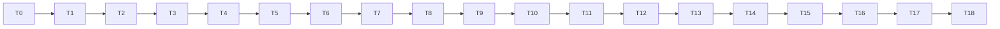

# Implementation Plan: scan-backend (LEAN)

## Overview
Implements `.kiro/specs/scan-backend/requirements.md` per `design.md`. Order: T0 bootstrap permissions (then **STOP** for the maintainer's bootstrap apply), then pure core, GitHub side, handlers, API, packaging, Terraform, CI, checks. Two MANUAL tasks at the end (the maintainer's GitHub App secrets, and the first dev scan).

**Working rules (every task):**
- **The agent never runs `terraform init` against a backend, `terraform plan`, `terraform apply` or the `aws` CLI**, and never reads `~/.aws` or `AWS_*` variables. Terraform checks run only through `scripts/ci/local-checks.sh` (fmt, `init -backend=false`, validate, test, tflint, checkov, actionlint, guards). CI deploys.
- Python runs from `backend/` with `uv run` (`uv run pytest -q`, `uv run ruff check`, `uv run ruff format --check`, `uv run mypy --strict core`). Never bare `pytest`, `ruff` or `mypy`.
- Before each task read the requirement IDs it names. Requirements win over the design.
- Reuse the existing code listed in design §2. If a task finds it must copy logic from `core`, `sources` or `cli`, **stop and report** instead.
- Lean: example-based unit and integration tests only. No mutation checks, no bad-sample suites, no verification register, no spec rewrites for small findings (note them in the task result).
- A permission the roles lack is **not** worked around. If a task or a CI run shows a missing permission beyond T0 (SB-PERM-5), stop and list it as a new request.
- Nothing is committed by the agent. No secret, token, account ID or key in any file (SB-SEC-6); test keys are generated at test time.
- After each task: `uv run pytest -q` and `uv run ruff check` green; after a Terraform task also `scripts/ci/local-checks.sh all`.

## Task Dependency Graph

T11 to T13 need only T10's names and can start once T5 has fixed the handler names, but the chain is kept linear so each task starts green.

## Tasks

- [x] T0 — Bootstrap permissions (SB-PERM-1 to SB-PERM-3; amendment A1 of `infra-foundation`) **DONE 19 Nov 2026. STOP: the maintainer applies the bootstrap locally before T1.**
  - [x] T0.1 — `github-oidc`: `KmsCreateGrant` in the apply data policy (key tags and `kms:GrantIsForAWSResource = true`); exception E7 (log-delivery actions on `*`) in the apply `ops` policy and in both boundaries; `StatesExpressExecutions` in both boundaries.
  - [x] T0.2 — Tests updated and added in `shared_account`, `boundary` and `services` (exception lists E1 to E7, removed-actions list without the three log-delivery actions, exact statements). Amendment A1 added to `infra-foundation/requirements.md`; `terraform.md` and `infra/README.md` say E1 to E7.
  - [x] T0.3 — `scripts/ci/local-checks.sh` fmt, validate, test, tflint, checkov, guards green (github-oidc: 83 tests).
  - [ ] T0.4 — **MANUAL STOP (maintainer):** apply the bootstrap root locally (`docs/runbooks/terraform-bootstrap.md`), then tell the agent to continue with T1.
- [ ] T1 — Baseline, dependencies (SB-SEC-5, design §10)
  - [ ] T1.1 — `git status --short`; read `infra/modules/github-oidc/policies_actions.tf` and `boundary.tf` and confirm the SB-PERM table of design §9 still matches. **If a listed permission now exists or a new one is missing, report and update only §9.**
  - [ ] T1.2 — Use the `check-before-adding-dependency` skill for `aws-lambda-powertools`, `boto3`, `PyJWT` and `cryptography`. Record name, exact version, release date and verdict in design §10. **If a package is abandoned, deprecated or has an unfixable vulnerability, stop and report.**
  - [ ] T1.3 — Add them to `backend/pyproject.toml` as an optional extra `aws` with exact pins, `uv lock`, add the new packages to `packages` and the ruff and pytest config (`core/scan`, `exhume`, `scan`, `workflow`, `api`). Existing suites pass unchanged.

- [ ] T2 — Pure scan core (SB-API-2, SB-API-4, SB-DATA-2, SB-DATA-3, SB-CLS-2, SB-CLS-3, SB-ERR-1)
  - [ ] T2.1 — `core/scan/ids.py`: `new_scan_id`, `SCAN_ID_RE`, `is_scan_id`. Tests: format, 43 characters, sortable by time, rejects bad forms.
  - [ ] T2.2 — `core/scan/errors.py`: the codes, titles, `ScanError` base and one subclass per code (class name equals the code), `code_for(exc_name)` with `INTERNAL` fallback.
  - [ ] T2.3 — `core/scan/records.py`: `result_to_json` and `result_from_json` for `SourceResult` (signals, evidence, warnings, repo fields), `node_to_json`/`node_from_json` (`PathInfo` pairs), `build_node_record(node, signals, scoring, result)`, `state_of(scoring)`, `is_grave`, `count_nodes`, cursor encode and decode. Tests: round trip on the recorded `core/sources/tests/fixtures/recorded` signals; counts; grave rule; cursor accepts non-negative integers only.
  - [ ] T2.4 — `uv run mypy --strict core` green, including `core/scan`.

- [ ] T3 — GitHub side (SB-VAL-1, SB-VAL-2, SB-FET-1 to SB-FET-6, SB-SEC-3)
  - [ ] T3.1 — Export `is_lockfile_name` from `cli/discover.py` (rename, keep a private alias so nothing else changes). Run the `cli` suite.
  - [ ] T3.2 — `exhume/validate.py` (`parse_repo`, `parse_ref`) with the accept and reject lists of SB-TEST-1, including `http://github.com/a/b`, `a/b/../c`, `a/b?x=1`, `a b/c`, `é/x`, `a/.`, `a/..`, `-a/b`, a 40-character owner, refs with `..`, `//`, trailing `/` and `.lock`.
  - [ ] T3.3 — `exhume/select.py` (`select_services`, limits, `TOO_LARGE`, `NO_MANIFESTS`) with a tree fixture that has a root `package-lock.json`, `services/api/uv.lock`, `requirements-dev.txt`, a `node_modules/x/package-lock.json` (skipped) and an oversize file.
  - [ ] T3.4 — `exhume/github_app.py`: `make_jwt`, `installation_token` (returns `SecretToken`). Tests: claims decoded with a test key generated in the test, the token request path, the token not in `repr`, `GITHUB_AUTH_FAILED` on 401 and 404.
  - [ ] T3.5 — `exhume/trees.py`: tree fetch (`truncated` to `TREE_TRUNCATED`, 404 to `REPO_NOT_FOUND`, rate limit to `GITHUB_RATE_LIMITED`, remaining header to a returned value) and blob fetch by SHA with the per-file cap. `httpx.MockTransport` tests; assert every requested URL starts with `https://api.github.com/repos/<owner>/<name>/`.

- [ ] T4 — Store (SB-DATA-2, SB-DATA-3, SB-CFG-3)
  - [ ] T4.1 — `scan/store.py`: Protocols `ScanTable` (put/update meta, put and batch-put nodes, get node, query nodes, get and batch-get autopsy, put autopsy) and `Artefacts` (put, get), boto3 implementations that take the clients as arguments, TTL helpers (30 d, 24 h) with an injected clock, expired-item check on read.
  - [ ] T4.2 — `scan/fakes.py` (in-memory implementations, used by tests only; excluded from the wheel) and `scan/config.py` (limits and flags from an injected `get_parameter`). Tests: item shapes, TTL values, expired autopsy ignored, `UnprocessedKeys` retry path.

- [ ] T5 — Handlers: Validate, FetchManifests (SB-VAL-3, SB-FET-5, SB-FET-7, SB-WF-3)
  - [ ] T5.1 — `workflow/runtime.py` (the only env reader: table, bucket, secret, parameter prefix; Powertools Logger with correlation ID, Tracer, Metrics namespace; boto3 clients created once) and `workflow/validate.py`.
  - [ ] T5.2 — `workflow/fetch.py`: token, tree, selection, blobs to S3, `services.json`, stage update, metric, return only keys and counts and `serviceItems`. Handler tests with fakes and `MockTransport`: success, repo not found, no manifests, too large, truncated, rate limited; assert the token is never in the logs captured by the test logger.

- [ ] T6 — Handlers: GenerateSBOM, BuildGraph (SB-SBOM-1, SB-SBOM-2, SB-SBOM-4, SB-GRAPH-1 to SB-GRAPH-4)
  - [ ] T6.1 — Export `_augment` from `cli/pipeline.py` as `augment_service` (same body, `_augment` kept as an alias). Run the `cli` suite.
  - [ ] T6.2 — `workflow/syft.py` (download to a private temp dir, `check_version`, `run_syft`, put SBOM, clean up in `finally`, `CliError` to `SBOM_FAILED`). Test with a stubbed `run_syft`; one real-binary test under the `syft` marker using `spikes/fixtures/npm`.
  - [ ] T6.3 — `workflow/graph.py` (download, `read_scopes`, `augment_service`, `build_graph`, write `purls.json` and `nodes.json`, limits). Test with the recorded npm SBOM (`spikes/npm-sbom.cdx.json`) and its lockfile: purl count, one transitive node, a `dev` scope, `TOO_MANY_PACKAGES` with a low limit, `SBOM_INVALID`.

- [ ] T7 — Handlers: Autopsy, Classify, Finalise (SB-AUT-1 to SB-AUT-6, SB-CLS-1 to SB-CLS-4, SB-FIN-1)
  - [ ] T7.1 — Read the real signatures of `cli.pipeline.autopsy_requests`, `make_config` and `cli.env.CliEnvironment`; decide how the handler supplies token and contact without copying their bodies (design §5.5); note the decision in the task result. **If it needs a change to `sources` or `core.sources`, stop and report.**
  - [ ] T7.2 — `workflow/autopsy.py`. Tests with `MockTransport` replaying the recorded cassette (or the stub results where the cassette does not cover a purl): cache miss then write; second call is a hit (`cached` count); a failing source gives `failed` and no cache item; the handler never raises for a source error; the metrics are emitted.
  - [ ] T7.3 — `workflow/classify.py`: build `Signals` with exposure, `score_package_v2`, `sort_results`, node items, `unscored` for missing items, counts, `modelVersion = v2`. Test: a declared-dead fixture is `dead` with `dead_reason` declared; a quiet healthy fixture is not Dead; one missing autopsy gives `unscored` and `partial`.
  - [ ] T7.4 — `workflow/finalise.py`: counts, `partial`, `status`, `ScanDurationSeconds`. Test.

- [ ] T8 — API (SB-API-1 to SB-API-10, SB-ERR-2)
  - [ ] T8.1 — `api/problem.py` and `api/routes.py` (router table, one function per route, kill switch, body size, unknown fields, stale-scan `TIMEOUT`, cursor, filters, purl decoding with `core.purl`).
  - [ ] T8.2 — `api/handler.py` (Powertools, one entry point) and `api/openapi.yaml` (OpenAPI 3.1, four routes, problem+json). Tests: each route through the handler with the fakes; the route table equals the OpenAPI paths (SB-API-7); `404` for a bad scan ID and for a purl outside the scan; `503` with the kill switch; the Terraform route list will be compared in T12.
  - [ ] T8.3 — `StartExecution` through a Protocol `Runner` (boto3 implementation, fake in tests). A failed start marks the scan `FAILED/INTERNAL` and returns 503.

- [ ] T9 — Integration (SB-TEST-3)
  - [ ] T9.1 — `tests/integration/test_scan_flow.py`: handlers in state-machine order with fakes, the fixture tree for `olajaido/haunted-house`-like content (a root `package-lock.json` and a `services/worker/requirements.txt`), the recorded SBOM, then the API reads (`scan`, `graves`, one certificate). Assert counts add up (`total = alive + resting + ailing + dead + unscored`), the Death Certificate has all fields of SB-API-5, and that no GitHub URL outside the repo path was requested.
  - [ ] T9.2 — Run the whole backend suite and `ruff`, `mypy --strict core`. Report totals.

- [ ] T10 — Packaging (SB-CI-1, SB-SBOM-3, SB-INF-6)
  - [ ] T10.1 — `scripts/build/build_lambda_zip.py` with a unit test in `scripts/build/tests/` (two builds of a temp tree give an equal hash; entries sorted; fixed timestamps).
  - [ ] T10.2 — `scripts/build/syft-pin.json` (version `1.56.0`, the `linux_arm64` release URL, SHA-256) and `scripts/build/build_syft_layer.py`. Take the SHA-256 from the release's published `syft_1.56.0_checksums.txt` (public metadata) and record the source in the task result. **If the downloaded tarball does not match the pin, stop and report.** Tests (no network: a small fake tarball served from a temp path): a matching file builds a zip with `bin/syft` mode 0755 and a stable hash; a mismatching file fails and writes nothing. Then run the script once for real to confirm the pin, and delete the output.
  - [ ] T10.3 — Extend `scripts/ci/guards.py` and its tests: the pin file must hold a version, an https URL and a 64-hex SHA-256, and no file under `scripts/build/` may name `latest`.

- [ ] T11 — Terraform: `data`, `github-app` (SB-DATA-1, SB-DATA-4, SB-DATA-5, SB-CFG-1, SB-CFG-2, SB-INF-2, SB-INF-8)
  - [ ] T11.1 — Module `data` with `terraform test` (names, `prevent_destroy` is a lifecycle block and cannot be asserted by a mock plan: check the file with a guard test instead, lifecycle rules, TTL, GSI, PITR, bucket policy JSON, key policy JSON, SSM parameter names and defaults).
  - [ ] T11.2 — Module `github-app` (secret container with no version, two parameters with `UNSET` and `ignore_changes`) with tests. **Assert there is no `aws_secretsmanager_secret_version` anywhere.**

- [ ] T12 — Terraform: `lambda-function`, `workflow`, `api` (SB-INF-1, SB-INF-3 to SB-INF-5, SB-INF-7, SB-WF-1 to SB-WF-6, SB-CI-2)
  - [ ] T12.1 — Module `lambda-function` (role with path and boundary, policy from `statements`, log group, function with `publish = true`, `live` alias, X-Ray, reserved concurrency, `precondition` on `zip_sha256` for zip functions). Tests: boundary attached, alias, concurrency, env vars contain names only.
  - [ ] T12.2 — Module `workflow`: seven task functions with the statements of SB-INF-5, the Syft layer (`aws_lambda_layer_version` from `syft-layer.zip`, `source_code_hash`, precondition on `syft_layer_sha256`), the state machine definition in `locals` with `jsonencode`, logging at `ERROR` to the vended log group, role, `publish = true`, alias. Concurrency defaults as in SB-INF-3. Tests per SB-TEST-4: decode the definition and assert state order, Catches, batcher size, alias-only ARNs, `TimeoutSeconds = 300`, the logging configuration, the layer on `syft` only, and per-role policy actions.
  - [ ] T12.3 — Module `api`: function, HTTP API, routes from a variable, throttling, JSON access logs to `/graveyard/<env>/api-access`, CORS from a variable, permission. Test that the route keys equal the list exported by `api/routes.py` (a small Python script run by the guard in T15 prints it).

- [ ] T13 — Terraform: `observability` (SB-OBS-1)
  - [ ] T13.1 — Module `observability` with the alarms of SB-OBS-1 (including the kill-switch metric filter and alarm), the SNS topic and tests for names, thresholds and the topic target.

- [ ] T14 — Env roots and docs (SB-INF-1, SB-INF-2, INF-LAY-4, INF-LAY-5)
  - [ ] T14.1 — Add the module calls to `infra/envs/dev` and `infra/envs/prod` (same calls, values from `locals.tf` and `variables.tf`, `account_id`/`partition`/`region` from the three allowed data sources). New root variables: `lambda_zip_sha256`, `syft_layer_sha256`, contact, throttles, concurrency (total about 50 per env, SB-INF-3). Outputs: `api_url`, table name, bucket name, state machine name. Update both `terraform.tfvars.example` files. No account ID anywhere.
  - [ ] T14.2 — Update `structure.md` and PRD §14 for `core/scan/`, `exhume/`, `scan/`, `scripts/build/` and the new modules (INF-LAY-5); record deviation D7 (Syft layer instead of the container image) in PRD §10.2/§10.3 and `tech.md`; add a dated entry to `docs/KIRO_JOURNAL.md`.
  - [ ] T14.3 — `docs/runbooks/scan-backend.md`: the SB-MAN-1 and SB-MAN-2 steps without values, how to read a failed scan, how to roll back an alias, the kill switch and its alarm.

- [ ] T15 — CI (SB-CI-1 to SB-CI-5)
  - [ ] T15.1 — Add the build steps (setup-uv pinned by SHA, `build_lambda_zip.py`, `build_syft_layer.py`) to the plan and apply composite actions and pass `lambda_zip_sha256` and `syft_layer_sha256` as variables. Keep the diff small. `actionlint` green.
  - [ ] T15.2 — Add the route-list guard (T12.3) and the OpenAPI check to the CI static stage. No image job, no ECR, no new repository variable.

- [ ] T16 — Full local check (SB-CI-5, SB-TEST-5)
  - [ ] T16.1 — `scripts/ci/local-checks.sh all` and the full backend suite (`ruff check`, `ruff format --check`, `mypy --strict core`, `pytest -q`, `HYPOTHESIS_PROFILE=ci pytest -m property -q`). **If a check fails, fix it in the owning task's files; do not weaken a check.**
  - [ ] T16.2 — Report: tests added, files changed, the SB-PERM list with the exact actions and resources (design §9), and which `terraform test` assertions replaced a plan the agent cannot run.

- [ ] T17 — MANUAL: GitHub App secrets (SB-MAN-1)
  - [ ] T17.1 — **MANUAL (maintainer).** After CI has applied dev (the push to `main` that merges this work) and the bootstrap of T0 is applied: create the Graveyard Reader GitHub App (no repository permissions), install it on your account, then put the PEM key into the secret `graveyard/dev/github/reader` and the App ID and installation ID into `/graveyard/dev/github/reader/app-id` and `installation-id`, following `docs/runbooks/scan-backend.md`. The agent stops here and does not carry out these steps.

- [ ] T18 — MANUAL: first dev scan (SB-MAN-2)
  - [ ] T18.1 — **MANUAL (maintainer).** Run `POST <api_url>/v1/scans` for `olajaido/haunted-house`, poll `GET /v1/scans/{id}` until `COMPLETE`, then call `/graves` and one `/graves/{purl}`. Check: status `COMPLETE`, counts add up, Dead nodes are declared deaths, state machine execution succeeded in the console, no `AccessDenied` in the Map (SB-PERM-4). Report results (or the failing state) so the agent can fix them.
