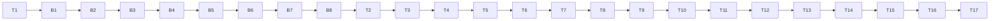

# Implementation Plan: ui-core (LEAN)
## Overview
Implements `.kiro/specs/ui-core/requirements.md` (revision 2) per `design.md`, with the design system in `.kiro/steering/frontend-design.md`. Delivery order, each piece its own review:
1. **T1 — CORS**, a small PR of its own, merged before any UI task starts.
2. **Group B (B1 to B7)** — backend support, **one PR**, right after CORS. `openapi.yaml` is the contract.
3. **T2** docs amendment (model v2), then **T3 to T17** the web app.
Nothing is started. M-items at the end are for the maintainer.

**Working rules (every task):**
- **§0.** The agent never runs `terraform plan`, `terraform apply` or `terraform init` against a backend, never runs the `aws` CLI, and never reads `~/.aws` or `AWS_*` variables. Terraform is checked only through `scripts/ci/local-checks.sh` (fmt, validate, offline test, tflint, checkov). CI deploys.
- Python runs from `backend/` with `uv run` (`uv run pytest -q`, `uv run ruff check`, `uv run ruff format --check`, `uv run mypy --strict core`). Never bare `pytest`, `ruff` or `mypy`. Web tooling runs from `web/` with npm scripts. CI script tests run with `python3 -m unittest discover -s scripts/ci/tests`.
- Before each task read the requirement IDs it names and the section of `design.md` it cites. Requirements win over the design; the PRD (as amended by T2) wins over mockup copy.
- Backend: reuse `core`, `sources`, `exhume`, `scan`, `workflow` as they are. If a task would copy logic, **stop and report**. A permission the roles lack is **not** worked around: stop and list it.
- Follow `frontend-design.md`. Use tokens, never hex values in components. Port art from the mockups, do not redraw (`design/mockups/*.dc.html`: ignore `<x-dc>`, `<helmet>`, `<sc-for>`, `<sc-if>`, `{{ }}`).
- Never fill a gap with invented data (UI-Q-7). A missing value renders "Not recorded".
- Before adding any dependency, check it with `autopsy_package` (skill `check-before-adding-dependency`). A Dead or Cursed result stops the add; tell the maintainer. Pin exact versions (`--save-exact`); never `latest`, never a range.
- Nothing is committed by the agent. No secret, token, account ID or API ID in any file. The dev API URL goes only in git-ignored `web/.env.local`.
- After each web task: `npm run lint`, `npm run typecheck` and `npm test` green in `web/` (from T3 on). After a backend task: the four `uv run` checks. After a Terraform task: `scripts/ci/local-checks.sh all`.
- Lean: example-based tests, one Playwright smoke, no mutation checks, no extra specs for small findings (note them in the task result).
- If a requirement cannot be met as written, **stop and report** rather than work around it.

**Execution and stops** (maintainer, 23 Nov 2026): execute in order and stop and report (a) after T1, (b) after T2 and group B (B1 to B8), (c) at every MANUAL task, (d) after the UI tasks (T3 to T17). Nothing is committed or pushed by the agent.

## Task Dependency Graph

T3 onward needs the group B `openapi.yaml` final in the working tree (the B PR may still be in review) and the CORS PR merged.

## Tasks
- [x] T1 — CORS on the HTTP API, its own PR (UI-CORS-1 to UI-CORS-3; design 12)
  - [x] T1.1 — `infra/modules/api/main.tf`: `allow_methods = ["GET", "POST", "OPTIONS"]`; keep `allow_headers = ["content-type"]`, `max_age = 600`, no credentials. Update the variable description (methods listed, still empty by default).
  - [x] T1.2 — `infra/modules/api/tests/api.tftest.hcl`: extend `cors_origins_are_listed_when_given` with the exact methods, headers, `max_age` and no `allow_credentials`. Keep the default-off and star-rejected runs.
  - [x] T1.3 — (done, with two additions the tests needed: output `cors_allow_origins` on the `api` module, because a root test cannot read a module's resources, and `scripts/ci/tests/test_env_roots.py`, whose guard demanded identical dev and prod variables; it now allows only the default of `cors_allowed_origins` to differ and asserts it) `infra/envs/dev/variables.tf`: default `["http://localhost:5173"]`, "dev only". `infra/envs/dev/tests/root.tftest.hcl`: a run asserting exactly that origin on `module.api.aws_apigatewayv2_api.http`. `infra/envs/prod/tests/root.tftest.hcl`: a run asserting no CORS block.
  - [x] T1.4 — `scripts/ci/local-checks.sh all` green. Confirm in the task result, with file and statement name, that `ManageHttpApis` already allows `apigateway:PATCH`, and that no file under `infra/bootstrap` or `infra/modules/github-oidc` changed.
  - [ ] T1.5 — **MANUAL (maintainer):** commit and merge this PR on its own. CI then applies dev. **STOP: report (a). No further task starts before the maintainer says so.**
- [x] B — **Backend support, one PR** (UI-B-1 to UI-B-7; design 11). Order within the PR: B1 to B7. Each item updates `backend/api/openapi.yaml` and its tests in the same change.
  - [x] B1 — Stages (UI-B-1). `infra/modules/workflow/main.tf`: states `StageSbom` (between `FetchManifests` and `GenerateSBOM`) and `StageAutopsy` (between `BuildGraph` and `AutopsyMap`), `dynamodb:updateItem` service integrations with `ResultPath = null` and the shared `Catch`. `StageSbom` sets `stage = SBOM`. `StageAutopsy` sets `stage = AUTOPSY` and the counters of B2. Update `FetchManifests.Next` and `BuildGraph.Next`. `workflow.tftest.hcl`: states in order, both are `updateItem` on the table, both catch to `HandleError`, the role gains no action.
  - [x] B2 — Progress (UI-B-2). `StageAutopsy` also sets `progressTotal = $.graph.total` and `progressExamined = 0`. In the Express child: `Autopsy` goes to new `CountBatch` (`ADD progressExamined :n`, `:n` = `States.MathAdd(States.MathAdd($.ok, $.cached), $.failedCount)` through `States.Format`), whose `Catch` on `States.ALL` goes to `Counted` (Succeed). `api/routes.py` `get_scan` returns `progress {examined, total}` only while `RUNNING` and `AUTOPSY`, clamped, else `null`. Tests: the definition strings, `CountBatch` has a `States.ALL` catch that continues to `Counted`, child still `DISTRIBUTED` and `EXPRESS`, `CountBatch` has no path to `HandleError`; `get_scan` for each stage, missing attributes, `examined > total`, an old item. No Lambda and no IAM change (N1).
  - [x] B3 — Via and services (UI-B-3). `core/scan/records.py`: `via_of`, stored as `via`, added to `_SUMMARY`; `get_grave` defaults `via` to `None`. `exhume/select.py`: `ecosystem_of`. `workflow/fetch.py`: store `services` (`[{id, manifests: [{ecosystem, path}]}]`, one entry per service, no duplicate `id`) on the scan item; `get_scan` returns it or `null`. Tests per design B3.
  - [x] B4 — Error enum (UI-B-4). `Scan.error.code` enum in `openapi.yaml`; `test_openapi_error_codes_match_core`.
  - [x] B5 — Schemas and contract test (UI-B-5). Exact, required-listed schemas for `Scan`, `Service`, `Progress`, `Source`, `GraveSummary`, `Certificate` and its parts (design B5). `api/tests/test_contract.py` with the small recursive checker, run on real shapes (scored, unscored, pre-B, minimal scan). The existing route-to-OpenAPI test stays green.
  - [x] B6 — Evidence links (UI-B-6). `core/scan/links.py` `evidence_links`; `get_grave` adds `evidenceLinks`; schema `EvidenceLink {kind, url, signals}`. Tests per design B6, including hostile advisory IDs, the host set, and the crafted-input property test (no crafted purl, repo or advisory ID gives a host outside the allowlist).
  - [x] B7 — Compatibility and spec (UI-B-7). A pre-B item test (null fields, never missing). Amendment A3 in `.kiro/specs/scan-backend/requirements.md` and `design.md`. Run `uv run pytest -q`, `ruff check`, `ruff format --check`, `mypy --strict core`, `scripts/ci/local-checks.sh all`, `python3 scripts/ci/guards.py`. Report the list of changed files.
  - [x] B8 — Prepare the optional check: add to `docs/runbooks/scan-backend.md` a section "Test the CountBatch state" with the state definition (copied from `main.tf`), a sample input `{ok, cached, failedCount}`, and the `aws stepfunctions test-state` command for the maintainer to run with their own credentials. The agent does not run it.
- [x] T2 — Docs amendment, model v2 (UI-DOC-1; decision D5)
  - [x] T2.1 — `docs/PRD.md`: Appendix D row "v1.4, 23 Nov 2026" stating that model v2 supersedes the "or score ≥ 60" rule of §7.4 (Dead is `s1_declared_death` only, `dead_reason = "declared"`; a package v1 classed Dead by score is Ailing; Cursed and Wounded unchanged), citing `mortality-model-v2` design 7.5 and `docs/heldout-result.md`. Edit §6 (Glossary, Dead and Ailing rows), §7.4 (Dead, Ailing, and the sort of rows), the §11 steering table (`ui-theme.md` becomes `frontend-design.md`), and the status line (v1.4).
  - [x] T2.2 — `.kiro/steering/product.md`: the same glossary change. `.kiro/steering/mortality-model.md`: a note under the state list that v2 is the shipped rule, pointing to the PRD amendment. No change to `mortality-model` scoring files.
  - [x] T2.3 — Check that no other file in `docs/` or `.kiro/steering/` still says "score ≥ 60" as the current rule (`grep`), and report the hits that are history (specs, journal) and were left alone.
  - [x] T2.4 — **STOP: report (b) (reported 23 Nov 2026).** The B tasks and T2 are one PR for the maintainer. Then MP1 (optional) and MP2 below.
- [x] T3 — Scaffold, dependency checks, tooling (UI-STK-1 to UI-STK-7; design 2, 10)
  - [x] T3.1 — Run `autopsy_package` on every package in design section 10 (the "to check" rows), resolve peer ranges (TypeScript, ESLint, Vitest, Next), choose exact versions, and record versions and verdicts in design section 10. Stop on a Dead or Cursed result.
  - [x] T3.2 — Create `web/` with npm: `package.json` (exact pins, `engines`, `.node-version`), `package-lock.json`, `tsconfig.json` (strict), `next.config.ts` (`output: 'export'`, `trailingSlash: false`, `images.unoptimized`, fail when `NEXT_PUBLIC_API_URL` is unset in a production build), Tailwind v4 through `postcss.config.mjs`, `eslint.config.mjs`, `prettier.config.mjs`, `vitest.config.ts` (jsdom, React plugin, `@` alias), `.env.example` (placeholder URL), scripts `dev` (port 5173), `build`, `lint`, `format:check`, `typecheck`, `test`, `gen:api`.
  - [x] T3.3 — Fonts: the three `@fontsource` packages through `next/font/local` (latin, `display: swap`; preload Cormorant 600 and Inter 400 only) in `app/fonts.ts`.
  - [x] T3.4 — `.gitignore`: `web/.next/`, `web/out/`, `web/.env.local`, `web/test-results/`, `web/playwright-report/`, `web/.lighthouseci/`, `web/content/evidence.generated.json`, `*.tsbuildinfo`. Confirm `.kiro` is not ignored.
  - [x] T3.5 — Copy `design/fixtures/haunted-house/*` verbatim to `web/content/haunted-house/`. Run `npm run gen:api` against the group B `openapi.yaml` and commit the generated `lib/api/schema.d.ts`.
  - [x] T3.6 — A placeholder page and one passing test; `lint`, `typecheck`, `test`, `build` green; `npm run dev` answers on 5173.
- [x] T4 — Tokens, base styles, layout shell (UI-STEER-1, UI-Q-2, UI-Q-3; steering 1 to 4, 7)
  - [x] T4.1 — `app/globals.css`: every token of `frontend-design.md` as `--color-*` in `@theme`, type scale, radii, container and gutter, `focus-ring` utility (bone on dark, ink inside `.surface-paper`), motion utilities inside `prefers-reduced-motion: no-preference`, the global `reduce` reset, `.sr-only`.
  - [x] T4.2 — `lib/contrast.ts` and `contrast.test.ts`: parse the tokens from `globals.css`, assert every pair in steering section 1 (text ≥ 4.5, non-text ≥ 3), and that the documented failures stay excluded (`bone-dim` on `stone`).
  - [x] T4.3 — `layout.tsx` (lang, skip link, fonts, metadata), `SiteHeader` (sizes), `SiteFooter` (fence), `PageShell`, `StatusRegion`, `Button`, `Chip`, `Pill`, `AppLink`. Tests: skip link is the first tab stop; `StatusRegion` announces only on change.
- [x] T5 — Art components (UI-Q-5; design 5.1)
  - [x] T5.1 — Port `NightScene` (and `Moon`, `Fog`, `Fence`, `DeadTree`, `Chapel`), `PlotBackdrop`, `Grave` (cursed, dead, ailing, resting, wounded, alive), `GraveIcon` (six), `Lantern` (three variants), `OpenGraveScene` (with the `depth` backfill), `WaxSeal`, `ToeTag`, `StepArt` (four), `BrandMark`. Same coordinates and colours as the mockups; `aria-hidden`; `useId` for pattern IDs; animation classes from T4.
  - [x] T5.2 — Tests: every component renders `aria-hidden="true"`; two instances on one page have distinct pattern IDs; `depth` 0, 0.5, 1 move the backfill.
  - [x] T5.3 — Fidelity test: for each art component, the `d`, `points` and key `fill` and `stroke` values of the mockup SVG appear in the rendered markup (reads `design/mockups/*.dc.html`; the folder must be committed for CI, flag it if it is not).
- [x] T6 — Pure model (UI-RT-2, UI-GY-3 to UI-GY-5, UI-GY-8, UI-TBL-2, UI-TBL-3, UI-LAND-2, UI-PRG-1 to UI-PRG-3, UI-API-7; design 3, 4, 6)
  - [x] T6.1 — `route` (`parseQuery`, `scanHref`, `graveHref`), `purl`, `grave` (`displayOf`, `relationOf`), `buckets`, `plots`, `cause`, `filter-sort`, `stage-map`, `poll`, `repo-input`, `url-state`, `dates`, `links` (`safeLink`), `signals`. Unit tests for the cases in design section 16.
  - [x] T6.2 — Table-driven test of every state and overlay combination against PRD §7.4 as amended (both overlays, Cursed on Alive, Wounded on Dead).
  - [x] T6.3 — A test over `web/content/haunted-house/graves.json`: buckets and plot grouping for the 137 real graves (ties in one bucket, 133 and 4 split across two services, 40-stone cap).
- [x] T7 — API client, errors, mocks (UI-API-1 to UI-API-6, UI-ERR-1, UI-ERR-2, UI-TEST-2; design 4.1, 7)
  - [x] T7.1 — `client.ts`, `cache.ts`, `use-resource`, typed with the generated types. Tests with MSW: routes, three-page pagination, encoded purl (scoped), timeout, problem body, network error, malformed body, no caching of a non-complete scan.
  - [x] T7.2 — `errors.ts` typed `Record<ErrorCode, …>`; the test that reads the enum from `backend/api/openapi.yaml` and compares both ways.
  - [x] T7.3 — `mocks/`: `handlers.ts`, `scenario.ts` (scripted scan: QUEUED, then each stage with `AUTOPSY` progress moving in steps, then COMPLETE or FAILED), the overlay and builders over `web/content/haunted-house/` (N5: `services`, `via` for seven packages, `evidenceLinks`, a typed `Certificate` for `lodash.template`, minimal certificates for the rest), fixtures `empty`, `partial`, `large` (600), `pre-b`, `failed-*`. Everything `satisfies` the generated types. A test checks the fixture copies equal `design/fixtures/haunted-house/*`. `node.ts` for Vitest, `browser.ts` for the e2e build.
- [x] T8 — Shared views (UI-RT-3, UI-RT-5, UI-ERR-3, UI-PRG-8)
  - [x] T8.1 — `ErrorView` (title, sentence, action, focus on the heading, `role="alert"` where it replaces content), `NotFoundView` (and `app/not-found.tsx`), `CopyLinkButton` (clipboard, confirmation through `StatusRegion`, fallback selects the URL), `usePageTitle`, `useFocusHeading`, `useQueryState`.
  - [x] T8.2 — Tests for each view and error action, copy success and failure, unresolvable query gives the 404 view without an API call.
- [x] T9 — Landing (UI-LAND-1 to UI-LAND-6; design 5.2, 9)
  - [x] T9.1 — `scripts/gen-evidence.mjs` (`predev`, `prebuild`): read `eval/heldout/results.v2.json`, write `content/evidence.generated.json`, fail on a missing field. Unit test on a fixture copy.
  - [x] T9.2 — `Hero` with `RepoForm`, `ExampleStrip` (from `content/haunted-house/scan.json`), `HowItWorks`, `SixStates` (v2 copy, design 5.2), `EvidenceStone`, footer. No Framer Motion import on this route.
  - [x] T9.3 — Tests: form (accepts and rejects, submit calls the client with `owner/name` and navigates to `/scan?id=…`, disabled while submitting, error tied to the input, focus on error); the strip shows 208, 17, 2, 84 and the capture date from the fixture; six-state copy says Dead is declared and does not say Cursed is dead or Wounded is alive; evidence stone shows "inconclusive" when `passed` is false; axe.
  - [x] T9.4 — Early performance check: create `lighthouserc.json` (T16 finalises it), build the production export and run `npx lhci autorun` on `/`. Under 90 means fix the landing now (fonts, SVG, script weight), not in T16.
- [x] T10 — Exhumation progress (UI-PRG-1 to UI-PRG-8; design 5.3, 6)
  - [x] T10.1 — `use-scan-poll` with the schedule, visibility pause, retry and `lost` state; `LanternPath` and the stage map; `OpenGraveScene` with `depth`; captions from `services` and `progress`; `Elapsed` outside the live region.
  - [x] T10.2 — Tests with fake timers and MSW: every stage of design 6.2 plus an unknown stage; delay sequence 1.5, 2.25, 3.4, 5, 5 s; reset on stage change; `AUTOPSY` shows "N of M examined" and the depth moves; no per-state tally while `counts` is null; hidden tab; five failures then "Lost the trail" and Retry; 404 view; FAILED with each of the 12 codes shows its message; already COMPLETE goes straight to results; a pre-B scan (null `services`, `progress`) renders; axe.
- [x] T11 — Results: header, chips, view toggle, scene (UI-GY-1 to UI-GY-11; design 5.4)
  - [x] T11.1 — `ResultsPage`, `Summary`, `DigFirst`, `FilterChips`, `ViewToggle` (URL and `localStorage`), `Plot`, `Stone`, `use-roving`, `EmptyState`. Framer Motion entrances through `LazyMotion` in `app/scan/layout.tsx`.
  - [x] T11.2 — Tests on the real fixture: a stone per grave and a plot per service entry; the clean-plot message from a service with no graves; the 40-stone cap and the "N more in Lights on" link opening the table filtered to that service; accessible names ("lodash.template 3.6.2, Dead and cursed, priority 1 of 137"); "via gulp-util" on its stone and toe tag; roving tabindex keys; chips set `aria-pressed` and filter; the view toggle writes the URL and storage and the URL wins; empty, partial and pre-B states; the summary sentence never calls cursed a subset of dead; axe.
- [x] T12 — Lights On table (UI-TBL-1 to UI-TBL-5; design 5.5)
  - [x] T12.1 — `LightsOnTable`, `SortHeader`, parchment styling with the ink focus ring, scroll region (`tabindex`, label), `use-window-rows` (on at 501 or more).
  - [x] T12.2 — Tests: columns and caption; "via" in Relationship; sort each column both ways with `aria-sort`; filter; keyboard (Tab, Enter on a header and a link); 500 rows render all, 501 render a window with correct `aria-rowcount` and `aria-rowindex`; axe.
- [x] T13 — Death Certificate (UI-CERT-1 to UI-CERT-7; design 5.6)
  - [x] T13.1 — `CertificatePage` and parts, using the generated types and `evidenceLinks`. Wax seal word and ink per state (D10). Path badges from the graves list (N6). No rites controls.
  - [x] T13.2 — Tests: the real `lodash.template` payload (descent through `gulp-util`, advisory `GHSA-35jh-r3h4-6jhm` with "no fix", "Read the notice on npmjs.com"); a payload with every optional field missing shows "Not recorded" and none of the mockup placeholders; direct and transitive sentences; path badges for nodes in the graves list and none for nodes outside it, with no extra request; `pathCount` above the listed paths; a link on another host, `http:` or `javascript:` is not rendered; scoped npm purl; 404 and 400 views; back link goes to the remembered view; axe.
- [x] T14 — Accessibility, motion, responsive pass (UI-Q-1, UI-Q-3 to UI-Q-5, UI-Q-7)
  - [x] T14.1 — Keyboard walkthrough of every page by test (user-event): every control reachable and operable, focus-ring class present, no trap, headings in order, one `h1`.
  - [x] T14.2 — `UI-Q-7` test: render each page with minimal fixtures and assert no mockup placeholder text (`[notice text`, `[advisory`, `142 of`, `68%`).
  - [x] T14.3 — Fix findings. Record anything deferred in the task result.
- [x] T15 — Playwright smoke against MSW (UI-TEST-3, UI-TEST-4, UI-STK-8, UI-Q-3, UI-Q-4; design 15, 16)
  - [x] T15.1 — `npm run build:e2e` (`NEXT_PUBLIC_API_MOCKING=enabled`; `scripts/e2e-build.mjs` copies the MSW worker into `out/`), `playwright.config.ts` (Chromium, `serve out` as the web server).
  - [x] T15.2 — `e2e/smoke.spec.ts`: landing, submit `olajaido/haunted-house`, progress through each stage with moving progress, results scene, Lights On with sort and filter, certificate, Back, unknown scan 404; plus a direct load of `/scan?id=…` and of `/grave?scan=…&purl=…` for a scoped purl. On each page: axe with the full rule set and tags `wcag2a`, `wcag2aa`, `wcag21aa`, `wcag22aa`; a 360×800 pass asserting no horizontal page scroll; a `reducedMotion: 'reduce'` pass asserting `document.getAnimations()` is empty on landing, progress and results.
- [x] T16 — Build checks and Lighthouse (UI-STK-4, UI-STK-8, UI-Q-6)
  - [x] T16.1 — `scripts/check-build.mjs`: fail on `fonts.googleapis.com`, `fonts.gstatic.com`, `msw` or `mockServiceWorker` anywhere in the production `out/`. A test that runs it on a deliberately bad folder.
  - [x] T16.2 — Finalise `lighthouserc.json` (static dist `out`, `/`, 3 runs, performance ≥ 0.9) and run it on the production build. If under 90, fix the landing; record the numbers.
- [x] T17 — CI, docs, hand-off (UI-CI-1, UI-CI-2, UI-RT-4)
  - [x] T17.1 — Look up the commit SHA of the `actions/setup-node` release (read-only `git ls-remote`) and pin it with the version comment, as the other actions in `ci.yml` are.
  - [x] T17.2 — `scripts/ci/changed_paths.py`: add the `web` output (design 15) and extend `scripts/ci/tests/test_changed_paths.py`.
  - [x] T17.3 — `.github/workflows/ci.yml`: `changes` output `web`; job `web` per design section 15. Update `scripts/ci/tests/workflow_rules.py` (`CI_JOBS`) and `test_ci_workflow.py`. Run `python3 -m unittest discover -s scripts/ci/tests` and `scripts/ci/local-checks.sh actionlint guards`.
  - [x] T17.4 — `web/README.md`: scripts, env vars, the host contract for `infra-edge` (clean URLs, `404.html`, `connect-src`), the CORS origin, how MSW and the fixtures are used. Root `README.md` "Third-party components": add the three font packages (SIL OFL) and the npm dependency policy (PRD §2 checklist).
  - [x] T17.5 — Full local run: `npm ci`, lint, format check, typecheck, `gen:api` diff, tests, build, checks, Lighthouse, e2e. Report results and open items.
- [ ] M — **MANUAL (maintainer), not tasks for the agent**
  - MP1 (optional, before merging the B PR) — run the `aws stepfunctions test-state` check described in `docs/runbooks/scan-backend.md` (task B8) on the `CountBatch` state with your own credentials, and report the result. The agent does not run it.
  - MP2 — commit and merge the B and T2 PR. CI applies dev. Then M1 and M2. **STOP: report (c).**
  - M1 — After the B PR is deployed to dev: run a fresh `haunted-house` scan and recapture `scan.json`, `graves.json` and `grave-lodash.template.json` into `design/fixtures/haunted-house/`. The agent then recopies them to `web/content/haunted-house/`, removes the overlay in `web/mocks/fixtures/`, and updates the tests that name counts. The landing example stays on committed fixtures.
  - M2 — After the CORS and B deploys: run `npm run dev` against the real dev API (URL in `web/.env.local`) and check one scoped npm purl certificate, the progress stages and the evidence links.
  - M3 — Hand the host contract (design section 3) to `infra-edge`. Decide the open gaps (design section 13) and, when `narrate` and `rite-reincarnate` land, add the narrative, "Born" and "Buried alongside" to the certificate.
