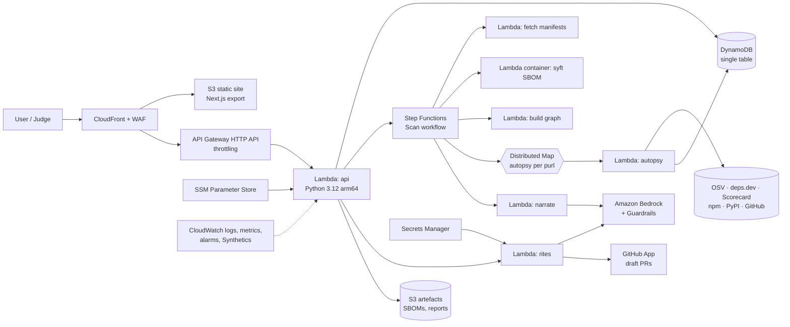

# Graveyard — Product Requirements Document

> **Every codebase is built on the dead. Graveyard finds them, explains how they died, and brings your software back to life.**
>
> **One-liner (for judges who skim):** *Dependabot upgrades what's alive. Graveyard deals with what's dead.*

| | |
|---|---|
| **Product** | Graveyard |
| **Hackathon** | Kiroween 2026 (Devpost, sponsor: AWS) |
| **Category** | Resurrection |
| **Bonus targets** | Best Startup Project (TBC, see §19), Best Demo, Bonus Blog, Social Blitz, Best Kiro Crew App (stretch) |
| **Author / Entrant** | Olajide Adeluwoye (`olajaido`) |
| **Status** | Draft v1.3, 3 Nov 2026 (changelog: Appendix D) |
| **Submission deadline** | **Fri 4 Dec 2026, 14:00 PT = 22:00 GMT**. Internal target: **Thu 3 Dec, 20:00 GMT** |

---

## 0. How to use this document (read first)

1. This PRD is the **single source of truth for intent**. Commit it as `docs/PRD.md`.
2. **Do not hand-write the Kiro specs from this document.** Feed each feature section (§8) into Kiro spec mode and let Kiro generate `requirements.md` → `design.md` → `tasks.md` under `.kiro/specs/<feature>/`. Review and edit what Kiro produces. Judges score *how you used Kiro*, and the spec history is your evidence.
3. Requirements in §8 are already written in **EARS notation** (`WHEN … THE SYSTEM SHALL …`), which is the format Kiro specs use, so Kiro can lift them directly.
4. Keep a running **`docs/KIRO_JOURNAL.md`** from day one (a hook appends to it automatically, see §11.4). The write-up, blog post and video narration all come from it.
5. Anything marked **🔍 SPIKE** must be validated in Week 0 before you build on it.

---

## 1. Executive summary

Modern applications pull in hundreds to thousands of open-source packages. A meaningful share of them are **dead**: deprecated, archived, abandoned by a sole maintainer, or carrying known vulnerabilities for which no fix will ever ship. Nobody notices until something goes wrong.

The pattern is well documented:
- `event-stream` was handed to a stranger by a burnt-out maintainer and backdoored.
- `xz-utils` was nearly backdoored through a social-engineered, exhausted maintainer.

Since **11 September 2026**, the EU Cyber Resilience Act's Article 14 reporting obligations apply. Manufacturers placing software on the EU market must report actively exploited vulnerabilities, so "we didn't know that dependency was dead" is no longer an acceptable posture.

Graveyard works in three stages:

1. **Exhumes** a repository's full dependency tree from a public GitHub repo or an uploaded SBOM.
2. **Autopsies** every package using public datasets (OSV.dev, deps.dev, OpenSSF Scorecard, npm and PyPI registries, GitHub). It produces a deterministic, explainable **Mortality Score** and a cause of death.
3. **Resurrects** your software through three agent-assisted rites:
   - **Reincarnate:** migrate to a living alternative, opened as a draft PR.
   - **Necromancy:** fork and patch the dead package.
   - **Seal the Crypt:** quarantine it behind an adapter, add a CI policy and draft a VEX statement.

It presents all of this as a **moonlit graveyard**: each tombstone is a dead dependency still haunting production. A one-click **"Lights On"** mode turns the same data into an accessible, sortable table for real work.

Graveyard also lives where developers work:
- a **Kiro Power** and **PreToolUse hook** that stop an agent installing a dead package;
- a **GitHub Action** ("Vigil") that blocks PRs which introduce new corpses;
- an **MCP server** that any agent can call.

---

## 2. Hackathon alignment

### 2.1 Why Resurrection

The category asks to *"bring dead technology back to life… solving tomorrow's problems."* Graveyard does this literally and at scale: it finds dead open-source technology inside real software and brings it, and the software that depends on it, back to life. The problem is tomorrow's because the CRA's reporting regime, supply-chain attacks on abandoned packages, and AI agents installing whatever they remember from training data are all accelerating.

### 2.2 Differentiation from Kiroween 2025 winners

- **Zombie Blaster** (2025) turned cloud identity cleanup into a retro game. Graveyard is *not* a game and *not* about cloud IAM. It is a real supply-chain tool with a themed UI that serves function.
- **Faxi**, **ELIZA Exhumed** and **Dark Ledger** revived one specific dead technology. Graveyard revives *all* the dead technology inside *your* codebase, and the set is different for every user.

### 2.3 How each judging criterion is won (each worth 20%)

| Criterion | How Graveyard scores |
|---|---|
| **Potential Impact** | Real, regulated, current problem (CRA, xz, event-stream). Clear audience: platform, security and engineering leads. Works on any public repo in seconds. The output is a draft PR you would actually merge. |
| **Technological Implementation** | Kiro used end to end: every major feature is spec-driven; about 25 fine-grained specs with visible v2 iterations; steering uses several inclusion modes plus docs-to-steering via MCP; 17 hooks covering every trigger type, including a *blocking* PreToolUse hook; a custom MCP server; property-based testing with Hypothesis and fast-check on parsers and scoring; custom agents; a published Kiro Power; Kiro CLI; optional Crew app. |
| **Design** | Distinctive, polished graveyard UI where the metaphor *encodes data*: height is blast radius, cracks mean cursed, fog means low confidence. An accessible Lights On table, a complete flow from landing to PR, and empty, loading and error states. |
| **Innovation** | Novel fusion of several public datasets into one explainable mortality model. "Dormant vs dead" nuance that existing tools lack. Agent-generated resurrection PRs. The Graveyard checks its *own* recommended alternatives before suggesting them. |
| **Presentation** | Scripted 3-minute video with a dramatic but factual cold open, a live end-to-end demo, and a "Kiro blocks a dead install" moment. |

### 2.4 Compliance checklist (disqualification risks)

- [ ] Public **GitHub** repo (not GitLab).
- [ ] **Apache-2.0** `LICENSE` at the root, visible in the About section. Apache-2.0 is recommended over MIT because of its patent grant and because it matches Kiro Crew's licence.
- [ ] `/.kiro/` committed at the repo root and **not** in `.gitignore`. Add a CI check that fails if `.kiro` is ignored.
- [ ] All code written on or after 30 Oct 2026. Pre-existing work disclosed in the README "Third-party components" section: Syft, data sources, fonts, any starter templates.
- [ ] Working app URL, live until **29 Jan 2027**.
- [ ] Judge credentials and instructions in the private Devpost field. Default design: **no login needed** to scan public repos or use the demo.
- [ ] Demo video under 3 minutes, public on YouTube, no copyrighted music, no third-party logos or trademarks without permission. Use your own voice and royalty-free or self-made audio.
- [ ] Kiro usage write-up (§11.8).
- [ ] Third-party API and data terms checked and attributed (§13.3).
- [ ] Employer due diligence: built on personal time, personal equipment and personal accounts; NHS BSA and DWP gifts, hospitality and IP policies checked before accepting any prize.
- [ ] Kiro credits requested (deadline Tue 1 Dec, 20:00 GMT) and redeemed (by Fri 4 Dec). **Do this now.**

---

## 3. Problem statement

### 3.1 The problem

Dependency tooling today answers *"does this version have a known CVE?"*. It does not answer:

1. **Is anyone still alive on the other end?** If a vulnerability is found tomorrow, will a fix ever ship?
2. **Is it dead, or just finished?** A two-hundred-line utility with no commits in four years can be perfectly healthy. A popular HTTP client with no commits in four years and 300 unanswered issues is not.
3. **Where is it haunting me?** Through which dependency paths, in which services, at runtime or dev-time only?
4. **What do I do about it?** Is there a living alternative, a built-in replacement, or a fork? If not, how do I contain it?

### 3.2 Who feels it

| Persona | Pain | What they need from Graveyard |
|---|---|---|
| **Priya, platform/DevSecOps engineer** (primary) | Owns the dependency health of 40 services, buried in Dependabot noise, can't tell what's actually dangerous. | Prioritised list of dead dependencies, ranked by mortality and exposure, with PRs ready to merge. |
| **Marcus, engineering lead or CTO** | Has to answer "what's our exposure?" for audits, customers and CRA readiness. | One-page Coroner's Report, a trend over time, and evidence for compliance. |
| **Ade, application developer** | Adds packages from memory or AI suggestions without knowing they're dead. | Real-time warning *at install time*, in their editor or agent. |
| **AI coding agents** (non-human user) | Recommend packages from stale training data, often deprecated ones. | A machine-callable check (MCP) and a blocking hook. |

### 3.3 Existing alternatives and the gap

| Tool | Strength | Gap Graveyard fills |
|---|---|---|
| Dependabot / Renovate | Upgrades to newer versions | Useless when there *is* no newer version, which is the definition of dead |
| Snyk / Socket / OSV-Scanner | CVEs, malware, some health signals | No dead-versus-finished nuance, no migration-to-alternative rites, not designed around abandonment |
| OpenSSF Scorecard | Project security posture | Per-project, not per-your-dependency-tree; no remediation |
| deps.dev | Excellent raw data | A data source, not a workflow |

**Graveyard's angle:** abandonment-first, explainable, remediation-oriented, and agent-native.

---

## 4. Goals and non-goals

### 4.1 Goals (hackathon MVP)

- **G1** Scan any public GitHub repo (npm and PyPI) or an uploaded CycloneDX SBOM. Show the graveyard in **≤ 90 s at p95** for 1,000 packages on a cold cache, and ≤ 10 s warm.
- **G2** Explainable Mortality Score with ≥ 90% precision on a labelled evaluation set (§7.6), and ≤ 10% false positives on "finished but healthy" packages.
- **G3** At least one fully automated resurrection: a draft PR for **native or drop-in replacements**. Every dead package gets an actionable plan.
- **G4** Graveyard stops a Kiro agent installing a dead package, shown live in the demo.
- **G5** A polished, accessible UI that a judge understands in 10 seconds.
- **G6** Running cost of **≤ £30/month** while live for judging.

### 4.2 Non-goals (explicitly out of scope)

- Private repositories, private registries and self-hosted GitHub. Private repos are a P2 option via GitHub App.
- Ecosystems beyond npm and PyPI. Go, Maven and Cargo are stretch only.
- Auto-merging anything. All PRs are **draft** and need a human to merge.
- **Executing user code** in Graveyard infrastructure. Tests run in the user's own CI.
- Malware detection. Use Socket or OSV for that; Graveyard links to it.
- Being a full SCA platform. Graveyard is focused and complements existing tools.

---

## 5. Product principles

1. **Explainable over clever.** The score is deterministic and every point is traceable to evidence with a link. **LLMs never compute the score.** They only narrate and draft remediation.
2. **Dormant is not dead.** Crying wolf kills trust, so the "Resting" state exists precisely to protect quiet-but-healthy packages.
3. **Theme serves function.** Every spooky element encodes information, and Lights On is always one click away.
4. **Human in the loop.** Agents propose; humans dispose.
5. **Eat our own dog food.** Graveyard autopsies the alternatives it recommends, and its own dependencies via a hook and CI.
6. **Untrusted by default.** READMEs, issues and changelogs are attacker-controllable input to an LLM.

---

## 6. Glossary (themed term → plain meaning)

The UI always shows both, e.g. **"Dead** (abandoned)".

| Themed | Plain | Definition |
|---|---|---|
| Exhume | Ingest | Fetch manifests or SBOM and resolve the dependency graph |
| Autopsy | Health analysis | Collect signals and compute the Mortality Score for one package version |
| Mortality Score | Abandonment risk | 0–100 deterministic risk score (§7) |
| Alive | Healthy | Actively maintained |
| Resting | Dormant, stable | Quiet but no risk indicators. Informational only |
| Ailing | At risk | Declining maintenance signals |
| Dead | Abandoned | Declared dead, or score ≥ 60 |
| Cursed | Unfixable vulnerability | Overlay: a known vuln affects this version, **no fixed version exists**, and it isn't a fresh disclosure on a healthy package (§7.4) |
| Wounded | Fixable vulnerability | Overlay: an advisory with a fix, a fix pending, or an older version deprecated. Upgrade, not resurrect |
| Unknown | No data | No scored signals are available, so no verdict is given |
| Haunting | Exposure | Dependency paths through which a package reaches you |
| Blast radius | Impact | Number of paths × runtime weight × services affected |
| Death Certificate | Package report | Detail view with evidence |
| Rite | Remediation | Reincarnate, Necromancy, or Seal the Crypt |
| Vigil | Continuous monitoring | CI check and scheduled rescans |
| Coroner's Report | Exportable report | Markdown, PDF and CycloneDX VEX |
| Séance | Grounded Q&A | Ask questions about a dead package, answered only from its artefacts with citations |

---

## 7. The Mortality Model (core IP)

### 7.1 Inputs (per package version, identified by a purl)

| ID | Signal | Source | Notes |
|---|---|---|---|
| S1 | **Declared death**: npm `deprecated` on the **latest** version (package-level deprecation); GitHub repo `archived`; PyPI project status *archived* or *deprecated* (PEP 792) where exposed; PyPI classifier `Development Status :: 7 - Inactive` on the latest release | deps.dev `isDeprecated`, npm registry, GitHub GraphQL | ✅ Spike (ADR 0001): PyPI exposes **no** status or deprecation signal, so PyPI S1 comes only from GitHub `isArchived`. Deprecating only an *older* version is **not** death (see S1b) |
| S1b | **Version deprecated**: the resolved version is deprecated but the latest is not | npm registry | Produces the Wounded (upgrade advised) overlay; does not affect mortality |
| S2 | **Release staleness**: latest release date; core converts to months via `months_between` | deps.dev / registry | |
| S3 | **Commit staleness**: last push to default branch date; core converts to months via `months_between` | GitHub GraphQL `pushedAt` / history | |
| S4 | **Maintenance activity**: Scorecard `Maintained` check (0–10), which covers 90-day activity | deps.dev `GetProject` (includes Scorecard) or Scorecard API | |
| S5 | **Bus factor**: distinct committers in the last 12 months | GitHub stats / ecosyste.ms | Cap the API cost; P1 |
| S6 | **Issue neglect**: all-time open and closed issue counts | GitHub GraphQL `issues { totalCount }` | v1 uses the all-time ratio; a 12-month window and response time are planned for v2 (they need the rate-limited search API) |
| S7 | **Vulnerabilities**: OSV advisories affecting the resolved version; split into *fix available* and *no fix* | OSV.dev `querybatch` | Drives the Wounded and Cursed states |
| S8 | **Scorecard overall** | deps.dev / Scorecard | Weak signal, low weight |
| S9 | **Popularity**: weekly downloads (deps.dev v3 has no dependents count, confirmed by the spike) | npm downloads API, pypistats | Used for *exposure*, not mortality |

### 7.2 Normalisation (each signal → risk r ∈ [0,1])

```
months_between(start, as_of) = (as_of − start).days / 30.4375    # pure; non-negative for start ≤ as_of
g = grace_months, s = span_months                              # from weights.v1.yaml
r2 = clamp((months_between(s2_latest_release_at, as_of) − g) / s, 0, 1)
r3 = clamp((months_between(s3_last_push_at, as_of) − g) / s, 0, 1)
r4 = 1 − (maintained_check / 10)                       # missing if absent or −1 (inconclusive)
r5 = R5_BUCKETS[committers] if committers ≤ 4 else 0.0    # constants.py: {0:1.0, 1:1.0, 2:0.6, 3:0.3, 4:0.3}
open_ratio = open / (open + closed)                    # all-time counts (v1)
r6 = 0 if (open + closed) == 0, else clamp(open_ratio − R6_MIDPOINT, 0, 0.5) × 2   # R6_MIDPOINT = 0.5 (constants.py)
r8 = 1 − (scorecard_overall / 10)                      # missing if absent or −1
```

- All weights, thresholds, exposure multipliers and the cursed multiplier live in `weights.v1.yaml`. Code contains no model literals. Formula-shape constants (`R5_BUCKETS`, `R6_MIDPOINT`) live in `constants.py` and define the formula structure, not tunable parameters.
- `Signals` rejects out-of-domain values at construction (`__post_init__` raises `ValueError`): counts must be ≥ 0; s4/s8 must be in [0,10] or exactly −1.
- Repo-level signals (S3–S6, S8) are marked `shared_repo = true` when the source repo hosts several packages (monorepo). This is a known limitation, surfaced in the UI.

### 7.3 Score

```
mortality = 100 × Σ(wᵢ × rᵢ) / Σ(wᵢ for signals present)
weights (v1): w2=0.25, w3=0.25, w4=0.20, w5=0.10, w6=0.10, w8=0.10
contributions = { i: (wᵢ·rᵢ / Σw_present) × 100 }     # per present signal; sums to mortality pre-S1
```

- **Declared death (S1)** overrides the score: `mortality = max(mortality or 0, thresholds.s1_min_score)`, `dead_reason = "declared"`, and the base state is **Dead (declared)**. This applies even when no scored signals are present: `mortality = thresholds.s1_min_score`, `confidence = 0`.
- **Missing signals** are excluded from the denominator and increase **uncertainty**: `confidence = Σ w(present) / Σ w(all)`. The UI renders low confidence as **fog**. When S1 is True and no scored signals are present, `confidence = 0`.
- If **no** scored signal is present and S1 is not True, `mortality = null` and the base state is **Unknown**, shown as heavy fog. This avoids division by zero and keeps classification total.
- The scoring functions take `as_of` as an argument and never read the clock, so they are deterministic.
- Weights live in a **versioned config file** (`backend/core/scoring/weights.v1.yaml`), not SSM, so that the score is reproducible from git. Every certificate is stamped `model_version`.
- `ScoringResult` carries `dead_reason` (`"declared"`, `"score"`, or `None`), `contributions` (per-signal breakdown summing to mortality pre-S1), and `exposure_assumed` (bool).

### 7.4 State classification

| State | Rule (base states evaluated in order; exactly one applies) |
|---|---|
| **Dead** | S1 true (`dead_reason = "declared"`), OR mortality ≥ thresholds.dead (`dead_reason = "score"`) |
| **Unknown** | mortality is null (no scored signals and S1 is not true) |
| **Resting** | thresholds.ailing ≤ mortality < thresholds.dead AND s7_advisories is not None and empty (known + no advisories) AND (r6 ≤ thresholds.resting_r6_max OR r6 missing) AND weekly downloads is known AND ≥ `resting_min_weekly_downloads` |
| **Ailing** | thresholds.ailing ≤ mortality < thresholds.dead |
| **Alive** | mortality < thresholds.ailing |
| **Cursed** (overlay) | ≥ 1 advisory affecting the resolved version with **no fixed version in any range**, AND (the advisory's `published_at` is not None and was published ≥ `cursed_min_age_days` before `as_of`, OR the base state is Dead or Ailing). An advisory with `published_at = None` never satisfies the age condition. This stops healthy packages with a fresh CVE being labelled cursed |
| **Wounded** (overlay) | Any advisory with a fix available; OR a no-fix advisory that doesn't meet the Cursed rule ("fix pending"); OR S1b ("upgrade advised"). If both overlays apply, the UI shows Cursed |

### 7.5 Priority (what to fix first)

```
path_weight = (runtime ? exposure.runtime : exposure.dev) × (direct ? exposure.direct : exposure.transitive)   # from weights.v1.yaml
exposure    = max(path_weight over all paths to the node)          # 1.0 if paths is None/empty (exposure_assumed = True)
priority    = mortality × (exposure.base + (1 − exposure.base) × exposure) × (cursed ? cursed_priority_multiplier : 1.0)
```

- Exposure is always computed (including Unknown nodes); defaults to `1.0` when no paths, with `exposure_assumed = True`.
- `priority` is `None` only when `mortality` is `None`.
- Purls must be unique in the input list (validated; duplicates raise `ValueError`).
- Sort: scored nodes by priority desc → services_affected desc → purl asc. Unknown nodes sort after scored, by exposure desc → services_affected desc (None last) → purl asc. A deterministic total order.

### 7.6 Evaluation harness (credibility, and a strong point for judges)

- Build `eval/labelled_packages.csv` with about **100 npm and PyPI packages** hand-labelled: dead (deprecated or archived), finished-healthy (tiny stable utilities), alive, and ailing.
- `make eval` prints precision, recall and false-positive rate on "finished" packages, plus a confusion matrix. CI fails if precision drops below 0.90.
- Report the numbers in the README and the video. **Judges rarely see hackathon projects that measure themselves.**

### 7.7 Properties that must always hold (property-based tests, §11.6)

All Hypothesis strategies generate valid-domain signals; a separate test asserts invalid values raise `ValueError`.

- **I1** Mortality is null, or 0 ≤ mortality ≤ 100.
- **I2 Monotonicity**, holding the set of present signals constant:
  - moving `s2_latest_release_at` earlier (more months since release) never decreases mortality;
  - moving `s3_last_push_at` earlier never decreases mortality;
  - decreasing `maintained`, `overall` or committers never decreases mortality;
  - increasing `open_issues` (closed fixed) never decreases mortality.
- **I3** S1 ⇒ Dead, `dead_reason = "declared"`, whatever the other signals are — including when no scored signals are present.
- **I4** Confidence ∈ [0,1]; making an additional signal present never decreases it; it equals 1 iff all six are present; it equals 0 when S1-only with no scored signals.
- **I5** Totality: every valid input, including all-missing and S1-with-no-signals, maps to exactly one base state.
- **I6** Determinism: identical inputs and `as_of` ⇒ identical output.
- **I7** Exposure is always a float in [0, 1]; priority ≥ 0 for scored nodes; the sort is a strict total order (no ties after tie-breakers).
- **I8** Version-only deprecation (S1b) never yields `dead_reason = "declared"` or Dead via declaration.

---

## 8. Features and requirements (EARS)

Priority: **P0** = must ship for the demo, **P1** = should, **P2** = stretch.

### 8.1 F1 — Exhume (ingest) · P0 · spec: `exhume`

**User story:** As a platform engineer, I want to point Graveyard at a repo or SBOM so that I get my full dependency tree without installing anything.

- **EX-1** WHEN a user submits a public GitHub repo (`owner/name`, optional ref) THE SYSTEM SHALL fetch only supported manifest and lock files via the GitHub Contents/Trees API, without cloning or executing code.
- **EX-2** THE SYSTEM SHALL support, at P0: `package-lock.json` (v2/v3), `pnpm-lock.yaml`, `requirements.txt` (pinned), `poetry.lock`, `uv.lock`; at P1: `yarn.lock`, `Pipfile.lock`.
- **EX-3** WHEN a user uploads a file THE SYSTEM SHALL accept CycloneDX 1.5–1.7 JSON or SPDX 2.3 JSON up to 5 MB via a presigned S3 URL, and reject other content types.
- **EX-4** THE SYSTEM SHALL normalise all inputs to an internal CycloneDX-based graph keyed by purl, recording for each node: direct/transitive, scope (runtime/dev), and the manifest path it came from (to support monorepos).
- **EX-5** IF a repo is not found, private, or has no supported files THEN THE SYSTEM SHALL show a specific, friendly error and suggest the SBOM upload route.
- **EX-6** WHEN a monorepo contains several manifests THE SYSTEM SHALL treat each manifest directory as a "service" for exposure purposes.
- **EX-7** THE SYSTEM SHALL dedupe packages by `purl@version` across services and reuse cached autopsies (§10.4).
- ✅ **EX-S1 resolved (ADR 0001):** use **Syft v1.56.0** (pinned) in a container Lambda. Its CycloneDX output includes the `dependencies` graph, so direct and transitive are distinguishable. Identify the root via the project component's `bom-ref` in `components`, not `metadata.component`.
- **EX-8** THE SYSTEM SHALL derive each node's scope (runtime/dev) from the lockfile, because Syft does not provide it:
  - `package-lock.json` `packages[*].dev` / `devOptional`;
  - `poetry.lock` groups;
  - `uv.lock` dev groups;
  - `requirements.txt` entries are treated as runtime.
- **EX-9** THE SYSTEM SHALL resolve each package's source repository via deps.dev `SOURCE_REPO`, then the registry `repository` field, then PyPI `project_urls`. It SHALL normalise every URL form (`git+https://`, `git://`, `ssh`, `github:owner/repo`, trailing `.git`) to `github.com/<owner>/<repo>`. IF no repository resolves THEN repo-level signals SHALL be marked missing.

### 8.2 F2 — Autopsy and Mortality Score · P0 · spec: `autopsy`

**User story:** As an engineer, I want each dependency's health assessed with evidence so that I trust the verdict.

- **AU-1** WHEN a scan graph is built THE SYSTEM SHALL autopsy every unique `purl@version` in parallel (Step Functions Distributed Map), respecting per-source rate limits.
- **AU-2** THE SYSTEM SHALL compute mortality, state, overlays, confidence and priority exactly as specified in §7, using only deterministic code.
- **AU-3** THE SYSTEM SHALL store, for every signal, the raw value, the normalised risk, the source URL and the fetch timestamp (the "evidence").
- **AU-4** WHEN a signal source fails or times out THE SYSTEM SHALL mark the signal missing, lower confidence, and continue. A single source failure never fails the scan.
- **AU-5** THE SYSTEM SHALL cache autopsies for 24 h (DynamoDB TTL) and serve cached results with an "as of" timestamp.
- **AU-6** WHEN a package is Dead, Ailing or Cursed THE SYSTEM SHALL generate a two-sentence plain-English **cause of death** via Bedrock, using only the evidence JSON as input. The output must not introduce facts absent from the evidence (enforced by prompt plus a post-check that every number in the narrative appears in the evidence).
- **AU-7** THE SYSTEM SHALL expose `GET /packages/{purl}/autopsy` for use by the CLI, MCP server and GitHub Action.

### 8.3 F3 — The Graveyard (main view) · P0 · spec: `graveyard-ui`

**User story:** As any user, I want to see at a glance what's dead and how badly it haunts me.

- **GY-1** WHEN a scan completes THE SYSTEM SHALL render a graveyard scene containing one tombstone per Dead, Ailing or Cursed package. Alive and Resting packages appear as a count ("The living: 412 · Resting: 37").
- **GY-2** Tombstone **height** SHALL encode blast radius, **cracks** SHALL indicate Cursed, **moss** SHALL scale with staleness, **fog density** SHALL reflect low confidence, and **ghost wisps** SHALL animate along haunting paths on hover.
- **GY-3** Tombstones SHALL be ordered left to right by priority, with the most urgent nearest the viewer.
- **GY-4** THE SYSTEM SHALL provide filters: ecosystem, state, runtime/dev, direct/transitive, service.
- **GY-5** WHEN the user toggles **Lights On** THE SYSTEM SHALL render the same data as a sortable, filterable, keyboard-navigable table, exportable to CSV, and SHALL remember the choice per browser.
- **GY-6** THE SYSTEM SHALL meet WCAG 2.2 AA:
  - roving-tabindex keyboard navigation between tombstones;
  - `aria-label` on every tombstone (e.g. "pycrypto 2.6.1, Dead and Cursed, priority 1 of 7");
  - respect for `prefers-reduced-motion`;
  - text contrast of at least 4.5:1;
  - no information conveyed by colour alone.
- **GY-7** Sound SHALL be off by default.
- **GY-8** WHILE a scan is running THE SYSTEM SHALL show the **Exhumation** progress view: stages (fetch → resolve → autopsy n/N → narrate) with a live count, driven by polling or SSE.
- **GY-9** WHEN a scan finds no Dead, Ailing or Cursed packages THE SYSTEM SHALL show an empty state ("No graves here. Your dependencies live.") with a share card.
- **GY-10** The layout SHALL work from 360 px wide to 4K.

### 8.4 F4 — Death Certificate · P0 · spec: `death-certificate`

- **DC-1** WHEN a user selects a tombstone THE SYSTEM SHALL open a parchment-styled drawer containing:
  - name, version and ecosystem;
  - **Born** (first release) and **Died** (last release or archive date);
  - state badges;
  - mortality score with a per-signal breakdown bar;
  - confidence;
  - cause of death;
  - vital signs (each signal with its evidence link);
  - **Haunting**, the dependency paths (e.g. `api-service → express-jwt → jsonwebtoken@8 → …`);
  - **Next of kin**, the alternatives;
  - **Last Rites**, the available rites.
- **DC-2** Every evidence item SHALL link to its primary source (OSV advisory, GitHub repo, registry page).
- **DC-3** THE SYSTEM SHALL provide a deep link (`/scan/{id}/grave/{purl}`) so certificates can be shared.

### 8.5 F5 — Resurrection Rites · P0 (Reincarnate), P1 (Seal), P2 (Necromancy) · spec: `resurrection-rites`

**User story:** As an engineer, I want a concrete, reviewable fix, not just a warning.

**Reincarnate (migrate)**
- **RR-1** THE SYSTEM SHALL propose alternatives from, in order:
  1. the **module-replacements** dataset (e18e; npm; includes *native* replacements, e.g. a package replaced by a built-in);
  2. a curated `alternatives.yaml` maintained in-repo for PyPI;
  3. LLM-proposed candidates.
- **RR-2** THE SYSTEM SHALL **autopsy every proposed alternative** and discard any that are not Alive or Resting, that are absent from the registry, or whose licence is incompatible with the original (permissive → copyleft is flagged).
- **RR-3** WHERE the replacement is classified *native* or *drop-in* THE SYSTEM SHALL generate a complete diff: manifest change, import and call-site rewrites via codemod (ast-grep rules for JS/TS; LibCST for Python), and lockfile regeneration instructions.
- **RR-4** WHERE the replacement is not drop-in THE SYSTEM SHALL generate a **migration plan**: an API mapping table, affected files with line references, and a risk rating. It SHALL open the PR with TODO markers instead of guessing.
- **RR-5** WHEN the user confirms THE SYSTEM SHALL open a **draft** PR with a templated body: cause of death, evidence links, what changed, how to test, and a rollback note. It SHALL never push to the default branch and never auto-merge.
- **RR-6** In public demo mode, PRs SHALL be opened only against the `haunted-house` demo repo (§15.2), rate-limited to 10 per hour globally.

**Seal the Crypt (quarantine) · P1**
- **RR-7** THE SYSTEM SHALL generate:
  - an adapter module that wraps the dead package's used API surface (anti-corruption layer);
  - a lint rule that forbids new direct imports (ESLint `no-restricted-imports` / Ruff `banned-api`);
  - a draft **CycloneDX VEX** entry with status `under_investigation`, which a human must change to `not_affected` with a justification.
- **RR-8** THE SYSTEM SHALL never assert `not_affected` automatically.

**Necromancy (fork and patch) · P2**
- **RR-9** WHEN a package is Cursed and no alternative exists THE SYSTEM SHALL produce:
  - a patch plan from the OSV advisory references (vulnerable function and fix pattern);
  - a patch generated in a sandboxed scratch branch of a **user-owned fork**;
  - the manifest `overrides` (npm) or direct-reference (pip) change that points at the fork.

### 8.6 F6 — Kiro Power, hook and MCP server · P0 · spec: `kiro-power`

**User story:** As a developer using an AI agent, I want the agent to be *unable* to bring a dead package into my project.

- **KP-1** THE SYSTEM SHALL ship a **Graveyard MCP server** (Python, stdio via `uvx graveyard-mcp`; P1: remote streamable HTTP) with these tools:
  - `autopsy_package(purl)`
  - `scan_lockfile(path)`
  - `find_alternatives(purl)`
  - `check_install_command(command)`, which parses `npm/pnpm/yarn add`, `pip/uv add/install` and returns a verdict.
- **KP-2** THE SYSTEM SHALL ship a **Kiro Power** (`powers/graveyard/`) containing:
  - `POWER.md` (keywords: dependency, package, install, npm, pip, library, deprecated, abandoned);
  - `mcp.json`;
  - steering on dependency hygiene;
  - a hook.
- **KP-3** The Power's hook SHALL be a **PreToolUse** hook on shell-execution tools that runs `graveyard check-install "<command>"`. It exits non-zero, blocking the tool call, WHEN the package is Dead or Cursed, and prints the alternative. 🔍 SPIKE KP-S1: confirm the matcher syntax and blocking semantics for PreToolUse on the shell tool in the current Kiro hook schema (`.kiro/hooks/*.json`, `version: "v1"`).
- **KP-4** THE SYSTEM SHALL publish the Power from the main repo, with install instructions, so judges and users can install it from GitHub.

### 8.7 F7 — Vigil (CI and monitoring) · P1 · spec: `vigil`

- **VG-1** THE SYSTEM SHALL ship a GitHub Action (`graveyard/vigil@v1`, composite action, pinned by SHA in docs) that diffs lockfiles between base and head and comments on the PR with any newly introduced Dead, Ailing or Cursed packages.
- **VG-2** The Action SHALL fail the check for new Dead or Cursed packages by default (configurable: `fail-on: dead,cursed`).
- **VG-3** P2: scheduled weekly rescans (EventBridge Scheduler) for watched repos, with an email digest via SES.
- **VG-4** Graveyard's own repo SHALL run Vigil on itself (dog-fooding, shown in the write-up).

### 8.8 F8 — Coroner's Report · P1 · spec: `coroners-report`

- **CR-1** THE SYSTEM SHALL export a scan as Markdown and PDF:
  - an executive summary (counts by state, top 10 by priority);
  - the methodology (model version, data sources, timestamps);
  - a per-package appendix.
- **CR-2** THE SYSTEM SHALL export a CycloneDX SBOM enriched with Graveyard properties (`graveyard:mortality`, `graveyard:state`) plus any human-approved VEX statements.
- **CR-3** The report SHALL include a CRA-readiness note: it identifies components where no fix will be available, so that vulnerability handling plans can be documented. It is **not** legal advice.

### 8.9 F9 — Séance (grounded Q&A) · P2 · spec: `seance`

- **SE-1** WHEN a user asks a question on a Death Certificate THE SYSTEM SHALL answer **only** from that package's README, changelog, last 50 issues and advisories, with citations. Where the answer isn't in those sources, it SHALL say "the dead do not speak of this."
- **SE-2** All retrieved third-party text SHALL be wrapped as untrusted data, with tool use disabled for that model call, Bedrock Guardrails prompt-attack filtering applied, and output stripped of links not present in the sources.

### 8.10 F10 — Landing and onboarding · P0 · spec: `graveyard-ui`

- **LD-1** The landing page SHALL offer three entry points: **Scan a GitHub repo**, **Upload SBOM**, **Visit the Haunted House** (a pre-scanned demo, instant).
- **LD-2** It SHALL show a one-line value proposition, three example findings, "how it works" in three steps, and links to the Kiro Power and Action.
- **LD-3** The page SHALL load with LCP under 2.5 s on 4G (static, CloudFront-cached).

---

## 9. UX and design specification

### 9.1 Visual language

- **Scene:** 2.5D layered SVG with a night sky, moon, treeline silhouette, rolling hills, iron fence and ground fog. Tombstones sit on parallax layers, and subtle motion (fog drift, wisps) is CSS/Framer Motion. **No Three.js**: it costs scope and accessibility.
- **Palette tokens** (CSS custom properties, light-mode equivalents used by Lights On):
  - `--night-900 #0B0E14`, `--night-700 #161B26`
  - `--moon #E8E4D8`
  - `--fog rgba(200,205,215,.12)`
  - `--ectoplasm #7CFFB2` (Alive/Resting accent)
  - `--ember #FF8A3D` (Ailing)
  - `--blood #E5484D` (Dead)
  - `--curse #B07CFF` (Cursed)
  - `--parchment #F2E6C9` (certificate)
- **Type:** a display face for headings only (OFL-licensed Google Font, e.g. *Creepster* or *IM Fell English*, chosen in the design spike); body text in **Inter**; code in **JetBrains Mono**. Keep the display face out of body text for readability.
- **Iconography:** custom SVG set (tombstone variants, coffin, candle, raven, key) drawn in-house so there are no licensing questions.

### 9.2 Tombstone component

| Attribute | Encodes |
|---|---|
| Height (3 sizes) | Blast radius tercile |
| Shape (rounded, cross, obelisk) | Ecosystem (npm, PyPI, other) |
| Crack overlay + purple glow | Cursed |
| Moss coverage | Months since last release |
| Fog around base | Low confidence |
| Epitaph (engraved) | `name@version`, "†  <died-date>" |
| Wisps on hover/focus | Haunting paths highlighted in the mini dependency graph |

### 9.3 Key screens

1. **Landing**: hero over the graveyard horizon; repo input and two secondary CTAs.
2. **Exhumation (progress)**: a shovel animation with a stage list and a live autopsy counter showing the fan-out happening.
3. **Graveyard**: the scene, a filter bar, the "The living / Resting" counters, the Lights On toggle and an export menu.
4. **Death Certificate drawer**: as DC-1.
5. **Last Rites modal**: rite cards (Reincarnate, Seal, Necromancy) showing feasibility and effort, then a diff preview (Monaco diff, read-only), then **Open draft PR**.
6. **Coroner's Report**: a printable view.
7. **Vigil setup**: copy-paste snippets for the Action and the Kiro Power install.

### 9.4 States to design explicitly

Loading, partial results (a source down, with a fog banner), errors (repo not found, rate limited, file too large), empty graveyard, mobile layout, Lights On, reduced motion, keyboard focus rings.

### 9.5 Copy tone

Darkly playful in headers ("Cause of death: abandonment"), and sober and precise in evidence and PR text. **Never** spooky in the PR body, because it lands in other people's repos.

---

## 10. Technical architecture

### 10.1 Overview



### 10.2 Technology choices (and why)

| Layer | Choice | Rationale |
|---|---|---|
| Frontend | **Next.js (static export) + TypeScript + Tailwind + Framer Motion** | Static on S3/CloudFront: near-zero idle cost, fast, no server to keep alive until 29 Jan |
| Backend | **Python 3.12 on Lambda (arm64), AWS Lambda Powertools** | Your strongest language; Hypothesis is the best property-based-testing library available; Graviton is cheaper |
| Orchestration | **Step Functions** (Standard parent, Express child for the Distributed Map) | Visual fan-out that is great to show on video, built-in retries and backoff per source, no queue plumbing |
| Data | **DynamoDB** single table, on-demand, TTL | Serverless, cheap, TTL gives the autopsy cache for free |
| Artefacts | **S3** with SSE-KMS, lifecycle rule (7-day expiry for uploads, 30 days for reports) | |
| LLM | **Amazon Bedrock** with EU cross-region inference profiles: `eu.anthropic.claude-haiku-5-5` for narrate, `eu.anthropic.claude-sonnet-5-5` for rites; **Bedrock Guardrails** | Sponsor-native; Guardrails covers the prompt-attack filter. Model IDs in SSM. ✅ Profiles confirmed in `eu-west-2` (ADR 0001). Use `eu.` profiles only, never `global.` |
| SBOM | **Syft** (pinned version, pinned image digest) | Mature lockfile coverage; avoids writing parsers |
| Codemods | **ast-grep** (JS/TS), **LibCST** (Python) | Deterministic rewrites; the LLM only *chooses* the rule |
| Auth to GitHub | **GitHub App** (not an OAuth app or PAT) | Fine-grained, per-repo, short-lived installation tokens |
| IaC | **Terraform ≥ 1.10**, S3 backend with **native lockfile locking** (`use_lockfile = true`) | Current best practice; DynamoDB state locking is deprecated |
| CI/CD | **GitHub Actions + OIDC to AWS** | The repo must be on GitHub; no long-lived AWS keys |
| Region | **eu-west-2 (London)**; CloudFront global; ACM certificate in us-east-1 | Latency and data residency for a UK author |

### 10.3 Deliberate deviations (flagged)

- **No VPC.** There are no private data stores that need one: DynamoDB, S3, Bedrock and Secrets Manager are reached over IAM-authenticated AWS endpoints. A VPC with NAT would add about £25–30 a month and a single point of failure for no security gain at this scale. *Revisit if* private repos or self-hosted runners are added.
- **Single production environment** plus local and `dev` stacks in the same personal AWS account, separated by state key and name prefix. This is acceptable for a hackathon. Document the multi-account path (Organizations, separate prod account) in the README as "production hardening".

### 10.4 Data model (DynamoDB single table `graveyard`)

| Entity | PK | SK | Notable attributes | TTL |
|---|---|---|---|---|
| Scan | `SCAN#<scanId>` | `META` | source, status, stage, counts, createdAt, modelVersion, ownerGithubId? | 30 d |
| Scan node | `SCAN#<scanId>` | `NODE#<purl>` | direct, scope, services[], paths[] (compressed), state, priority | 30 d |
| Autopsy cache | `PKG#<purl>` | `AUTOPSY#v1` | signals{}, evidence[], mortality, state, overlays, confidence, narrative, fetchedAt | 24 h |
| Rite | `SCAN#<scanId>` | `RITE#<riteId>` | type, purl, plan, diffS3Key, prUrl, status | 30 d |
| Rate counters | `RL#<key>` | `WINDOW#<ts>` | count | 2 h |

- `scanId` = ULID plus a 64-bit random suffix, so it is **unguessable**. Scans of public repos are viewable by anyone with the link, which is intended. Authenticated scans (P2) are checked against `ownerGithubId` on every read **to prevent IDOR**.
- GSI1 (`source#repo`, `createdAt`) supports "latest scan for repo".

### 10.5 API (OpenAPI 3.1, `backend/api/openapi.yaml` is the source of truth)

| Method | Path | Purpose |
|---|---|---|
| POST | `/v1/scans` | `{source:{type:"github",repo,ref?}}` or `{source:{type:"sbom",uploadId}}` → `202 {scanId}` |
| GET | `/v1/scans/{scanId}` | Status, stage and progress |
| GET | `/v1/scans/{scanId}/graves` | Nodes in state ≠ Alive (paginated, filterable) |
| GET | `/v1/scans/{scanId}/graves/{purl}` | Death Certificate |
| POST | `/v1/uploads` | Presigned PUT URL (5 MB, `application/json`) |
| GET | `/v1/packages/{purl}/autopsy` | Single-package autopsy (CLI, MCP, Action) |
| POST | `/v1/scans/{scanId}/graves/{purl}/rites` | `{type}` → plan and diff |
| POST | `/v1/rites/{riteId}/pull-request` | Open a draft PR (demo repo, or the user's repo with the GitHub App installed) |
| GET | `/v1/scans/{scanId}/report?format=md\|pdf\|cdx` | Coroner's Report |

- TypeScript client types are generated from the OpenAPI spec (hook, §11.4).
- Errors use RFC 9457 `application/problem+json`.

### 10.6 Scan workflow (Step Functions)

1. `ValidateInput`: allow-list `github.com` only; regex on `owner/name`; reject anything else. This prevents SSRF.
2. `FetchManifests`: GitHub Trees API (recursive, filtered by filename), max 50 manifests and 10 MB in total.
3. `GenerateSBOM`: Syft container Lambda (one per manifest directory, in parallel).
4. `BuildGraph`: merge, dedupe, and compute paths and exposure.
5. `AutopsyMap`: Distributed Map over unique purls; MaxConcurrency 20; per-source retry with exponential backoff and jitter; results cached.
6. `Classify`: deterministic scoring.
7. `Narrate`: Bedrock calls only for Dead, Ailing and Cursed packages, batched, with a token budget per scan.
8. `Finalise`: write counts, status `COMPLETE`, emit the metric `ScanDurationSeconds`.

Timeouts: overall 5 min. Partial-results policy is AU-4.

### 10.7 External rate limits and mitigations

| Source | Auth | Approach |
|---|---|---|
| deps.dev API v3 | None | Primary source for versions, links, Scorecard and dependents; cache aggressively |
| OSV.dev `/v1/querybatch` | None | One batch call per scan of up to 1,000 queries |
| GitHub GraphQL | **Graveyard Reader** app installation token (5,000 points/hr), **P0** | The only source for `isArchived`, S3, S5 and S6. One batched query per group of up to 50 repos; cache per repo for 24 h |
| npm downloads API / pypistats | None | S9 weekly downloads; pypistats is rate-limited, so cache for 7 days |
| Scorecard API | None | Fallback when deps.dev has no project for a resolved repo |
| npm registry / downloads API | None | Abbreviated metadata (`application/vnd.npm.install-v1+json`) for speed |
| PyPI JSON API | None | Per-package JSON |
| ecosyste.ms | None (polite pool) | P1 for bus factor and issue stats; set a contact `User-Agent` |

---

## 11. Kiro usage plan (Technological Implementation, 20%)

**Rule: if you did it in Kiro, write it in the journal the same day.**

### 11.1 Surfaces

| Surface | Used for |
|---|---|
| **Kiro IDE** | Spec authoring and iteration, UI work, hooks, steering, power development |
| **Kiro CLI** | Running custom agents from the terminal, scripted evaluation runs, power scaffolding; 🔍 evaluate headless use in CI (e.g. an automated PR review step) |
| **Kiro Web** | Quick fixes and doc edits away from your main machine; note the differences in the write-up |
| **Kiro Crew** (P2) | **Gravedigger** Crew App: persistent agents that rescan watched repos on a schedule, triage new deaths into a queue, and draft rites in parallel with sub-agents (separate repo, §15.3) |

### 11.2 Specs (`.kiro/specs/`)

**Fine-grained specs.** Size each one to about 1–3 evenings of tasks. Many small specs give Kiro tighter context, make review faster, and leave a richer evidence trail; the 2025 2nd-place entry shipped 21. Each spec has Kiro-generated `requirements.md`, `design.md` and `tasks.md`.

| Group | Specs | From PRD |
|---|---|---|
| Core logic | `mortality-model` · `purl-and-versions` · `dependency-graph` | §7, AU-2/3, EX-4 |
| Ingest | `exhume-github` · `exhume-sbom-upload` · `syft-sbom-lambda` | §8.1 |
| Autopsy | `autopsy-sources` (clients + cache) · `autopsy-workflow` (Step Functions) · `narrate` (Bedrock + Guardrails) | §8.2, §10.6 |
| UI | `landing` · `exhumation-progress` · `graveyard-scene` · `lights-on-table` · `death-certificate` · `last-rites-modal` | §8.3, §8.4, §8.10, §9 |
| Rites | `rite-reincarnate` · `rite-seal-the-crypt` · `github-app-pull-requests` · (`rite-necromancy`, P2) | §8.5 |
| Agent-native | `graveyard-cli` · `graveyard-mcp` · `kiro-power` · `vigil-action` | §8.6, §8.7 |
| Reports | `coroners-report` | §8.8 |
| Platform | `infra-foundation` (state, OIDC, tagging) · `infra-serverless` (api, workflow, data) · `infra-edge` (CloudFront, WAF) · `observability` | §10, §12, §14 |
| Quality | `eval-harness` | §7.6 |
| Stretch | `seance` · `gravedigger-crew` (separate repo) | §8.9, §15.3 |

**Versioning rule.** When requirements change materially *after* implementation, create `<spec>-v2` instead of overwriting the original. Add `> Superseded by <spec>-v2 — <reason>` at the top of the v1 `requirements.md`. Visible iteration is evidence of a deliberate process.

**Workflow.** Paste the PRD section → Kiro drafts requirements → you edit them (record what you changed and why) → design → tasks → execute task by task. Capture **one example where the spec stopped a vibe-coding mistake**, for the write-up.

### 11.3 Steering (`.kiro/steering/`)

Use several inclusion modes deliberately:

| File | Inclusion | Content |
|---|---|---|
| `product.md` | always | Purpose, personas, principles from §5 (Kiro-generated, then edited) |
| `tech.md` | always | Stack, versions, "LLMs never score", error handling, logging standard |
| `structure.md` | always | Repo layout (§14), naming |
| `security.md` | always | Untrusted-input rules, no secrets, least privilege, prompt-injection handling |
| `mortality-model.md` | fileMatch `backend/core/scoring/**` | §7 verbatim plus invariants |
| `ui-theme.md` | fileMatch `web/**` | Tokens, component rules, accessibility checklist, copy tone |
| `terraform.md` | fileMatch `infra/**` | Module conventions, tagging, `default_tags`, alarms required for every resource |
| `testing.md` | fileMatch `**/test*/**` | PBT-first for pure functions, fixture strategy |
| `pr-voice.md` | manual (`#pr-voice`) | Sober PR body template, used by the rites code |
| `docs-bedrock-guardrails.md` | fileMatch `backend/narrate/**` | **Generated from current AWS docs via MCP** (§11.7) |
| `docs-step-functions-dmap.md` | fileMatch `backend/workflow/**`, `infra/modules/workflow/**` | Generated via MCP: Distributed Map limits, Express-child patterns |
| `docs-terraform-aws-current.md` | fileMatch `infra/**` | Generated via MCP: S3 native state locking, current provider resource arguments |
| `docs-osv-depsdev-apis.md` | fileMatch `backend/sources/**` | Generated from API docs: endpoints, rate limits, response shapes |

### 11.4 Hooks (`.kiro/hooks/*.json`, schema `version: "v1"`)

| # | Name | Trigger | Action | Why it matters |
|---|---|---|---|---|
| H1 | `pbt-on-core-save` | File save `backend/core/**/*.py` | command: `pytest -m "property or unit" -x -q backend/core` | Property-based tests on every save of core logic |
| H2 | `tf-guard` | File save `infra/**/*.tf` | command: `terraform fmt -check && tflint && checkov -d infra --quiet` | IaC quality and security gate |
| H3 | `secret-sentinel` | PreToolUse (write/shell) **blocking** | command: `gitleaks protect --staged --redact` (or on the path written) | Agent can't commit secrets |
| H4 | `openapi-sync` | File save `backend/api/openapi.yaml` | command: regenerate TS types (`openapi-typescript`) | Contract drift eliminated |
| H5 | `kiro-journal` | Post spec task execution | agent prompt: "Append to docs/KIRO_JOURNAL.md: task, Kiro feature used, what you'd have done manually, surprises" | Write-up evidence, generated automatically |
| H6 | `dogfood-autopsy` | File save `**/package-lock.json`, `**/uv.lock` | command: `graveyard check web/package-lock.json backend/uv.lock --fail-on dead,cursed` | Graveyard guards its own dependencies |
| H7 | `a11y-review` | File save `web/components/**/*.tsx` | agent prompt: review against `ui-theme.md` accessibility checklist | Design-score insurance |
| H8 | `stop-lint` | Stop (agent turn complete) | command: `ruff check && mypy backend && pnpm -C web lint && pnpm -C web typecheck` | No broken turns left behind |
| H9 | `dead-install-blocker` | PreToolUse shell **blocking** | command: `graveyard check-install "$COMMAND"` | **The demo moment**; also shipped inside the Power |
| H10 | `component-scaffold` | File create `web/components/**/*.tsx` | agent prompt: scaffold a typed component, a Vitest test and an a11y checklist per `ui-theme.md` | Consistency from the first line |
| H11 | `stale-import-sweep` | File delete `backend/**/*.py`, `web/**/*.ts*` | agent prompt: find and remove imports of the deleted module, then run typecheck | Prevents broken builds after refactors |
| H12 | `post-write-format` | PostToolUse (file write) | command: `ruff format` / `prettier --write` on the written path | Agent output is always formatted |
| H13 | `prompt-ledger` | Prompt Submit | command: append timestamp + spec context (not the prompt text) to `docs/.kiro-ledger.csv` | Hard numbers for the write-up (prompts per spec) |
| H14 | `release-readiness` | **Manual** | agent prompt: audit the repo against the §2.4 checklist (LICENSE detectable, `.kiro` not ignored, README links, attribution page, judge instructions) and write `docs/RELEASE_CHECK.md` | Disqualification insurance |
| H15 | `red-team-narrate` | **Manual** | command: `pytest -m redteam backend/narrate` (poisoned-README fixtures against narrate and Séance) | Proves the T1 controls work |
| H16 | `docs-to-steering` | **Manual** | agent prompt: "Use the AWS Docs / Terraform MCP to fetch current documentation on `<topic>` and create or update `.kiro/steering/docs-<topic>.md` with dated source links" | Keeps model knowledge current (§11.7) |
| H17 | `writeup-refresh` | **Manual** | agent prompt: rebuild `docs/KIRO_WRITEUP.md` from `KIRO_JOURNAL.md` and the ledger using the §11.8 template, with counts | The Devpost write-up maintains itself |

**Trigger coverage goal:** every trigger type at least once. That means File Save, File Create, File Delete, Prompt Submit, Pre Tool Use (blocking), Post Tool Use, Stop, Post Task Execution and Manual. Say so explicitly in the write-up.

> 🔍 SPIKE: confirm exact trigger names, matchers and the stdin payload in the current hook schema (the docs list Prompt Submit, Agent Stop, Pre/Post Tool Use, File Create/Save/Delete, Pre/Post Task Execution, Manual). Keep hook commands in `scripts/hooks/` so they are testable outside Kiro.

### 11.5 Custom agents (`.kiro/agents/*.json`)

Use **JSON format**. Kiro Crew only discovers `.json` agents, not `.md`.

| Agent | Tools allowed | Role |
|---|---|---|
| `coroner` | read-only filesystem, Graveyard MCP, fetch | Investigates package health and writes the eval-set labels with evidence |
| `necromancer` | write within `backend/rites/**`, test runner | Implements codemod rules and rite generators |
| `stylist` | write within `web/**`, Playwright MCP | UI implementation against `ui-theme.md` |
| `warden` | read-only, Terraform MCP, AWS docs MCP | Reviews IaC for least privilege, tagging and alarms |

### 11.6 Property-based testing

Hypothesis (Python) and fast-check (TypeScript). Tag tests `@pytest.mark.property`. Requirements with properties:

| Target | Properties |
|---|---|
| purl parse/format | Round-trip `format(parse(s)) == normalise(s)`; parse never raises on valid grammar; rejects invalid |
| Mortality score | Bounds, monotonicity, declared-dead override, total classification (§7.7) |
| Graph builder | Every reported path starts at a root and ends at the node; no cycles in output paths; dedupe is idempotent |
| CycloneDX ingest | Output independent of input order; dedupe is idempotent (`dependency-graph`). The "ingest → export → ingest is a fixed point" property belongs to `coroners-report`, which owns export |
| Codemods | The rewritten file parses; applying it twice equals applying it once (idempotence) |
| check-install parser | Every generated `npm/pnpm/yarn/pip/uv` command variant yields the correct package set |

Semver and PEP 440 range matching is not a target: OSV `querybatch` matches versions server-side, so Graveyard has no range matcher (spec `purl-and-versions`, decision D1).

**Capture any bug PBT found** (likely candidates: scoped npm names `@scope/pkg` in purls, PEP 503 name normalisation, repo-URL normalisation). That becomes your write-up and blog headline.

### 11.7 MCP servers (`.kiro/settings/mcp.json`, no secrets committed; use environment references)

- **Graveyard MCP**: our own server, so Kiro uses Graveyard while building Graveyard.
- **GitHub MCP**: PRs and issues during development.
- **AWS Documentation MCP** and **Terraform MCP**: accurate IaC and service limits.
- **Playwright MCP**: UI verification and screenshots for the README.

Powers to evaluate from the kiro.dev catalogue: AWS serverless, AWS observability, Terraform. Use whichever exist and record their impact.

**Docs-to-steering technique.** This is the highest-leverage MCP pattern, borrowed from the 2025 2nd-place entry. Model knowledge goes stale exactly where this project is most sensitive: Bedrock Guardrails, the Step Functions Distributed Map, S3 native state locking, and deps.dev v3 response shapes. Before starting each spec that touches one of these, run the manual hook **H16** to pull current docs through MCP into a dated `docs-*.md` steering file scoped by `fileMatch`. In the write-up, name one specific hallucination this prevented, such as Kiro proposing deprecated DynamoDB state locking.

### 11.8 Devpost write-up template

The structure is modelled on the 2025 2nd-place entry, with the sections this year's rules ask for that it lacked: property-based testing, powers, custom agents, Crew, testing and metrics. `H17` generates the draft; you edit it in your own voice.

1. **🪦 Inspiration**: the event-stream and xz stories plus the CRA, in three sentences.
2. **⚡ What it does**: the one-liner, then 6–8 key abilities with an emoji each, scannable.
3. **🧱 How we built it**: architecture, scan workflow and rites pipeline diagrams. **Export the Mermaid diagrams to PNG** with `@mermaid-js/mermaid-cli` into `docs/img/`, because Devpost won't render Mermaid. Then the tech stack list.
4. **🎃 How we used Kiro**, one subsection each, every one with a **count** and **named examples**:
   - Specs: number and list, plus the v1 → v2 example and the spec that stopped a vibe-coding mistake.
   - Steering: number, inclusion-mode strategy, and the docs-to-steering technique.
   - Hooks: table of name, trigger, outcome and run count, with trigger coverage called out.
   - MCP: the Graveyard MCP used to build Graveyard, plus docs MCP servers.
   - Property-based testing: the properties, case counts, and **the bug it caught**.
   - Powers: the one we built and the ones we used.
   - Custom agents: coroner, necromancer, stylist, warden.
   - Surfaces: IDE, CLI and Web compared; Crew if built.
5. **🔁 How these systems worked together**: the daily loop. Steering → spec → tasks → hooks guard → MCP verifies → journal records.
6. **🩼 Challenges**: 3–5 real ones with how they were solved, e.g. dead-vs-finished false positives, rate limits, prompt injection.
7. **🏆 Accomplishments**: eval precision, scan time, the blocking hook.
8. **📚 What we learned**.
9. **🔮 What's next**: private repos, more ecosystems, a Team tier. This also supports the Startup bonus.

---

## 12. Non-functional requirements

| Area | Requirement |
|---|---|
| Performance | p95 scan ≤ 90 s cold for 1,000 unique packages, ≤ 10 s warm; certificate open ≤ 300 ms; LCP ≤ 2.5 s |
| Availability | Best effort, but **monitored** until 29 Jan 2027: CloudWatch Synthetics canary every 30 min (landing + demo scan) → SNS email |
| Scalability | 20 concurrent scans; WAF rate-based rule 100 requests per 5 min per IP; API Gateway throttle of 20 rps steady and 50 burst |
| Cost | ≤ £30/month: AWS Budgets alarms at 50%, 80% and 100%; Bedrock tokens per scan capped; `GRAVEYARD_KILL_SWITCH` SSM parameter switches the app to cached-demo-only mode |
| Graceful degradation | **Cached-demo mode must look intentional, never broken.** It shows a calm banner ("The crypt is resting — showing a recent exhumation of the Haunted House"), keeps every page navigable, and the Haunted House demo works end to end from cache with no external calls. A 2025 finalist lost judge-testing time when an LLM API key ran out of credits; that must be impossible here |
| Security | §13 |
| Accessibility | WCAG 2.2 AA (GY-6), axe-core in CI with zero serious violations |
| Observability | Structured JSON logs (Powertools) with correlation ID = scanId; X-Ray tracing; custom metrics (`ScanDurationSeconds`, `AutopsyCacheHitRate`, `SourceErrors{source}`, `BedrockTokens`) |
| Privacy | No user code stored beyond manifests and SBOMs (7-day expiry); only the GitHub username is stored for PR auth; no third-party analytics; a plain-English privacy note on the site |

### 12.1 Alarms (Terraform, every one routed to an SNS topic)

- Lambda `Errors` > 5 in 5 min (per function)
- Lambda `Throttles` > 0
- Step Functions `ExecutionsFailed` > 2 in 15 min
- API Gateway 5xx rate > 2%
- DynamoDB `ThrottledRequests` > 0
- Bedrock `InvocationThrottles` > 0
- Bedrock daily token usage > 70% of the daily cap (custom metric `BedrockTokens`): early warning before the cap trips degraded mode
- GitHub App rate-limit remaining < 20% (custom metric from the `x-ratelimit-remaining` header)
- Per-source error rate > 10% over 15 min (`SourceErrors{source}`)
- Kill switch or degraded mode activated (notify immediately, so you know judges are seeing the cached path)
- Synthetics canary failure
- AWS Budgets thresholds
- WAF `BlockedRequests` spike (informational)

---

## 13. Security and threat model

### 13.1 Threats and mitigations

| # | Threat | Mitigation |
|---|---|---|
| T1 | **Prompt injection** through package READMEs, issues or changelogs: an attacker poisons their package to manipulate the rites agent | Third-party text never enters rite *generation* prompts, only narrative and Séance; delimited untrusted blocks; Bedrock Guardrails prompt-attack filter; no tools on those calls; output validated (no URLs or commands not in the evidence); codemods are deterministic rules |
| T2 | **SSRF** via the repo URL | Accept `owner/name` only; server builds GitHub API URLs; no arbitrary fetch |
| T3 | **Malicious upload** (zip bomb, giant JSON, parser exploits) | 5 MB cap at the presigned URL (`content-length-range`); JSON only; streaming parser with depth and size limits; Lambda memory and time limits |
| T4 | **IDOR** on scans and rites | Unguessable IDs; ownership check for authenticated resources; rites in demo mode only target the demo repo |
| T5 | **Abuse of the PR-opening capability** | GitHub App permissions: `contents:write`, `pull_requests:write` on **selected repos only**, `metadata:read`; draft PRs only; global rate limit; kill switch |
| T6 | **Secret leakage** | Secrets Manager for the GitHub App private key and webhook secret; never in Lambda environment variables or logs; gitleaks hook (H3) and CI; GitHub push protection enabled |
| T7 | **Cost-exhaustion attack** | WAF rate limiting, API throttling, Bedrock token cap per scan and per day, Budgets alarm, kill switch |
| T8 | **Supply chain of Graveyard itself** | Pinned dependencies with lockfiles; Vigil and H6 on ourselves; Dependabot security updates; Docker images pinned by digest; Actions pinned by SHA |
| T9 | **Executing untrusted code** | Never. No `npm install`, `pip install` or tests in our infrastructure; resolution is purely metadata-based |

### 13.2 IAM (least privilege; one role per Lambda)

- **Baseline per role:** its own log group, X-Ray writes, `ssm:GetParameter(s)` on `parameter/graveyard/<env>/*`, and `kms:Decrypt` on the app CMK. Add `kms:GenerateDataKey` only for roles that write.
- **Two GitHub Apps, two secrets:**
  - **Graveyard Reader** has no repo permissions and handles public reads. Its key is `graveyard/<env>/github/reader`, used by `fetch` and `autopsy`.
  - **Graveyard Rites** has `contents:write` and `pull_requests:write` on selected repos. Its key is `graveyard/<env>/github/rites`, used by `rites` only.
  - So scanning code can never open PRs.
- `api`: `dynamodb:GetItem/Query/PutItem` on the table and GSI ARNs; `states:StartExecution` on the scan state machine; `s3:PutObject` on `uploads/*` for presigning.
- `fetch`: reader secret; `dynamodb:PutItem` on the table.
- `autopsy`: reader secret; `dynamodb:GetItem/PutItem` on the table; no S3; no Bedrock.
- `narrate`:
  - `bedrock:InvokeModel` on the **specific EU inference-profile ARN**;
  - **also** on the underlying foundation-model ARNs it routes to (`arn:aws:bedrock:eu-*::foundation-model/<model>`), with condition `bedrock:InferenceProfileArn` equal to that profile;
  - `bedrock:ApplyGuardrail` on the guardrail ARN;
  - `dynamodb:UpdateItem` on the table.
- `rites`: rites secret only; Bedrock as above; S3 read/write `rites/*`.
- Remaining roles (syft, graph, classify, finalise, state machine) are derived in the `infra-serverless` spec under the same rules.
- No `*` resources except where the AWS API requires it (documented inline).
- KMS key policy scoped to these roles.
- **Rotation:** both GitHub App private keys rotated manually every 90 days via a documented runbook (`docs/runbooks/rotate-github-app-key.md`); Secrets Manager rotation is not applicable to GitHub App keys.

### 13.3 Third-party data and licensing (rules require authorisation)

Confirm in Week 0 and list on an `/attribution` page:

- OSV.dev data: per-source licences, mostly CC-BY 4.0.
- deps.dev API: CC-BY 4.0 data.
- OpenSSF Scorecard: Apache-2.0.
- module-replacements: MIT.
- ecosyste.ms: CC-BY-SA 4.0 if used.
- npm and PyPI terms of use.
- GitHub API terms.
- Google Fonts: OFL.
- Syft: Apache-2.0.

### 13.4 Penetration-test scope (post-hackathon, recommended)

- API authorisation (IDOR on scans and rites)
- Upload pipeline (size and parser abuse)
- Prompt-injection red team using poisoned fixture packages
- GitHub App token handling
- WAF bypass and rate-limit evasion
- CloudFront/S3 origin access (OAC only, no public bucket)

---

## 14. Repository structure

```
graveyard/
├── .kiro/
│   ├── specs/<feature>/{requirements,design,tasks}.md
│   ├── steering/*.md
│   ├── hooks/*.json
│   ├── agents/*.json
│   └── settings/mcp.json
├── powers/graveyard/            # Kiro Power: POWER.md, mcp.json, steering/, hooks
├── backend/
│   ├── core/                    # pure logic: purl, versions, scoring, graph (PBT heavy)
│   ├── sources/                 # osv, depsdev, scorecard, npm, pypi, github clients
│   ├── workflow/                # Step Functions task handlers
│   ├── api/                     # handlers + openapi.yaml
│   ├── rites/                   # reincarnate, seal, necromancy; codemod rules
│   ├── narrate/                 # Bedrock prompts + validators
│   ├── mcp/                     # graveyard-mcp server
│   ├── cli/                     # graveyard CLI (check, check-install, scan)
│   └── tests/{unit,property,integration,fixtures}
├── web/                         # Next.js app
├── infra/
│   ├── modules/{web,api,workflow,data,ai,github_app,observability}
│   ├── envs/{dev,prod}/         # thin roots: backend config, tfvars, module calls
│   └── bootstrap/               # state bucket (S3 native locking), OIDC role
├── actions/vigil/               # GitHub Action
├── docker/syft-lambda/          # multi-stage Dockerfile + .dockerignore
├── eval/                        # labelled set + harness
├── docs/{PRD.md,KIRO_JOURNAL.md,ARCHITECTURE.md,runbooks/}
├── scripts/hooks/
├── .github/workflows/{ci.yml,deploy.yml,vigil.yml}
├── LICENSE (Apache-2.0)  NOTICE  README.md  SECURITY.md
```

### 14.1 Terraform conventions

- Provider `default_tags`: `Project=graveyard`, `Env`, `Owner=olajide`, `ManagedBy=terraform`, `CostCentre=kiroween-2026`, `Repo=github.com/olajaido/graveyard`.
- No hard-coded ARNs or account IDs. Use `locals`, `data "aws_caller_identity"` and variables. Config values (model ID, kill switch, limits) live in **SSM Parameter Store**.
- Lambdas: `publish = true` plus a `live` alias; API and Step Functions invoke the alias; rollback means repointing the alias.
- `lifecycle { prevent_destroy = true }` on the DynamoDB table, the KMS key and the state bucket.
- `lifecycle { ignore_changes = [...] }` only where justified, e.g. Lambda image digest if it is deployed by CI.
- S3: block public access, OAC for CloudFront, SSE-KMS, versioning on the state and artefact buckets, TLS-only bucket policy.
- CloudFront: TLS 1.2+, HSTS, security headers policy (CSP, X-Content-Type-Options, Referrer-Policy, frame-ancestors none); WAF with AWS managed Common, KnownBadInputs and IP reputation rule sets plus a rate-based rule.
- **State:** a separate bootstrap root; remote state in S3 with `use_lockfile = true`; state bucket versioned and encrypted; no local state committed.

### 14.2 Docker (Syft Lambda image)

- Multi-stage build: stage 1 downloads the **pinned Syft release** and verifies its checksum; stage 2 starts `FROM public.ecr.aws/lambda/python:3.12@sha256:<digest>`.
- Copy only the binary and handler; `.dockerignore` excludes everything else.
- The Lambda runtime runs as a non-root sandbox user; no `latest` tags anywhere.

---

## 15. Demo assets

### 15.1 Demo script (≤ 3:00)

| Time | Beat | Shows |
|---|---|---|
| 0:00–0:15 | **Cold open**: dark screen; narration covers the facts of how abandoned packages became attack paths (event-stream, xz), with no news logos | Problem, emotion |
| 0:15–0:30 | "Who this is for": platform and security teams, CRA reporting since Sept 2026 | Impact |
| 0:30–1:10 | Paste the `haunted-house` repo → **Exhumation** fan-out → the **Graveyard** appears; hover wisps; open **pycrypto**: *Dead + Cursed*, no fix will ever ship, haunting path | Core product |
| 1:10–1:40 | **Reincarnate** a native-replaceable npm package → diff preview → **draft PR opens on GitHub** | Real remediation |
| 1:40–2:05 | **Kiro moment**: in Kiro, ask the agent to "add the request library" → **Graveyard Power + PreToolUse hook blocks it** and suggests a living alternative | Kiro depth, agent safety |
| 2:05–2:20 | Vigil fails a PR that introduces a dead package; flip **Lights On** to show the accessible table | Workflow and design |
| 2:20–2:50 | "Built with Kiro": quick montage of specs, steering, hooks firing, the PBT bug caught, eval precision figure | Technological Implementation |
| 2:50–3:00 | Tagline and URL | Memorable close |

Record each segment separately, then edit. Keep a **pre-warmed cache** and a **backup screen recording** of every live step.

### 15.2 `haunted-house` demo repository

A small, real-looking app (`olajaido/haunted-house`) with npm and Python services whose **lockfiles** reference known-dead packages. **It is never installed or executed.**

- **Confirmed by the spike (ADR 0001):**
  - **Dead (declared):** `request`, `node-uuid`, and `left-pad`, whose native replacement `String.prototype.padStart` makes it the ideal automated Reincarnate PR.
  - **Dead + Cursed:** `pycrypto` (no-fix advisories; alternative `pycryptodome`).
  - **Dead (staleness):** `nose`.
  - **Not dead, Wounded (upgrade advised):** `express`, which demonstrates that Graveyard doesn't cry wolf over deprecated *old* versions.
  - **Resting:** `six` (finished, not dead).
- `moment` turned out Alive, with only old versions deprecated, so it is no longer the Resting example.
- **Exclude** packages with a history of *malicious* versions (e.g. compromised event-stream releases). Reference those only in narration.

### 15.3 Kiro Crew App: Gravedigger (P2, separate repo `olajaido/graveyard-gravedigger`)

- Watches a list of repos and runs a scheduled nightly Graveyard scan via the CLI or MCP.
- New deaths create items in a Crew queue; sub-agents (one per dependency) draft rites in parallel; a summary goes to the main conversation and needs approval before any PR.
- Built only if the P0 and P1 scope is done by **Sun 29 Nov**.

---

## 16. Delivery plan (2 Nov → 3 Dec)

Solo, alongside a day job and a job transition. Plan for **about 2.5 hrs on weeknights and 8–10 hrs on weekend days**.

| Week | Dates | Outcomes |
|---|---|---|
| **W0 Foundations** | Mon 2 – Sun 8 Nov | Request Kiro credits; create the repo (Apache-2.0, `.kiro/`, CI skeleton, CI check that `.kiro` isn't ignored); generate and edit steering; **spikes**: EX-S1 (Syft graph), deps.dev/OSV/Scorecard coverage for npm and PyPI, PyPI status signal, Bedrock model access in eu-west-2, KP-S1 hook blocking; Terraform bootstrap (state, OIDC); design moodboard and tokens; start the eval label set; verify the demo package list; Kiro specs for `mortality-model`, `purl-and-versions`, `dependency-graph`; run H16 for the first `docs-*` steering files |
| **W1 Engine** | Mon 9 – Sun 15 Nov | Core (purl, versions, scoring, graph) with full PBT; source clients with caching; CLI `check`; MCP server v0; infra: data, api, workflow modules deployed to dev; first end-to-end scan from the CLI. **Wed 11 Nov 18:00 GMT: Devpost build session** |
| **W2 Graveyard** | Mon 16 – Sun 22 Nov | Web app: landing, exhumation view, graveyard scene, death certificate, Lights On; narrate (Bedrock and Guardrails); deploy prod (CloudFront, WAF, alarms, canary); `haunted-house` repo live; eval harness ≥ 0.90 precision |
| **W3 Rites + Kiro** | Mon 23 – Sun 29 Nov | Reincarnate (native and drop-in codemods, draft PR); Seal the Crypt; Kiro Power and PreToolUse blocker; Vigil Action; Coroner's Report (Markdown, PDF, CycloneDX). **Feature freeze Sun 29 Nov 23:59** |
| **W4 Ship** | Mon 30 Nov – Thu 3 Dec | Polish, accessibility audit, load test (k6, 20 concurrent scans), security review against §13, README, write-up from the journal, **record video (Mon 30 Nov–Tue 1 Dec)**, publish blog (dev.to or Hashnode) and LinkedIn post (*hashtag first, in your own words*), **submit Thu 3 Dec by 20:00 GMT** |
| **Post** | Until 29 Jan 2027 | Keep alive; respond to alarms; no material changes to the submission |

### 16.1 Cut-lines (if behind schedule)

1. Drop Crew App → 2. Drop Séance → 3. Drop Necromancy → 4. Drop PDF (keep Markdown) → 5. Drop PyPI codemods (keep npm) → 6. Drop SBOM upload (keep GitHub).

**Never cut:** the graveyard UI, the death certificate, one working draft-PR rite, the Kiro blocking hook, or the eval numbers.

---

## 17. Testing strategy

| Layer | Tooling | Gate |
|---|---|---|
| Lint/format | Ruff, mypy (strict on `core`), ESLint, Prettier, tflint, terraform fmt, hadolint, actionlint | CI fail |
| Unit | pytest, Vitest | 85% line coverage on `backend/core`, `backend/rites` |
| Property | Hypothesis, fast-check | `max_examples=500` in CI (200 locally via hook) |
| Integration | pytest with **recorded** HTTP fixtures (VCR-style) for every source; LocalStack is optional | CI fail |
| Contract | Schemathesis against `openapi.yaml` on the dev stage | Deploy gate |
| E2E | Playwright: landing → demo scan → certificate → rite preview; axe-core accessibility | Deploy gate |
| Security | gitleaks, checkov, `pip-audit`/`pnpm audit`, Graveyard Vigil (dog-food), CodeQL | CI fail on high |
| Eval | `make eval` precision ≥ 0.90 | CI fail |
| Load | k6, 20 concurrent scans of the demo repo | Manual, W4 |

### 17.1 CI/CD pipeline (GitHub Actions)

```
PR:    lint ─┬─ unit+property ─┬─ integration ─┬─ build (web, lambdas, syft image) ─ tf plan (dev+prod, PR comment)
             └─ security scans ┘               └─ eval
main:  [all of the above] → apply dev → contract + e2e on dev → ⏸ manual approval (environment: prod) → apply prod → smoke test → alias shift
```

- Caching: pnpm store, uv cache, Docker layer cache (`cache-from: type=gha`), Terraform plugin cache.
- Jobs run in parallel wherever there is no dependency.
- AWS access via **OIDC** roles: a plan role (read-only) and an apply role restricted to `main` and the `prod` environment.

---

## 18. Success metrics

### 18.1 Hackathon

- Pass Stage 1 (theme fit and Kiro use).
- Finish in the top 10% (Best Demo eligibility).
- Category or overall placing.

### 18.2 Product (measured and shown in the submission)

| Metric | Target |
|---|---|
| Dead-classification precision (eval set) | ≥ 0.90 |
| False positives on "finished" packages | ≤ 10% |
| p95 cold scan, 1,000 packages | ≤ 90 s |
| Rites with a fully automated draft PR | ≥ 1 type (native/drop-in) |
| Accessibility | 0 serious axe violations |
| Hooks executed during the build | Counted in the journal |
| PBT cases run / bugs found | Reported |

---

## 19. Open questions and decisions needed

| # | Question | Owner | Due |
|---|---|---|---|
| Q1 | **Best Startup Project ($10k):** enter Graveyard as a new product of J3 Tech Ltd? Needs a startup website (a Graveyard page on the J3 Tech site or a standalone domain) and founder confirmation. The project itself is new, which satisfies the rules | Olajide | 8 Nov |
| Q2 | Solo, or add a teammate (max 3)? **A designer would materially lift the Design score**; prizes are then split by you as Representative | Olajide | 6 Nov |
| Q3 | Name and domain availability (`graveyard.dev` is likely taken; consider `graveyard.sh`, `exhume.dev`, `lastrites.dev`); run a trademark sanity check. **Ship on a custom domain**, not a CloudFront URL, because it signals a real product (Design, Startup bonus) | Olajide | 6 Nov |
| Q4 | Bedrock model and region availability (SPIKE) | Olajide | 6 Nov |
| Q5 | Is Syft's dependency-relationship output sufficient (SPIKE EX-S1)? | Olajide | 6 Nov |
| Q6 | Did you register for Kiroween 2025 (Ghost of Kiroween Past bonus)? | Olajide | 8 Nov |
| Q7 | Employer checks: NHS BSA and DWP conflicts, gifts and IP policies | Olajide | Before submission |
| Q8 | Build the Crew App (P2)? Decide at feature freeze | Olajide | 29 Nov |

---

## 20. Risks

| Risk | Likelihood | Impact | Mitigation |
|---|---|---|---|
| Time (day job plus job move) | High | High | Strict cut-lines (§16.1); freeze on 29 Nov; submit a day early |
| Kiro credit exhaustion (4,000 one-off) | Med | Med | Request now; use specs for the big work and quick chat for small edits; monitor the usage dashboard weekly; fall back to your own plan if needed |
| False positives damage credibility | Med | High | "Resting" state, eval harness, evidence links, confidence fog |
| External API limits or outages during judging | Med | Med | 24 h cache, pre-warmed demo, partial-results policy, canary alarms |
| LLM hallucinated alternatives | Med | High | Alternatives are autopsied and registry-validated; deterministic codemods |
| Prompt injection via package content | Low–Med | High | §13 T1 controls; red-team fixtures |
| Demo fragility on recording day | Med | High | Backup recordings per segment; demo mode on cached data |
| Cost spike while live for 3 months | Low | Med | Budgets, WAF, caps, kill switch |
| Third-party terms violation | Low | High | Week 0 licence review, `/attribution` page, polite rate limits |
| Employer conflict or IP claim | Low | High | Personal time, equipment and accounts; policy check before accepting a prize |

---

## 21. Bonus prize playbook

- **Best Startup Project:** Q1. If yes, add a credible landing page, a pricing sketch (free for public repos; Team tier for private repos, Vigil scheduling and reports), and an "after Kiroween" roadmap in the README.
- **Best Demo:** §15.1. Presentation must also land you in the top 10% overall.
- **Blog** (top 100 *submissions* with a blog): publish in Week 4 on dev.to or Hashnode. Suggested title: "I built a graveyard for dead dependencies with Kiro, and property-based testing found the bug I'd never have caught". State clearly that it was written as part of the **Kiroween 2026 hackathon**.
- **Social Blitz:** a LinkedIn post that starts with `#KiroweenHackathon26`. Write it **yourself**, since judges penalise AI-sounding posts. Share one genuine insight (e.g. the blocking hook changed how you trust agents). Attach a 20-second screen clip. Make sure the profile matches your Devpost details.
- **Kiro Crew App:** §15.3, a separate public repo on the same GitHub account.

---

## 22. Appendix A — Week 0 checklist (start tonight)

- [ ] Kiro account → find user ID → **submit the credit request form**
- [ ] Register on Devpost (if not done), join the Kiro Discord `#kiroween-hackathon`
- [ ] Create `olajaido/graveyard` (public, Apache-2.0, README stub stating "built for Kiroween 2026")
- [ ] Open in Kiro → *Generate Steering Docs* → edit `product.md` and `tech.md` using §5 and §10
- [ ] Commit `docs/PRD.md` (this file) and an empty `docs/KIRO_JOURNAL.md`
- [ ] Create hooks H5 (journal) and H8 (stop-lint) first; they pay off from day one
- [ ] Spikes: deps.dev / OSV / Scorecard calls for 10 sample packages (npm and PyPI); Syft on a sample `package-lock.json` and `uv.lock`; Bedrock invoke in eu-west-2
- [ ] Terraform bootstrap: state bucket (versioned, KMS, `use_lockfile`), GitHub OIDC provider and roles
- [ ] Verify the `haunted-house` package list; start the eval labels (aim for 30 in W0)
- [ ] Gifts and IP policy check (NHS BSA, DWP)

## 23. Appendix B — PR body template (Reincarnate)

```markdown
## Replace `<old>@<version>` with `<new>@<version>`

**Why:** `<old>` is no longer maintained — <cause of death, factual>.
Evidence: <links: registry deprecation notice, archived repo, OSV advisories>.

**What changed**
- <manifest change>
- <n> call sites rewritten (<files>)

**How to test**
- Run the existing test suite; specifically exercise <affected modules>.

**Rollback**
Revert this PR; no data or schema changes.

_Draft opened by Graveyard (mortality model v1). Review before merging._
```

## 24. Appendix C — Example Death Certificate payload

```json
{
  "purl": "pkg:pypi/pycrypto@2.6.1",
  "state": "dead",
  "overlays": ["cursed"],
  "mortality": 94,
  "confidence": 0.9,
  "modelVersion": "v1",
  "born": "2009-xx-xx",
  "died": "2013-xx-xx",
  "causeOfDeath": "No releases since 2013 and the repository is inactive. Known vulnerabilities affect this version and no fixed release exists.",
  "signals": [
    {"id": "S2", "raw": {"monthsSinceRelease": 150}, "risk": 1.0, "source": "https://deps.dev/...", "fetchedAt": "..."},
    {"id": "S7", "raw": {"advisories": ["..."], "noFix": true}, "source": "https://osv.dev/...", "fetchedAt": "..."}
  ],
  "haunting": [["services/payments", "pycrypto@2.6.1"]],
  "alternatives": [{"purl": "pkg:pypi/pycryptodome", "state": "alive", "dropIn": false, "licenceCompatible": true}],
  "rites": ["reincarnate", "seal"]
}
```

*(Values are illustrative; populate them from live data during the build.)*

## 25. Appendix D — Changelog

| Version | Date | Changes |
|---|---|---|
| v1.0 | 2 Nov 2026 | Initial PRD |
| v1.3 | 3 Nov 2026 | Spike results (ADR 0001):
- Syft v1.56.0 adopted; CycloneDX 1.7 accepted.
- New EX-8 (lockfile scope) and EX-9 (repo resolution and normalisation).
- PyPI S1 comes from GitHub `isArchived` only; the GitHub Reader app is P0.
- S6 uses all-time issue counts; S9 and the Resting rule use weekly downloads.
- Bedrock models chosen (EU profiles), with the cross-region IAM fix.
- Demo package list confirmed. |
| v1.2 | 3 Nov 2026 | Mortality-model corrections from the steering review:
- S1 counts only latest-version deprecation; a deprecated older version is now S1b (Wounded).
- New Unknown state for the all-missing case.
- Cursed requires the advisory to be at least 90 days old, or the package to be Dead or Ailing.
- `resting_min_dependents` defined.
- r6 defined precisely.
- Scorecard −1 treated as missing; r5 handles 0 committers.
- Exposure is the maximum path weight, with a total-order sort.
- Invariants I1–I8 stated precisely.

IAM changes: split into Reader and Rites GitHub Apps, a baseline per-role policy, and `fetch` and `narrate` roles (§13.2). |
| v1.1 | 2 Nov 2026 | Lessons from the Kiroween 2025 2nd-place entry (UnitSet). Changes: one-liner pitch; specs split into about 25 fine-grained specs with a `-v2` versioning rule (§11.2); docs-to-steering via MCP plus four `docs-*` steering files (§11.3, §11.7); hooks H10–H17 covering every trigger type, including four manual hooks (§11.4); write-up template with diagram export (§11.8); graceful-degradation requirement (§12); Bedrock quota, GitHub rate-limit, source-error and degraded-mode alarms (§12.1); custom-domain requirement (Q3) |

---

*End of PRD v1.3*